# Devlog

Diário do desenvolvimento em público. Uma entrada por marco.

---

## M0: Fundação (29/10/2026)

**O que mudou**
- Projeto criado com Vite + React + TypeScript, instalável como app (PWA), em pt-BR.
- Qualidade automática: lint, checagem de tipos, testes unitários (Vitest) e testes no navegador simulando um celular (Playwright). Tudo roda no CI a cada push.
- Teste de privacidade: o CI falha se qualquer dado pessoal, foto ou segredo for versionado.
- O guia de execução original (25 animações, 4 treinos) entrou em `referencia/` como ponto de partida. O QA dele continua passando: **0 falhas de IK** em todos os exercícios e erros.
- Plano do MVP aprovado em `docs/PLANO-MVP.md`, com regras do projeto em `CLAUDE.md` e licença "todos os direitos reservados".

**Decisões**
- **Vite em vez de Next.js.** O app roda inteiro no celular. O único serviço no servidor é enviar a foto para a IA, então montar páginas no servidor seria complexidade sem ganho.
- **Sem login no MVP.** Os dados ficam no aparelho (LGPD: dado de saúde é sensível), com exportação em JSON.
- **Etapa de pesquisa antes das regras (M0-R).** Antes de codar o gerador, cada regra de treino vai ser levantada com fonte e nível de evidência.

**No ar**
- Produção: https://treino-mvp-sigma.vercel.app (deploy automático a cada push na `main`, com pré-visualização em cada PR).
- CI verde na primeira rodada: https://github.com/gustavoGopp/treino-mvp/actions/runs/40935289634

**Imagens:** `img/m0-inicio.png` (o app vazio) e `img/m0-guia-original.png` (o guia que vai ser migrado).

**Rascunho de post para o LinkedIn**
> Comecei a construir em público um app de treino para quem treina com o que tem: academia de prédio, casa, academia pequena.
>
> A origem: mandei fotos da academia do meu prédio para o Claude, ele identificou os equipamentos, montou um programa de hipertrofia baseado em evidência e criou um guia animado de execução. Funcionou tão bem que virou projeto.
>
> Hoje foi o marco zero: projeto criado, testes automáticos e uma regra que me orgulha: o CI quebra se algum dado pessoal for parar no repositório.
>
> Duas decisões que valem para qualquer produto:
> 1. O treino sai de regras testáveis, não de texto livre de IA. A mesma entrada sempre gera o mesmo treino.
> 2. Antes de escrever as regras, vem uma etapa de pesquisa com fonte e nível de evidência em cada uma.
>
> Próximo passo: a pesquisa. Sigo contando por aqui.

---

## M0-R: Pesquisa (29/10/2026)

**O que mudou**
- `docs/pesquisa/` com 8 blocos (volume, intensidade, progressão, seleção, equipamento limitado, tempo, segurança, técnica), a tabela `regras.md` (77 regras com valor por nível, selo de evidência e fonte) e a bibliografia `fontes.md` (114 fontes).
- Um teste no CI garante que nenhuma regra fica sem selo ou fonte e que toda fonte citada está na bibliografia.
- Anexo de auditoria do programa de referência: o que se confirma, o que ajustar, o que muda. Nada é alterado sem aprovação.
- As divergências do guia foram resolvidas sem mexer nas animações: o texto do programa passa a seguir o guia na remada baixa (polia na altura do umbigo) e aceita as três pegadas na barra fixa.

**Decisões**
- **Selos honestos.** Das 77 regras, só 5 têm evidência robusta; 47 são consenso de treinadores. O app vai mostrar isso para quem usa, em vez de vender certeza.
- **Verificação pendente.** A rede desta sessão bloqueou PubMed e editoras, então as fontes foram conferidas por busca. 52 das 114 seguem marcadas "NÃO VERIFICADO" até a leitura do texto completo.
- **BFR fica fora**, porque pressupõe supervisão. Se aparecer sinal cardiovascular, o app encerra a sessão e orienta procurar o SAMU (192).

**Imagem:** não houve tela nova neste marco. O "visual" é a tabela de `docs/pesquisa/regras.md`.

**Rascunho de post para o LinkedIn**
> Antes de escrever uma linha do gerador de treino, fiz a pesquisa: 8 temas, 114 fontes e 77 regras, cada uma com um selo de evidência.
>
> A parte mais interessante foi descobrir o quanto a ciência *não* sabe:
> • Só 5 das 77 regras têm evidência robusta (volume semanal e proximidade da falha, por exemplo).
> • 47 são consenso de treinadores: progressão de carga, readaptação depois de uma pausa, deload.
> • Algumas "verdades de academia" não têm estudo nenhum, como a altura certa da polia numa remada.
>
> A decisão de produto: o app vai mostrar o selo de cada recomendação. Quem treina merece saber o que é ciência e o que é prática razoável.
>
> E quando a evidência é fraca, o app avisa em vez de inventar.

---

## M1: Motor de animação no app (29/10/2026)

**O que mudou**
- O motor do guia (um HTML de ~1.800 linhas) virou módulos TypeScript em `src/engine/`: matemática, esqueleto com IK, desenho, cena e **um arquivo por exercício** (26).
- Os textos dos exercícios (setup, execução, amplitude, respiração, cues, checklist, erros) saíram do código e foram para `src/conteudo/exercicios/*.json`, com validação em zod.
- Nova tela **`/guia/:id`** no app, com a mesma interface do guia: treinos, palco animado, fases e respiração, vistas, modos Técnica/Erros/Músculos/Trajetória, cues, checklist e detalhes.
- Três redes de segurança no CI:
  1. **Equivalência do motor:** 4.968 quadros (26 exercícios × vistas × modos × erros × 24 tempos) geram o mesmo SVG, caractere por caractere, que o guia original. O IK continua com 0 falhas.
  2. **Regressão visual:** o palco do app é comparado com o guia original (que serve de referência) em 208 situações, com **0 pixel de diferença**.
  3. **Conteúdo:** todo exercício animado tem texto, e todo erro animado tem título e descrição.

**Decisões**
- **Port mecânico, gerado por script** (`scripts/extrair-motor.mjs`), em vez de reescrever à mão. Reescrever é onde entram regressões; gerar por script deixa a mudança auditável e repetível.
- **A equivalência roda no Chromium, não no Node.** O Node usa outra versão do motor JavaScript, e algumas funções matemáticas diferem no último bit (15ª casa decimal). Isso mudava 9 quadros isolados. Testar no mesmo motor que gerou a linha de base elimina o falso alarme.
- **A remada baixa e a barra fixa ficam como estão nas animações**, conforme a pesquisa do M0-R. Só o texto do programa de referência muda, e isso fica para o M2.
- O temporizador de descanso volta no M5, junto com a tela de treino.

**Imagem:** `img/m1-guia.gif` (supino inclinado no app, modo Técnica).

**Rascunho de post para o LinkedIn**
> Migrar código sem quebrar nada: como tirei um motor de animação de um HTML de 1.800 linhas e coloquei num app, sem mudar um único pixel.
>
> 1. Antes de mexer, fotografei o original: 4.968 quadros, cada um guardado como uma "impressão digital" (hash).
> 2. Um script fez a migração mecânica. Ninguém reescreveu à mão, então não entrou nenhum "aproveitei e melhorei".
> 3. Um teste compara cada quadro novo com a impressão digital do original. Hoje o resultado é 4.968 de 4.968, e 0 pixel de diferença nas 208 telas comparadas.
>
> A surpresa: o mesmo código dava resultados diferentes no Node e no Chrome na 15ª casa decimal. O teste pegou isso no primeiro dia.
>
> Agora o guia animado é peça do app, e qualquer mudança futura na animação passa por essa rede de segurança.

---

## M2: O gerador de programa (29/10/2026)

**O que mudou**
- **Taxonomia de equipamentos** (25 itens) e **capacidades** derivadas do inventário. "Polia alta" vale tanto para a polia simples regulável quanto para a estação dupla. O app também calcula as cargas de halter possíveis com as anilhas disponíveis.
- **Biblioteca de 73 exercícios**, em dados validados. Os 25 que têm animação apontam para o guia; os outros aparecem como cartão de texto.
- **Regras:** `src/domain/regras/regras.json` é gerado direto de `docs/pesquisa/regras.md`, e um teste falha se os dois saírem de sincronia. Cada decisão do gerador guarda o id da regra que a justifica, com selo e fontes.
- **Gerador determinístico:** escolhe a divisão pelos dias, filtra por equipamento, nível e dor, escolhe os exercícios por padrão de movimento, distribui o volume (série indireta = meia série; teto por sessão), ordena, prescreve, corta para caber no tempo e monta a readaptação.
- **Triagem** no estilo do PAR-Q+ (qualquer "sim" bloqueia até a pessoa confirmar a liberação), escala de dor e sinais de alerta.
- **Progressão:** dupla progressão, incrementos (halter, placa de polia, escada de peso do corpo), salto grande, carga leve demais, estagnação e semana leve só sugerida.
- **Testes:**
  - 4 personas fictícias com snapshots;
  - 432 combinações de perfil × inventário testadas por propriedade (determinismo, equipamento, dor, complexidade, tempo, volume, porquê);
  - cobertura mínima de 90% no CI (hoje 99,8% das linhas).
- O programa de referência recebeu os ajustes aprovados da auditoria do M0-R.

**Resultado no caso real** (teste privado, fora do git): **25 de 25 exercícios** iguais ao programa montado à mão. A diferença de séries semanais por grupo ficou entre −2 e +2.

**Decisões**
- **Modelos de divisão como dados**, com preferências por vaga (ex.: "inclinado" na primeira vaga de peito). A escolha é auditável e fácil de testar.
- **Semana leve nunca automática**, como definido no escopo do MVP.
- **Ordem da sessão:** multiarticulares primeiro e, dentro de cada tipo, os grupos prioritários primeiro. Por isso, nos dias de pernas de quem prioriza superiores, a rosca vem antes da panturrilha. A pesquisa mostra que a ordem quase não muda a hipertrofia.
- **Tela `/dev/gerador`** para inspecionar o resultado. Ela só existe em desenvolvimento e não vai para o site publicado.

**Imagem:** `img/m2-gerador.png` (tela de inspeção: cada decisão com o seu selo de evidência).

**Rascunho de post para o LinkedIn**
> Quando o gerador de treino ficou pronto, rodei com o meu caso real: as fotos da academia do meu prédio e o meu perfil. Ele chegou nos mesmos 25 exercícios do programa que eu tinha montado à mão com o Claude, com diferença de no máximo 2 séries por grupo muscular.
>
> E sem usar IA para gerar o treino. São regras, dados e testes:
> • 73 exercícios, cada um com o equipamento que exige;
> • 77 regras, cada uma com um selo de evidência (só 5 são "robustas");
> • 432 combinações de perfil e equipamento testadas automaticamente: o mesmo pedido sempre gera o mesmo treino, ninguém recebe exercício para um equipamento que não tem, e ninguém com dor no joelho recebe exercício que carrega o joelho.
>
> Cada escolha no programa vem com o "porquê" e o selo da regra. A IA fica com o que ela faz melhor: reconhecer os equipamentos na foto.

---

## M2.1: Ajustes da revisão independente (30/10/2026)

Uma sessão separada, sem o contexto de quem escreveu o código, revisou três pontos do M2. Ela leu o código e a pesquisa, rodou os testes e fez experimentos próprios. O relatório está em `revisoes/2026-10-30-revisao-m2.md`. As quatro recomendações foram aprovadas e aplicadas:

1. **Ordem da sessão.** A ordem gerada estava boa, mas o texto da regra `ordem.sessao` descrevia outra. A regra agora diz o que o código faz: multiarticular → prioridade → modelo de divisão → core por último. Um teste de propriedade garante isso.
2. **Cortes de tempo que respeitam a prioridade.** Antes, a Ana (que prioriza pernas) recebia o mesmo volume com ou sem prioridade. Agora há um piso por músculo (prioritário: mínimo do nível; demais: 4, contando também a meia série indireta). Os cortes começam pelos não prioritários, e o passo "menos exercícios" voltou a funcionar. O app avisa, músculo por músculo, o que ficou abaixo da meta e se a causa é tempo ou equipamento. A panturrilha ganhou uma 2ª vaga nos modelos de 2 e 3 dias, e o aquecimento ficou mais realista. Resultado da Ana em quadríceps, posteriores, glúteos e panturrilha: de 6/6/6/4 para 8/6/7/6.
3. **Escolhas calculadas.** Quando o programa não atinge as metas ou não cabe no tempo, `opcoesDeAjuste` testa "+1 dia", "+15 min" e "um grupo prioritário a menos" e mostra só o que melhora. A tela fica para o M3.
4. **Regressão visual determinística.** O falso alarme vinha da rasterização do Chromium, que não é determinística. Agora ela roda num fio só, sem novas tentativas, com trace e artefato quando falha. Foram 78 de 78 testes em 3 rodadas locais (624 quadros), com 0 pixel de diferença.

A revisão também achou um defeito real: um corte de séries numa remada podia derrubar o deltoide posterior, que recebe volume indireto, abaixo do piso. Está corrigido e coberto por teste.

**Caso real** (teste privado): continua com 25/25 exercícios e diferença de ±2 séries por grupo.

---

## M3: Onboarding, inventário e programa (31/10/2026)

**O que mudou**
- **As primeiras telas de verdade.** A pessoa sai da primeira abertura com o programa pronto em 6 passos: boas-vindas e aviso, triagem, experiência, rotina, equipamento e restrições.
- **Triagem** com as 9 perguntas próprias do app. Qualquer "sim" pausa o programa automático e mostra o motivo; a pessoa só segue se confirmar que foi avaliada e liberada (o app guarda só a data, nada sobre o profissional). "Sim" apenas na pergunta osteoarticular pede as regiões e tira do programa os exercícios que as carregam.
- **Nível** calculado por uma função nova em `src/domain/nivel/` (tempo de treino contínuo, pausa e confiança na técnica). Na dúvida, para baixo; a pessoa pode baixar o nível, nunca subir.
- **Inventário por cartões com desenho** dos 25 itens, em 7 categorias, com os atributos que mudam a prescrição (faixa e passo dos halteres, anilhas, polia regulável, banco que declina, elásticos). Nada vem pré-preenchido. A foto ficou com o lugar reservado para o M4.
- **Tela do programa:** divisão, dias, séries × repetições, RIR, descanso, minutos estimados, fases, avisos de meta por músculo, alternativas, o "porquê" de cada decisão com o selo de evidência e o link para o guia animado (ou o cartão "animação em breve").
- **Ajustes calculados na tela.** Quando o programa fica abaixo da meta ou passa do tempo, a pessoa vê as opções ("4 treinos de 50 min", "3 treinos de 65 min"…) com o que cada uma resolve. Nenhuma vem pré-selecionada; escolher uma gera o programa de novo.
- **Dados no aparelho:** IndexedDB com esquema versionado, migração testada e pedido de armazenamento persistente. Exportação e importação em JSON, com validação; um arquivo inválido não altera nada.
- **Acessibilidade:** Lighthouse 100 em acessibilidade nas 8 telas (celular), alvos de toque de 44 px ou mais, foco visível, rótulos sempre visíveis e `prefers-reduced-motion`. Um token de cor novo para links resolveu o único problema de contraste sem mexer no guia (que continua com 0 pixel de diferença).

**Decisões (com pesquisa)**
As 8 perguntas do plano foram respondidas por pesquisa, não por preferência. O documento está em `pesquisa/09-decisoes-m3.md`. Duas recomendações mudaram:
- **Sem exemplo dentro do campo.** Testes da Nielsen Norman Group mostram que o placeholder some ao digitar e atrapalha; o exemplo virou texto de ajuda acima do campo.
- **Nenhum ajuste pré-selecionado.** Numa meta-análise com 58 estudos, a opção pré-marcada é escolhida bem mais vezes; pré-marcar seria decidir pela pessoa.

E um alerta registrado no backlog: a nossa triagem é mais rígida que o PAR-Q+ oficial, que faz perguntas de acompanhamento antes de encaminhar. Cerca de 28% dos adultos das capitais têm hipertensão diagnosticada (Vigitel 2023), e todos cairiam no bloqueio.

**Decisão do Gustavo:** todos os exercícios terão animação. A pesquisa apoia: numa meta-análise de 26 estudos, a animação ensinou movimento melhor que imagens paradas, com vantagem maior em tarefas motoras. Os 48 exercícios que faltam entram no próximo marco, em 4 lotes revisados.

**Defeitos que os testes pegaram antes de você ver**
- Depois de importar, o app dizia "há uma versão nova do seu programa" sem mudança nenhuma: o zod devolve as chaves em outra ordem. A comparação agora ignora a ordem.
- Ao recarregar, os formulários abriam vazios porque liam o estado antes do IndexedDB terminar. As telas agora só aparecem depois da carga.

**Ajustes depois da revisão do Gustavo (31/10)**
- **Pausa sem contar semanas.** "Há quantas semanas está sem treinar?" virou 4 opções de um toque (treinando, ~2 semanas, 3 semanas a 6 meses, mais de 6 meses), alinhadas aos limites de readaptação e de nível. Um teste garante o alinhamento.
- **Equipamento por desenho.** Os 25 itens viraram cartões com um desenho simples, para quem não sabe o nome do aparelho. Os detalhes são por toque: valores comuns de halter e manopla (com "Outro"), anilhas com contador de pares por peso, manoplas e elásticos com um toque.
- **Treino direto ao ponto.** A tela do programa abre no treino: abas por dia e um cartão por exercício com a imagem do guia (no modo músculos), séries × repetições em destaque e descanso. Tocar no cartão abre o guia animado. Ajustes viram uma faixa com "Ver opções"; avisos, porquês e volume ficam em "Sobre o programa".

**GIF:** `img/m3-jornada.gif` (a persona fictícia Ana, do zero ao programa).

**Rascunho de post para o LinkedIn**
> Até ontem, o app de treino que estou construindo em público tinha um "cérebro" (77 regras com fonte, 73 exercícios, 432 combinações testadas) e nenhuma tela. Hoje ele ganhou as primeiras telas: em 6 passos, a pessoa sai com um programa de hipertrofia montado só com o equipamento que tem.
>
> Antes de desenhar, pesquisei cada decisão de interface como pesquiso as de treino. Duas coisas mudaram por causa disso:
> • nenhum campo traz exemplo dentro dele, porque testes com usuários mostram que isso atrapalha mais do que ajuda;
> • quando o programa não cabe no tempo, o app mostra as opções ("4 treinos de 50 min" ou "3 de 65 min"), mas não marca nenhuma. A opção pré-marcada é escolhida muito mais vezes, e a decisão tem que ser de quem treina.
>
> Tudo fica no celular da pessoa. Sem login, sem servidor, com exportação em um arquivo.

---

## Animações novas: a primeira (01/11/2026)

- **Remada unilateral com halter apoiada no banco**, a primeira animação criada depois do guia original. Ela aparece nos 3 dias do programa da Ana. Tem ficha de técnica com fontes (`pesquisa/animacoes/remada-unilateral.md`), 2 vistas, 3 erros e 0 falhas de cinemática. O Gustavo aprovou.
- **Processo para as próximas 47** (`pesquisa/animacoes/README.md`): pesquisa → poses → verificação automática → folha de contatos (`node scripts/folha-animacao.mjs <id>`) → aprovação → linha de base.
- **Animações aprovadas ficam congeladas.** A regressão do motor ganhou uma linha de base para as animações novas (`tests/visual/linha-de-base/novas.json`). Uma animação no motor sem linha de base aprovada faz o CI falhar.

**Imagem:** `img/anim-remada-unilateral.png` (folha de contatos).

---

## M5: Treinar com o app (01/11/2026)

**O que mudou**
- **Treino do dia.** O programa abre no próximo treino da rotação (A → B → C), com o botão "Começar o treino". A tela mostra a prescrição da semana em que a pessoa está (na fase de aprendizado, menos séries e RIR 3–4).
- **Um exercício por vez**, com a imagem do guia, a meta (séries × repetições × RIR), o lembrete de aquecimento no primeiro multiarticular de cada região e o link "Ver como fazer".
- **Registro de cada série com um toque:** carga conforme o equipamento (só as cargas de halter que o inventário permite; placa na polia; degrau da escada no peso do corpo e no elástico), repetições com − e + e RIR em 5 botões. A série seguinte já vem com os valores da anterior.
- **Temporizador de descanso** portado do guia original: começa sozinho depois da série, com bipes, vibração, ±15 s e pedido de tela ligada. Conta pelo horário de término, então continua certo se o celular bloquear.
- **"Senti algo":** dor no peito, falta de ar, tontura ou batimento irregular encerram o treino e orientam ligar para o SAMU (192). Dor articular aguda, formigamento ou perda de força encerram o exercício e oferecem a alternativa. A nota de dor segue a escala de 0 a 10. O app não diagnostica.
- **Trocar exercício** (equipamento ocupado ou dor) vale só para aquela sessão, e o histórico guarda o que de fato foi feito.
- **Fim do treino:** resumo e, para cada exercício, a sugestão da próxima vez (subir, manter, reduzir, voltar ou estagnado), com o motivo e a regra. No treino seguinte, a carga sugerida aparece no topo.
- **Dados:** o histórico entra no estado salvo (esquema versão 2). Foi a primeira migração real (da versão 1 para a 2), com teste. O treino em andamento sobrevive a fechar o app.
- **Testes:** 219 unitários; 5 E2E novos (sessão completa, retomar treino, troca, dor > 5, dor no peito). Lighthouse com acessibilidade 100 nas telas do treino.

**Decisões (com pesquisa, em `pesquisa/10-decisoes-m5.md`)**
- Rotação em vez de dia fixo da semana: o que importa é o volume semanal e treinar cada músculo ~2x por semana, não o dia exato.
- A dica de RIR avisa que as pessoas costumam subestimar a reserva em ~1 repetição, mas o app não corrige o número sozinho.
- Na primeira sessão de cada exercício, o app não sugere carga. O peso inicial sugerido vai para o replanejamento depois do M4.

**GIF:** `img/m5-treino.gif` (a Ana registra duas séries, descansa e vê o resumo).

**Rascunho de post para o LinkedIn**
> O app de treino agora serve para treinar. Abro o treino do dia, vejo o exercício com a animação, marco carga, repetições e quantas ainda conseguiria fazer, e o descanso começa sozinho, com bipe e vibração.
>
> No fim, cada exercício recebe a sugestão da próxima vez: subir a carga, manter ou reduzir, sempre com o motivo e a regra. A regra principal é a dupla progressão: primeiro as repetições sobem; quando todas as séries chegam ao topo da faixa por 2 treinos seguidos, a carga sobe.
>
> E tem um botão "Senti algo". Dor no peito ou tontura encerram o treino e orientam ligar para o 192. Dor numa articulação encerra só aquele exercício e oferece uma alternativa. O app não diagnostica, mas também não deixa ninguém "treinar com dor 7".

---

## M4: Foto do equipamento (01/11/2026)

**O que mudou**
- **Reconhecer pela foto.** Na tela do equipamento, a pessoa digita o código de convite e escolhe até 5 fotos. O app mostra o que encontrou, com o motivo ("foto 1, no batente"), e a pessoa responde "Tenho" ou "Não tenho" para cada item. Só entra na lista o que ela confirmar; a lista por desenhos continua lá.
- **Privacidade no aparelho.** Antes de sair do celular, cada foto é reduzida para no máximo 1.568 px e regravada como um JPEG novo, o que descarta os metadados (câmera, data e GPS). Um teste monta uma foto com GPS e confere que o que chega ao servidor não tem esses dados.
- **Uma função no servidor** (`api/vision.ts`): confere o convite, o limite por aparelho e por IP e o tamanho das fotos; chama o Claude com saída estruturada (só os 25 ids da taxonomia são possíveis); valida a resposta de novo e devolve as sugestões. Não guarda nada, e o log não leva imagem. Se o modelo recusar, a API refaz o pedido em outro modelo; se mesmo assim falhar, o app volta para a lista.
- **Testes:** validação da resposta do modelo, regras do pedido (convite, limite, formato, erros), EXIF fora da foto, fluxo completo com a API simulada e a garantia de que a chave não aparece no código do navegador.
- **Eval pronto para rodar** (`npm run eval:visao`): mede recall, precisão, falsos positivos graves, custo e tempo dos modelos Haiku 5.5, Sonnet 5.5 e Opus 5.5 com as fotos e o gabarito de `privado/`.

**Decisões (em `pesquisa/11-decisoes-m4.md`)**
- 1.568 px no lado maior: menos tokens por foto e 5 fotos cabem no limite da função. Os modelos mais novos aceitam até 2.576 px; o eval pode medir se ajuda a ler os números dos halteres.
- Modelo padrão: Opus 5.5, trocável por variável de ambiente. Pelo plano, fica o mais barato que atingir recall ≥ 85% e precisão ≥ 90%; a escolha sai do eval.
- O limite diário fica na memória da função, o que basta para o beta fechado com convite. Antes de abrir o beta, ele vai para um contador compartilhado (anotado no backlog).

**Imagem:** `img/m4-foto.png` (sugestões da foto com "Tenho / Não tenho"; persona fictícia e API simulada).

**Para funcionar em produção (depende do Gustavo):** cadastrar `ANTHROPIC_API_KEY` e `CONVITES` na Vercel, definir o teto de gasto no console da Anthropic e rodar o eval com as fotos reais. Até lá, a foto responde "ainda não está configurado" e a lista funciona normalmente.

**Rascunho de post para o LinkedIn**
> Agora dá para tirar foto da academia e o app sugere os equipamentos. Mas ele só sugere: cada item aparece com o motivo ("foto 1, no batente") e a pessoa responde "tenho" ou "não tenho". Nada entra no treino sem confirmação.
>
> E a foto sai do celular sem a localização. Antes do envio, o app redesenha a imagem e grava um arquivo novo, o que apaga os dados de câmera, data e GPS. Escrevi um teste que monta uma foto com GPS e confere que o servidor nunca recebe essa informação.
>
> Próximo passo: medir o acerto com as fotos reais da academia e escolher o modelo mais barato que acerta pelo menos 85% dos equipamentos sem inventar o que não existe.

---

## Animações: lote 1 aprovado (01/11/2026)

O Gustavo aprovou mais 5 animações: **panturrilha no chão, abdominal no chão, rosca alternada, tríceps francês com halter e stiff unilateral**. Com a remada unilateral, são 6 animações novas, todas com 0 falhas de cinemática e congeladas na regressão visual (`tests/visual/linha-de-base/novas.json`). Agora a persona Ana tem animação em quase todos os exercícios do programa. As fichas com as fontes estão em `pesquisa/animacoes/`, e três estudos foram conferidos no PubMed (Maeo 2023, Kassiano 2023 e 2025).

---

## Replanejamento (01/11/2026)

Uma sessão de estudo, sem código novo, revisou o projeto inteiro. Ela usou o app como as personas fictícias, rodou os testes e o gerador e pesquisou cada ideia. O diagnóstico está em `planejamento/2026-11-diagnostico.md`. Os documentos intermediários foram depois consolidados:
- `2026-11-diagnostico.md`: o diagnóstico;
- as decisões, incorporadas ao `PLANO-MVP.md`;
- a avaliação de equipamentos, levada para `pesquisa-v2/03-universo-de-equipamentos.md`.

**O que o diagnóstico encontrou**
- A base técnica é sólida: 239 testes unitários, 21 testes no navegador e 99,8% das regras cobertas.
- **Três problemas que confundem quem treina** passavam em todos os testes:
  - marcar "ombro" na triagem tirava todos os exercícios de peito, costas e ombros;
  - o guia mostrava a prescrição do programa de referência, e não a da pessoa;
  - alguns textos diziam o contrário do app.
- **O app não percebe pausas durante o uso.** Depois de um mês parada, uma persona recebia mais séries e mais esforço, quando a regra de readaptação manda o contrário.
- **Numa academia completa, o gerador usa 32 dos 60 exercícios possíveis.** As máquinas ficam em 8%, e a cadeira extensora nunca entra, porque os modelos de cada dia copiam o programa de referência.

**Decisões do Gustavo**
- O público principal é ele mesmo. Família e amigos podem testar, mas o plano não depende disso.
- O sucesso passa a ser medido pelo uso dele e pelo acompanhamento do progresso no app: treinos feitos, séries por músculo, carga depois de faltar.
- O cadastro deve levar até 1 minuto para quem não tem condição de saúde nem dor, com um botão "academia completa".
- O boneco atual fica, e um boneco diferente será testado num exercício para comparar.
- A revisão por profissional de Educação Física e a triagem com perguntas de acompanhamento ficam de lado.
- Foto do corpo, biotipo, idade, peso e sexo no perfil: não agora.
- **Primeiro passo:** aproveitar melhor o equipamento disponível (marco R0), antes das correções (R1) e do acompanhamento (R2).

O `PLANO-MVP.md` recebeu os critérios (seção a) e os marcos (seção i) novos. Os antigos ficam no mesmo arquivo, para histórico.

**Atualização (01/11/2026, mais tarde).** O Gustavo pediu um passo atrás antes de qualquer código: refazer a base do programa com um estudo aprofundado, para todos e para ele, sem tomar como certo o programa pessoal de referência.
- **Novo marco P (pesquisa v2),** em `docs/pesquisa-v2/`.
- **O critério "repetir 80% do programa de referência" saiu.** Agora o critério é "só regras com selo e fonte, com revisão da montagem".
- **Novidade de método:** a rede desta sessão abre o PubMed, e os estudos passam a ter o resumo oficial lido.
- **Primeiros resultados:**
  - divisão dividida ou corpo todo dá o mesmo crescimento com o mesmo volume (meta-análises de 2019, 2024 e 2026), então a divisão vira uma escolha da pessoa entre opções equivalentes;
  - as regras numéricas do app foram confirmadas pela evidência mais recente (ACSM 2026, Pelland 2026), com 4 ajustes propostos;
  - foi montado um universo de cerca de 45 equipamentos.

---

## R0b: O gerador com a divisão escolhida e as vagas por função (01/11/2026)

**O que mudou**
- **A divisão é escolhida pela pessoa.** São 12 opções, de 2 a 6 dias, na ordem da pesquisa (`pesquisa-v2/01`). Na rotina, um passo opcional, "Como prefere dividir?", mostra quantas vezes cada músculo treina e quantos exercícios cabem por treino. A recomendada vem explicada e nada vem marcado; se a pessoa pular, vale a recomendada. A clássica (ABC, ABCD, ABCDE) só aparece quando as metas cabem em 1 treino por músculo, com o aviso de que faltar a um dia tira a semana daquele músculo. 6 dias passa a ser aceito.
- **Cada vaga pede uma função, não um aparelho.** Os modelos de dia viraram listas de funções (agachar, flexão de joelho, tríceps acima da cabeça…). A tabela 2.1 do T7 virou dado validado (`src/domain/gerador/funcoes.json`), em níveis: o 1º é a 1ª escolha, e máquina e peso livre valem o mesmo. Saiu o campo `ordem` da biblioteca, que era cópia do programa de referência. O desempate passou a ser, nesta ordem: estabilidade (só para iniciante), carga possível, variedade entre os dias e animação aprovada.
- **Extensora, tríceps acima da cabeça e panturrilha em pé entram sempre que houver equipamento.** A extensora, que nunca aparecia, agora entra 2 vezes por semana na academia completa.
- **Glúteo:** a ponte passou para o padrão novo "extensão de quadril", e entraram os padrões de abdução e adução e o músculo adutores (sem meta).
- **Tempo:**
  - o descanso dos multiarticulares caiu para 105 s em todos os níveis;
  - o número de exercícios por treino segue a tabela do T4 (45 min → 6, 60 → 8, 75 → 10);
  - a escada de cortes começa pelas técnicas que mantêm o volume: superséries, depois drop set na última série dos isoladores, que agora é prescrição e pode ser registrado no treino com as quedas de carga;
  - só depois vêm menos exercícios e menos séries, primeiro nos músculos não prioritários.
- **Avisos com o motivo verdadeiro:** "sem cadeira extensora…", "nenhum exercício possível com o seu equipamento", "com 50 min cabem cerca de 6 exercícios…", "a divisão treina este músculo 2x por semana…".
- **Semana leve:** só com sinal (estagnação, fadiga ou dor), sem o gatilho de tempo.
- **Regras:** `regras.md` ganhou 14 regras e teve 14 revistas, todas com selo e fonte. `fontes.md` ganhou 17 fontes, com o status novo "resumo-PubMed" (resumo oficial lido).
- **Estado salvo:** versão 3, com a divisão escolhida e a migração 2 → 3, que não inventa escolha. Os programas já salvos continuam válidos.
- **Testes:** 293 unitários (eram 239), entre eles:
  - as divisões;
  - a tabela de funções;
  - cada regra nova;
  - a escada de cortes testada direto ("um prioritário nunca perde séries antes de um não prioritário");
  - a varredura de 1.296 combinações;
  - as metas do R0.

  No navegador, há um teste novo de ponta a ponta para a escolha da divisão.

**O que mudou em cada persona** (o antes e o depois completo está na página "Diagnóstico do treino-mvp")
- **Ana:** continua corpo todo A/B/C, com cerca de 6 exercícios por treino. Ganha a ponte de glúteo 2x por semana, e a panturrilha vai de 6 para 8 séries. O agachar vira o búlgaro, que pesa mais por perna com halteres leves. Só o ombro posterior fica abaixo do mínimo, porque nenhum exercício dele é possível com halteres e banco reto.
- **Bruno:** Superior/Inferior 2x. Os braços saem do dia de pernas, e o superior fica com 12 séries por músculo. No tempo que o descanso economizou, coube mais exercício: os dias de superior chegam a 66–70 min. A barra fixa vira alternativa das puxadas na polia.
- **Carla:** Superior/Inferior + Empurrar/Puxar/Pernas. Entra a cadeira extensora 2x por semana, e quadríceps e posteriores vão de 12 e 8 para 14 séries. A panturrilha fica em 8 de 14, com aviso.
- **Diego:** continua corpo todo A/B/C, com 6 exercícios. Entra a ponte, e não há superséries nas 2 semanas de aprendizado.

**Metas do R0, medidas com o equipamento da Carla** (540 programas: 3 níveis × 12 divisões × 5 durações × 3 escolhas de prioridade)

| Meta | Hoje | Falta, para o R0c |
|---|---|---|
| 45 ou mais exercícios distintos | **39** de 60 possíveis | 6 exercícios; os 29 novos do R0c cobrem com folga |
| 0 equipamento sem exercício possível | 1: as **paralelas** (a esteira fica fora por decisão) | o mergulho |
| 2 ou mais alternativas de outro equipamento | 12 exercícios com menos | os pares em máquina: voador invertido, desenvolvimento, tríceps, panturrilha em pé, hip thrust e glúteo na máquina |
| aviso com o motivo verdadeiro | todo músculo abaixo da meta tem aviso com motivo | — |

As listas exatas ficam em `tests/unit/metas-r0.test.ts`, para o R0c zerar.

**Decisões do Gustavo (01/11/2026)** — os snapshots das 4 personas foram revistos e aprovados, e as 3 recomendações ficam:
1. Animação aprovada como desempate entre equivalentes **[opinião]**: fica.
2. Sem drop set nas semanas de RIR 3–4 (fase de aprendizado e 1ª semana depois de uma pausa) **[opinião]**: fica.
3. Barra fixa ou puxada na polia, quando há as duas: fica a regra atual (a polia ganha pelo critério "carga possível"; a barra fixa é alternativa).

**Imagem:** `img/r0b-divisao.png` (o passo "Como prefere dividir?").

**Rascunho de post para o LinkedIn**
> Corpo todo, ABC ou superior/inferior? Com o mesmo volume semanal, as meta-análises de 2019, 2024 e 2026 não acharam diferença de crescimento. Então o meu app de treino parou de escolher por você.
>
> Agora a pessoa diz quantos dias tem, e o app mostra as divisões que cabem, recomenda uma e explica o motivo, sem deixar nada marcado. Quem quer o ABC clássico pode escolher, com um aviso honesto: faltou ao dia de perna, ficou a semana sem perna.
>
> A outra mudança é mais funda. Cada vaga do treino deixou de pedir um aparelho ("supino com halteres") e passou a pedir uma função ("empurrar horizontal"). O equipamento só diz o que é possível. Máquina e peso livre valem o mesmo, porque os estudos dizem isso. Resultado: numa academia completa, a cadeira extensora, que nunca aparecia, entra 2 vezes por semana, porque é o que cresce a parte da coxa que o agachamento não pega.
>
> E quando o treino não cabe no tempo, o app primeiro junta exercícios em superséries e usa drop set, e só depois corta. Cada decisão tem um selo de evidência, e onde é opinião minha, está escrito "opinião".

## R0c: O catálogo ampliado (01/11/2026)

**O que mudou**
- **Equipamento:**
  - de 25 para 46 itens, por capacidade (pesquisa-v2/08, seção 1);
  - o multifuncional vale pelas estações que a pessoa marca (puxador, remada, extensora, flexora, voador, supino);
  - a polia simples passa a ser "no alto", "embaixo" ou "regulável", e a fixa deixou de ser inútil;
  - a tela pergunta só o que muda o programa: as estações, a altura da polia, os pesos do kettlebell, se o voador inverte e se o tríceps na máquina é acima da cabeça;
  - os 21 itens novos aparecem só com o nome, porque os desenhos ficam para depois.
- **Exercícios:**
  - entraram os 29 da pesquisa, todos sem animação. Cada um tem um **cartão de texto** tirado da ficha de técnica: montagem segura, posição, execução, amplitude, dicas, erros e como a carga sobe;
  - o agachamento livre virou "profundo";
  - os adutores entram como secundário dos agachamentos profundos e do afundo.
- **Vagas:**
  - a tabela de funções (2.1) está completa;
  - entram a panturrilha sentada e a adução como complementos, só com pernas ou glúteos como prioridade e se houver tempo;
  - a máquina de tríceps vale como "acima da cabeça" só quando o braço fica acima da cabeça.
- **Alternativas:** passaram a ser todas as da mesma função. Aparecem 3, e o resto fica em "ver mais".
- **Registro da carga, nos 5 tipos da pesquisa:**
  - placa nas máquinas com torre;
  - **kg de anilhas por lado** nas máquinas de anilha (leg press, hack, smith, panturrilha sentada), subindo o menor par (2 kg até a pessoa informar; opinião);
  - **contrapeso** no graviton, onde progredir é tirar placa. Sem placa para tirar, a sugestão é passar para a barra fixa ou o mergulho livre;
  - o kettlebell sobe pela lista de pesos.
- **Foto:** os 46 ids, a altura da polia, as estações e os pesos do kettlebell como atributos, e as 14 dicas para não confundir aparelhos (hack × leg press, voador × polia, smith × rack…).
- **Regras:** 7 novas e 2 revistas em `regras.md`, todas com selo e fonte; `fontes.md` ganhou 26 fontes.
- **Estado salvo:** versão 4. A polia simples regulável vira "regulável"; a fixa fica sem altura até a pessoa dizer, sem inventar.
- **Testes:** 331 unitários (eram 293) e 50 no navegador (eram 49). A meta de 45 exercícios e as outras metas do R0 agora passam no teste.

**Metas do R0, com a Carla** (que agora tem os 46 equipamentos; 540 programas)

| Meta | R0b | R0c |
|---|---|---|
| 45 ou mais exercícios distintos | 39 | **54** (de 102 possíveis) |
| Nenhum equipamento sem exercício possível | paralelas e esteira | **só a esteira** (decidido) |
| Todo exercício possível como vaga ou alternativa | faltava 1 | **todos** |
| 2 ou mais alternativas de outro equipamento | 12 com menos | **só a adução** (não há outro exercício de adutores) |
| Máquinas nas vagas | 17% | 31% |
| Vagas com animação aprovada | 64% | 55% |

**O que mudou em cada persona**
- **Ana, Bruno e Diego:** os mesmos exercícios, os mesmos minutos. Muda só a conta: os adutores aparecem no volume, sem meta. A Ana ganha um aviso: "sem panturrilha sentada na máquina, o complemento para o sóleo fica de fora", porque pernas é prioridade dela.
- **Carla:**
  - entram a adução (2x), a panturrilha sentada, o coice na máquina (no lugar da ponte), a rosca na máquina e o abdominal na máquina;
  - a panturrilha sobe de 8 para 12 séries (a meta é 14);
  - o dia de Pernas vai de 54 para 67 min.

**Imagens:** `img/r0c-equipamento.png` (o multifuncional e as estações) e `img/r0c-cartao.png` (o cartão de texto do hack).

**Decisões do Gustavo (01/11/2026)** — o marco foi aprovado, com os snapshots das 4 personas:
1. **Leg press:** o desempate fica como está, e o leg press segue nas alternativas. Entra uma funcionalidade nova, a **preferência** ("prefiro este" entre equivalentes), que vale nos próximos programas e nas trocas entre locais (marco R1b).
2. **Adução sem alternativa:** aprovada como exceção.
3. **Aviso da panturrilha sentada** para quem prioriza pernas sem a máquina: aprovado.

**Ideia nova do Gustavo, que virou o marco R1b:** cadastrar mais de um local (por exemplo, a academia do prédio e a do bairro) e fazer o treino de um no outro, com trocas inteligentes de aparelho e sem perder o progresso.

**Fica para depois:** os atalhos de cenário, a esteira fora da lista e a pergunta da menor anilha (R1); as animações dos exercícios novos (pela fila da seção 6); os desenhos dos 21 equipamentos; e a calibração por tipo de carga (R2).

**Rascunho de post para o LinkedIn**
> Meu app de treino sabia o que fazer com halteres e polia. Numa academia de verdade, metade dos aparelhos ficava sem uso: o hack, o voador, a cadeira abdutora, o graviton.
>
> Agora ele conhece 46 equipamentos e 102 exercícios. Ele trata o equipamento pelo que dá para fazer com ele: o multifuncional do condomínio vale pelas estações que você marca, e a polia de altura fixa finalmente serve para alguma coisa.
>
> Duas escolhas de que gosto. Exercício sem animação aprovada aparece como um cartão de texto, escrito a partir de uma ficha de técnica com fonte, nunca como um desenho improvisado. E cada aparelho diz como a carga sobe: no leg press você anota as anilhas por lado, porque ninguém sabe quanto pesa o trenó; no graviton, progredir é tirar placa, porque ali mais peso é mais ajuda.

## R1: Nada contradiz o programa, e o cadastro leva cerca de 1 minuto (01/11/2026)

**O que mudou**
- **Triagem** (regra de segurança aprovada pelo Gustavo antes do código):
  - um botão "Nenhuma se aplica a mim" marca "não" nas 9 perguntas; a pessoa ainda vê as perguntas e toca em "Continuar" (`seguranca.triagem.nenhuma`);
  - o "sim" na pergunta de osso e articulação deixa de tirar a região inteira. Ela pede a região e a **dor de hoje, de 0 a 10**, e segue a regra de dor que já existia (`seguranca.triagem.osteoarticular`, revista; `seguranca.dor.programa`, nova):
    - acima de 5, os exercícios que carregam a região saem;
    - de 3 a 5, no desempate, o app prefere os que poupam a região;
    - até 5, o exercício que carrega a região ganha um lembrete ("se doer acima de 5 numa série, pare e use a alternativa").
  - o resto da triagem não muda, e a proposta da seção 9 do T5 continua só registrada.
- **Dor num lugar só:** a dor saiu de "Restrições", que virou "O que evitar (opcional)", com um resumo da dor informada na triagem.
- **Aviso com o motivo verdadeiro:** "peito 0 de 12 séries, porque os exercícios que carregam o ombro ficaram de fora por causa da dor no ombro (7 hoje)". Antes, o aviso dizia "nenhum exercício possível com o seu equipamento". A vaga que a dor esvazia deixa de virar aviso de falta de equipamento e recebe um exercício possível de outro músculo do mesmo dia (`selecao.dia-sem-principal`, nova).
- **Teto semanal:** a distribuição das séries passou a conferir o teto de 20 séries em todos os músculos do exercício, e não só no músculo da vaga. O caso apareceu no teste de propriedade novo; nenhuma persona mudou por isso.
- **Minutos por toque:** 30, 45, 60, 75, 90 ou "Outro".
- **Equipamento:**
  - os 3 atalhos do T7 ("casa com halteres e elásticos", "condomínio com multifuncional", "academia completa"). Nenhum vem marcado; o toque marca o conjunto, sem desmarcar o que a pessoa já tinha, e os "às vezes tem" aparecem logo abaixo, desmarcados (`equipamento.atalhos`, nova). Os detalhes que mudam o programa continuam sendo perguntados;
  - a pergunta única "qual a menor anilha?", quando há leg press, hack, smith, panturrilha sentada, barra longa ou hexagonal. Ela é gravada em cada item; sem resposta, vale 2 kg (`equipamento.menor-anilha`, nova; opinião);
  - a esteira saiu da lista. A foto ainda a reconhece e diz que o cardio não entra no treino.
- **Guia com a prescrição da pessoa:** aberto pelo programa ou pelo treino, ele mostra a semana dela ("Semana 1: 2 × 8–12 cada lado · RIR 3–4 · descanso 1:45 · fase de aprendizado"), as abas do dia dela, "Voltar ao treino" e o checklist "Carga para RIR 3–4". Numa troca, vale a vaga com as repetições da alternativa. Sem contexto, é o catálogo, sem prescrição.
- **Textos de técnica:** saíram o campo `rx` e os outros campos da prescrição de referência (séries e descanso), o "RIR 1–2" fixo dos checklists, os "até 10 kg" e "1–10 kg" e a nota "o programa diz polia no ponto mais baixo".
- **Textos corrigidos:**
  - a privacidade nas boas-vindas e em "Meus dados" (a foto é enviada sem localização e não fica guardada);
  - "(em breve)" e "cerca de 5 minutos";
  - "última registrada" na volta de pausa (`readaptacao.semana1`, só o texto);
  - "mais repetições × 12", que virou "peso do corpo × 12";
  - o README.
- **Estado salvo, versão 5:** a dor fica só em `triagem.dores`. A migração não inventa nada:
  - a região antiga entra sem nota e continua excluída até a pessoa dar a nota;
  - a nota dada em "Restrições" vem junto;
  - a resposta da pergunta osteoarticular não muda.
- **Regras:** 5 novas e 2 revistas em `regras.md`, todas com selo e fonte.
- **Testes:**
  - 362 unitários (eram 331) e 53 no navegador (eram 50);
  - teste de propriedade do R1: as 4 personas, com dor acima de 5 em 1 ou 2 regiões, em cada divisão possível. Nenhum dia fica sem exercício principal, e todo grupo grande com 0 série tem o aviso com o motivo;
  - no navegador:
    - o cadastro sem condição sai com 0 caractere e 13 toques;
    - a Ana abre o búlgaro pelo treino e vê RIR 3–4;
    - a triagem pede a nota;
    - o atalho "academia completa";
  - uma busca no repositório barra "Nada é enviado para servidor", "(em breve)" e "última registrada".
- **Regressão visual do guia:** o teste fixa a altura do cabeçalho do exercício nas duas páginas (a original e a do app). A prescrição do cabeçalho agora é da pessoa, e, com outra altura de texto, o palco descia meio pixel. O SVG continua idêntico, caractere por caractere, e os 26 palcos, pixel a pixel.

**Medido (personas fictícias, Pixel 7 simulado)**

| | Antes | Depois |
|---|---|---|
| Toques da Ana até o programa (sem a tela de equipamento) | 28 | **13** |
| Caracteres digitados | 2 | **0** |
| Toques na tela de equipamento (Ana) | — | 6 |
| Lugares onde a dor é perguntada | 2 | **1** |
| Guia do búlgaro aberto pelo treino (Ana, semana 1) | "3 × 8–12 por perna · RIR 1–2 · 1,5 min" | "2 × 8–12 cada lado · RIR 3–4 · descanso 1:45" |

**Bruno com o ombro marcado** (caso novo; antes, qualquer nota dava o mesmo resultado)
- **Antes:** peito, costas e ombros com 0 série. O Superior A ficava só com a rosca alternada, e o aviso falava em falta de equipamento.
- **Dor 0 a 2 hoje:** o mesmo programa de quem não tem dor, com o lembrete nos 18 exercícios que usam o ombro.
- **Dor 3 a 5:** os mesmos grupos. Todo exercício de tronco dele usa o ombro, e o lembrete diz que nenhum equivalente poupa a região.
- **Dor 7:** os exercícios do ombro saem. O aviso diz o motivo verdadeiro e recomenda avaliação, e o Superior A ganha o tríceps na polia, que poupa o ombro.

**O que mudou em cada persona**
- **Ana:** passa de 50 para **45 min**, como na seção b do plano, porque 50 não é botão. Sai o crucifixo, 4 exercícios perdem 1 série e os treinos ficam com 42 a 43 min. Entra o aviso "abaixo da meta semanal por falta de tempo: quadríceps 6 de 8; posteriores da coxa 7 de 8". Com 50 min, o programa sai idêntico ao do R0c.
- **Bruno, Carla e Diego:** nenhuma mudança (os snapshots não mudaram).

**Imagens:** `img/r1-guia-antes-depois.png` (o guia do búlgaro antes e depois) e `img/r1-jornada.gif` (a jornada da Ana, do zero ao programa, sem digitar).

**Decisões do Gustavo (01/11/2026)**: o marco foi aprovado por inteiro e foi para a `main`.
1. **Ana com 45 min:** aprovada, com o snapshot revisto.
2. **`selecao.dia-sem-principal`:** aprovada.
3. **Regressão visual com o cabeçalho fixo nas duas páginas:** aprovada.

**Fica para o R1b:** vários locais com trocas inteligentes, a calibração da carga na 1ª série e o "prefiro este". Os atalhos e a menor anilha só mexem no formulário de um inventário, e a menor anilha fica em cada item, sem amarrar o app a um local só.

**Rascunho de post para o LinkedIn**
> Um "sim" honesto custava caro no meu app. Quem respondia que teve um problema no ombro no último ano perdia todo o treino de peito, costas e ombros, mesmo sem dor nenhuma hoje. E o aviso ainda culpava o equipamento.
>
> Agora a pergunta segue com outra: "e hoje, dói? de 0 a 10". Até 5, o programa continua, com um lembrete para parar se doer numa série. Acima de 5, os exercícios da região saem, e o app diz o motivo verdadeiro e recomenda avaliação.
>
> No mesmo pacote, o cadastro de quem não tem nenhuma condição caiu para 13 toques, sem digitar nada, e o guia passou a mostrar a prescrição da sua semana, não a de um programa de exemplo. Nada no app pode contradizer o seu programa.

## R1b: Vários locais, trocas explicadas e progresso que não se perde (01/11/2026)

**Pesquisa antes do código** (`pesquisa-v2/09-trocas-e-locais.md`, tema T9, aprovada pelo Gustavo):
- equivalentes crescem o músculo igual (máquina × peso livre; moderada, Haugen 2023 e Heidel 2022);
- a força é em parte específica do aparelho, e boa parte do ganho de carga no começo é coordenação (moderada; um estudo);
- não há conversão confiável de carga entre aparelhos: de −17% a +8% conforme o par (três estudos, um cada);
- a proteção contra a dor muscular passa de uma variação para outra (um estudo); sobre a carga, ninguém mediu;
- daí a regra: a troca leva a semana, a fase, a prescrição da vaga e o histórico; a carga do exercício novo recomeça pela calibração na 1ª série, e nunca se converte carga de um aparelho para outro.

**O que mudou**
- **Locais:** em "Meus locais", cada local tem um nome que a pessoa escolhe (chips "Prédio", "Academia", "Casa", "Trabalho" ou texto) e o seu equipamento, na mesma tela do cadastro, com os atalhos, a foto e a menor anilha. Um toque escolhe o local principal, para o qual o programa é montado.
- **Onde vou treinar hoje?** Com 2 locais ou mais, aparece antes de começar, com o último local usado já escolhido e todos à vista. A prévia mostra cada troca com o motivo ("Aqui não tem polia alta: puxada unilateral → barra fixa").
- **Treino do dia no local** (`local.treino-do-dia`, nova): cada vaga que não é possível ali troca pelo equivalente da mesma função, com o mesmo desempate do gerador (o código de escolha passou a ser um só, `contextoDeSelecao`). Séries, RIR e descanso da vaga ficam; as repetições são as do exercício que entrou. Sem equivalente, primeiro outro movimento do mesmo músculo, depois outro músculo do dia (`selecao.dia-sem-principal`); se nada for possível, a vaga sai com o motivo, e nenhum dia fica sem exercício principal. As alternativas do "pare e use a alternativa" são as do local.
- **Calibração na 1ª série** (`progressao.calibracao`, nova; os casos C1 a C7 do T6): em toda 1ª vez de um exercício, e na 1ª vez de uma máquina de placa, anilhas ou contrapeso num local. Série a série, nos 5 tipos de carga. A série de acerto fica no histórico, marcada como "acerto da carga", e fora da dupla progressão. O texto diz "Você já faz X; aqui é a 1ª vez", sem número do exercício antigo.
- **Progresso que não se perde** (`progressao.troca-equivalente`, nova): o histórico segue o exercício em qualquer local. Halteres, kettlebell, barra e peso do corpo continuam a progressão em qualquer local; se o local não tem o peso, vale o maior abaixo, com o aviso. Nas máquinas, cada local tem a sua carga (decisão do Gustavo).
- **"Prefiro este"** (`selecao.preferencia`, nova): nos detalhes do exercício e no "Trocar exercício", entre equivalentes do mesmo nível da função. Entra no desempate antes da animação e da ordem alfabética, vale no próximo programa (o aviso "Há uma versão nova do seu programa" oferece atualizar) e nas trocas de local, aparece no "porquê", e um toque desfaz. A dor acima de 5 tira o preferido igual.
- **Estado salvo, versão 6:** `locais`, `localPrincipalId`, `ultimoLocalId`, `preferidos`, o local de cada sessão e a marca de acerto nas séries. A migração 5 → 6 põe o inventário de antes no 1º local, "Meu local", sem tocar em atributo; não inventa principal, último local nem preferência. As sessões antigas contam como do 1º local. Exportação e importação continuam, e um arquivo da versão 5 entra já com o 1º local.
- **Regras:** 4 novas (`progressao.calibracao`, `progressao.troca-equivalente`, `local.treino-do-dia`, `selecao.preferencia`) e 2 revistas (`selecao.funcao-da-vaga`, `selecao.equivalencia`), todas com selo e fonte; `fontes.md` ganhou 12 fontes.
- **Testes:** 408 unitários (eram 362) e 55 no navegador (eram 53), entre eles:
  - C1 a C7 da calibração e os 5 tipos de carga;
  - o Bruno faz o Superior A no prédio e na academia do bairro, com as trocas explicadas, e o supino com halteres continua a progressão;
  - a Carla num local sem rack: sem preferência entra o hack, com "prefiro o leg press" entra o leg press;
  - propriedades: 4 personas × 6 locais × 2 semanas, nenhum exercício exige o que o local não tem e todo dia tem exercício principal; 8 treinos alternando locais, nenhum histórico é apagado nem misturado;
  - no navegador: o 2º local, a escolha de onde treinar, a troca com o motivo e a calibração no leg press.

**Snapshots**
- **Ana, Bruno, Carla e Diego, sem 2º local e sem preferência:** os 4 snapshots não mudaram. O programa sai idêntico, inclusive o hash.
- **Novo, Bruno na academia do bairro** (halteres de 2 a 30 kg, banco regulável, barra fixa, paralelas, leg press, extensora e flexora, sem polia):
  - Superior A: puxada unilateral → barra fixa; francês na polia → francês com halter; crucifixo na polia → com halteres; face pull → crucifixo inverso;
  - Inferior A e B: flexão de joelho na bola ou com elástico → cadeira flexora; panturrilha no step → no leg press; abdominal na polia → no chão;
  - Superior B: remada baixa → remada apoiada; puxada com barra reta → barra fixa; elevação lateral na polia → com halteres; rosca na polia → rosca inclinada; tríceps na corda → mergulho.
- **Novo, Carla com "prefiro o leg press":** no Inferior, o leg press entra no lugar do agachamento livre (4 × 8–15 em vez de 4 × 6–10). Os minutos não mudam; os adutores (sem meta) vão de 7,5 para 5,5 séries.

**O que mudou em cada persona**
- **Ana, Carla e Diego:** o programa é o mesmo. Muda o 1º treino de cada exercício: em vez de "escolha uma carga", vem a calibração.
- **Bruno:** igual no prédio. Na academia do bairro, o mesmo dia troca o que é de polia, com o motivo, e a carga dos halteres segue.

**Imagem:** `img/r1b-locais.png` (onde vou treinar hoje, a troca explicada e a calibração no leg press).

**Decisões do Gustavo (02/11/2026):** o marco foi aprovado por inteiro e foi para a `main`, com os 2 snapshots novos (o Bruno na academia do bairro e a Carla com "prefiro o leg press").

**Fica para o R2:** pausas detectadas sozinhas (e com elas a calibração na volta de mais de 26 semanas), "a sua semana", evolução por exercício e semana leve sugerida. No backlog: apagar um local e oferecer o que o local a mais permite.

**Rascunho de post para o LinkedIn**
> Eu treino em dois lugares: a academia do prédio e uma do bairro. Meu app de treino só conhecia um.
>
> Agora cada local tem o seu equipamento, e antes de começar eu escolho onde treino hoje, com um toque. O treino do dia se ajusta: "aqui não tem polia alta: puxada → barra fixa". As séries e o descanso ficam os mesmos.
>
> A parte difícil foi o progresso. Fui aos estudos: o músculo cresce igual na máquina e no peso livre, mas a carga não passa de um aparelho para o outro. No supino, os halteres levantaram 17% menos que a barra; a máquina, 8% mais. Então o app não inventa conta. Na 1ª vez num aparelho, ele pede uma carga fácil e acerta pela 1ª série: "ficou leve: na próxima, 12 kg por lado". O histórico segue o exercício, em qualquer lugar.
>
> E entrou o "prefiro este": entre exercícios equivalentes, eu escolho. A preferência nunca passa por cima da dor.

## R2: O app percebe a pausa, mostra a sua semana e a evolução (02/11/2026)

**Antes do código:** o plano das telas foi aprovado pelo Gustavo, com 4 decisões:
1. "A sua semana" fica numa faixa no topo do "Seu treino"; um toque abre a tela completa.
2. As séries de acerto da calibração contam na semana quando o RIR é 4 ou menos (`rir.serie-efetiva`); na evolução e no recorde, ficam fora.
3. Acima de 26 semanas, com ou sem o aceite de refazer o nível, a volta é a mesma: a calibração a partir da última carga −20%.
4. A semana leve aceita vale 7 dias a partir do toque; "Voltar ao normal" encerra antes.

**O que mudou**
- **Pausas detectadas sozinhas** (`readaptacao.durante-uso`, nova; `readaptacao.semana1` e `readaptacao.gatilho`, revistas):
  - a pausa é contada em dias, do fim do último treino até hoje, em qualquer local, no calendário do aparelho;
  - até 13 dias, nada muda. De 14 a 20, o 1º treino de cada dia tem 1 repetição a mais de reserva, com a mesma carga. Com 21 ou mais, começa um bloco novo, com a volta gradual: semana 1 com ~55% das séries e RIR 3–4, semana 2 com ~75% e RIR 2–3, semana 3 completa;
  - a carga da volta vem preenchida: −10% (21 a 56 dias), −15% (57 a 182) e, acima de 182, a calibração da 1ª série a partir de −20%, com a proposta "Quer refazer o nível? Leva 1 minuto" (nada marcado). Sempre para baixo no que o local de hoje tem; nas máquinas, a partir da última carga daquele local, e sem registro ali, a calibração;
  - a semana do programa conta as semanas com treino desde o início do bloco, e não o calendário. A fase de aprendizado da Ana passa a acabar depois de 2 semanas com treino;
  - a mensagem de volta é sem culpa: "Bem-vindo de volta! Faz 22 dias do último treino. Estas 2 semanas vão mais leves, para o corpo se readaptar sem dor. O músculo não some em 3 semanas.";
  - a fase "1ª sessão com RIR +1" do cadastro, que até aqui era só texto, passa a valer.
- **"A sua semana"** (`acompanhamento.semana` e `acompanhamento.mensagens`, novas): treinos feitos × planejados, de segunda a domingo e em qualquer local; séries efetivas por músculo (a indireta vale meia; o drop set, 2, como na meta), do exercício feito de verdade, contra a meta da semana (na volta, no aprendizado e na semana leve, o prescrito); 4 estados no tom do app, sem vermelho; "X das últimas 8 semanas com treino"; e as mensagens da seção 4.4 do T6. Depois de 3 de 4 semanas abaixo do planejado, a oferta de um programa com menos dias ("2 dias", "3 dias", "Manter 4"), que só muda com o toque.
- **Evolução por exercício** (`acompanhamento.evolucao`, nova): a melhor série de cada treino, com "subiu a carga" e "recorde"; a placa nas máquinas e o degrau no peso do corpo; nenhuma carga máxima estimada. A série de acerto aparece como "acerto da carga" e não vira recorde; a de amplitude encurtada também não. Nas máquinas, uma lista por local. Abre pela tela da semana e pelo cartão de cada exercício.
- **Semana leve só com sinal** (`deload.semana-leve`, revista): 2 exercícios estagnados, "pesado demais" em 2 dos últimos 3 treinos, ou dor de 3 a 5 no mesmo exercício em 2 treinos seguidos, com o aviso de dor e de avaliação, que aparece mesmo sem a sugestão. Não sugere nas 3 semanas depois de uma volta nem depois de uma semana leve. O texto diz "Para descansar, não para crescer". O toque "hoje foi: leve / normal / pesado demais" fica no fim do treino, opcional e sem nada marcado. As sessões da semana leve ficam fora da dupla progressão.
- **Tempo que se ajusta** (`tempo.calibracao`, nova): depois de 3 treinos com 80% das séries ou mais, se o tempo real ficar 5 min ou mais longe do previsto, o app pergunta "Ajustar a estimativa do tempo?". Com o "Ajustar", a margem pessoal substitui os 10%, e o aviso "Há uma versão nova do seu programa" oferece atualizar.
- **Estado salvo, versão 7:** o "hoje foi" e a marca de semana leve em cada sessão; a semana leve aceita; as respostas às ofertas ("Manter", "Agora não", "Não"); a margem pessoal do tempo. Todos opcionais; a migração 6 → 7 não inventa nada. Exportação e importação continuam, e um arquivo da versão 6 entra igual.
- **Regras:** 5 novas e 4 revistas em `regras.md`, todas com selo e fonte; 13 fontes novas em `fontes.md`, e Bickel 2011 e Spiering 2021 passam a resumo-PubMed. **Correção:** a `progressao.calibracao` (R1b) citava `nuzzo2024`, que em `fontes.md` é outro estudo do Nuzzo (dose mínima); ela passa a citar `nuzzo2024b` (repetições × % da carga máxima, 37792272).
- **Testes:** 480 unitários (eram 408) e 60 no navegador (eram 55):
  - os casos P1 a P9, W1 a W7, E1 a E4 e S1 a S5 do T6; o critério 6 fica coberto por P1, P3, W1 e W2;
  - com locais: a pausa conta o treino de qualquer local; o Bruno volta de 30 dias na academia do bairro, e a flexora parte da placa daquele local; a semana conta o treino de qualquer local, inclusive a troca de local e a alternativa;
  - propriedades: em 200 sequências de datas, a semana do programa nunca volta para trás dentro de um bloco; em 100, nenhuma pausa de até 13 dias muda a carga;
  - no navegador: a volta de 22 dias (mensagem e 9 kg), a de menos de 14 dias (nada muda), a sua semana pela faixa, a evolução do supino e a semana leve com o "hoje foi".

**Medido no T6 × agora:** o T6 media o Superior A do Bruno com 20 séries; com o programa de hoje (R0c e R1), ele tem 28. Na volta de 22 dias, a semana 1 fica com **16** séries, a semana 2 com **21** e a semana 3 com 28 (o T6 previa 12, 15 e 20, a mesma proporção).

**Snapshots**
- **Os 4 programas das personas não mudaram** (o gerador sai igual, inclusive sem margem pessoal).
- **Novos, o treino de cada persona na volta de 30 dias** (2 semanas de treino, 30 dias parado), antes e depois:

| Persona | Antes (sem o R2) | Depois |
|---|---|---|
| Ana | semana 6, programa completo (13 séries no Corpo todo A), RIR 2–3 e 1–2, a mesma carga | semana 1 da volta: 8 séries, RIR 3–4; halteres 10 → 9 kg; peso do corpo um degrau abaixo |
| Bruno, de volta na academia do bairro | semana 6: 28 séries no Superior A, RIR 1–2 e 0–1, a mesma carga | semana 1: 16 séries, RIR 3–4; halteres 10 → 8 kg (lá vão de 2 em 2 kg); flexora placa 8 → 7 (a do bairro); panturrilha no leg press 20 → 15 kg por lado (menor anilha de 5 kg); barra fixa, mergulho e francês com halter, nunca feitos, calibram na 1ª série |
| Carla | semana 6: 24 séries no Superior, a mesma carga | semana 1: 14 séries, RIR 3–4; halteres 10 → 8 kg (os dela vão de 2 em 2 kg); barra 40 → 35 kg; polias placa 8 → 7 |
| Diego | semana 6: 16 séries no Corpo todo A, a mesma carga | semana 1: 10 séries, RIR 3–4; elásticos e peso do corpo um degrau abaixo |

**O que mudou em cada persona**
- **Ana:** a fase de aprendizado acaba depois de 2 semanas com treino. Se ela some 10 dias depois da 1ª semana, volta na semana 2 (12 séries no Corpo todo A, RIR 3–4), e não na 3ª.
- **Bruno:** treina no prédio e na academia do bairro; voltando de 30 dias na academia do bairro, faz a volta gradual com a carga de cada máquina daquele local.
- **Carla:** com 3 de 5 treinos em 3 de 4 semanas, recebe a oferta de um programa de 3 ou 4 dias; com "pesado demais" em 2 dos últimos 3 treinos, a sugestão da semana leve.
- **Diego:** na volta, um degrau abaixo nos elásticos e no peso do corpo.

**Decisões do Gustavo (02/11/2026):** o marco foi aprovado por inteiro e foi para a `main`, com:
1. os 4 snapshots novos (a volta de 30 dias de cada persona);
2. nenhuma semana leve nova nas 3 semanas depois de uma semana leve;
3. na volta de uma pausa, a proposta do tempo espera o próximo treino;
4. a correção da fonte da `progressao.calibracao` (`nuzzo2024b`).

**Imagem:** `img/r2-acompanhamento.png` (a volta de 22 dias, a sua semana, a evolução do supino e a semana leve).

**Fica para o R3 (uso real):** o Gustavo treina 4 semanas com o app e vê, de verdade, a semana, as pausas e o tempo calibrado; o eval da foto com as fotos reais.

**Rascunho de post para o LinkedIn**
> Meu app de treino não percebia quando eu parava. Se eu sumisse um mês, ele me esperava na "semana 6", com o treino cheio e a mesma carga.
>
> Agora ele conta os dias desde o último treino. Até 13 dias, nada muda: a pesquisa mostra que duas semanas não tiram força. Com 3 semanas ou mais, ele me recebe com um "bem-vindo de volta", deixa as 2 semanas seguintes mais leves e já preenche a carga 10% abaixo da última vez. A semana do programa passou a contar as semanas em que eu treinei, e não o calendário.
>
> Entrou também "a sua semana": quantos treinos eu fiz, as séries de cada músculo contra a meta, e "6 das últimas 8 semanas com treino", nunca uma sequência que zera. Sem vermelho e sem "você falhou": acompanhar o próprio progresso ajuda a manter o hábito, culpa não.

## R4: O experimento do boneco, o mesmo movimento em 3 estilos (02/11/2026)

**Por quê:** no uso real (R3), o boneco do guia foi bem no geral, mas a vista de trás da puxada unilateral não se lia: o tronco virava um triângulo com triângulos menores, e não dava para separar corpo e músculo. O Gustavo pediu para comparar dois caminhos antes de mexer em tudo.

**Antes de desenhar (decisões do Gustavo):** músculo principal em vermelho e secundários em laranja, sólidos e sem transparência; caminho A com contorno e juntas marcadas, caminho B sem contorno; o músculo só no modo Músculos; na vista de trás da puxada, todos os músculos (grande dorsal e redondo maior; trapézio médio e inferior, romboides, deltoide posterior e bíceps).

**O que mudou**
- **Por que a vista de trás não se lia** (`docs/pesquisa/animacoes/r4-estilo-do-boneco.md`, seção 1): o tronco são dois polígonos que afinam para baixo; as escápulas são triângulos claros; coluna pontilhada, escápulas, seta e músculo se empilham em ~25 px no celular; o músculo é meio transparente; e a câmera inclui a torre inteira, então o corpo ocupa um quarto do palco.
- **Pesquisa curta**, com selo: realçar o essencial ajuda a aprender com imagens (Richter 2016, moderada); animação × imagem parada (Höffler 2007, moderada e contestada); boneco × vídeo real (Lucas 2019, um estudo: preferiram o vídeo, aprenderam igual). Ninguém comparou boneco com silhueta para musculação; silhueta neutra com cor só no alvo é consenso de design. A anatomia de cada músculo realçado tem origem e inserção, com as divergências entre fontes anotadas; o OpenStax não abriu na rede da sessão.
- **Dois estilos novos, como opção paralela do motor** (`src/engine/estilo/`): o mesmo esqueleto e as mesmas poses aprovadas, com outro desenho do corpo (tronco com forma de costas e de peito, membros com espessura) e músculos com forma anatômica simplificada, presos aos ossos. Um músculo só aparece se a face dele está virada para quem olha (de trás, o bíceps some). Com o estilo desligado, a saída é a de sempre, caractere por caractere.
- **Laboratório do boneco** (`/lab/boneco`): os 3 estilos animados, com troca de exercício, vista e modo, câmera lenta e os três juntos. Só existe em desenvolvimento e nas prévias da Vercel; no app publicado a rota não existe (teste no navegador).
- **Folhas de contatos** com `--estilo=a|b` (`scripts/folha-animacao.mjs`) e grades de comparação (`scripts/comparar-estilos.mjs`): início, meio e fim, nos modos Técnica e Músculos, no tamanho do celular e na miniatura do cartão.
- **Roteiro da revisão do especialista** (`docs/revisoes/r4-roteiro-especialista.md`): o que é o app, o que avaliar, o material, 7 perguntas e como devolver; e quem chamar (designer de ilustração didática ou profissional de Educação Física ou Fisioterapia).
- **Testes:** 485 unitários (eram 480; 5 novos provam que o estilo desligado não muda nada e que A e B não vazam estado para o estilo atual) e 62 no navegador (eram 61; o novo confere que o laboratório não aparece no app). As 31 animações aprovadas seguem com **0 pixel de diferença** e **IK = 0**; nenhuma linha de base foi tocada.

**Decisão do Gustavo (02/11/2026):** **seguir com o caminho A.**
- Qual explica melhor o movimento? **A.**
- Em qual dá para ver que músculo trabalha? **A.**
- Qual é mais agradável de ver? **B, com A um pouquinho atrás.**

**Estimativa para o R5 (levar o A às 31 animações e às que faltam)**
- **Antes:** a rodada com o especialista sobre o A, com o roteiro pronto. O que o B tem de mais agradável (a leveza, menos linhas) entra como pergunta para ele: por exemplo, um contorno mais fino no A.
- **O que falta desenhar:** as formas anatômicas dos outros músculos do app (peitoral, deltoides anterior e lateral, trapézio superior, tríceps, antebraço, posteriores da coxa, panturrilha, eretores, reto abdominal e oblíquos: 11 formas, com fonte); os modos Trajetória e Erros no estilo A (as figuras fantasma e a de erro); a vista de cima do tronco, que ainda sai estranha.
- **Esforço:** cerca de 5 a 7 dias de trabalho, mais as aprovações do Gustavo em 3 lotes de folhas de contatos.
- **Regressão visual:** o estilo atual continua no motor, e os testes de hoje (o guia original como oráculo, `motor.json` e `novas.json`) seguem provando que poses e cinemática não mudaram. O estilo A ganha uma **linha de base nova**, aprovada pelo Gustavo lote a lote, e o guia do app passa a ser comparado com ela. Nenhuma linha de base é atualizada só para o teste passar.
- **Ordem:** pela frequência nos programas das 4 personas (vagas e alternativas): panturrilha em pé, afundo, elevação lateral, flexão, remada unilateral, elevação com halteres, panturrilha no chão, supino reto, stiff e stiff unilateral no 1º lote; depois barra fixa, búlgaro, crucifixo na polia, abdominais, tríceps francês, puxada unilateral, remadas, desenvolvimento, face pull e roscas; o resto no 3º. As animações novas que faltam já nascem no estilo A.

**Face pull de cima:** o estilo A **não resolve sozinho**. O "triângulo comprido" é a corda (dois segmentos) somada ao cabo até a polia, e o rótulo "mãos abrem ao lado da cabeça" fica no topo do palco, onde a caixa da fase do app o cobre. Proposta para o R5, à parte: desenhar a corda e o cabo de forma mais leve e mover o rótulo para baixo, com linha de base nova da vista de cima.

**Imagem:** `img/r4-boneco.png` (os 3 estilos lado a lado, no modo Músculos, no fim do movimento: puxada de trás e de lado, e goblet de lado).

**Fica para o R5:** levar o A a todas as animações, depois do especialista; a correção do face pull.

**Rascunho de post para o LinkedIn**
> Meu app de treino tem um boneco animado que mostra como fazer cada exercício. De lado, ele funciona. De trás, numa puxada na polia, o tronco virava um triângulo cheio de triângulos menores, e ninguém entendia o que era corpo e o que era músculo.
>
> Antes de redesenhar 31 animações, fiz um experimento pequeno: o mesmo movimento, nas mesmas poses, em 3 estilos. O atual; um boneco melhorado, com braços e pernas com espessura, contorno e juntas marcadas; e uma silhueta lisa, sem contorno. Nos dois novos, o músculo tem forma de músculo e cor sólida: vermelho no principal, laranja nos secundários. E o músculo só aparece se estiver virado para quem olha: de trás, o bíceps some.
>
> A pesquisa ajuda pouco aqui: realçar o essencial ajuda a aprender com imagens, mas ninguém comparou boneco com silhueta para musculação. Então decidi olhando, no celular, lado a lado.
>
> O boneco melhorado explica melhor o movimento e mostra melhor o músculo. A silhueta é um pouco mais bonita. Fico com o boneco, e antes de levá-lo a todos os exercícios vou pedir a opinião de quem entende de ilustração ou de anatomia.
>
> E nenhuma das 31 animações aprovadas mudou um pixel no caminho.

### R4, continuação: o Boneco vira o padrão do app, em todos os exercícios (02/11/2026)

**Pedido do Gustavo:** o caminho A passa a ser o boneco oficial do app agora, com todos os exercícios, e os outros estilos ficam como opção nas configurações. Ele escolheu aprovar as folhas de uma vez e incluir a correção do face pull. Com isso, o "levar o A às animações" sai do R5 e entra aqui; a revisão do especialista passa a vir depois, e pode ainda pedir ajustes.

**O que mudou**
- **Os 32 exercícios do guia no Boneco**, nos 4 modos. No modo Erros, a figura que erra aparece em tons de vermelho e o certo continua como fantasma verde por cima; na Trajetória, as figuras de início e fim continuam em traço fino.
- **12 músculos novos** com forma anatômica simplificada e a origem e a inserção comentadas no código (`src/engine/estilo/musculos.ts`): peitoral (partes clavicular e esternocostal), deltoides anterior e lateral, trapézio superior, tríceps, antebraço, posteriores da coxa, panturrilha, eretores da espinha, reto do abdome e oblíquos. Os músculos de cada exercício vêm da mesma lista do estilo clássico; o grande dorsal ganha o redondo maior, e o trapézio médio ganha os romboides e o trapézio inferior, como na puxada aprovada no R4.
- **"Meus dados" → "Estilo do boneco":** Boneco (padrão), Clássico (o do guia original) e Silhueta (o caminho B). A escolha fica no aparelho (fora dos dados de treino e da exportação) e vale para o guia e as miniaturas.
- **Miniatura do cartão:** no Boneco, a vista em que o músculo principal ocupa mais espaço (no supino, de cima, porque de lado o braço cobre o peitoral).
- **Face pull de cima:** a corda e o cabo mais leves, e o rótulo "mãos abrem ao lado da cabeça" perto do cabo, fora da caixa da fase. O clássico fica como estava.
- **Testes:** 488 unitários; no navegador, o guia confere que o Boneco é o padrão e que a troca em "Meus dados" funciona. **Regressão visual:** o Clássico continua comparado com o guia original (0 pixel, IK = 0, `motor.json` e `novas.json` intocados); o Boneco ganhou a linha de base `tests/visual/linha-de-base/estilo-a.json`, gravada **depois da aprovação do Gustavo** (02/11/2026) a partir das 32 folhas de contatos (`node scripts/folha-animacao.mjs <id> --estilo=a`), todas com IK = 0.

**Decisão do Gustavo (02/11/2026):** as 32 folhas aprovadas; publicar no site.

**Depois da publicação (02/11/2026, pedido do Gustavo):** as prévias do "Estilo do boneco" em "Meus dados" ganharam a câmera fechada no corpo (`montarPrevia`); o guia não muda.

**Fica para depois:** a revisão do especialista sobre o Boneco (roteiro pronto) e o enquadramento da puxada unilateral.

## Auditoria do treino: o programa testado em 149.760 combinações (02/11/2026)

**Por quê.** Antes das sessões de anatomia e de design, o Gustavo pediu uma revisão independente da **qualidade do treino**: a base de exercícios, o programa que o gerador monta e a progressão, com evidência e com muitos casos. O R3 (uso real) segue em paralelo, noutra sessão e noutro branch.

**O que foi feito**
- **Teste de estresse reproduzível** (`npm run auditoria`; scripts em `scripts/auditoria/`): 13 cenários fictícios (os 3 atalhos, com e sem os "às vezes tem", os mínimos e as personas) × 3 níveis × 12 divisões de 2 a 6 dias × 8 durações de 20 a 150 min × 5 prioridades × 8 situações de dor = **149.760 programas** em ~2,5 min. Mede volume, equilíbrio, escolha, monotonia, tempo, segurança e o treino do dia num 2º local; guarda 3 exemplos de cada problema. Duas rodadas dão arquivos idênticos.
- **Praticante simulado:** 16 semanas seguindo a sugestão do app com os saltos reais de 15 equipamentos (o corpo é um modelo declarado no script).
- **Inventário dos exercícios e mapa da cobertura** (`revisoes/auditoria/inventario.md` e `cobertura.md`), com a frequência de cada exercício nos programas.
- **Relatório** `revisoes/auditoria-treino.md`: 12 achados por gravidade × frequência, cada um com exemplos, selo, proposta e esforço, e o que está bom. Seção nova na página "Diagnóstico do treino-mvp".

**O que estava bom:** nenhum exercício carregava uma região marcada com dor acima de 5; nenhum dia acima do tempo sem aviso; todo músculo abaixo da meta com aviso e motivo; nenhum dia só com abdominal; os textos dos guias e dos cartões coerentes com a biblioteca e com as regras de técnica.

**Decisões do Gustavo (02/11/2026), item a item:** entram agora os achados 1, 2 (lote 1), 3, 4, 6, 7, 9 (a partir da 3ª semana) e 10; vão para o backlog o 5 e o 8; o 11 é medido no export do R3.

**O que mudou no app** (um commit e um teste por correção)
1. **Articulações:** o cotovelo em 18 exercícios de empurrar e puxar e a lombar no pull-through. Com dor no cotovelo acima de 5, a remada, a puxada e a flexão saíam do lugar só no papel: ficavam no programa.
2. **Motivo verdadeiro no 2º local:** "o único equivalente possível aqui já está no treino de hoje", em vez de "nenhum exercício possível substitui".
3. **Treinos de até 4 exercícios:** os isoladores obrigatórios entram depois das vagas-base. Com 20 min, 48% dos programas zeravam costas ou posteriores na semana; agora 12% (só 2 dias × 3 exercícios), e 0% com 30 min. Regra `selecao.isolador-obrigatorio` revista.
4. **Progressão sem vaivém:** a carga leve sobe 2 degraus só com salto de até ~10%, e uma carga que pesou demais não volta a ser sugerida por 6 sessões. Regras `progressao.carga-leve` e `progressao.salto-grande` revistas. No simulador, as voltas caíram de 5 para 0 (halteres), de 6 para 0 (placas) e de 4 para 0 (graviton).
5. **Só carga que existe:** a barra sobe de 2 × a menor anilha (antes, sempre 2,5 kg); a panturrilha sem halteres registra por degrau (um "0 kg" antigo vale o 1º degrau); a Scott com halteres e o hip thrust no smith seguem o equipamento da versão possível.
6. **`rir.carga-baixa` aplicada:** multiarticular do iniciante com 15 repetições ou mais (ponte, agachamento sem carga, elásticos) fica com reserva 1–2 a partir da 3ª semana.
7. **Lote 1 de fichas e cartões:** ponte de glúteo (o exercício mais prescrito do teste), crucifixo com halteres, crucifixo inverso, cadeira extensora e flexora sentada.
8. **4 exercícios que só pedem halteres**, com ficha e cartão: remada curvada, crucifixo invertido curvado, ponte com halter e supino no chão. Só com halteres, costas e ombro posterior deixam de ficar zerados.

**Antes × depois:** sem guia, de 33% para 18% das prescrições; articulação faltando, de 128.531 ocorrências para 0; ombro posterior abaixo de 4 séries com halteres e banco reto, de 38% para 1%. Efeitos colaterais medidos e aprovados: o abdômen da Ana sai do dia B (4 → 0 séries, com aviso), e mais programas deixam um equivalente do mesmo nível sem uso.

**Snapshots** revistos e aprovados pelo Gustavo (02/11/2026): Ana (ponte com halter, ombro posterior 3 → 6, peito 4 → 6, costas 6 → 7,5, abdômen 4 → 0), Bruno (ponte com halter no Inferior B, nos 2 locais) e as voltas do R2 (barra da Carla 40 → 36 kg; Ana com 9 séries na semana 1).

**Testes:** 501 unitários (eram 488); `npm run check` passando; `npm run test:e2e` com os 64 testes passando (o da volta de 22 dias passou a esperar "9 de 14" séries no Corpo todo A da Ana, eram "8 de 13", pelo programa aprovado). As 32 animações e a linha de base do Boneco não mudaram.

**Fica para depois** (`backlog.md`): os 37 exercícios ainda sem guia, em lotes pela frequência; a 2ª vaga do músculo prioritário; a escada por exercício no peso do corpo e no elástico; a cascata no 2º local (achado novo); e, para a sessão do R3, medir o "estagnado" no export.

**Rascunho de post para o LinkedIn**
> Testei o meu app de treino em 149.760 combinações de pessoa, equipamento, dias, minutos e dor. Ele não "acha": cada programa sai de regras, então dá para rodar todos e contar.
>
> O que me deixou tranquilo: em nenhum caso o app passou um exercício que carrega uma articulação marcada com dor forte. O que me surpreendeu: com dor no cotovelo, a rosca saía, mas a remada ficava, porque o dado dizia que a remada não usa o cotovelo. Um campo esquecido numa planilha vira um treino errado em escala.
>
> Também apareceu um bug que nenhum teste de exemplo pegaria: com halteres de 2 em 2 kg, o app subia a carga, mandava voltar e subia de novo, sem fim. E o exercício mais prescrito de todos, a ponte de glúteo, não tinha nem animação nem texto de como fazer. Agora tem.

---

## Revisão de anatomia: os músculos de cada exercício em 3 lugares (02/11/2026)

**Por quê.** A 2ª das 3 sessões pedidas pelo Gustavo (auditoria do treino → **anatomia** → design). Os músculos de cada exercício aparecem em três lugares que precisam bater: a **biblioteca** (que conta o volume: o secundário vale meia série), o **texto** do guia e do cartão e o **desenho** do Boneco. A auditoria tinha conferido só a biblioteca × o texto.

**O que foi feito**
- **Tabela da anatomia gerada pelos dados** (`npm run auditoria:anatomia`, encadeada no `npm run auditoria`; `revisoes/anatomia/tabela.md`): os 69 exercícios com guia (31 animações e 38 cartões), com a biblioteca, o `target`, o `feel`, o desenho e marcas automáticas onde os três não batem; e toda a biblioteca por músculo. As regras de leitura ficam em `scripts/auditoria/anatomia-regras.ts`, usadas também pelo teste.
- **Contra as fontes:** os 9 pontos da auditoria e cada marca da tabela, com selo. 10 estudos com o resumo lido no PubMed (que voltou a abrir nesta sessão), 5 deles novos em `fontes.md`; EMG só como apoio.
- **Relatório** `revisoes/anatomia.md`: 13 achados por gravidade × frequência, o efeito de cada mudança simulado nas 4 personas antes da decisão, e uma seção nova na página "Diagnóstico do treino-mvp".

**O que estava bom:** todo músculo principal aparece no texto; os 38 cartões batem com a biblioteca; 48 dos 69 exercícios batiam nos três lugares; as costas no desenho (dorsal e meio das costas) batem com os textos; os isoladores com ensaio (extensora, flexora sentada, panturrilha em pé, tríceps acima da cabeça) estão marcados como os ensaios mediram.

**Decisões do Gustavo (02/11/2026), item a item:** entram os achados 1 a 7, 9, 10 e 13; o 8 fica como está (os músculos que só ajudam continuam no desenho, sem contar); o 12 (mergulho) também fica como está.

**O que mudou no app** (um commit e um teste por correção; `tests/unit/anatomia.test.ts`, 13 testes)
1. **Posteriores fora da ponte, do hip thrust e dos coices.** No único ensaio que mediu (hip thrust, Plotkin 2023), os posteriores quase não cresceram. A conta deixava o stiff com uma série a menos.
2. **"Costas" fora dos crucifixos invertidos** (fica no face pull): o cartão pede para não juntar as escápulas, que é o que faz o meio das costas trabalhar.
3. **Adutores em todo agachamento, no leg press e no terra hexagonal** (Kubo 2019, Plotkin 2023, Kinoshita 2026). Não muda treino nenhum (adutores não têm meta). E, de quebra, "prefiro o leg press" passou a manter o volume igual.
4. **O desenho do Boneco segue a biblioteca** em 6 animações, com as folhas aprovadas uma a uma: o glúteo em laranja no afundo, no búlgaro e no stiff unilateral; os adutores no afundo e no búlgaro; a lateral do ombro em laranja no desenvolvimento; e o trapézio fora das elevações laterais (o texto diz que senti-lo é sinal de erro).
5. **Textos:** o desenvolvimento ensina a frente do ombro como principal; o cartão da hiperextensão diz que a lombar segura a coluna; 7 guias passam a citar os secundários ("o bíceps e a parte de trás do ombro ajudam").
6. **A cópia `elevacao-lateral-b` saiu** do motor, do texto e das linhas de base: aparecia duas vezes no catálogo do guia.
7. **As 9 fichas novas** ganharam selo e fonte nos músculos.

**Antes × depois:** marcas a conferir na tabela, de 10 para 0; principal do desenho diferente da biblioteca, de 4 animações para 0; programas com posteriores acima do máximo, de 2.511 para 992; com costas acima do máximo, de 1.493 para 994. Efeito colateral medido: programas com posteriores **zerados**, de 324 para 1.692, todos no cenário "só peso do corpo", em que a biblioteca não tem exercício de posteriores e a ponte só disfarçava isso na conta. O programa é o mesmo, e o aviso aparece em todos os casos.

**Snapshots** revistos e aprovados pelo Gustavo (02/11/2026; `revisoes/anatomia/personas-antes-depois.md`): Ana (stiff unilateral 3 → 4, costas 7,5 → 6, aviso "posteriores 7 de 8"), Bruno (remada baixa 2 → 3), Carla (puxada e stiff 3 → 4), Diego (rosca com elástico 3 → 2).

**Testes:** 512 unitários (eram 501); `npm run check` passando; `npm run test:e2e` com 63 testes (eram 64: saiu o da cópia removida). A linha de base do Boneco mudou só no modo "músculos" das 6 animações aprovadas; o estilo clássico continua idêntico ao guia original.

**Na `main`** desde 02/11/2026, com o ok do Gustavo (o branch `revisao-anatomia` entrou sem commit de merge). O CI do push falhou por tempo, não por lógica: um teste de propriedades levou 5,3 s com a cobertura ligada, acima do limite de 5 s (já tinha acontecido numa rodada anterior). Esse bloco agora tem 30 s.

**Imagem:** `img/anatomia-afundo-frente.png` (afundo de frente, antes em cima e depois embaixo: a faixa laranja na parte de dentro da coxa da frente são os adutores).

**Fica para a sessão de design** (`prompts/sessao-design.md`): os adutores aparecem pequenos na vista de frente; diferenciar na legenda o músculo que "só ajuda" do secundário que conta; e decidir se o estilo clássico continua como opção, já que ele não recebeu estas correções.

**Rascunho de post para o LinkedIn**
> No meu app de treino, cada exercício diz quais músculos trabalha em três lugares: a planilha que conta o volume, o texto que ensina e o desenho animado. Escrevi um script que compara os três, e eles discordavam em 21 de 69 exercícios.
>
> O caso mais curioso: na elevação lateral, o desenho pintava o trapézio de laranja ("sinta aqui"), enquanto o texto dizia "se sentir o trapézio, você está fazendo errado".
>
> O mais importante: a planilha contava os posteriores da coxa na ponte de glúteo, o exercício mais prescrito do app. O único estudo que mediu isso achou que eles quase não crescem ali. Uma meia série a mais na conta, repetida em milhares de programas, vira um treino que parece completo sem ser.
>
> Tudo foi decidido item a item, com a fonte e o efeito nos treinos na mesa antes de mudar qualquer coisa.

---

## Revisão de design e reformulação visual (03/11/2026)

**Por quê.** A 3ª das 3 sessões pedidas pelo Gustavo (auditoria → anatomia → **design**). A 1ª rodada (`revisoes/design.md`) mediu cada tela e o Boneco. O Gustavo pediu então uma revisão mais funda, com muitas fontes, e uma reformulação visual desapegada da estética de antes, salvo o Boneco (`revisoes/design-v2.md`). O protótipo navegável ficou no canvas "treino-mvp · reformulação visual". O Gustavo aprovou tudo ("depois vou revisar") e escolheu, nos itens do Boneco: legenda com listras, o modo Músculos abrindo na melhor vista e o clássico fora do app.

**O que mudou no app** (branch `reformulacao-visual`, um commit por mudança)
- **Base visual:** uma letra só (Atkinson Hyperlegible Next, feita para não confundir I/l/1 e O/0); fundo claro e quente; uma cor só para tocar (azul, que não disputa com o vermelho e o laranja dos músculos); toques de 48 px ou mais; tema escuro com cinza bem escuro. O desenho do Boneco e o palco não mudaram (os tons que ele usa ficam redeclarados no palco).
- **Treino:** "Senti algo" sempre no topo; a sugestão de carga e o aquecimento dentro do cartão da série; "Série feita" grudado no pé da tela enquanto a série está à vista; o descanso num painel grande, com relógio de 72 px.
- **Guia:** todos os controles com 48 px (eram 24 a 31 abaixo de 44); as 3 dicas em letra grande; "Voltar ao treino" na cor do app; o modo Músculos abre na vista em que o músculo principal aparece mais (no afundo, de lado).
- **Exercício sem animação:** a miniatura diz "guia em texto" (ou "sem guia ainda"), não mais "animação em breve"; o cartão abre nas dicas e nos erros, com a montagem segura sempre à vista e o passo a passo recolhido.
- **Cadastro:** a triagem abre numa lista das 9 condições, com "Nenhuma vale para mim" e "Sim, alguma vale" no fim da lista (regra `seguranca.triagem.nenhuma` reescrita). Nível e rotina mostram uma pergunta por vez. O equipamento começa pelo lugar, e "academia completa" preenche valores típicos nos detalhes, só onde a pessoa não respondeu (regra `equipamento.atalhos`): halteres de 2 a 40 kg e polia regulável; nos "sim ou não", o lado conservador. A divisão saiu do cadastro e foi para "Meus dados". As restrições viraram o resumo "Tudo certo?", com "Algo a evitar?" opcional.
- **Navegação:** barra fixa embaixo (Treino, Semana, Meus dados) e "Começar" ao alcance do polegar.
- **O clássico saiu do app:** quem o usava passa ao Boneco. O motor continua com ele, e o teste de equivalência com o guia original continua no projeto `motor`. O teste `guia-visual.spec.ts`, que comparava o clássico dentro do app, saiu.

**Medido** (`scripts/design/capturas.spec.ts` e os testes novos em `tests/e2e/telas.spec.ts`)
- **Toque e contraste:** 0 área de toque abaixo de 44 px e 0 texto abaixo do contraste mínimo, em todas as telas, nos 2 temas e a 360 px (antes: o guia com 24 a 31 toques pequenos e 6 textos abaixo do mínimo).
- **"Série feita":** visível sem rolar nas 2 séries, a 412 e a 360 px (antes: começava a 98% e a 121% da altura da tela).
- **Cadastro:** até 13 toques e 0 caractere sem contar o equipamento (eram até 15). Com "academia completa", nenhum detalhe a mais para responder.

**Imagens:** `img/v2-triagem.png`, `img/v2-programa.png`, `img/v2-treino.png`, `img/v2-guia.png`, `img/v2-equipamento.png` (antes, depois no claro, depois no escuro).

**Testes:** 514 unitários (eram 512) e 47 no navegador, todos passando (`npm run check`, `npm run test:e2e`).

**Boneco: listras e polia perto do corpo** (branch `boneco-legenda`, a partir de `reformulacao-visual`)
- **Legenda A:** o músculo que só ajuda a firmar (em 15 animações) sai listrado de laranja, e a legenda do guia ganha 3 itens. Uma lista no motor, `SO_AJUDA`, travada por `tests/unit/legenda.test.ts` contra a biblioteca.
- **Polia perto do corpo:** no modo Músculos, a câmera fica perto do corpo quando ele ocupa menos de 70% do palco (11 animações).
- As 22 folhas foram **aprovadas pelo Gustavo em 03/11/2026**, e a linha de base `estilo-a.json` foi gravada de novo.

**O que ficou para depois**
- Os 21 ícones de equipamento que faltam (item 8).
- O fim do treino, a semana e a evolução ganharam o sistema visual novo, mas mantêm a disposição de antes. A versão do protótipo, com os três números grandes no fim, fica para a próxima rodada.
- Conferir se a letra tem algarismos de largura igual.
- Teste de verdade, com uma mão, na academia.

**Rascunho de post para o LinkedIn**
> Refiz a cara do meu app de treino, com uma regra só: o que a mão precisa tocar fica embaixo, ao alcance do polegar. O botão "série feita", o que mais se toca no app, começava fora da tela na primeira série. Agora ele fica grudado no pé da tela.
>
> Medi tudo por script: nenhuma área de toque menor que 44 px, nenhum texto com contraste baixo, nos temas claro e escuro, até num celular pequeno. Antes, a tela que ensina o exercício tinha 25 botões pequenos demais.
>
> O boneco animado ficou igual, porque estava bom. O que mudou foi tudo em volta dele.

**Na `main`** desde 03/11/2026, com o ok do Gustavo: os branches `revisao-design`, `reformulacao-visual` e `boneco-legenda` entraram sem commit de merge e foram publicados no site. Testes: 517 unitários e 47 no navegador.

## Equipamento mínimo: quem treina com o corpo, ou com um aparelho só (03/11/2026)

**Por quê.** O app precisa funcionar para quem tem menos que o Gustavo: quem treina no quarto, na sala, no hotel, sem nada ou com um aparelho só. A meta foi um programa tão bem fundamentado, seguro e guiado quanto o da academia, dentro do que a evidência permite, e dizer com clareza onde ela não permite.

**O que foi feito**
- **Mapa e estresse reproduzíveis** (`npm run auditoria`; `scripts/auditoria/minimo*.ts`): o inventário vazio, os 46 itens sozinhos e 5 pares de casa, 483.840 programas. Duas rodadas dão arquivos idênticos. Números em `revisoes/equipamento-minimo/`.
- **Pesquisa** (`pesquisa-v2/10-equipamento-minimo.md`): 7 perguntas, com selo, lacunas e buscas no PubMed. Três pesquisadores trabalharam em paralelo, e as fontes centrais foram relidas.
- **Relatório** (`revisoes/equipamento-minimo.md`): 10 achados e 6 perguntas para o Gustavo, com a evidência e o efeito medido.

**Decisões do Gustavo (03/11/2026):**
- o botão novo do cadastro se chama "Corpo livre";
- o app não sugere comprar nada: "se a pessoa marcou que não tem nada, ela não tem nada";
- mochila e galão não entram como carga, e a remada na mesa também não (decidida pela sessão, a pedido dele);
- todos os exercícios ganham animação;
- o aviso de limite do peso do corpo é sutil;
- os três problemas principais foram corrigidos.

**O que mudou no app** (um commit e um teste por correção)
1. **"Corpo livre"**, o 4º atalho do cadastro: o toque desmarca tudo e explica que o programa usa o chão, uma parede e uma cadeira.
2. **4 exercícios novos de peso do corpo**, com ficha e cartão: flexão com as mãos juntas, pike, flexão de joelho deslizante e nórdico. Sem nada, os posteriores da coxa iam de 0 para 6,7 séries por semana.
3. **O dia "Puxar" diz a verdade.** Sem nada para puxar, a divisão recomendada é a de corpo todo. Se a pessoa escolhe outra, o aviso diz "exercícios de outros músculos", e não mais "dos músculos do dia".
4. **Aviso da vaga sem compra:** "Sem algo para puxar: costas, bíceps e ombro de trás ficam sem exercício…".
5. **Escada própria por exercício**, guardada como dado. O elástico sobe pelas intensidades informadas. As faixas de repetições ficaram mais estreitas, e o degrau sobe com a 1ª série no topo. No fim da escada, aparece um aviso sutil. No simulador, os casos que não subiam em 16 semanas caíram de 30 para 12 de 52.
6. **O corte de tempo nunca zera um músculo**, e "dobrar o quadril" recorre à flexão de joelho.
7. **9 animações em revisão**, com folha de contatos e `ik=0`. Até a aprovação, cada uma aparece como cartão de texto.
8. **Personas Elisa** (sem nada) **e Fábio** (só barra fixa de porta), teste de propriedade do vazio e de cada item sozinho, e e2e do caminho "Corpo livre".

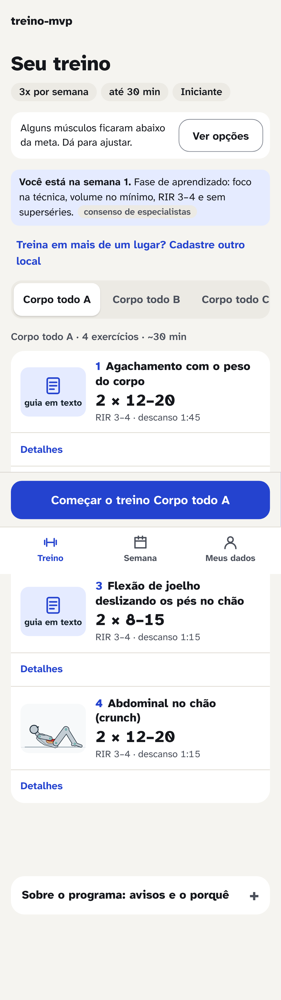

**Antes × depois** no relatório. Os efeitos colaterais, medidos: mais casos de peito, tríceps e glúteo acima do máximo do nível em quem não priorizou esses músculos, e mais repetição da flexão deslizante entre os dias.

**Testes:** 549 unitários (eram 501), `npm run check` passando, os e2e passando (o "Corpo livre" é novo; 2 foram ajustados ao programa novo da Ana). As 31 animações e a linha de base do Boneco não mudaram.

**Fica para depois** (`backlog.md`): kettlebell como halter, flexão na suspensão, o aviso de tempo que sobra, a lista "o que tem em casa", a flexão com as mãos fechadas para o punho, a remada na mesa e as animações do elástico.

**Rascunho de post para o LinkedIn**
> Perguntei ao meu app de treino o que ele faria por quem não tem equipamento nenhum. Testei em quase meio milhão de combinações: ninguém se machucava, mas costas, bíceps e a parte de trás da coxa ficavam zeradas. E havia um "dia de puxar" com panturrilha e abdominal, apresentado como se fosse dos músculos do dia.
>
> A pesquisa foi clara: sem algo para segurar e puxar, não existe exercício de costas, e nenhum estudo testou a mesa da cozinha ou a mochila cheia. Então o app passou a dizer isso com todas as letras, sem tentar vender nada. E ganhou 4 exercícios com evidência para o resto do corpo, como o nórdico, que cresce a parte de trás da coxa só com o peso do corpo.

---

## Catálogo completo, continuação: 14 animações prontas para aprovar, 5 peças novas e a conferência das 40 antigas (04/11/2026)

**Por quê.** O Gustavo pediu "a melhor recomendação e mais apropriada, e que todos os treinos tenham a animação". Depois dos 25 exercícios novos do catálogo, 83 dos 135 ainda apareciam como cartão de texto. Esta continuação fez as famílias novas (suspensão, bola e paralelas, caneleiras, mini-band e roda) chegarem à folha, montou a fila do resto e conferiu, uma a uma, as 40 animações antigas contra as fichas.

**O que foi feito**
- **5 peças novas no motor** (`src/engine/desenho.ts`), todas como funções novas, sem mexer em nenhuma animação aprovada: a fita de suspensão (âncora no alto, um trecho único e duas fitas até as mãos ou os pés), as paralelas, a caneleira (uma caixa presa acima do tornozelo), o laço da mini-band (feito com a peça do elástico) e a roda abdominal. E a forma clássica dos adutores, que a adução com caneleira tem como principal.
- **14 animações em revisão**, cada uma com folha de contatos, medidas (`scripts/medir-animacao.mjs`, que agora imprime o comprimento da fita por pose) e conferência escrita "o que a fonte pede × o que o boneco faz": remada, rosca, T, tríceps, flexão de joelho e búlgaro na suspensão; abdominal na bola, ponte com os pés na bola e elevação de joelhos nas paralelas; extensão de joelho, abdução e adução com caneleira; abdução com mini-band; roda abdominal. Os textos do guia dos 14 estão prontos. Nas quatro de pé na suspensão, o corpo gira sobre os calcanhares: a fita não estica, então o ângulo do tronco em cada fase sai da geometria, não da mão.
- **Conferência das 40 antigas** (`revisoes/catalogo/conferencia/antigas.md`): 38 batem com a ficha, dentro de 1–3 cm. Duas correções ficaram em revisão, com a folha antes × depois: a barra reta da rosca na polia "encolhia" 9 cm no meio da subida, e as mãos do pike, que deveriam ficar plantadas, subiam 5 cm. As 25 do guia original não tinham ficha e ganharam uma ficha curta cada.
- **Fila dos outros 69** (`revisoes/catalogo/fila.md`), por frequência medida e custo: 11 só com halter e banco rendem mais por unidade de custo (321 mil prescrições, nenhuma peça nova); as 13 máquinas de perna pedem a peça mais cara e cobrem 228 mil; os 12 do elástico (311 mil) esperam o R4.
- **Auditoria e mapa do catálogo regravados com os 135** (a versão de 110 ficou guardada): o "só kettlebell" caiu de 11 para 7 vagas vazias, a polia dupla de 7 para 4, a casa com os "às vezes tem" de 4 para 1.

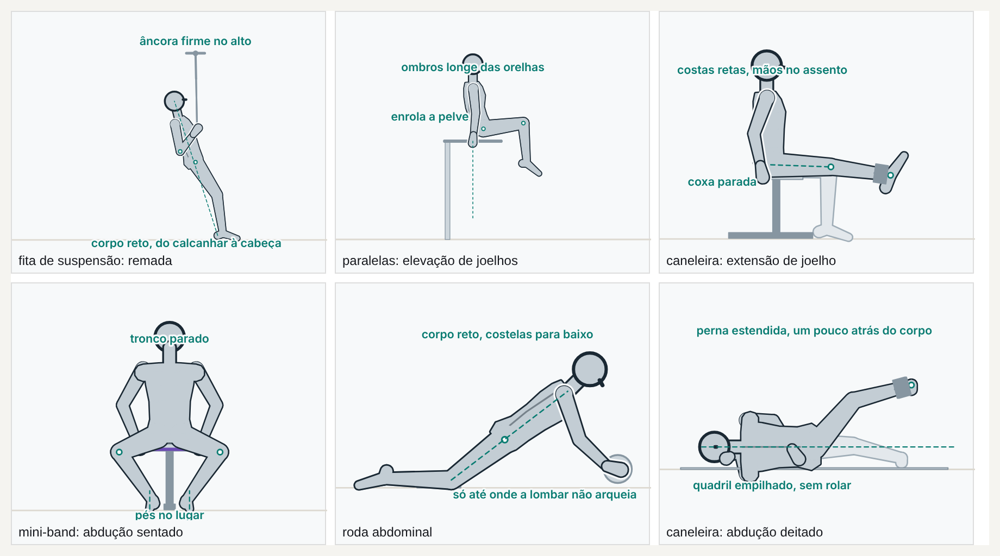

**Decisões do Gustavo (04/11/2026):** continuar na branch `claude/focused-shannon-7243on`; a mini-band sai agora e os 12 do elástico esperam o R4. **Esperando a decisão dele:** as 14 folhas (uma família por vez), as 2 correções, a ordem da fila e a ida para a `main`.

**Medido:** nenhuma das 14 animações muda o programa das 6 personas nem o do 2º local do Bruno (os exercícios novos são do nível 2 das suas vagas). O que muda é o guia: 14 cartões viram animação quando aprovadas.

**Testes:** `npm run check` passando (600 unitários); e2e e motor rodados no fim (as linhas de base das 52 aprovadas não mudaram); auditoria idêntica em duas rodadas.

**Fica para depois** (`backlog.md`): os 12 do elástico depois do R4; os 55 da fila em blocos; a seção do Diagnóstico, só pela conta certa; a opção (c) dos objetivos; as 17 fontes do `10` fora do `fontes.md`; as duas leituras do PubMed, que a rede da sessão bloqueou.

**Rascunho de post para o LinkedIn**
> Hoje o boneco do meu app de treino aprendeu a usar fita de suspensão, paralelas, caneleira, mini-band e roda abdominal. Catorze exercícios novos, cada um com a folha de contatos, as medidas em centímetros e uma tabela "o que a fonte pede × o que o boneco faz".
>
> O detalhe que mais me ensinou: a fita de suspensão não estica. Então, quando a pessoa puxa o corpo, ela não "chega" nas mãos; o corpo inteiro gira sobre os calcanhares e sobe. Deixar a geometria decidir o ângulo do tronco em cada fase, em vez de desenhar à mão, foi o que fez a animação parecer certa.
>
> E, antes de aprovar o que é novo, conferi as 40 animações antigas uma a uma. Trinta e oito batem com a ficha. Duas vão para a mesa: uma barra que encolhia 9 cm no meio da subida e um par de mãos que deveria ficar no chão e não ficava.

---

## Auditoria independente: 14 animações aprovadas, 4 exercícios novos, 2 correções do gerador e um piloto do modo Erros (04/11/2026)

**Por quê.** O Gustavo pediu uma auditoria por outro modelo, sem histórico no projeto: mapear o que existe, julgar a escolha dos exercícios, apontar o que falta, olhar a animação como um treinador olha o vídeo do aluno e **decidir e executar** as pendências do catálogo, em vez de deixá-las para ele. O relatório inteiro está em `revisoes/auditoria-fable.md`.

**O que foi feito**
- **As 14 animações em revisão foram aprovadas**, família a família (suspensão, bola e paralelas, caneleiras, mini-band e roda), pela conferência escrita e pela medida refeita (ik = 0 em todas; fita de comprimento fixo; mãos na largura da pegada). Nenhum programa de persona mudou. São 66 animações no app (eram 52).
- **As 2 correções antigas entraram** (as mãos plantadas do pike e a barra de largura fixa da rosca na polia). Decisão de produto: uma animação do guia original corrigida passa a ter linha de base própria, gravada do motor (`CORRIGIDAS` em `tests/motor/equivalencia.spec.ts`); as outras 24 continuam idênticas ao guia.
- **4 exercícios novos**, medidos numa cópia antes de entrar: abdução e adução deitado de lado sem carga, extensão de joelho com elástico e panturrilha sentada com halter. As vagas vazias somadas nos 55 cenários caíram de 431 para 313; a "casa com halteres e elásticos" foi de 4 para 0 vagas vazias.
- **2 correções do gerador**, achadas ao medir as entradas: o teto semanal de 20 séries não era conferido no preenchimento das vagas (no modelo de 6 dias, três vagas de glúteo somavam 21 já no mínimo); e um complemento do grupo prioritário tirava o único exercício direto de outro músculo (na Ana, a abdução tirava o crucifixo invertido do ombro posterior). Agora o único exercício direto de um músculo com meta vem antes dos complementos prioritários.
- **Folha-piloto do modo Erros** (`revisoes/auditoria-fable/erros-piloto.png`): o certo como figura cheia e só a parte errada em vermelho tracejado, com o nome do erro. Nenhuma linha de base mudou; a chave fica desligada até o Gustavo aprovar.
- O cartão do agachamento com barra (era o único exercício do programa da Carla sem guia nenhum), o script de aprovação corrigido e o backlog atualizado.

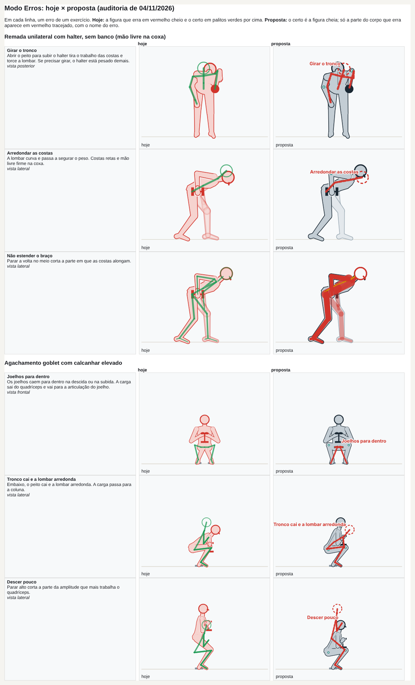

**Antes × depois nas personas:** a Ana não muda; o Bruno e o Diego ganham a extensão de joelho com elástico (vaga obrigatória da extensora); o Diego perde o face pull do dia B por falta de minutos; na academia do bairro, o Bruno passa a fazer a cadeira extensora. Snapshots regravados depois de registrados no relatório.

**O que o auditor discorda ou deixa como opção** (com a recomendação marcada no relatório): o texto do "porquê" do nível 2 ("entra a melhor possível" soa como "pior"); "prefiro este" só vale dentro do mesmo nível; o ombro posterior como secundário da barra fixa supinada; "estagnado" em 3 sessões (medir no R3 antes); o zod 4; e um R4 pequeno (erro sobre o certo, rótulos fora do corpo, vista pelo movimento) para destravar as 12 animações do elástico.

**Medido:** `npm run check` com 615 testes (eram 600); projeto `motor` passando com as linhas de base regravadas; auditoria completa regravada com os 139 exercícios (38,9% das prescrições do estresse ainda sem animação, eram 33,9%: as 4 entradas novas tapam vagas vazias e por isso são muito prescritas, 237 mil vezes; vão para o topo da fila), idêntica em duas rodadas.

**Rascunho de post para o LinkedIn**
> Pedi a um segundo modelo que auditasse o meu app de treino do zero: o que existe, se os exercícios escolhidos têm base, o que falta e se o boneco ensina bem. Ele podia discordar de tudo, desde que dissesse onde, por quê e com qual fonte.
>
> O achado que mais me ensinou veio de uma medição, não de uma opinião. Ao acrescentar dois exercícios sem carga para quem treina em casa, apareceu um limite que o gerador não conferia: num modelo de 6 dias, o mínimo de séries sozinho já passava do teto semanal do glúteo. O bug existia antes; ninguém tinha a combinação que o mostrava.
>
> E, nas animações, o veredito foi o que eu sentia: as poses estão certas, o que falta é o erro saltar aos olhos. A proposta veio com uma folha-piloto, lado a lado com o atual, antes de mudar qualquer coisa.

---

## R4: o erro sobre o certo, os rótulos fora do corpo, a vista pelo movimento e as 16 animações do elástico e da auditoria (05/11/2026)

**Por quê.** O retorno do Gustavo na folha do elástico (04/11): "precisa aprimorar ainda o boneco, em especial a visualização do treino e do erro". A auditoria propôs um R4 pequeno, de **cena** e não de corpo (o esqueleto, as poses e os músculos ficam como estão), com a folha-piloto do modo Erros; o Gustavo aprovou a direção em 05/11, e as 12 animações do elástico esperavam por isso. Prompt em `prompts/sessao-r4-boneco.md`; as folhas de decisão e os lotes em `revisoes/r4/`.

**O que mudou no Boneco** (três regras determinísticas, aplicadas por cima de todas as animações)
- **O erro sobre o certo.** No modo Erros, o certo é a figura cheia e só a parte do corpo que erra aparece em vermelho tracejado, com o nome do erro (o título do texto do guia, que a tela passa ao motor) ao lado da junta que mais se afasta. O modo abre no instante em que o certo e o errado mais se afastam (medido em 48 instantes do ciclo; antes, no começo, em que vários erros nem apareciam). O equipamento da pose errada também aparece, em vermelho translúcido. Erro em que o corpo não muda (o punho com o kettlebell, o elástico no pescoço): só o objeto errado em vermelho, com o nome na mão. Legenda nova: "execução correta" e "a parte que erra".
- **Rótulos fora do corpo.** O rótulo de técnica que cairia por cima do corpo em algum instante do ciclo vai para o lugar livre mais perto da âncora (dentro do palco, abaixo da caixa da fase, fora da silhueta, sem cruzar outro rótulo), com uma linha fina até o ponto; o deslocamento é fixo no ciclo, então o rótulo acompanha a âncora sem pular de lado; o rótulo largo quebra em duas linhas; quem já está fora não se move. Medido na largura do app: 58 das 172 linhas de rótulo se movem.
- **A vista que abre é a do maior movimento.** O modo Técnica abre na vista em que a trajetória da mão (ou do pé) é mais longa na tela, em fração da largura do palco; empate (menos de 15%) ou ruído (menos de 8% do palco) mantém a 1ª vista. Medido: mudam só os dois crucifixos na polia, o face pull, e os seus pares com elástico, todos para a vista de cima. A miniatura do cartão fica no modo Músculos (decisão do Gustavo).

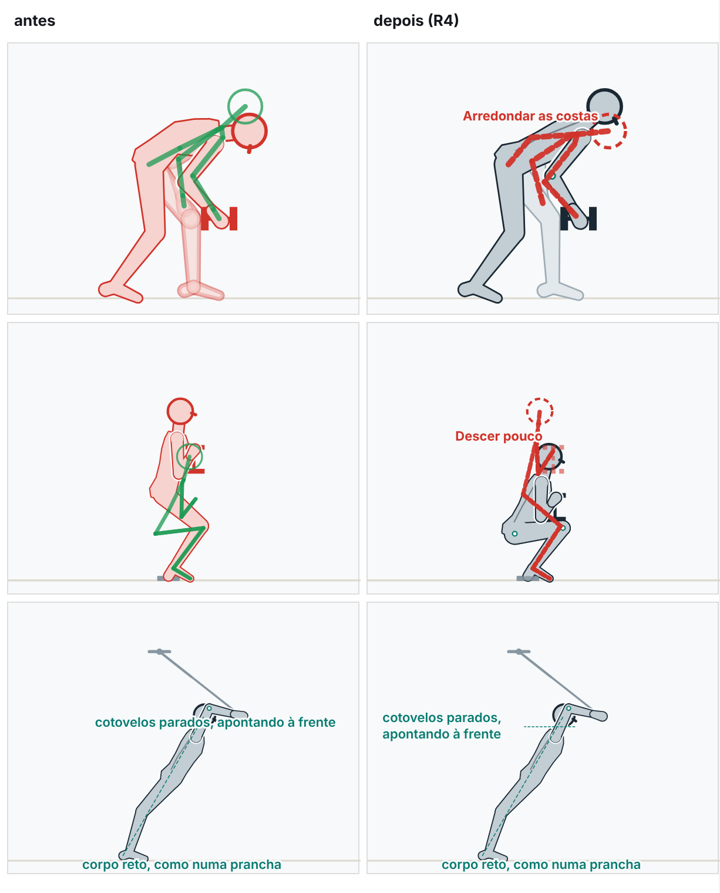

**As 16 animações** (12 do elástico, 4 da auditoria), cada uma com folha, medida (ik = 0 em todas; a faixa do elástico afinando na fase em que o músculo encurta) e conferência escrita (`revisoes/elastico/`, `revisoes/catalogo/conferencia/`), aprovadas pelo Gustavo em 05/11. A pose nova é a de bruços (flexão de joelho); as outras partem das aprovadas mais parecidas. A âncora do elástico preso num ponto virou um **poste fino com anel** (de lado, a porta cobriria o corpo). São **82 animações no app** (eram 66); os 16 cartões viraram texto completo.

**Antes × depois nas personas:** só o Diego muda: no Corpo todo A, o agachamento com o peso do corpo dá lugar ao agachamento com elástico (equivalentes; o desempate pela animação aprovada). Bruno e Carla não mudam.

**Medido:** `npm run check` com 647 testes (eram 615); e2e com 46 testes; linhas de base regravadas (`estilo-a.json`: 82 animações, 15.624 quadros; `novas.json`: 58) e conferidas sem as variáveis; auditoria completa idêntica em duas rodadas, com 22,5% das prescrições do estresse sem animação (eram 38,9%).

**Decisões que ficaram registradas:** a Silhueta continua no modo Erros antigo; o estilo clássico não muda um byte (a regressão contra o guia original continua verde); o poste como âncora é escolha de desenho, confirmada pelo Gustavo.

**Fica para depois** (`backlog.md`): a câmera perto do corpo no modo Técnica, a vista de cima na adução deitada, a mão por cima do disco de frente, a sombra no chão, a miniatura pelo movimento; a fila dos 57 sem animação.

**Rascunho de post para o LinkedIn**
> O boneco do meu app de treino aprendeu a mostrar o erro de outro jeito. Antes, a figura errada aparecia inteira em vermelho, com o certo desenhado por cima em palitos verdes, e a pessoa tinha que procurar onde estava a diferença. Agora o certo é a figura, e só a parte que erra aparece em vermelho tracejado, com o nome do erro ao lado. O instante do quadro também é medido: o motor acha o momento do ciclo em que o certo e o errado mais se afastam.
>
> O detalhe que mais me ensinou: um rótulo de texto em cima do corpo atrapalha mais do que ajuda. A regra nova empurra o rótulo para o lugar livre mais perto, com uma linha fina até o ponto, e mantém o deslocamento fixo no ciclo inteiro, para ele não pular de lado quando a animação roda.
>
> Com isso, saíram as doze animações do elástico que esperavam na fila, cada uma com a folha de contatos, a medida em centímetros e a tabela "o que a fonte pede × o que o boneco faz". O elástico afina quando estica: dá para ver onde a tensão está.

---

## Qualidade dos treinos gerados: 911 mil programas, 9 pesquisas e o treino de 3 exercícios que virou 5 (05 e 06/11/2026)

**Por quê.** O Gustavo marcou opções aleatórias no cadastro, escolheu 60 minutos e nenhum equipamento, e recebeu um treino de 3 exercícios. Pelo que ele conhece, um treino tem 5 a 7. A pergunta valia para o app inteiro: o gerador está certo, quando está errado e o que mudar.

**O que foi feito.** Um estresse novo (`npm run auditoria:qualidade`): 911.625 programas, com os 55 cenários de equipamento, os 3 níveis, 2 a 6 dias, 30 a 90 min, 13 combinações de prioridade, dor leve e forte em cada região e exercício evitado, em 4 processos com junção determinística. `npm run auditoria:verificar` passou a conferir por hash que a auditoria inteira sai idêntica em duas rodadas. Nove pesquisas por grupamento, uma das combinações por dia e uma da prioridade, com 94 fontes novas conferidas no PubMed ou no Crossref (`docs/pesquisa-v2/13` a `15`). Cada opção para a vaga sem exercício virou um protótipo descartável medido na grade inteira, nas personas e no caso dele; ele aprovou as recomendações das decisões 1 a 7, que entraram uma por vez (`docs/revisoes/qualidade-treinos.md`, Parte F).

**O que se descobriu.** O caso dos 3 exercícios tinha duas origens: um exercício evitado num cenário sem opção (a flexão, o único empurrar sem equipamento) e 6 dias sem como puxar (dois dias de "Puxar" com 2 exercícios). "5 a 7 exercícios" é prática de treinadores; os ensaios usam de 2 a 8, e o ACSM de 2026 conta séries por músculo por semana. Um exercício só, com o volume certo, cresce o músculo inteiro; o 2º serve à região. A prioridade era "foco pequeno, mantendo os outros": 16% das séries com um grupo de foco.

**Medido** (grade de qualidade, antes → depois):

| | Antes | Depois |
|---|---:|---:|
| Dias com até 3 exercícios, 45 min ou mais (sem dor nem exercício evitado) | 16,5% | 6,6% |
| Idem, sem equipamento | 20% | 0% |
| Programas que usam menos de 70% dos minutos | 35% | 21,8% |
| Mediana do uso dos minutos com 60 min | 75% | 95% |
| Abdômen a zero na semana | 11,6% | 5,9% |
| Músculo acima de 20 séries; dia acima do tempo sem aviso | 0; 0 | 0; 0 |

**Antes × depois nas personas:** o Fábio (só barra fixa) ganha as duas pegadas da barra no mesmo dia (costas de 8 para 12 séries), o búlgaro e o nórdico de 6 a 10; a Ana ganha o supino no lugar do crucifixo no dia B e o abdominal protegido, que custou 2 séries do búlgaro; o Diego chega ao piso do ombro de trás; a Ana e a Carla recebem o aviso de focos que competem. O caso do Gustavo: 4, 4 e 6 exercícios (26 a 45 min) viram 5, 5 e 6 (51 a 58 min).

**Também:** `npm run check` com 670 testes (eram 647); 48 testes de ponta a ponta; as linhas de base visuais regravadas só nas duas puxadas que ganharam o ombro de trás; 7 regras novas e 14 revistas (141 no total).

**Fica para depois** (`backlog.md`, "Da qualidade dos treinos gerados"): a prioridade puxar frequência; o custo da proteção do abdômen em treinos de 30 min (40% com um dia acima do tempo, eram 26%); a repetição no Corpo todo 6x; a panturrilha no degrau; mais séries para todos quando sobra tempo, também na academia.

**Rascunho de post para o LinkedIn**
> Um treino de 60 minutos com 3 exercícios. Foi o que o meu app de treino gerou quando eu marquei "sem equipamento" no cadastro. Em vez de ajustar o caso, rodei o gerador 911 mil vezes, com todas as combinações de equipamento, dias, minutos, foco e dor, e medi exercício por dia, tempo usado e séries por músculo.
>
> O que eu aprendi: "um treino tem 5 a 7 exercícios" não vem de estudo. Os ensaios de hipertrofia usam de 2 a 8, e o que conta é o número de séries por músculo por semana. O app acertava nessa conta e errava na experiência: encurtava o treino em vez de usar o tempo que eu tinha dado.
>
> A mudança foi pequena e medida: quando falta o equipamento para um exercício, entra outro movimento do mesmo músculo, e o tempo que sobra vira série. Os dias com até 3 exercícios caíram de 20% para zero no treino sem equipamento. E ficou registrado o que piorou, para eu decidir depois.

## Próximos passos: o retrato medido, 7 frentes de pesquisa, a biblioteca ampliada e a ordem do R5 (06 e 07/11/2026)

**Por quê.** Com os marcos M0 a M5, R0 a R2 e o R4 feitos e o R3 (uso real) em andamento, o Gustavo pediu um retrato honesto do app e uma recomendação de onde investir: a qualidade e a variação dos treinos, as combinações por dia, a experiência de uso, uma opção para a pessoa montar o próprio treino com um avaliador, e o que mais faltasse. No meio da sessão, ele testou o app sem equipamento e com foco nos superiores, recebeu treinos curtos e genéricos, e pediu duas rodadas extras: "cansar os testes" de corpo livre e uma pesquisa ampla (internet, YouTube, fontes confiáveis) para dar opções a todas as combinações. Só documentos: nada do app mudou.

**O que foi feito.**
- **O retrato** (`revisoes/proximos-passos.md`, parte 1): 670 testes unitários e 48 de ponta a ponta passando; a auditoria completa com os mesmos arquivos da `main`; as 141 regras por selo (66% consenso); o catálogo por cenário; a grade de qualidade; o backlog por frente e estado; o que o redesign está mudando.
- **Cinco frentes em paralelo** (`revisoes/proximos-passos/a-qualidade.md` a `e-produto.md`): qualidade e variação; "monte o seu treino" e um avaliador (protótipo que achou 3 defeitos reais do gerador); fluxo e função (achou que **a nota de dor do "Senti algo" não fica guardada** e que **um treino vazio conta como feito**, os dois conferidos no código); progressão de longo prazo (4 defeitos de lógica num simulador de 24 e 52 semanas); e o que falta para abrir a família e amigos (o texto da foto, termos, uma tela de erro com "Exportar").
- **Rodada de corpo livre** (`f-corpo-livre.md`, `pesquisa-v2/16-corpo-livre-e-casa.md`): numa grade de 15.300 programas só sem equipamento, a semana com foco nos superiores tinha 1,9 exercício diferente de superiores; 3 pesquisadores acharam 7 exercícios novos que valem a pena.
- **Rodada da biblioteca ampliada** (`g-biblioteca-ampliada.md`, `pesquisa-v2/17-biblioteca-ampliada.md`): 5 frentes (programas de treinadores, YouTube, lacunas de equipamento, evidência, o que faz um treino agradável), uma **régua** de qualidade em dois níveis (defeitos que não podem piorar; notas que devem melhorar), 32 exercícios novos medidos em **108.900 programas** e **duas revisões cegas** por treinadores independentes simulados (que não sabiam qual semana era de qual versão).
- **Fontes:** de 331 para 507 em `pesquisa/fontes.md` (176 chaves novas e 7 atualizadas), cada PMID conferido no PubMed (autor, ano, título; retratados marcados). Sites que bloqueiam robôs não foram contornados.

**Medido** (biblioteca ampliada no protótipo, grade de 108.900 programas, os 36.300 sem dor):

| | Hoje | Proposta |
|---|---:|---:|
| Programas sem nenhum defeito | 73,4% | 83,8% |
| Defeitos que pioram | — | nenhum |
| O mesmo exercício em todos os dias, sem alternativa | 44,1% | 15,6% |
| Exercícios diferentes por semana | 12,9 | 15,8 |
| Sem equipamento: exercícios por dia | 4,9 | 5,4 |
| Dias com 3 ou mais cartões de texto (sem animação) | 8,4% | 74,9% (19,5% com os 5 animados) |
| Revisão cega: personas melhores / piores / iguais | — | 12 / 0 / 6 |

**Decidido em 07/11** (`proximos-passos.md`, parte 3; o Gustavo pediu que a sessão decidisse): os cartões de texto ficam até as 5 animações de corpo livre mais prescritas; o foco ganha um marco próprio; a ordem é **R5a** (o registro que não engana) → **R5-CL** (biblioteca ampliada) → **R5d** (o foco que aparece) → **R5-anim** (os 5 de corpo livre) → **R5b** (o avaliador) → **R5c** (abrir para família e amigos). O limiar de empurrar ÷ puxar é 1,5; "usar todo o tempo que sobra" ficou descartado. Uma sessão nova conduz os marcos a partir de `prompts/sessao-desenvolvimento.md`.

**Fica para depois** (`backlog.md`, "Da sessão de próximos passos"): o "monte o seu treino" do zero e a leitura de programa por IA; os gatilhos da semana leve pelo export do R3; a variação por blocos; as costas sem algo para puxar (sem saída honesta).

**Rascunho de post para o LinkedIn**
> Pedi a uma "equipe" de agentes de IA para responder uma pergunta simples sobre o meu app de treino: o que melhorar primeiro? A resposta mais útil não foi uma função nova. Foi achar duas coisas que enganavam sem ninguém perceber: a dor que a pessoa registrava no meio do treino não ficava guardada, e um treino aberto e fechado sem nenhuma série contava como feito.
>
> Depois, testando eu mesmo sem equipamento, recebi treinos curtos e genéricos. Em vez de ajustar o meu caso, o app foi testado em 108.900 combinações de equipamento, nível, dias, tempo e foco, com uma régua de qualidade em duas camadas: o que não pode piorar e o que deve melhorar. Com 32 exercícios novos (de flexão com os pés elevados a abertura com elástico), os programas sem nenhum defeito foram de 73% para 84%, e o mesmo exercício repetido todos os dias por falta de opção caiu de 44% para 16%.
>
> E dois revisores, sem saber qual semana era de qual versão, preferiram a nova em 12 de 18 casos e não preferiram a antiga em nenhum. O que eles ainda criticaram (o foco escolhido recebe pouco a mais que o resto) vira o próximo passo. Uma coisa não teve solução: treinar as costas sem nada para puxar. Nenhum estudo, treinador ou vídeo sério mostrou um jeito honesto, e o app continua dizendo isso.

---

## R5c: Abrir para família e amigos (07/11/2026)

**Por quê.** O Gustavo decidiu (06/11) abrir o app para família e amigos, não para o público. A frente E mediu o que faltava para outra pessoa usar sem ele por perto: três telas diziam que a foto "não fica guardada no servidor" sem dizer que ela vai para a Anthropic, nos EUA; um erro de tela deixava a página em branco, sem caminho até "Exportar"; não havia termos nem canal de problema; e "série", "repetição" e "carga" não eram explicados em lugar nenhum. O R5c veio antes dos outros marcos do R5 a pedido do Gustavo; ele não mexe no gerador, então não conflita com eles.

**O que mudou** (branch `claude/kind-cori-879ak9`, a partir da `main` `b92fa13`; o lote do redesign não está na `main`, então tudo é o mínimo funcional com os componentes de hoje, e as telas seguem como pedidos ao design, itens 11 a 17 de `revisoes/proximos-passos.md`)
- **A foto (P1).** As 3 telas usam o mesmo texto: a foto vai reduzida e sem a localização para a Anthropic, empresa dos EUA; o servidor do app não guarda; a Anthropic diz que apaga em até 30 dias, com exceções. Na tela da foto, uma **caixa de autorização** antes do 1º envio diz para onde a foto vai, por quanto tempo fica lá e que não treina modelos; o botão das fotos fica desligado até a pessoa marcar. A data fica só no aparelho, e "Retirar a autorização" (na foto e em Meus dados) a apaga. Regra nova `privacidade.foto` (consenso, norma).
- **Uma descoberta ao reler as fontes:** a página da Anthropic sobre servidores (15/06/2026) diz que o dado é **guardado nos EUA, mas pode ser processado também na Europa, na Ásia e na Austrália**; e um envio marcado como violação da política de uso pode ficar **até 2 anos**. As duas coisas entraram no texto (fonte nova `anthropic-servidores`). A retenção especial dos "Covered Models" só vale para quem tem retenção zero contratada, não para o app.
- **Tela de erro (P4).** Em volta de tudo, sem depender do resto do app: "Exportar meus dados" lê o armazenamento direto (mesmo um dado que o app não consegue mais ler), "Tentar de novo", "Avisar um problema" e a versão.
- **Não perder os dados (P3).** Meus dados mostra "Última cópia: hoje / há N dias / nenhuma cópia ainda"; diz quando o navegador **negou** guardar de forma permanente; o início lembra de exportar depois de 3 treinos sem cópia (e cópia com mais de 7 dias), abaixo de "Começar", com "Exportar agora" e "Agora não" (7 dias). No iPhone aberto no Safari, um aviso com os passos para instalar, até o "Entendi". Tudo no `localStorage`: o estado guardado **não mudou de versão**. Regras `dados.copia`, `dados.instalar-iphone`, `dados.persistente`.
- **Termos e canal (P2, P5).** A página `/termos` (rascunho para o advogado): o que o app faz e não faz, os dados no aparelho, a foto, o que Vercel, Google e Anthropic recebem, os direitos do art. 18 da LGPD (lido hoje) e como exercê-los no próprio app. Link nas boas-vindas, em Meus dados e na tela de erro. "Avisar um problema" leva a versão, o aparelho e a tela, e nunca o estado do app. O nome e o e-mail vêm de variáveis da Vercel (`VITE_RESPONSAVEL`, `VITE_CONTATO_EMAIL`): **nenhum dado pessoal no repositório**.
- **"Como ler o seu treino" (B2).** No programa, aberto até o 1º treino terminado: série, repetição, carga, descanso e RIR, cada um com o seu selo; no iniciante, a linha da fase de aprendizado. Regra nova `treino.leitura`.
- **Limite compartilhado (B1, feito depois do ok do Gustavo em 07/11).** O limite diário da foto (10 por aparelho, 40 por IP) passa a valer para todas as instâncias da função, num Redis do Upstash, com um comando por pedido e sem dependência nova. Basta criar o banco pelo Marketplace da Vercel (plano grátis), que cria as variáveis `KV_REST_API_URL` e `KV_REST_API_TOKEN`; sem elas, vale o contador em memória, como antes. O script foi rodado num Redis local: os pedidos barrados não somam no IP.
- **Também:** o limite da foto confere o aparelho e o IP juntos (um pedido barrado pelo aparelho gastava a cota do IP); ícone do iPhone (`apple-touch-icon` de 180 px, gerado do `icon.svg` por `scripts/icone-iphone.mjs`; o lote 5 do redesign pode trocar o desenho); "Apagar tudo" apaga também o que fica no `localStorage`.

**Medido**

| | Antes | Depois |
|---|---:|---:|
| Telas com "não fica guardada no servidor" sem dizer para onde a foto vai | 3 | 0 (um teste falha se a frase voltar) |
| Tela de erro com saída até "Exportar" | 0 | 1, em volta de todas as telas |
| e2e: erro forçado → a saída aparece e o export baixa o arquivo com o programa | — | passa |
| e2e: a caixa da foto aparece antes do 1º envio, não depois, e volta ao retirar | — | passa |
| e2e: "Última cópia" em Meus dados (nenhuma → hoje, também depois de recarregar) | — | passa |
| Lighthouse de acessibilidade (boas-vindas, termos, programa, Meus dados, caixa da foto, tela de erro) | — | 100 nas 6 (meta ≥ 90) |
| Toque ≥ 44 px e contraste WCAG nas telas novas, tema claro e escuro | — | 0 falha |
| `npm run check` | 670 testes | 698 testes passando (um teste antigo do gerador, "todo músculo abaixo do limiar", leva 4,8 a 6 s nesta máquina e às vezes passa do limite de 5 s; já acontecia na `main`, antes do R5c) |
| `npm run test:e2e` | 48 | 55, todos passando |
| Regras | 141 | 146 (5 novas, todas consenso) |

**Imagem:** `img/r5c-abertura.png` (a caixa da foto, a tela de erro, a última cópia, o aviso do iPhone e "Como ler o seu treino").

**Sem revisão jurídica.** Os textos não são parecer jurídico. O Gustavo decidiu, em 08/11/2026, dispensar a revisão por um advogado para abrir a família e amigos; a página deixou de dizer "rascunho".

**Com o Gustavo, antes de mandar o link a qualquer pessoa** (preencha aqui):
- [x] **Teto de gasto confirmado pelo Gustavo em 08/11/2026** (console da Anthropic, Cobrança e pagamentos): saldo de **US$ 4,97** em créditos e **recarga automática desativada**, então a API para quando o saldo acaba. É um teto total, não mensal: para gastar mais, o Gustavo precisa comprar créditos. Com a foto desligada, nada é gasto. Pela estimativa da frente E (até ~US$ 0,14 por envio de 5 fotos no Opus 5.5), dá **~35 envios de 5 fotos por mês**, ou mais com menos fotos por envio [estimativa; o eval mede o valor real]. Com 30 pessoas e 2 envios cada (~US$ 8), o teto pode chegar antes do fim do mês: aí a API recusa, o app mostra "Não foi possível analisar as fotos agora. Use a lista." e a lista funciona igual.
- [x] **A foto fica desligada por enquanto** (decisão do Gustavo em 08/11/2026): o app abre para família e amigos sem o reconhecimento pela foto, até haver um convite por pessoa. Sem `VITE_FOTO=ligada` no build, a tela da foto some, o pacote nem tem a chamada à API, e as telas dizem "nada sai do aparelho". Os testes ligam a foto (`playwright.config.ts`).
- [ ] Depois: um código de convite por pessoa em `CONVITES` e `VITE_FOTO=ligada` na Vercel, para ligar a foto.
- [ ] *(Opcional)* `VITE_RESPONSAVEL` e `VITE_CONTATO_EMAIL` na Vercel. Sem eles, os termos dizem que o responsável é "quem te mandou o link do app" e o "Avisar um problema" mostra um texto para copiar e mandar a essa pessoa.
- [x] Revisão do advogado: **dispensada** pelo Gustavo (08/11/2026).
- [ ] Teste num iPhone: o aviso de instalar, o ícone e se o app instalado começa vazio.
- A triagem continua com as perguntas próprias, e a revisão por um CREF continua "de lado" (decisão de 01/11): **reavaliar antes de abrir o app a desconhecidos**, não para família e amigos.

**Fica para depois** (`backlog.md`, "Do R5c"): a letra do Google Fonts (sai com o lote 1 do redesign); a explicação do RIR no 1º toque em cada tela; medir o uso sem dado pessoal (só com decisão do Gustavo).

**Rascunho de post para o LinkedIn**
> Antes de mandar o meu app de treino para a família, reli uma frase que eu mesmo tinha aprovado: "a foto não fica guardada no servidor". Era verdade e era incompleta. O meu servidor não guarda, mas a foto vai para a empresa que faz o reconhecimento, nos EUA, que guarda por até 30 dias. Relendo os documentos dela, achei mais duas coisas: o dado pode ser processado em outros países, e um envio suspeito de abuso pode ficar até 2 anos.
>
> Agora o app diz isso antes do 1º envio, numa caixa que a pessoa marca (e pode desmarcar quando quiser). Quem não quer, usa a lista de equipamento, que faz o mesmo.
>
> Também descobri que, se uma tela desse erro, o app ficava em branco, sem caminho para salvar os dados. Como os dados moram só no celular, isso podia apagar meses de treino. Agora o erro mostra uma saída: exportar os dados, tentar de novo ou me avisar, sem nenhum dado de saúde na mensagem.
>
> Abrir para os amigos não foi uma função nova. Foi escrever, com fonte, o que o app faz com os dados de cada pessoa.

## R5-CL: a biblioteca ampliada, 32 exercícios novos e a régua na auditoria (07 e 08/11/2026)

**Por quê.** Em 06/11 o Gustavo testou o app sem equipamento, com foco nos superiores, e recebeu treinos curtos e genéricos. A sessão de próximos passos mediu, num protótipo descartável, 32 exercícios novos e duas proteções do gerador (`revisoes/proximos-passos/g-biblioteca-ampliada.md`). Este marco os põe no app, com a régua de qualidade como teste da auditoria. O R5a (o registro que não engana) ainda não foi feito; dele, entraram aqui só o ajuste de 30 min e o "descer um nível antes de repetir", que o protótipo já usava.

**O que mudou.**
- **A régua** (`scripts/auditoria/regua.ts`, também medida no estresse de `qualidade.ts`) e a **grade de 108.900 programas** (`npm run auditoria:regua`, ~1,5 min), com a linha de base da `main` gravada (`revisoes/qualidade/regua-linha-de-base.json`): a auditoria falha se algum defeito passar dela. As definições do protótipo se perderam com o rascunho; as de agora reproduzem todos os números publicados da `main`, menos o empurrar ÷ puxar (D1), que segue o limite escrito na tabela da régua (1,5) e por isso é mais rígido (6,1% na `main`, e não 0,9%).
- **O equilíbrio da coxa** (regra nova `volume.equilibrio-coxa`): nenhum corte de tempo tira quadríceps ÷ posteriores de 0,5–2 nem o único exercício direto de posteriores.
- **Com 30 min**, o abdômen ou a panturrilha protegidos ficam com 2 séries e, se o dia passar do tempo, sai um isolador do dia (`tempo.musculo-protegido`).
- **Os 32 exercícios**, em 4 lotes, cada um com a regra (`selecao.corpo-livre-ampliado`, `selecao.halteres-ampliado`, `selecao.elastico-ampliado`, `selecao.barra-negativa`, `selecao.item-sozinho-ampliado`), a ficha de técnica (`pesquisa/animacoes/`), o cartão de texto (`src/conteudo/exercicios/`), a escada quando é de peso do corpo, os testes e a grade. Todos aparecem como **cartão de texto** até a animação ser aprovada.
- **No último dia da semana**, entre equivalentes do mesmo nível, o exercício que já está em todos os outros dias fica por último; sem equivalente, a função desce um nível antes de repetir (`selecao.variacoes-equivalentes`).
- **Os avisos dizem o que o programa tem**: sem nada, o ombro de trás sai da lista "fica sem exercício" (a abertura em T está no programa); com a puxada de elástico, o aviso não diz mais que as costas treinam "só com remadas".

**Decisões técnicas desta sessão** (o Gustavo pediu para não decidir as técnicas; cada uma medida):
1. **As faixas de repetição** dos novos de peso do corpo e elástico seguem `reps.faixa.degrau` (a flexão com os pés elevados, 8–15, como a flexão; a abertura em T, 12–20, e não os 15–30 propostos). Com as faixas propostas, dois defeitos pioravam por 1 programa cada.
2. **O desenvolvimento em pé e a elevação lateral unilateral com halter** ficam num nível próprio, logo abaixo dos animados, como a elevação deitado (decisão 5 do relatório). No mesmo nível, eles tiravam o lugar do animado nos programas do Bruno e da Carla, que o aceite pede iguais. Medido: a grade fica igual ou melhor.
3. **A regra do último dia** (acima) entrou porque o lote de corpo livre fazia a hiperextensão ocupar os 6 dias de dois programas com outro exercício possível (o defeito B1). Ela leva o B1 de 0,3% a 0%.

**Medido** (grade de 108.900 programas, os 36.300 sem dor; `revisoes/qualidade/regua.md`):

| | `main` | R5-CL | protótipo (`g-biblioteca-ampliada.md`) |
|---|---:|---:|---:|
| Programas sem nenhum defeito | 71,4% | **83,9%** | — |
| Idem, sem contar o D1 (a medida comparável com o protótipo) | 73,6% | **84,6%** | 73,4% → 83,8% |
| Algum defeito pior que na `main` | — | **nenhum** (sem dor e com dor) | nenhum |
| Dia com menos de 3 exercícios ou sem multiarticular (A2) | 7,5% | 1,5% | 7,5% → 1,5% |
| Dia acima de 110% dos minutos (A3) | 9,8% | 7,0% | 9,8% → 7,3% |
| O mesmo exercício em todos os dias havendo opção (B1) | 0,3% | 0% | 0,3% → 0,3% |
| Foco abaixo da meta com tempo (C1) | 4,1% | 2,1% | 4,1% → 2,1% |
| Empurrar ÷ puxar acima de 1,5 (D1) | 6,1% | 1,2% | 0,9% → 0,9% (outra leitura) |
| Coxa desequilibrada (D3) | 1,6% | **0%** | 1,6% → 0% |
| O mesmo exercício em todos os dias sem alternativa (B2, nota) | 44,1% | **15,6%** | 44,1% → 15,6% |
| Exercícios por dia, média | 5,18 | 5,50 | 5,18 → 5,51 |
| Exercícios diferentes por semana | 12,9 | 15,6 | 12,9 → 15,8 |
| Sem nada: exercícios por dia; diferentes por semana | 4,91; 9,5 | **5,38; 12,9** | 5,38; 12,9 |
| Prescrições sem nenhuma alternativa | 49,1% | 26,9% | 54,3% → 28,4% (outra leitura) |
| Programas com um dia de 3 ou mais cartões de texto (G1, nota: **o custo**) | 8,4% | 73,1% | 8,4% → 74,9% |

**O caso do Gustavo** (fictício: intermediário, sem nada, 60 min, foco nos superiores):
- **3 dias, antes:** A (46 min) flexão, flexão com as mãos juntas, agachamento, flexão de joelho deslizante, abdominal; B (53 min) flexão, pike, búlgaro, nórdico, panturrilha no chão, abdominal; C (56 min) flexão, flexão com as mãos juntas, afundo, ponte, flexão de joelho deslizante, abdominal. 11 exercícios diferentes; ombro de trás 0.
- **3 dias, depois:** A (52 min) flexão, **flexão com os pés elevados**, agachamento, **extensão de tríceps com o peso do corpo**, flexão de joelho deslizante, abdominal; B (60 min) **flexão com os pés elevados**, pike, búlgaro, nórdico, **panturrilha no degrau**, **abertura em T**, **abdominal invertido**; C (56 min) flexão, flexão com as mãos juntas, afundo, ponte, flexão de joelho deslizante, abdominal. 15 exercícios diferentes; ombro de trás 4; peito 12; tríceps 12,5.
- **4 dias:** de 5, 5, 6 e 5 exercícios (36 a 52 min) para 6 em todos os dias (46 a 49 min); 11 → 15 exercícios diferentes; ombro de trás 0 → 8.
- **Igual nas duas versões:** costas e bíceps a 0, com o aviso; as pernas, que não são foco, com 11 a 12 séries. Isso é regra do gerador (o foco), não biblioteca: é o marco seguinte (R5d).

**As 6 personas:** Bruno e Carla **iguais**. Ana: o crucifixo invertido sentado no lugar do curvado (estável, para a iniciante), a panturrilha no degrau e a flexão num dos dias no lugar do supino (desce um nível antes de repetir); 13 → 15 exercícios diferentes. Diego: a panturrilha no degrau, a elevação lateral unilateral com elástico e a flexão com elástico num dos dias; 15 → 17. Elisa (30 min): 4, 4 e 3 → 4, 4 e 4 exercícios, com a abertura em T e a extensão de tríceps; 7 → 9. Fábio (só barra fixa): 4, 6, 4 e 6 → 5, 6, 5 e 6 exercícios (33 a 45 → 44 a 45 min), com a barra só na descida como 2ª puxada; 13 → 17. Os snapshots estão em `tests/unit/__snapshots__/` para a revisão.

**Também:** 683 testes unitários (eram 670); 148 regras (eram 141); 32 fichas de técnica e 32 cartões novos. Cinco dos 32 não entram em nenhum programa da grade e servem só de alternativa (o desenvolvimento em pé, as duas elevações laterais com halter, a remada unilateral com elástico e a caminhada lateral).

**Fica para depois** (`backlog.md`, "Do R5-CL"): a fila de animação, com os 5 de corpo livre primeiro (eles respondem pela maior parte dos cartões); o foco que muda a distribuição; o 1º degrau da escada pelo nível; a regressão da barra fixa para o iniciante.

**Rascunho de post para o LinkedIn**
> No meu app de treino, "sem equipamento" com foco nos superiores gerava 5 exercícios por dia, sempre os mesmos. Agora são 6 ou 7, com 15 exercícios diferentes na semana em vez de 11, e o ombro de trás deixou de ficar a zero.
>
> O que mudou não foi uma regra nova de treino. Foram 32 exercícios novos, cada um com a técnica escrita a partir de estudos e de vídeos de profissionais, e uma régua que mede 108.900 combinações de equipamento, nível, dias, tempo, foco e dor antes de cada mudança. A régua tem duas camadas: o que não pode piorar (defeitos com evidência) e o que deve melhorar (gosto e consenso). Os programas sem nenhum defeito foram de 71% para 84%, e o mesmo exercício repetido todos os dias por falta de opção, de 44% para 16%.
>
> O preço está medido: os exercícios novos ainda não têm o boneco animado, e aparecem como um cartão de texto. Animar os 5 mais usados devolve a animação à maioria dos treinos. E uma coisa continua sem solução honesta: as costas sem nada para puxar. O app diz isso, em vez de inventar.

## Redesign visual: o app inteiro refeito, tela por tela, com medida antes e depois (05 a 08/11/2026)

**Por quê.** O app já tinha passado por duas rodadas de design (03/11), que zeraram as falhas de toque e contraste, mas ainda era a estrutura antiga com uma pintura nova. O Gustavo pediu o melhor app possível para quem usa, sem compromisso com o visual de antes: estrutura, navegação, cor, letra e componentes podiam mudar. O que não podia mudar ficou escrito antes de começar:
- o Boneco e o motor;
- a evidência visível;
- a segurança à mão;
- a LGPD;
- o uso na academia;
- o domínio;
- poucas dependências;
- motivação sem culpa.

O plano, as decisões e as medidas estão em `docs/revisoes/redesign/` (`proposta.md`, `medidas.md`).

**Como foi feito.**
- **Fases 1 a 4, a proposta:**
  - **Pesquisa:** 5 agentes pesquisaram em paralelo (retenção, cadastro, treino ao vivo, organização, cor), e um 6º, o crítico, conferiu tudo sem ver a minha síntese.
  - **Protótipo:** um protótipo navegável nos 2 temas, com o Boneco real.
  - **Decisão:** uma tabela item a item. O Gustavo aprovou os 36 itens recomendados, escolheu a cor "Giz e grafite" e, depois do 1º lote, pediu **menos informação na tela**: a explicação e a fonte ficam a um toque, num "por quê?".
- **Fase 5, a implementação, em 6 lotes.** Cada lote teve medidas antes e depois e uma parada para ele olhar no celular:
  1. base visual;
  2. desempenho;
  3. treino e guia;
  4. início, fim e semana;
  5. cadastro;
  6. Meus dados, desenhos e ícone.

**O que mudou para quem usa**
- **Treino:**
  - "Senti algo" sempre à vista, no cabeçalho;
  - o descanso no alto, com a série seguinte inteira à vista;
  - "Desfazer" por 5 s depois de salvar;
  - o painel da série preso embaixo, com números legíveis de longe;
  - anterior, próximo, trocar e terminar no "⋯", e terminar pede confirmação;
  - a tela acesa o treino todo;
  - a sugestão do dia em 1 linha, com o motivo no "por quê?".
- **Guia:**
  - o palco no topo e a nota de segurança em todos os modos;
  - o motor do Boneco num Worker, sem travar a tela: a nota de desempenho do guia foi de 70 para 93 a 96.
- **Início:**
  - o cartão "Hoje" e um aviso por vez;
  - a volta depois de faltar vira o próprio cartão;
  - a lista com o nome e "4 × 8–12", e o resto numa folha;
  - "Começar o treino" sempre à vista.
- **Fim do treino:** primeiro "O que mudou hoje", com a semana, os recordes do dia e as cargas que sobem. A função nova `marcasDaSessao` e `marcasDaSemana`, aprovada pelo Gustavo, foi testada com o caso E1.
- **Semana e evolução:**
  - na semana, os seus números antes das sugestões, com a meta tracejada na barra de cada músculo;
  - na evolução, o resumo em 1 linha.
- **Cadastro:** de 6 para 5 telas.
  - A boas-vindas nova, "Treine onde estiver, com o que tiver", com os 4 lugares e o aviso inteiro antes do botão.
  - A saúde em uma pergunta, com a frase do PAR-Q+, as perguntas inteiras a um toque e a confirmação das não marcadas.
  - O objetivo e "algo a evitar" foram para Meus dados.
  - O equipamento começa pelo lugar e tem uma lista com busca, categorias e "tenho".
- **Meus dados:** 3 grupos de linhas, e "Apagar" confirmado num diálogo.
- **Desenhos e ícone:**
  - os **49 desenhos de equipamento refeitos em ilustração realista**, em 3 rodadas com o Gustavo; ficou "só o aparelho" nos cartões, porque o uso fica no vídeo do guia;
  - **o ícone do app novo**: o halter inclinado em Giz e grafite.

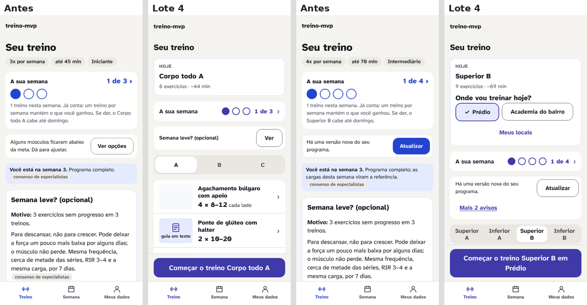
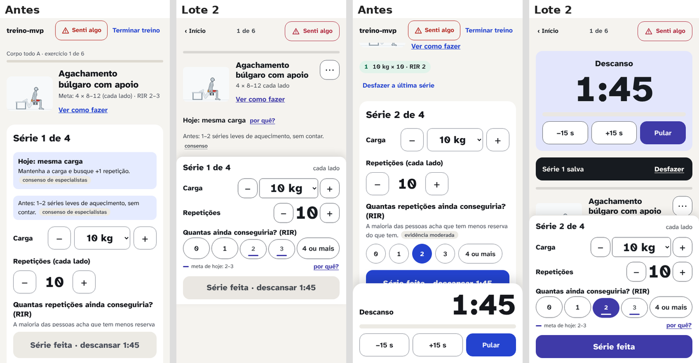
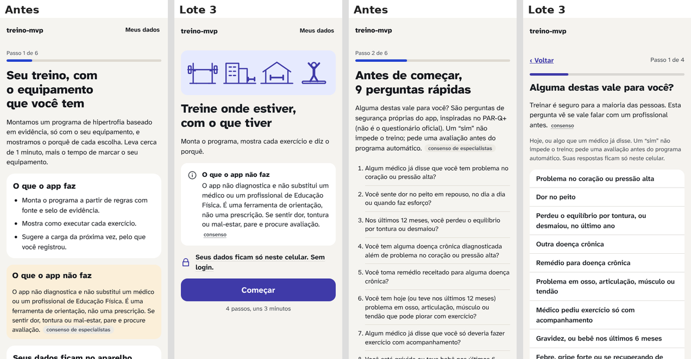
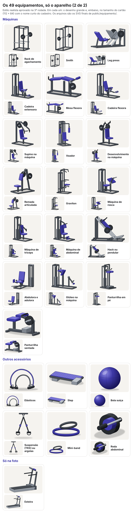

**Medido** (Ana, Pixel 7; o detalhe por lote está em `revisoes/redesign/medidas.md`):

| Medida | Antes (06/11) | Depois (08/11) |
|---|---:|---:|
| Desempenho no Lighthouse, app instalado (6 rotas) | 59 a 71 | 93 a 100 |
| Bloqueio da tela, app instalado | 2,7 a 5,1 s | 0,02 a 0,33 s |
| Acessibilidade no Lighthouse | 93 a 100 | 100 em todas |
| JavaScript da 1ª tela, comprimido | 269 kB (o app inteiro) | 147 kB |
| Pedidos externos na 1ª visita | 3 (a letra) | 0 (a letra é servida pelo app) |
| Palavras à vista no início | 116 | 66 |
| Palavras à vista na série | 73 | 61 |
| Palavras à vista na boas-vindas | 177 | 74 |
| "Começar o treino" à vista sem rolar | não, em 8 de 10 estados | sim |
| Telas do cadastro | 6 | 5 |
| Toques do cadastro, sem o equipamento | 13 | 11 |
| Alturas de tela: equipamento com "academia completa" | 8,1 | 1,9 |
| Alturas de tela: Meus dados | 2,8 | 1,2 |
| Toque < 44 px, contraste baixo e rolagem de lado (342 telas) | 0 | 0 |
| Texto cortado e foco coberto, 7 tamanhos de tela (incluindo 320 px, zoom de 200% e letra a 125%) | 13 combinações pendentes | 0 pendentes |

Os testes passaram de 647 para 662 unitários e de 46 para 113 de ponta a ponta. `src/engine/` não mudou nenhum byte, e a linha de base do Boneco continua igual.

**O que não melhorou ou ficou para depois** (`backlog.md`):
- **Equipamento item por item:** o caminho da Ana por "Item por item" ficou 2 toques mais longo.
- **Desenhos que se confundem no tamanho pequeno:** supino × desenvolvimento, extensora × flexora, smith × rack.
- **"Quando você costuma treinar?"** (estado novo, versão 8) espera uma parada própria.
- **2 achados do domínio, para decisão do Gustavo:** a nota de dor do "Senti algo" não é gravada na série, e o passo de 2,5 kg da barra ignora a menor anilha.
- **Cronometragem:** a do cadastro no celular, feita pelo Gustavo, ainda não foi registrada.

**Rascunho de post para o LinkedIn**
> Refiz o meu app de treino inteiro em quatro dias, tela por tela, e a regra que mais mudou o resultado não foi de cor nem de letra: foi "uma tela, uma coisa principal". Depois do primeiro lote, eu mesmo achei que tinha informação demais. A fonte de cada regra continua a um toque, num "por quê?", mas sai da frente. O início caiu de 116 para 66 palavras, e o botão de começar o treino, que ficava fora da tela em 8 de 10 situações, agora está sempre à vista.
>
> O ganho que eu não esperava veio do desempenho. O app parecia leve, mas travava a tela por até 5 segundos num celular simulado mais lento: o motor que desenha o boneco rodava junto com a interface. Ele foi para um processo separado, e a nota de desempenho saiu de 59–71 para 93–100.
>
> E um aprendizado de produto: os desenhos dos aparelhos precisaram de três rodadas. O ícone bonito não basta se quem não conhece o leg press não reconhece o leg press. No fim, ficou a ilustração realista, só do aparelho, porque o vídeo do guia já mostra como usar.

## R5d: o foco que aparece (08/11/2026)

**Por quê.** As duas revisões cegas da biblioteca ampliada apontaram, nas duas versões do app, a mesma falha: o grupo escolhido como foco recebia quase o mesmo volume que o resto. Na régua, é a nota C2, "foco invisível": o prioritário não passava da mediana dos outros músculos em 28,8% dos programas sem dor. No caso que motivou a sessão (fictício: intermediário, sem nada, foco nos superiores, 60 min), as pernas, que não são foco, recebiam 11 a 12 séries por semana, tanto quanto o peito. O R5a ainda não foi feito; este marco partiu da `main` com o R5-CL.

**O que mudou para quem usa.**
- **O foco usa o tempo primeiro** (regra nova `volume.prioridade.foco-primeiro`): o tempo que sobra vai primeiro para o foco (até o máximo do nível, e enquanto as séries diretas dele estiverem abaixo da meta) e só depois para os outros, que ficam pelo menos 6 séries abaixo do foco, sem desequilibrar o ombro (empurrar ÷ puxar até 1,5) nem a coxa. Com foco, os isoladores de quem não é foco entram depois das vagas do foco.
- **O 2º exercício do foco** (`volume.prioridade.segundo-exercicio`): o músculo do foco que fica abaixo da meta ganha até 2 exercícios de outra função, num dia da mesma região (nunca panturrilha num dia de superiores), se couberem nos minutos.
- **A meta do foco do iniciante** vai de 8 para 10, e o texto diz por quê (decisão técnica abaixo).
- **O 1º degrau da escada pelo nível** (`progressao.degrau-inicial`): na 1ª vez de um exercício de peso do corpo ou elástico, o intermediário começa no degrau 1 e o avançado no 2. O estado guardado não muda (o degrau continua sendo um índice).
- **A barra só na descida antes da barra para o iniciante** (`selecao.barra-negativa-iniciante`) e, no último degrau dela, a sugestão de tentar a barra fixa (`progressao.negativa-para-barra`).
- **"Escolha até 2" no cadastro** (`volume.prioridade.ate-dois`), sem bloquear: "pernas" conta como 3 e "braços" como 2; com mais, uma nota diz que o foco se divide. Feito com os componentes de hoje; a tela é pedido ao design.
- **Os avisos de lacuna** já diziam o que o programa tem desde o R5-CL; ficou um teste de regressão (0 contradições numa varredura de 6.600 programas).

**Decisões técnicas desta sessão** (cada uma medida):
1. **A meta do foco do iniciante vai de 8 para 10** (item 7). O 8 era convenção (nenhuma fonte valida volumes por nível); 10 é o topo da faixa do iniciante (6–10); a dose-resposta "10 ou mais rendem mais que menos de 10" é robusta e inclui não treinados; e o começo leve do iniciante serve para passar pela fase de dano, não porque ele cresça com menos (`pesquisa-v2/06`), o que a fase de aprendizado já cobre. Com 8, o foco invisível do iniciante ficava em 21,9%; com 10, em 15,4%. O tempo que sobra sem foco e a fase de aprendizado não mudam (seguem com 8 e 3/4 das séries).
2. **O tempo que sobra, revisto depois da 1ª revisão cega.** A 1ª versão deixava os outros na meta e o foco parava na meta: os treinos de quem tem pouco equipamento encurtavam (só barra fixa: de 51–59 para 33–37 min em 60) e a revisão cega os achou piores. Medi três saídas: o foco até o máximo do nível, sozinho, não enche o tempo e piora o ombro (D1 +11); os outros até 2 abaixo do foco piora o ombro (D1 +27); **o foco primeiro e os outros até 6 abaixo**, com as travas do ombro e da coxa, não piora nenhum defeito e usa 91,3% dos minutos no dia mais longo (`main`: 92,0%).
3. **Uma salvaguarda de tempo:** se adiar os isoladores de quem não é foco deixar um dia acima de 110% dos minutos que a montagem de antes não deixava, vale a de antes (sem ela, o A3 subia em 7 programas).
4. **O protegido do foco com 30 min** (a panturrilha ou o abdômen que entra para não ficar a zero) não fica preso em 2 séries quando é foco: a trava existe para quem não é foco.
5. **A fonte `fukunaga2022`, citada no pedido para a barra, não entrou:** é sobre a abertura com elástico. As regras da barra usam as fontes já conferidas da `selecao.barra-negativa`.

**Medido** (grade de 108.900 programas, os 36.300 sem dor; `revisoes/qualidade/regua.md`):

| | `main` (R5-CL) | R5d |
|---|---:|---:|
| **C2 foco invisível** (sem dor) | 28,8% | **13,2%** |
| C2 entre os programas com foco: iniciante / intermediário / avançado | 38,5% / 29,7% / 26,7% | **15,4% / 13,8% / 14,2%** |
| C2 por foco: pernas / abdômen / superiores / peito | 72,8% / 55,1% / 29,7% / 14,8% | 44,2% / 21,6% / 14,3% / 0,3% |
| C1 foco abaixo da meta com tempo | 2,1% | **1,5%** |
| Programas sem nenhum defeito | 83,9% | **85,0%** |
| Algum defeito pior que na `main` (sem dor e com dor) | — | **nenhum** |
| A2 / A3 / A4 / D1 / E1 (sem dor) | 532 / 2.553 / 1.877 / 445 / 75 | 385 / 2.512 / 1.831 / 444 / 35 |
| Uso do dia mais longo (média) | 92,0% | 91,3% |
| Notas que pioram (o custo) | — | G1 73,1% → 74,1% (a negativa e os 2º exercícios ainda são cartão de texto), A1 9,6% → 10,0%, A5 12,9% → 13,3% |

O que resta do foco invisível está nos treinos de 30 min (31,3%) e no foco nas pernas (44,2%): três músculos com meta alta em pouco tempo, o caso honesto do "não cabe", que o aviso de focos que competem e a nota do "até 2" explicam.

**O caso do Gustavo** (fictício "Gael": intermediário, sem nada, 60 min, foco nos superiores):
- **3 dias, antes:** 52, 60 e 56 min; peito 12, tríceps 12,5; quadríceps 11, posteriores 12, glúteos 12,5.
- **3 dias, depois:** 60, 58 e 44 min, os mesmos exercícios; **peito 16, tríceps 15**; quadríceps 9, posteriores 9, glúteos 9,5.
- **4 dias:** peito e tríceps de 12 para 16; quadríceps e posteriores de 12 para 10.
- O aceite pedia as pernas "perto do piso" (6). Elas ficam em 9–10: a versão que as deixava em 6 encurtava os treinos e foi a mais criticada na revisão cega (decisão 2). O foco fica 6 séries acima delas.

**As 18 personas** (as 6 de sempre e as 12 de teste, recriadas como fictícias em `tests/personas/regua.ts`): nenhuma ganhou defeito. Mudam de forma visível: Gael (o foco sobe), Fábio e Igor (só barra fixa: costas 12 → 16 e os outros em 9–10), Otto (peito e ombros acima das pernas), Rui (iniciante só com barra fixa: a negativa nos 3 dias, no lugar da barra), Diego (a negativa no lugar da barra; peito 10), Murilo e Pietra (ponte com 3 a 4 séries, glúteos 13,5–15,5), Carla (a panturrilha sentada entra no Inferior e chega a 14). Iguais: Bruno, Elisa, Iara, Joana, Lia, Nara, Kaique (pernas com kettlebell em 45 min: o corte de tempo ainda tira séries do foco). Os snapshots estão em `tests/unit/__snapshots__/` para a revisão.

**Revisão cega** (3 rodadas, cada uma com um treinador simulado diferente, que só via as 36 semanas embaralhadas; é opinião, não evidência):

| | Rodada 1 (1ª versão) | Rodada 2 | Rodada 3 (versão final) |
|---|---|---|---|
| Eficiente (`main` → R5d) | 5,28 → 5,11 | 5,22 → **5,39** | 5,11 → **5,33** |
| Agradável | 5,28 → 5,06 | 5,22 → 5,11 | 5,22 → 5,17 |
| Adequada | 4,89 → 4,94 | 4,83 → **5,39** | 5,11 → **5,67** |
| Personas melhores / piores / iguais | 4 / 4 / 10 | 7 / 2 / 9 | **8 / 2 / 8** |

- A rodada 1 achou piores os treinos encurtados (decisão 2); a 2 achou o foco nos glúteos só com séries indiretas (Murilo e Pietra: a ponte em 2 séries), o que levou à regra das séries diretas; na 3, Murilo melhora e Pietra empata.
- **O aceite "nenhuma persona pior" não fechou ao pé da letra:** na rodada 3, Helena e Otto perdem 1 ponto numa das três notas; nas rodadas anteriores, Helena empatou nas duas e Otto melhorou nas duas. Nenhuma persona piorou em mais de uma rodada.
- **O que os três treinadores criticaram, nas duas versões, e não é deste marco:** nada de puxar improvisado sem equipamento (remada sob a mesa, toalha na porta); avançado sem carga com agachamento de 12–20 (o degrau inicial muda a 1ª vez, mas a semana mostra o exercício base); abdominal com 4 séries num dia só e elevação lateral no dia de pernas; drop sets e superséries para iniciante; halteres leves sem elevação lateral; a fita e a mini-band pouco usadas.

**Também:** 6 regras novas e 3 revistas (159 linhas em `regras.md`); `tests/unit/foco.test.ts` (as regras novas e os avisos) e os testes das escadas; a coluna "C2 (com foco)" nas tabelas da grade; o recado ao R3 (`prompts/recado-r3-r5d.md`).

**Fica para depois** (`backlog.md`, "Do R5d").

**Rascunho de post para o LinkedIn**
> No meu app de treino, escolher um grupo de foco quase não mudava nada: quem pedia foco nos braços e no peito sem equipamento recebia tantas séries de perna quanto de peito. Três treinadores simulados, que não sabiam qual versão era qual, apontaram isso.
>
> A correção não foi "mais treino". Foi uma ordem: o tempo livre vai primeiro para o foco, e só depois para o resto, que fica sempre bem abaixo. Num caso típico, o peito foi de 12 para 16 séries por semana e as pernas de 12 para 9, com o mesmo tempo de treino. Na grade de 108.900 combinações, o "foco que não aparece" caiu de 29% para 13% dos programas, sem piorar nenhum dos defeitos que o app mede.
>
> O que aprendi: a primeira versão deixava o resto "no mínimo" e sobrava tempo sem uso. A revisão cega achou pior. Medir com opinião de fora, além dos números, pegou um erro que a régua não via.

## R5a: o registro que não engana (08/11/2026)

**Por quê.** A sessão de próximos passos (06/11) percorreu o app como as 6 personas e simulou meses de uso com o código real. O que mais pesou não foi uma função nova, foi o que engana a pessoa sem ela perceber: a nota de dor do "Senti algo" não ficava guardada (0 de 6 personas), então a redução da carga com dor de 3 a 5 e o aviso da "dor que se repete" nunca disparavam; "Começar" e "Terminar" sem série contava como treino e pulava o dia (6 de 6); a calibração da carga não terminava quando o próximo peso era um salto grande; e quem recusava a semana leve a via de novo a cada treino. O redesign já estava na `main`, então este marco mexeu só na lógica, com o mínimo de tela; o resto vai como pedido ao design.

**O que mudou** (branch `claude/dazzling-mendel-lb069v`, a partir da `main` `849a7b5`; o estado guardado **continua na versão 7**)
- **A dor fica guardada.** A nota do "Senti algo" vai para a última série feita do exercício ou, sem série, para a próxima registrada; duas notas na mesma série guardam a maior. A série mostra "dor 4", e a próxima vez do exercício vem com "Ajustar" (reduzir a carga). A dor que se repete em 2 treinos passa a sugerir a semana leve e a recomendar avaliação, como a regra sempre disse (`seguranca.dor.escala`).
- **Treino sem série não conta** (regra nova `registro.treino-feito`). A rotação, a semana, a pausa e a semana leve contam só sessões com série. "Terminar" sem nenhuma série pergunta: "Descartar este treino" ou "Guardar mesmo assim". No fim do treino, "Registrei algo errado: apagar este treino", com confirmação. A função de corrigir uma série (`corrigirSerie`) ficou pronta para a tela que o design vai fazer.
- **A calibração tem fim** (`progressao.calibracao`). Depois de 3 séries de acerto sem cair perto do alvo, a carga com o resultado mais perto da faixa vira a de trabalho (no empate, a mais leve), com a frase "Fim da calibração". O caso medido pela frente D está no teste: halter de 4 kg dá 24, o de 5 kg dá 12, para um alvo de 17,5; fica o de 5 kg.
- **"Agora não" vale 7 dias** (`deload.semana-leve`). Só a data da recusa, que já era guardada; nenhum campo novo.
- **Fase de aprendizado protegida.** Nas semanas 1 e 2 do iniciante, nem "estagnado" (o app pede +1 repetição com a técnica firme) nem semana leve.
- **A estagnação conta o exercício feito.** Quem troca pela alternativa tem a estagnação contada na alternativa, e não na vaga que ninguém fez.
- **O script que lê um export** (`npm run ler-export -- caminho.json`): refaz, treino a treino, o que o app mostrou e imprime os tipos de sugestão, os "estagnados", as semanas leves, as calibrações longas, a dor e os treinos sem série. O teste usa um export fictício; um export real fica fora do git (`.gitignore` e um teste de privacidade novo).
- **Quatro ajustes do gerador**, cada um com a regra em `regras.md`, um teste que falha no código de antes e a grade:
  1. o teto de 10 séries por músculo numa sessão conta as séries indiretas (`volume.sessao.teto`);
  2. no Corpo todo A/B sem como dobrar o quadril, a ponte de glúteo entra (`selecao.gluteo`);
  3. um afundo por dia, havendo outra opção: o dia de pernas que tinha búlgaro + afundo para trás fica com búlgaro + goblet (`selecao.funcao-da-vaga`);
  4. no Corpo todo 6x sem nada, o pike entra nos dias A, C e E, e o ombro deixa de ficar a zero (`divisao.sem-puxar`).
  O ajuste de 30 min e o "descer um nível antes de repetir" já tinham entrado no R5-CL.
- **Duas decisões técnicas, medidas.** (a) A ponte que entra pela falta do stiff, na 1ª versão, fazia 855 programas com dor no joelho passarem do tempo nos dias de 30 e 45 min, e a régua pegou (o A3 com dor subiu acima da linha de base). Com 45 min ou menos, ela agora fica com 2 séries, como o abdômen e a panturrilha protegidos: o A3 com dor passa a cair (2.680 → 2.289). (b) A mesma ponte ocupa uma vaga no Corpo todo A/B, e o empurrar ÷ puxar (D1) passa de 1,5 em mais 22 programas sem dor e 16 com dor (1,2% → 1,3%), ainda abaixo da linha de base. Mantive, porque em troca 147 programas deixam de ter o foco abaixo da meta, 391 deixam de passar do tempo com dor e o glúteo ganha extensão de quadril em milhares de programas.
- **A faixa "Há uma versão nova do seu programa" do Bruno e da Carla era artefato do teste.** O estado semeado sem passar pelo esquema do app muda a ordem das chaves do inventário, e com ela o código de entrada do programa. Pelo esquema, nenhuma das 6 personas vê a faixa, e quem faz o cadastro pela tela também não, nem depois de recarregar (3 testes novos; a prova inversa, com o estado "cru" da Carla, mostra a faixa).

**Medido**

| | Antes | Depois |
|---|---:|---:|
| Nota de dor guardada na série (e2e, 6 personas) | 0 de 6 | **6 de 6**, com "Ajustar" na próxima vez |
| "Começar" + "Terminar" sem série mantém o dia (e2e, 6 personas) | 0 de 6 | **6 de 6**, com "Descartar" |
| Simulador, 48 corridas de 24 semanas: exercícios com mais de 3 sessões só em séries de acerto | 57 (até 17 sessões) | **0** (no máximo 1 sessão) |
| Simulador: vezes que a oferta recusada aparece numa semana | até 5 | **no máximo 1** |
| Simulador: ofertas recusadas em 24 semanas | 0 a 106 | 0 a 22 |
| Simulador: semana leve na fase de aprendizado | 0 | 0 (o simulador não reproduziu o caso da frente D; o teste novo cobre a regra) |
| Grade reduzida (5.850 programas): 30 min com um dia acima do tempo | 50,3% | **49,8%** |
| O mesmo exercício (fora o abdômen) em todos os dias, 3 dias ou mais | 5,6% | 5,6% (o R5-CL já tinha baixado de 29,6%) |
| Dias com mais de 10 séries de um músculo, contando as indiretas | 27 dias | **0** |
| Ponte possível e nenhuma extensão de quadril (nem stiff) na semana | 150 programas (2,6%) | **0** |
| Dias com 2 afundos | 810 (3,5%) | **0** |
| Sem nada, Corpo todo 6x: ombro lateral a zero | 87,7% | **24,6%** |
| Grade de 55 cenários (53.625 programas): mais de 10 séries numa sessão / 2 afundos | 238 / 1.215 dias | **0 / 0** |
| Idem: ponte possível e nenhuma extensão de quadril (nem stiff) | 9,9% (5.299) | **0,8%** (426: todos cortes de tempo de 30 a 60 min, em cenários de um item só) |
| Com dor 7 (ombro / joelho / lombar), 2 e 3 dias: ponte possível e nenhuma extensão de quadril | 27% / 27% / 40% | **0,3% / 0% / 4,3%** |
| A régua (108.900 programas): sem nenhum defeito, sem dor | 83,9% | **84,2%**, e nenhum defeito acima da linha de base |
| Régua: dia acima de 110% dos minutos, com dor (A3) | 2.680 | **2.289** |
| Régua: foco abaixo da meta com tempo (C1), sem dor | 779 | **632** |
| Régua: empurrar ÷ puxar acima de 1,5 (D1), sem dor / com dor | 445 / 349 | 467 / 365 (a troca medida, abaixo) |
| As 6 personas | — | **idênticas** (nenhum snapshot mudou) |

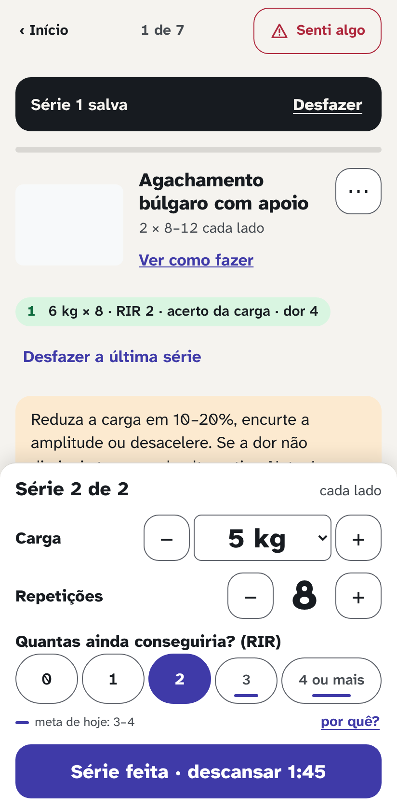
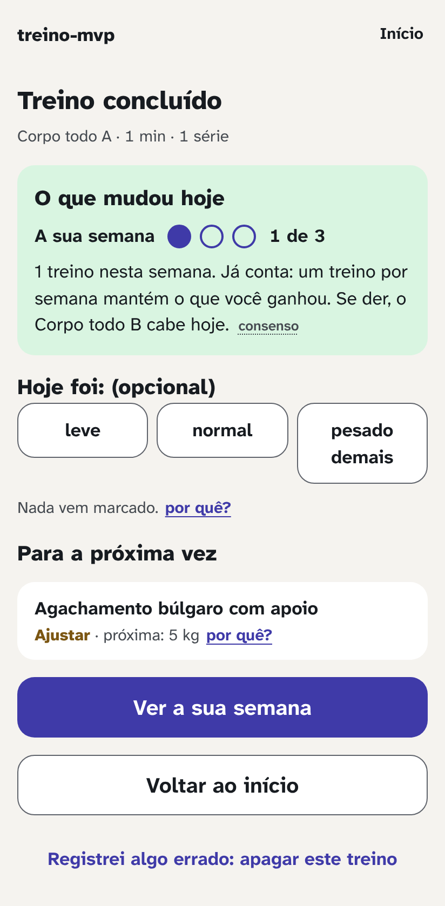
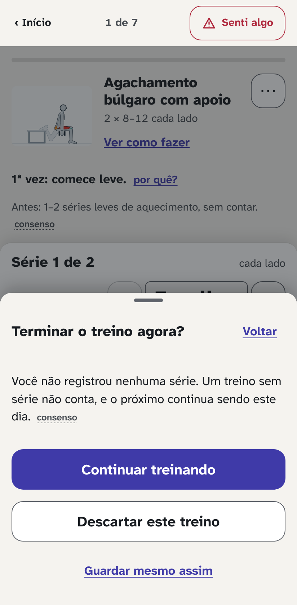

(Ana, fictícia: a nota 4 na série 1 do búlgaro; no fim, "Ajustar · próxima: 5 kg", e não os 6 kg de hoje; e o "Terminar" sem nenhuma série.)

**O simulador** foi reconstruído no scratchpad a partir de `revisoes/proximos-passos/d-longo-prazo.md` ("Como reproduzir"): 4 personas (Ana, Bruno, Elisa, Carla) × 3 ritmos × com e sem ruído × aceita ou recusa a semana leve, 24 semanas, com as ações reais do app; só o corpo é modelo. Ele reproduz a ordem de grandeza da frente D (até 106 ofertas recusadas; 57 calibrações longas, contra 62 de 492 lá).

**Também:** 749 testes unitários (eram 726), 141 e2e (eram 133), 154 regras (eram 153: 1 nova, `registro.treino-feito`, e 9 revistas); `npm run check`, `npm run test:e2e` e `npm run auditoria:verificar` limpos (37 arquivos idênticos nas duas rodadas). Um teste lento do gerador, que já passava às vezes do limite de 5 s (devlog do R5c), ganhou 20 s; o gerador ficou tão rápido quanto antes.

**Pedidos à sessão de design** (já listados em `revisoes/proximos-passos.md`, 2.5, itens 1 a 6; o que existe hoje é o mínimo funcional com os componentes atuais):
1. a dor registrada na série: hoje, a linha "· dor 4" na lista de séries e a frase "Nota 4 guardada na série 1" no aviso;
2. o fim do treino com exercício interrompido: ainda não existe;
3. "Descartar este treino / Guardar mesmo assim": feito na folha "Terminar o treino agora?";
4. corrigir uma série ou apagar um treino na Semana e na Evolução: hoje só "apagar este treino" no fim do treino, logo depois de terminar; `corrigirSerie` espera a tela;
5. a semana leve recusada como uma linha discreta em "A sua semana": ainda não existe (a oferta só some por 7 dias);
6. o fim da calibração: hoje, a frase "Fim da calibração: 5 kg é a carga mais perto da sua faixa…" no lugar da linha "Calibração:".

**Fica para depois** (`backlog.md`, "Do R5a"): a nota de dor dada antes da 1ª série de um exercício que é encerrado (dor acima de 5) não tem série onde ficar; os 0,8% de programas que perdem a extensão de quadril no corte de tempo; os gatilhos numéricos da semana leve e do "estagnado", que esperam o export do R3.

**Junto com o R5d (09/11/2026).** Antes de ir para a `main`, o R5a foi juntado ao R5d (o foco), que tinha chegado lá primeiro e mexe no mesmo gerador. Três acertos, medidos na régua contra a `main` com o R5d:
- **O 2º exercício do foco também respeita o teto com indiretas e o "um afundo por dia"**: ele punha um afundo num dia que já tinha búlgaro.
- **A ponte que entra pela falta do stiff** só ganha série, nos treinos de até 45 min, enquanto o dia couber nos minutos; e não entra num dia que perdeu vaga de pernas para a dor, que já é refeito com o músculo mais abaixo da meta. Sem isso, ela tirava o lugar do 2º exercício do foco (um caso da régua: abdômen de foco caindo de 8 para 4 séries, e o glúteo com 2).
- **Um teste pesado do gerador** ganhou 20 s de limite, e a amostra do teste do R5a passou a ser gerada sem travar o processo do Vitest.
- **O Vitest deixa um núcleo livre** para o processo principal: na `main` com o R5d, 2 de 3 rodadas acusavam "Timeout calling onTaskUpdate" mesmo com todos os testes passando; assim, 5 de 5 limpas.
- **O pacote da tela do programa** passava 0,5 kB do orçamento de 220 kB; o texto das regras do R5a ficou mais curto (as medições ficam aqui), e ele fica em 219,8 kB. A folga acabou (backlog).
- Ao fim: 773 testes unitários e 141 e2e passando.

| Régua (108.900 programas) contra a `main` com o R5d | `main` | com o R5a |
|---|---:|---:|
| Sem nenhum defeito, sem dor / com dor | 85,0% / 74,1% | **85,1%** / 74,1% (12 programas a menos) |
| A3, dia acima de 110% dos minutos, sem dor / com dor | 2.512 / 2.535 | **2.506 / 2.532** |
| C1, foco abaixo da meta com tempo, sem dor / com dor | 529 / 963 | **466** / 980 |
| D1, empurrar ÷ puxar acima de 1,5, sem dor / com dor | 444 / 341 | 467 / 341 |
| E1 e os outros defeitos | iguais | iguais |
| Grade reduzida: teto com indiretas / 2 afundos / ponte sem extensão / ombro lateral a zero (6x) | 44 dias / 820 dias / 150 / 87,7% | **0 / 2 / 0 / 24,6%** |
| Grade reduzida: 30 min com um dia acima do tempo | 50,6% | 50,1% (a meta era ≤ 50%: ficou 0,1 ponto acima) |
| Com dor 7, 2 e 3 dias, ponte possível e nenhuma extensão de quadril (ombro / joelho / lombar) | 27% / 27% / 40% | **0,3%** / 27% / **4,3%** |

As personas continuam iguais às aprovadas no R5d.

**Rascunho de post para o LinkedIn**
> No meu app de treino, a pessoa podia dizer "senti dor 4 de 10" no meio de uma série. O app mostrava o conselho certo, reduzir a carga, e esquecia a nota. Na sessão seguinte, sugeria a mesma carga, como se nada tivesse acontecido. A regra de segurança existia, tinha fonte e tinha teste. Só nunca recebia o dado.
>
> Achei isso simulando meses de uso com o código real, persona por persona. Junto vieram outras três coisas que enganavam sem ninguém perceber: abrir e fechar o treino sem fazer nada contava como treino feito e pulava o dia; a calibração da carga nunca terminava quando o próximo halter era um salto grande; e quem dizia "agora não" para uma semana mais leve via a mesma oferta a cada treino, até 106 vezes em 6 meses.
>
> Nenhuma dessas correções é uma função nova. São o app fazendo o que já dizia que fazia. Agora a dor fica guardada e reduz a carga da próxima vez, o treino vazio pode ser descartado, a calibração para em 3 séries e o "agora não" vale uma semana.

## R5b: o avaliador e o porquê (09/11/2026)

**Por quê.** O Gustavo quer, mais adiante, que a pessoa que já treina possa montar o próprio programa e ouvir de um avaliador se algum músculo ou área deve ser ajustado. Antes do editor, faltava a régua: uma função que olhe qualquer programa, o gerado ou um digitado com exercícios da biblioteca, e diga o que um treinador diria, com a regra e o selo de cada ponto. A sessão de próximos passos tinha um protótipo descartável; este marco faz o avaliador de verdade, usa-o como régua do próprio gerador e resolve o que a frente C mediu nos textos: só 2 de 20 avisos diziam o que fazer, e 61% dos exercícios só tinham o "porquê" genérico.

**O que mudou** (branch `claude/lucid-maxwell-sr3ewo`, a partir da `main` `6d03ad3`, com o R5a; o estado guardado **continua na versão 7**, nada novo é guardado)
- **O avaliador** (`src/domain/avaliador/`, regra nova `avaliador.gravidade`): uma função pura que recebe o programa, o perfil e o equipamento e devolve o veredito, os achados e a tabela por músculo. Cada achado tem a regra, o selo, o fato e o próximo passo, e os iguais saem numa linha só ("7 exercícios com mais de 4 séries", e não 21 linhas). Ele confere, por músculo, as séries da semana contra a meta e o piso (a série indireta vale meia), o teto da sessão e da semana, a frequência e as funções que se complementam; os isoladores obrigatórios; o equilíbrio do ombro (empurrar ÷ puxar até 1,5, regra nova `avaliador.empurrar-puxar`) e da coxa (0,5 a 2); o tempo de cada dia; e a ordem.
- **Cinco gravidades.** Só a segurança bloqueia (a triagem sem liberação e o exercício que carrega uma região com dor acima de 5). Alerta forte, sem bloquear: equipamento que o local não tem, exercício que a pessoa pediu para evitar, complexidade acima do nível (regra nova `selecao.complexidade-nivel`: o filtro do gerador ganhou um `regraId`). O resto orienta: **ajustar** quando há como mudar nos mesmos dias e minutos (com a sugestão concreta: "suba 1 série em…", "acrescente…", "troque leg press por cadeira extensora no treino C"); **limite** quando o equipamento, a dor ou o tempo não deixam, e então o texto diz "não precisa fazer nada"; **informação** para o que não muda o resultado.
- **Ele mede pela tabela de funções, como o gerador.** As famílias de funções de cada músculo grande ficam em `src/domain/gerador/familias.ts`, usadas pelos dois.
- **O avaliador como régua do gerador.** Ele achou três coisas que o gerador fazia sem avisar, e o gerador passou a corrigir, depois dos cortes de tempo, sem passar dos minutos, dos tetos nem dos pisos: (1) o músculo grande com um movimento só, havendo outro (ex.: stiff em dois dias e nenhuma flexora na academia de 30 min): a vaga repetida troca pela família que falta, ou ela entra num dia da mesma região com lugar; (2) o isolador obrigatório que coube; (3) as séries de puxar, enquanto empurrar ÷ puxar passar de 1,5.
- **O porquê específico.** A 1ª linha do "Por que este exercício" diz a vaga, o músculo dela (e se é o seu foco), quantas séries da semana o exercício leva e por que ficou com a vaga: a opção de cima não é possível (e por quê: equipamento, dor, algo a evitar, nível), o critério do desempate em que ele ganhou do 2º colocado, ou que ele equivale aos outros.
- **Os avisos com o próximo passo** (`acompanhamento.mensagens`), inclusive "não precisa fazer nada" quando a causa é o equipamento (o app não sugere compra).
- **A semana com a meta do programa.** Quando o programa planeja menos que a meta do nível, a linha do músculo diz "o seu programa planeja 6 de 10: falta tempo".
- **"Como está o seu programa"** em "Sobre o programa", com os componentes de hoje: o resumo em 1 linha, os pontos a ajustar numa caixa de aviso, os limites numa lista. A tela própria é pedido ao design.
- **O texto das regras saiu do pacote inicial.** O pacote da tela do programa estava a 0,2 kB do limite (backlog do R5a) e o R5b somava ~6 kB. O app passa a levar só o selo de cada regra (1,6 kB); o texto e as fontes vêm quando a pessoa abre o selo.

**Decisões técnicas desta sessão** (cada uma medida)
1. **A flexão em duas vagas conta como 2 funções do peito quando não há banco inclinável, e como 1 quando há.** A regra é a da própria tabela de funções: a vaga só desce de nível quando o de cima não é possível. Então um exercício vale numa função no nível igual ou acima do melhor possível no equipamento (e sempre na sua função própria), e cada vaga conta. Sem o banco, a flexão (ou o supino reto) na vaga inclinada é o "2º empurrar" que a decisão do Gustavo de 06/11 escolheu antes do crucifixo (`selecao.peitoral-inclinado`); com o banco, o avaliador pede o inclinado. Contar pela posição em qualquer nível fazia o avaliador sugerir trocas sem sentido ("troque a flexão por supino no chão"); contar só a função própria contradizia a tabela (a remada vale como puxada quando não há barra nem polia alta). Medido: com qualquer nível, 615 programas da grade reduzida tinham "ajustar" de funções sem aviso; com a regra da tabela, 258, todos defeitos reais do gerador, que este marco corrige.
2. **A barra só na descida do iniciante vale como a barra fixa que ela substitui** (o Diego tinha "costas só com remada").
3. **A troca a partir do que sobra só tira de um músculo acima do máximo do nível ou da mesma função repetida no dia**, nunca do foco: sem isso, o avaliador sugeria trocar o único agachamento do dia pela extensora.
4. **A troca de exercício do gerador não muda o uso do tempo da semana** (o dia mais longo não cai abaixo de 85% dos minutos se antes não estava). Sem isso, um caso com dor no joelho ganhava o defeito E1 da régua (um ombro lateral com 1 série num dia que passava a ter tempo sobrando), e a linha de base do E1 com dor é 0.
5. **O teste do gerador guarda o programa de cada variação** (o gerador é determinístico): ele estava em 58 s, perto do limite em que o Vitest acusa "Timeout calling onTaskUpdate"; agora leva 19 s, e a suíte inteira 43 s (na `main`, 60 s).

**Medido**

| | Antes | Depois |
|---|---:|---:|
| Grade reduzida (5.850 programas: 6 cenários comuns, sem dor): "está bom" ou só "limite" | 59,8% "está bom" (protótipo, outra amostra) | **87,5%** (44,3% bom, 43,1% só limite) |
| Grade reduzida: achados de segurança ou alerta | 0 | **0** |
| Grade reduzida: "ajustar" que o gerador não avisa | 17,4% (protótipo) / 5,4% (1ª versão deste avaliador) | **0** |
| Grade de qualidade inteira (911 mil programas, com dor e exercícios evitados): "está bom" ou só "limite" | — | VER_QUALIDADE |
| Régua (108.900 programas): empurrar ÷ puxar acima de 1,5 (D1), sem dor / com dor | 467 / 341 | **373 / 249** |
| Régua: dia com menos de 3 exercícios ou sem multiarticular (A2), sem dor / com dor | 385 / 14.995 | **359 / 14.978** |
| Régua: dia acima de 110% dos minutos (A3), sem dor / com dor | 2.506 / 2.532 | **2.458 / 2.505** |
| Régua: foco abaixo da meta com tempo (C1), com dor | 980 | **921** |
| Régua: algum defeito pior que na `main` | — | **nenhum** |
| Régua: sem nenhum defeito, sem dor / com dor | 30.890 / 53.774 | **31.023 / 53.932** |
| Régua: notas que pioram (o custo) | — | G1 26.882 → 26.952 sem dor (+70 dias com 3 cartões de texto); A5 22.875 → 22.966 com dor |
| Programas da grade reduzida que mudam | — | **4,9%** (86% deles de 30 min); as 6 personas **idênticas** |
| Avisos das 6 personas com o próximo passo | 2 de 20 (06/11) | **24 de 24** |
| Exercícios das 6 personas com o porquê específico | 39% | **140 de 140** |
| Os 4 programas publicados | os achados do protótipo | **os mesmos**, com a sugestão concreta (tabela abaixo) |
| Pacote da tela do programa (JS comprimido) | 219,8 kB (limite 220) | VER_PACOTE |

**Os 4 programas publicados** (protocolos de ensaios, digitados com exercícios da biblioteca em `tests/unit/programas-publicados.ts`, com a fonte de cada um; avaliados com o equipamento da Carla, intermediário, 60 min, sem foco). Todos ficam em "ajustar", nenhum bloqueado:
- **Thomas e Burns 2016 (ABC):** 6 a 9 séries num exercício; tríceps 15 e bíceps 13,5 num dia só; abdômen 3; sem extensora; dias de ~70 min em 60; a ordem só informa.
- **Schoenfeld 2019, 3 séries:** quadríceps 27 (teto 20); posteriores, panturrilha e abdômen a zero; peito e glúteo com um movimento só; faltam o tríceps acima da cabeça e a panturrilha em pé; nenhum exercício direto para a parte de trás da coxa; costas 18 só informa. Aqui o passo é trocar, não acrescentar: "troque cadeira extensora por flexão de joelho na cadeira flexora".
- **Schoenfeld 2019, 5 séries:** 7 exercícios × 3 dias com 5 séries (uma linha só), quadríceps com 15 numa sessão, dias de ~95 min em 60.
- **Carneiro 2024 (5 dias, 1x por músculo):** 10 séries num exercício; peito, costas e quadríceps com um movimento só; sem extensora nem tríceps acima da cabeça.

**Um exemplo da saída** (Thomas e Burns 2016, como o teste imprime; na tela, cada linha tem o selo):
```
Dá para melhorar: 6 pontos a ajustar.
AJUSTAR [volume.series-por-exercicio · moderada] 7 exercícios com mais de 4 séries: supino reto com halteres (6), …
        → Acima de 4 séries, divida entre 2 exercícios diferentes ou entre 2 dias.
AJUSTAR [volume.sessao.teto · um estudo] Mais de 10 séries de um músculo no mesmo treino: A: tríceps 15 e B: bíceps 13,5.
        → Leve parte dessas séries para outro dia: acima de 10 no mesmo treino, as séries a mais rendem pouco.
AJUSTAR [volume.semanal.abdomen · consenso] Abaixo do mínimo que faz crescer: abdômen 3 de 4 séries por semana.
        → Suba 1 série em abdominal no chão (crunch), no treino B.
AJUSTAR [selecao.isolador-obrigatorio · moderada] Falta extensora: cobre a parte da frente da coxa que vai até o quadril…
        → Troque leg press por cadeira extensora no treino C (pernas).
AJUSTAR [tempo.corte · consenso] Mais longo que os 60 min: A ~70 min e C ~70 min.
        → Faça elevação lateral e tríceps na corda em sequência (bi-set) no treino A… Ou escolha mais minutos.
INFO    [ordem.sessao · moderada] Isolador antes de um exercício grande: C (pernas).
        → Não precisa fazer nada: a ordem quase não muda o crescimento; os grandes primeiro ganham mais força.
```
As saídas completas das 6 personas, dos 4 publicados e do Bruno com dor no ombro (bloqueado, 17 exercícios numa linha só) estão em `revisoes/r5b/textos.md`, com os avisos e o porquê de antes e de depois, para a revisão do Gustavo.

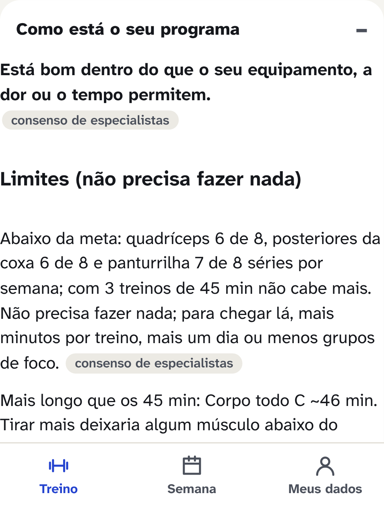
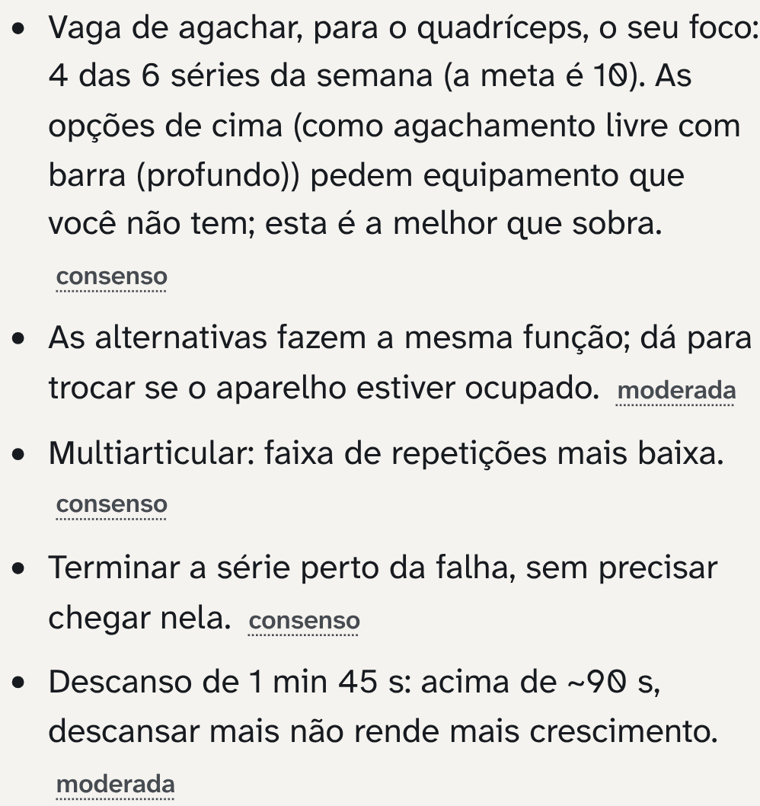

**Também:** VER_TESTES; 163 regras (eram 160: `avaliador.gravidade`, `avaliador.empurrar-puxar` e `selecao.complexidade-nivel`, e 2 revistas: `selecao.exercicios-por-musculo`, com a decisão da flexão, e `selecao.isolador-obrigatorio`); `npm run auditoria:avaliador` (a grade reduzida, em `revisoes/qualidade/avaliador.md`) e a seção "O avaliador" na auditoria de qualidade, com os suspeitos `avaliador.*-sem-aviso`.

**Pedidos à sessão de design** (já listados em `revisoes/proximos-passos.md`, 2.5, itens 7 a 9; o que existe hoje é o mínimo funcional com os componentes atuais):
1. **"Como está o seu programa"**: hoje, em "Sobre o programa", o resumo em 1 linha, os pontos a ajustar em caixas de aviso e os limites numa lista, cada um com o selo. Falta a tela pedida: os achados agrupados por tipo com as superfícies "alerta", "aviso" e "informação", e a tabela por músculo recolhida (séries, meta, dias). O avaliador já devolve a tabela (`musculos`) e os minutos de cada dia.
2. **A folha do exercício começa pelo porquê específico**: hoje ele é a 1ª linha da lista "Por que este exercício"; os 4 genéricos seguem abaixo, sem recolher.
3. **A semana com a meta do programa**: hoje, a frase "· o seu programa planeja 6 de 10: falta tempo" ao lado do estado do músculo.

**Fica para depois** (`backlog.md`, "Do R5b").

**Rascunho de post para o LinkedIn**
> No meu app de treino, eu queria que a pessoa que já treina pudesse trazer o próprio programa e ouvir o que um treinador diria. Antes de fazer o editor, fiz a régua: uma função que olha qualquer programa e aponta, com a fonte e o nível de evidência de cada ponto, o que ajustar.
>
> Testei com quatro programas de estudos publicados. Ela apontou o que um treinador apontaria: 6 a 10 séries num exercício só, posteriores da coxa e panturrilha sem nenhuma série, treinos de 95 minutos para quem tem 60. E, em vez de só reclamar, diz o que fazer: "troque o leg press pela cadeira extensora no treino C".
>
> A surpresa foi usá-la no próprio app. Em 5.850 programas que o app monta, ela achou três coisas que ele fazia sem avisar, como um músculo grande treinado com um movimento só havendo outro. Corrigi o gerador, e hoje a régua diz "está bom" ou "é o limite do seu equipamento" em 87,5% deles, sem nenhum ponto de segurança. O resto, ela aponta e o app já avisa.
