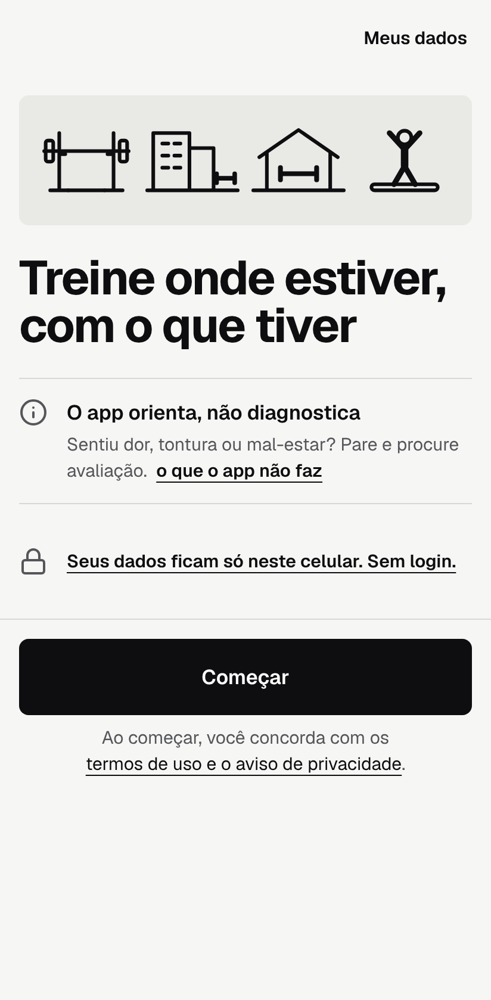
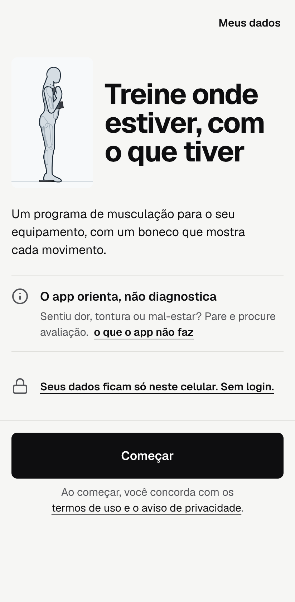
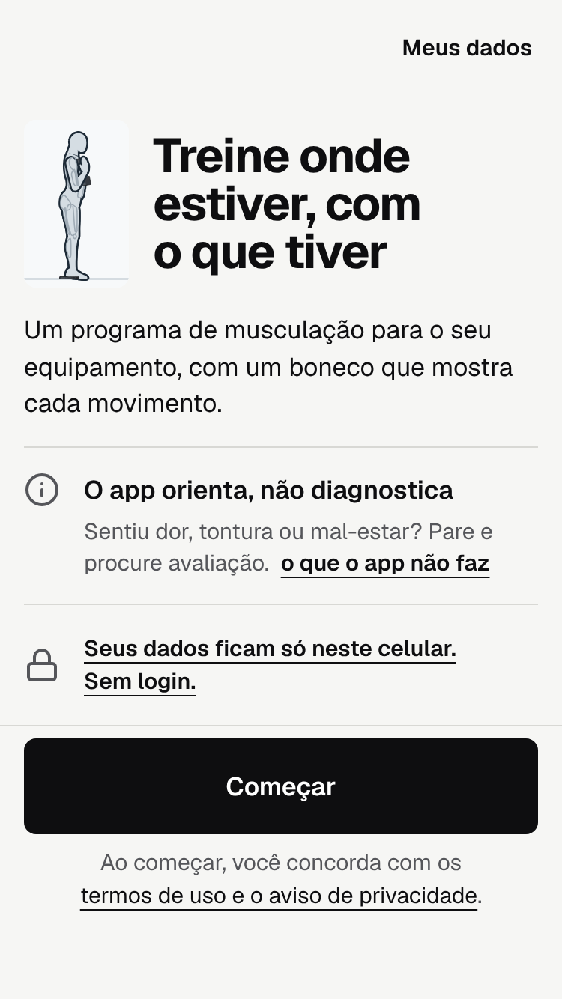
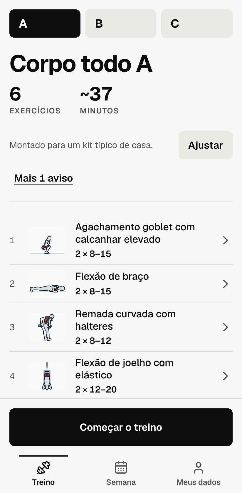
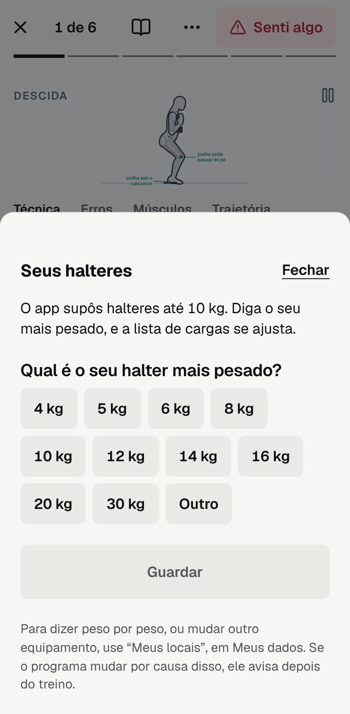
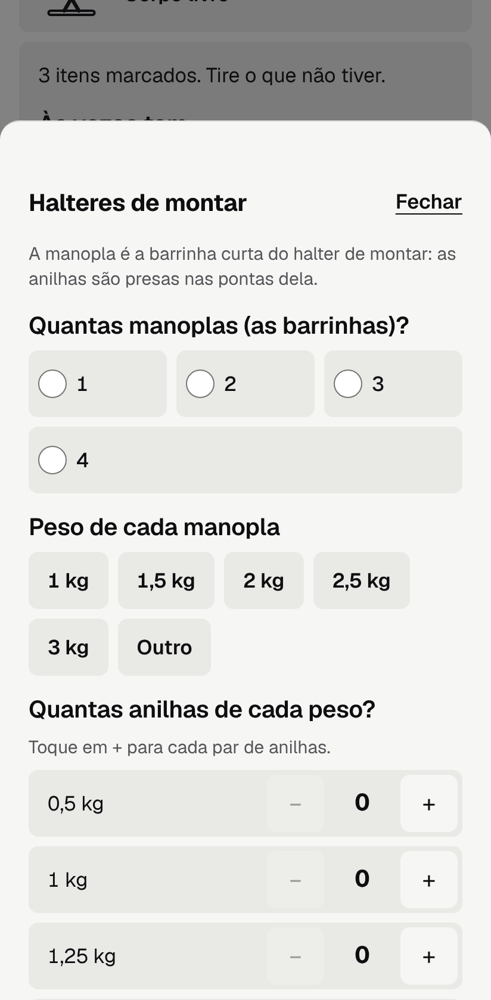

# Conferência do lote M1 (a porta)

22/11/2026. Feita pela sessão da análise crítica, como crítico de fora, a pedido do Gustavo ("quando o M1 terminar, confere daqui"). **Nada foi alterado** no ramo da conversa de construção.

## Em uma frase

**O problema 1 do ranking saiu.** Quem treina no prédio ou em casa chega agora ao programa em 9 a 12 toques, sem inventário; antes eram 21 e 24. O que sobra da "porta" não era deste lote: a triagem de saúde (M6) e o nome (adiado).

## O que foi conferido, e como

| | |
|---|---|
| **Versão** | A ponta do ramo `claude/melhorias-analise-critica`, commit `200d7a71` (22/11, 01:43 UTC) |
| **O lote M1 dentro dela** | Os commits de `bd809fa2` a `8b132ed4`, mais a frase da abertura escolhida pelo Gustavo (`068b179c`) |
| **Comparação** | A `main` de 19/11 (`ece5f79`), a mesma da análise |
| **Como** | Versão de produção das duas, lado a lado, com os roteiros de [`roteiros-de-medida.md`](roteiros-de-medida.md) e as mesmas personas |
| **Telas** | 412 × 839, 375 × 667, 360 × 640 e 320 × 568 |

**Os limites são os mesmos da análise:** nenhuma pessoa e nenhum celular de verdade. E mais um: **não rodei os testes de tela do ramo dela** (`npm run verificar`); isso é dela. Rodei a camada barata numa cópia do ramo: 1.047 de 1.048 testes passam, e as 3 falhas que apareceram são dos testes que chamam o git, porque a minha cópia não tem a pasta do git. Não são falha do código.

## O antes e o depois

**Toques da abertura até ver o programa, contando a tela de equipamento:**

| Persona | Antes (19/11) | Depois | Meta |
|---|---|---|---|
| Academia completa (a exigente, tela de 320 × 568) | 13 | **13** | 15 |
| Condomínio, com as mesmas respostas de 19/11 | 21 | **11** | 15 |
| Condomínio, com "Nunca treinei" | não existia | **9** | 15 |
| Casa, com as mesmas respostas de 19/11 (tela de 360 px) | 24 | **12** | 15 |
| Casa, com "Nunca treinei" | não existia | **9** | 15 |
| Corpo livre, com "Nunca treinei" | não medido | **9** | 15 |
| Com "sim" na triagem e academia completa | 17 | 17 | (não era do lote) |

O devlog dela registra 13 e 11 onde eu registro 11, 12 e 9. A diferença é do jeito de contar (o teste dela conta todo toque na tela; o meu, os toques que a pessoa precisa dar). Pelos dois, todos ficam abaixo de 15.

**O que o lote prometia, item por item:**

| Promessa | Resultado | Prova |
|---|---|---|
| O programa sai na hora em "Condomínio" e "Casa" | **Sim.** Nenhuma folha de detalhes depois de "Gerar meu programa" | Roteiros; captura abaixo |
| "Casa" supõe halteres comuns | **Sim.** Marca "Halteres fixos" e "Elásticos". Kit suposto: halteres de 2 a 10 kg, de 2 em 2, e 3 elásticos. No condomínio, até 12 kg | `src/domain/taxonomia/atalhos.ts:51,61` no ramo dela |
| O programa diz que supôs | **Sim.** "Montado para um kit típico de casa." com o botão "Ajustar" (92 × 48), que leva a "Meus locais" | Captura abaixo |
| Dá para corrigir no treino | **Sim, de ponta a ponta.** "Meus pesos são outros…" na lista de cargas; 4 toques para dizer "5 kg"; a lista se ajusta ali mesmo; depois do treino aparece "Versão nova do programa. Atualizar" | Captura abaixo |
| "Nunca treinei" | **Sim.** Não pergunta da pausa nem da técnica. O programa vem com 2 séries em tudo, sem nenhum "1 ×" e sem o texto da "carga de antes da pausa" | Programa da persona |
| A abertura diz o que se recebe e mostra o Boneco | **Sim.** "Um programa de musculação para o seu equipamento, com um boneco que mostra cada movimento." O Boneco se mexe | Capturas abaixo |
| O aviso de segurança continua inteiro e à vista | **Sim,** nos três tamanhos medidos. "Começar" também | Medido |
| Erro só no campo mexido | **Sim.** Tentei gerar com "Halteres de montar" sem preencher: a folha abre limpa, sem vermelho. "Manopla" agora vem explicada | Captura abaixo |

A abertura, antes e depois:

| Antes | Depois |
|---|---|
|  |  |

Em tela de 375 × 667 o Boneco encolhe e tudo continua cabendo. Em 320 × 568 ele sai, e a tela fica só com o texto:

O programa de casa, logo depois do toque em "Gerar meu programa":

A correção dos pesos, na hora de anotar a carga:

A folha de um item com detalhe faltando, sem erro antes da hora (compare com `capturas/trava-manoplas-p4.png`):

## O que não podia piorar

| Item | Antes | Depois |
|---|---|---|
| Sessão inteira de treino | 35 toques para 10 séries (3,5 por série) | 37 toques para 12 séries (3,1 por série) |
| Falhas de acessibilidade (axe-core) | 0 | 0 na abertura nova, no programa com o aviso e na folha dos halteres |
| Toques menores que 44 px | Só links pequenos de texto | Só "o que o app não faz" (já existia); os controles novos têm 44 ou mais |
| Movimento reduzido | Respeitado | O Boneco da abertura fica parado |
| Sem internet | Abre | Abertura, programa, treino e semana abrem |
| Programa de quem usa "Academia completa" | — | **Idêntico**, exercício por exercício, na persona exigente; igual também na de 55 anos |
| Abertura: velocidade (celular simulado) | Nota 100; primeira imagem em 1,0 s; pronta em 2,3 s | Nota 100; 0,9 s; 1,7 s |
| Abertura: peso da primeira carga | 206 KiB | **289 KiB** |

**Leitura:** nada piorou no uso. A abertura ficou 83 KiB mais pesada, porque agora traz o Boneco; a velocidade medida não sentiu.

## O que ficou, do mais ao menos importante

1. **Quem volta de uma pausa continua vendo exercícios de 1 série, sem explicação.** Com as respostas de 19/11 ("parei há mais de 6 meses"), o programa ainda traz "Supino 1 × 6–10". Para quem nunca treinou isso acabou; para quem de fato parou, continua, e a tela continua sem dizer que é a semana leve. **Não era do M1:** é do M3. Fica anotado para não se perder. *Fato; confiança alta.*

2. **O chute ainda erra para quem tem um par só.** Simulei a pessoa com um único par de 5 kg. Antes de corrigir, a lista oferece 2, 4, 6, 8 e 10 kg. Depois de dizer "5 kg", oferece **3 kg e 5 kg**: o app supõe pesos de 2 em 2 abaixo do máximo, e ela não tem o de 3. Não trava nada (ela escolhe o de 5), e a folha manda a "Meus locais" quem quiser dizer peso por peso. *Fato. Opinião: é pequeno; uma opção "tenho só esse par" resolveria.*

3. **Só os halteres se corrigem no treino.** Os elásticos (o app supõe 3) e o banco só mudam por "Ajustar" ou "Meus locais". *Fato. Opinião: aceitável; o halter é o que mais muda o treino.*

4. **A triagem de saúde continua igual:** 17 toques e a caixinha, para quem marca pressão alta. É o lote M6.

5. **O app continua sem nome.** Decisão do Gustavo; a abertura nova funciona sem ele.

## Três coisas fora do lote que o Gustavo precisa saber

- **O ramo dela ficou atrás da `main`.** As animações restantes foram juntadas à `main` em 22/11 (`ea98fc5b`), e o ramo `claude/melhorias-analise-critica` ainda parte da `main` de 19/11. Antes de o M1 ir para a `main`, ele precisa receber essa junção, e vale refazer a verificação depois.
- **Com as animações na `main`, a parte 4 do M2 (ligar as de barra e máquina) deixou de estar travada.**
- **Entraram no mesmo ramo mudanças que não são do M1,** todas pedidas pelo Gustavo em 22/11: a pergunta da menor anilha fora do cadastro, as anilhas pelo total, e os cortes da "régua de cara humana". Conferi só que não desfizeram nada do lote: as contagens acima foram feitas com elas dentro. Uma delas ajuda um achado da análise: o rótulo "DESCIDA · EXCÊNTRICA" virou "DESCIDA".

## O que continua valendo

Estas medidas dizem que a porta ficou destrancada. **Não dizem que as pessoas entram.** Isso só o teste com cinco pessoas mostra, e ele está marcado para depois das melhorias. Quando ele vier, a pergunta para este lote é uma só: quem treina em casa chega ao programa sem ajuda, e o primeiro treino dela oferece pesos que ela tem?
