# Diário de uso

Usei o app como quem nunca o viu, antes de ler qualquer documento do projeto além do `CLAUDE.md` e do `README.md`.

## Como foi feito (e os limites)

- **Versão usada:** a de produção (`npm run build` + `npm run preview`), no commit `ece5f79` da `main` (18/11/2026). A `main` andou 5 commits durante a análise (até `b55a98b`); a única mudança em telas foi um ajuste de 9 linhas no cartão de texto.
- **Aparelhos simulados:** Pixel 7 (412 × 839), iPhone SE (320 × 568, estreito) e uma tela de 360 × 640. Navegador: Chromium, dirigido por roteiros.
- **O que isto não é:** não é o Safari de um iPhone de verdade, não é uma academia e não é uma pessoa. Os **toques** foram contados de verdade. O **tempo** de uma pessoa eu não medi: onde dou minutos, é estimativa minha e está dito.
- **Personas:** inventadas por mim. Nenhum dado real.

| Persona | Quem é | O que tem | Tela |
|---|---|---|---|
| **P1, o curioso** | 28 anos, nunca treinou, abriu por curiosidade | Academia do prédio | Pixel 7 |
| **P2, a exigente** | Treina há 6 anos, já usou outros aplicativos | Academia completa | iPhone SE |
| **P3, 55 anos** | Pouca intimidade com aplicativos; pressão alta controlada com remédio | Academia completa, 2 dias | Pixel 7 |
| **P4, em casa** | Treinou um ano, parou há meses; só tem um par de halteres e elásticos | Casa | 360 px |

## Placar: da primeira tela até poder marcar a 1ª série

| | P1 curioso | P2 exigente | P3 55 anos | P4 em casa |
|---|---|---|---|---|
| Toques até ver o programa | **21** | **13** | **17** | **24** |
| Toques até a tela da 1ª série | 22 | 14 | 18 | 25 |
| Toques até *poder* marcar a 1ª série | 27 | 19 | 23 | 30 |
| Onde travou | Detalhes do equipamento | Não travou | Triagem de saúde | Detalhes do equipamento |
| Tempo (estimativa minha) | 3 a 5 min | 1 a 2 min | 4 a 6 min | 4 a 6 min |

A diferença entre 13 e 24 toques vem toda de um lugar: os **detalhes do equipamento**. Quem escolhe "Academia completa" não responde nada; quem treina no prédio ou em casa precisa fazer um inventário.

---

## P1, o curioso (nunca treinou)

**O que ele esperava:** abrir, entender em segundos o que é, e ver um treino.

### Os primeiros 10 segundos

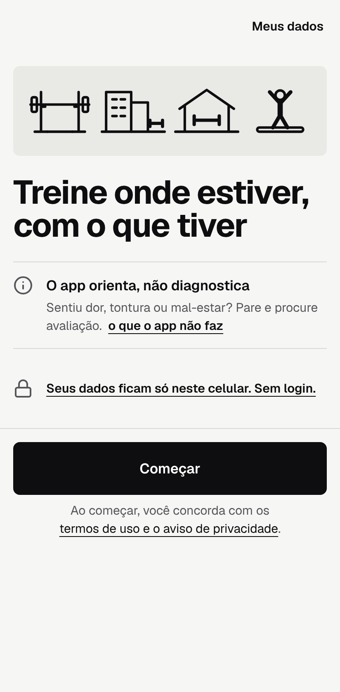

- **Fato:** a tela não tem nome nem marca. O título é "Treine onde estiver, com o que tiver". Logo abaixo, a primeira informação é um aviso: "O app orienta, não diagnostica. Sentiu dor, tontura ou mal-estar? Pare e procure avaliação."
- **Fato:** nada na tela diz o que ele vai receber (um programa, um boneco que mostra o movimento, um relógio de descanso).
- **Opinião:** a promessa é boa ("com o que tiver"). Mas a tela gasta o melhor espaço dizendo o que o app *não* faz. Para quem chega por curiosidade, parece um termo de responsabilidade, não um convite.

### O cadastro

1. **"Começar" leva direto a uma lista de doenças.** A primeira pergunta do app é sobre problema no coração.

   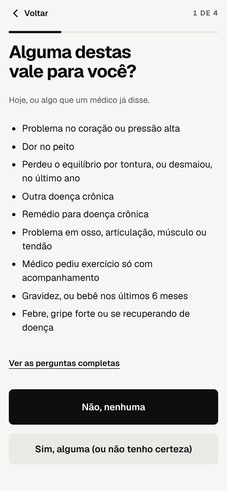

   Um toque em "Não, nenhuma" resolve. É rápido. Mas é a primeira impressão.

2. **Experiência.** "Há quanto tempo você treina musculação sem parar?" e depois "Você está treinando agora?", com as opções "Estou treinando", "Parei há umas 2 semanas", "Parei há 3 semanas a 6 meses", "Parei há mais de 6 meses".

   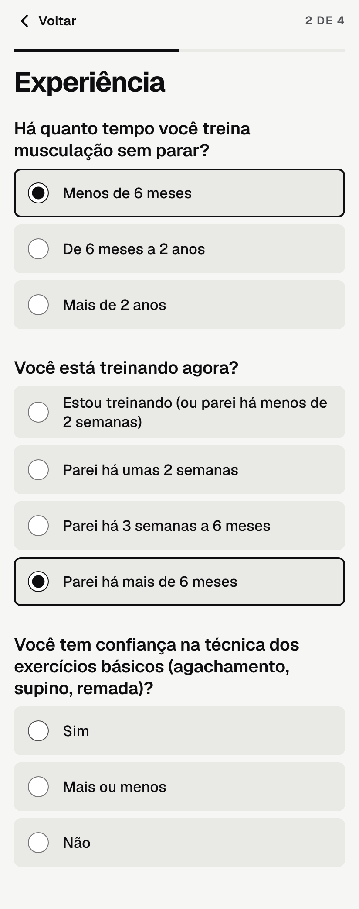

   **Onde travou:** não existe "nunca treinei". Ele teve de dizer que "parou há mais de 6 meses" algo que nunca começou.

3. **Rotina.** Dias, minutos e, opcional, um grupo para priorizar. Simples. **Fato:** o app não pergunta objetivo, idade, peso nem sexo.

4. **Onde você treina.** Quatro atalhos grandes. É a melhor tela do cadastro.

   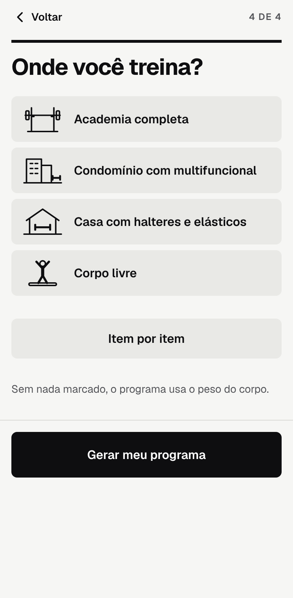

5. **A trava.** Ele escolheu "Condomínio com multifuncional" e tocou em "Gerar meu programa". O programa não veio. Veio isto:

   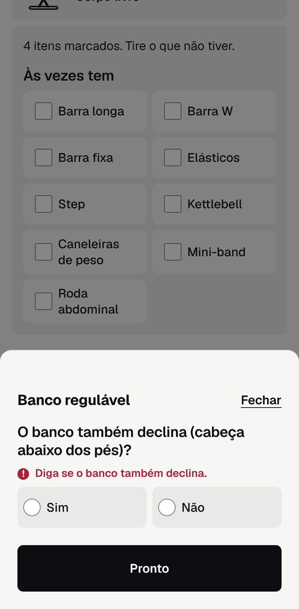

   E depois isto: a folha já abre com três erros em vermelho, em campos que ele nunca tinha visto:

   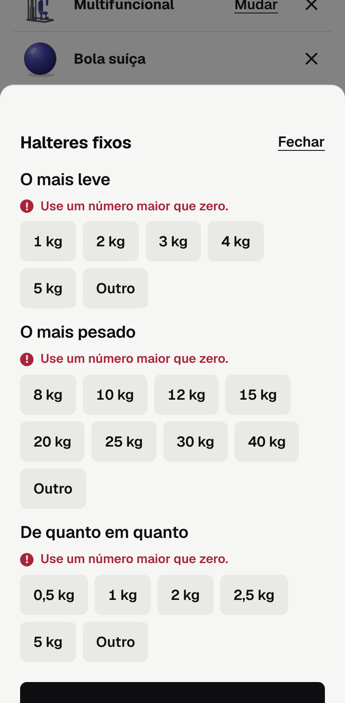

   - **Fato:** o aviso diz "Falta pouco: há 4 detalhes para completar". São eles: se o banco declina; o halter mais leve; o mais pesado; de quanto em quanto.
   - **Fato:** o texto do erro é "Use um número maior que zero." Os erros nascem do toque em "Gerar meu programa", que marca todos os campos de uma vez (`src/features/onboarding/Inventario.tsx:252-259`), e não somem enquanto ele preenche.
   - **Fato:** só o atalho "Academia completa" vem com valores típicos já preenchidos (`src/domain/taxonomia/atalhos.ts:99`). Os outros três perguntam tudo.
   - **O que ele não entendeu:** por que um app que prometeu "com o que tiver" quer saber o halter mais pesado do prédio. Ele não sabe. Está no sofá.
   - **Opinião:** é aqui que o curioso desiste. Ele ainda não viu nada do app e já recebeu uma tarefa.

**Toques até o programa: 21.** Sem os 4 detalhes seriam 11.

### O programa

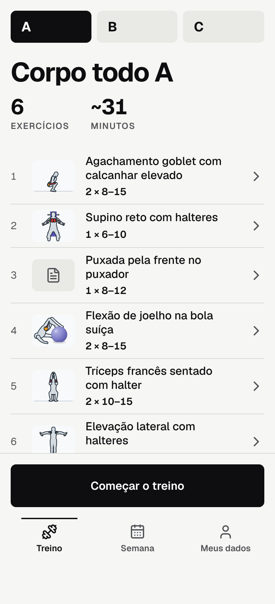

- **O que funcionou:** a tela é limpa. Dá para ver que são 3 treinos (A, B, C), 6 exercícios, cerca de 31 minutos.
- **O que ele não entendeu:**
  - "2 × 8–15". Ninguém explicou que são 2 séries de 8 a 15 repetições.
  - Por que o supino tem "1 ×". Uma série só parece pouco, ou erro. A explicação existe, mas está em "Meus dados → Entenda o treino → O seu programa", e é esta: "Semana 1. Cerca de metade das séries [...] e carga 10–20% abaixo da que você usava antes da pausa". **Ele nunca treinou.** Como não havia "nunca treinei", marcou "parei há mais de 6 meses", e o app o tratou como quem volta de uma pausa: cortou as séries para 55% e 2 séries viraram 1 no arredondamento (`src/domain/gerador/index.ts:2241`). Quem diz que treina há 5 meses recebe outra rampa, que nunca dá 1 série.
  - "Agachamento goblet com calcanhar elevado": o primeiro exercício da vida dele tem esse nome.
  - Ele pediu 45 minutos e recebeu 31. (É a mesma semana reduzida: o programa cheio daria 43 ou 44. A tela não diz.)
- **Fato:** o 3º exercício, "Puxada pela frente no puxador", um dos mais comuns de qualquer academia, não tem animação. Aparece um ícone de folha.
- **Fato:** nada na tela diz "isto foi montado para você: 3 dias, academia do prédio, começando do zero".

Ao tocar num exercício:

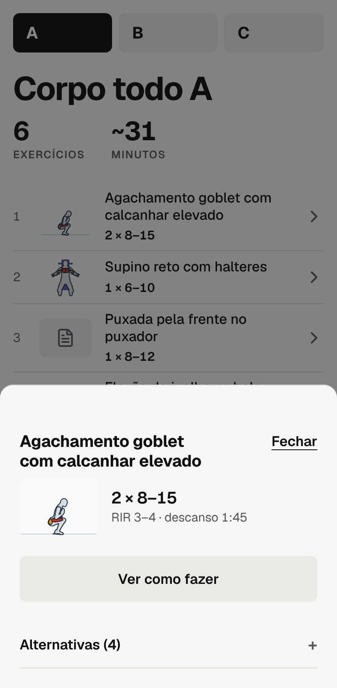

"RIR 3–4 · descanso 1:45". **RIR** não é explicado aqui.

### O guia em tela cheia

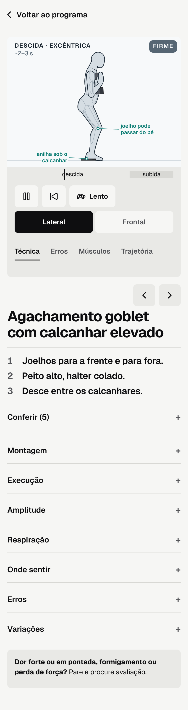

- **O que funcionou:** o boneco é claro, as três dicas são curtas e boas ("Peito alto, halter colado").
- **O que ele não entendeu:** "DESCIDA · EXCÊNTRICA", a aba "Trajetória" e o selo "FIRME" (descobri depois, no código, que é a respiração: INSPIRA, EXPIRA ou FIRME). E há 8 gavetas de texto abaixo.

### A sessão, como se fosse na academia

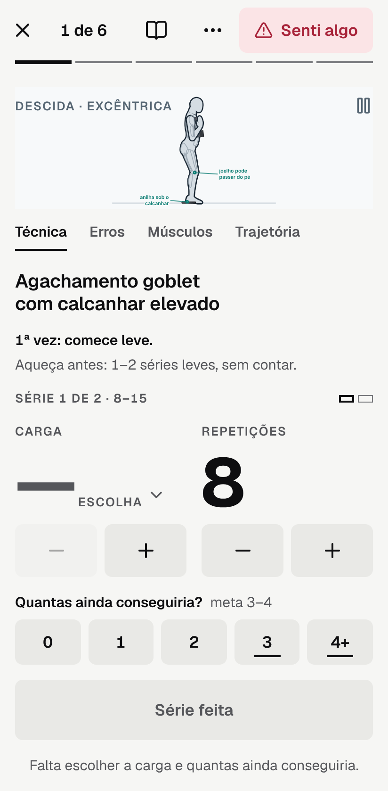

- **Fato:** para marcar a primeira série são 5 toques: escolher a carga numa lista, responder "Quantas ainda conseguiria?" e tocar em "Série feita". O botão fica apagado, com a frase "Falta escolher a carga e quantas ainda conseguiria."
- **Fato:** o app diz "1ª vez: comece leve", mas não sugere um número.
- **Fato:** o boneco ocupa uma faixa de 412 × 130 pontos. As legendas dele saem com letra de 8 pontos. Tocar nele **pausa**; não aumenta.
- **Onde travou:** para ver o movimento grande, ele precisa achar o ícone de livro lá em cima, sair da tela do treino e depois voltar.

**O descanso é a melhor tela do app:**

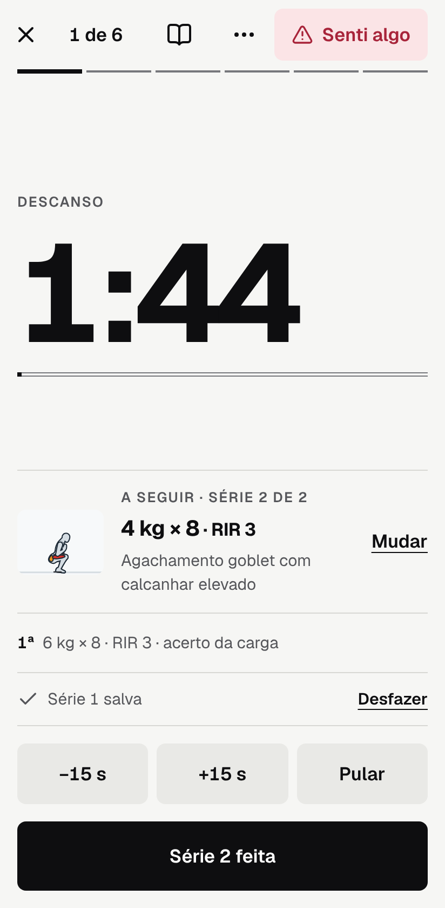

Relógio enorme, o que vem a seguir, e a série seguinte se marca com **um toque**. A partir da 2ª série, o registro é mais rápido do que em muito aplicativo conhecido.

- **O que ele não entendeu:** fez 6 kg com folga dentro da meta e o app sugeriu **baixar** para 4 kg, com a explicação "acerto da carga". No fim, "próxima: 2 kg".
  - **Por que acontece (li depois no código):** a tela mostra uma meta larga (8 a 15 repetições, sobrando 3 ou 4). Por dentro, o app só aceita o **meio** dessa meta: a soma de repetições e sobra tem de ficar entre 13 e 17 (`src/domain/progressao/calibracao.ts:19-21,50`). Ele fez 8 + 3 = 11. Está dentro do que a tela mostra e fora do que o app aceita. E 8 é justamente o número que a tela já traz preenchido. Quem aceita o que a tela oferece vê a carga cair a cada série.
  - **Opinião:** é regra, não defeito de programação; há teste que a fixa. Mas a tela e a regra dizem coisas diferentes, e quem paga é o iniciante.

**Exercício sem animação:**

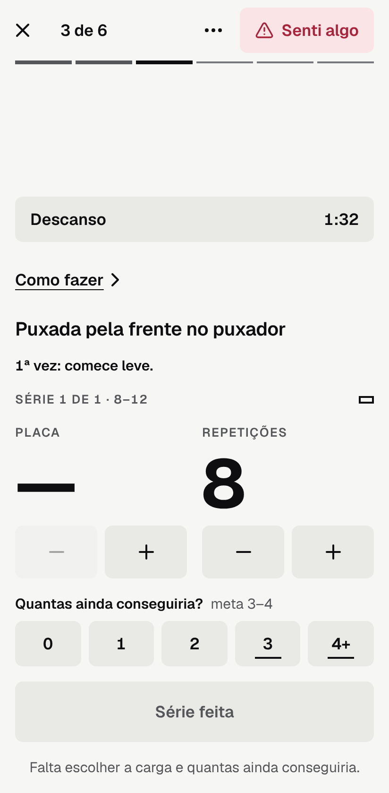

- **Fato:** no lugar do boneco fica um espaço vazio de cerca de 230 pontos. Parece que a tela não carregou. (É de propósito: `src/styles.css:690` diz "o vazio fica em cima".)

**Trocar exercício e "Senti algo"** funcionam bem:

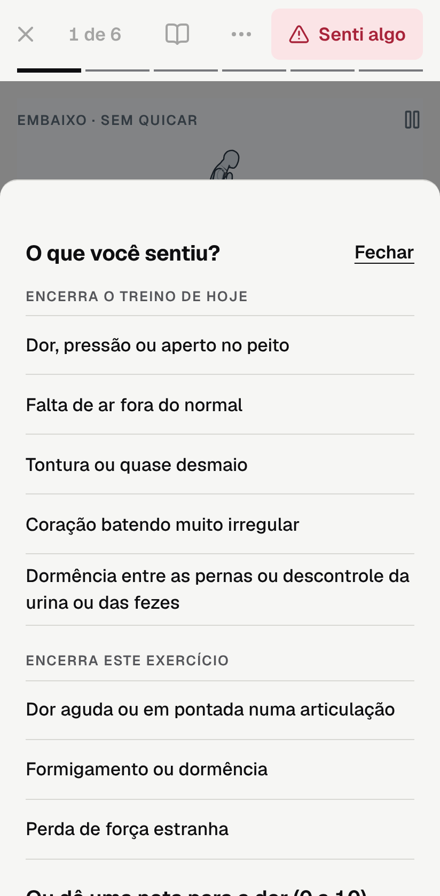

Separar "encerra o treino de hoje" de "encerra este exercício" é claro e sério. Trocar exercício oferece três opções e deixa marcar a preferida para sempre.

**Sessão inteira: 35 toques para 10 séries.**

### Depois do treino

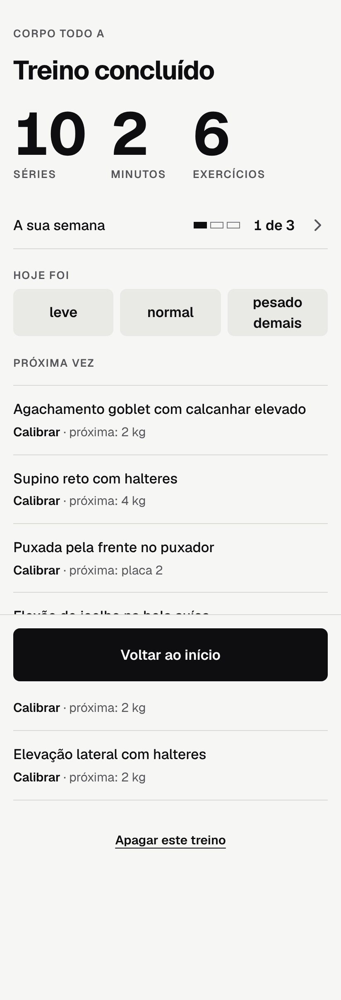

- **Fato:** três números (séries, minutos, exercícios), a semana ("1 de 3"), "Hoje foi: leve / normal / pesado demais" e uma lista "Próxima vez" com "Calibrar · próxima: 2 kg".
- **O que faltou:** qualquer sinal de que ele fez algo que vale. Não há comemoração, nem o que mandar para alguém.

### A volta

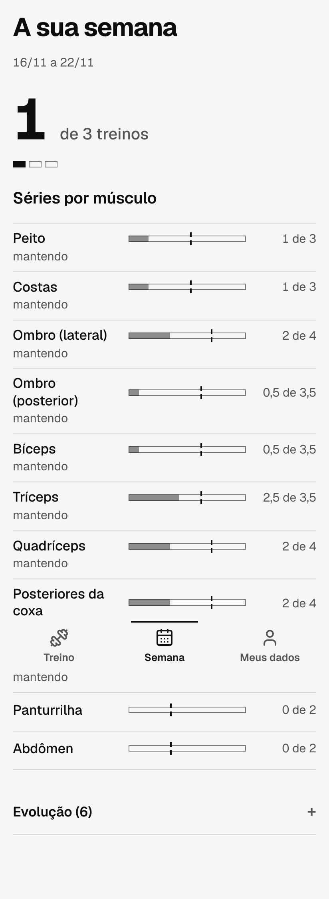

- **Fato:** a tela "Semana" abre com "1 de 3 treinos" (bom) e depois uma tabela "Séries por músculo": "Ombro (posterior) 0,5 de 3,5 · mantendo". Meia série.
- **Fato:** simulei a volta 9 dias depois. O app abre no programa, com "A sua semana 0 de 3". Não diz nada sobre a ausência, nem sobre o que ele fez da última vez.

  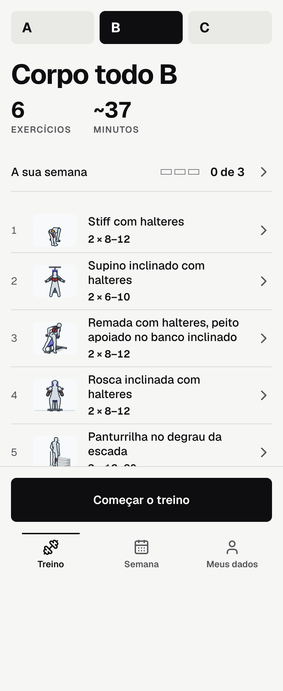

- **Opinião:** o app não tem como chamá-lo de volta (não manda aviso) e, quando ele volta sozinho, não o recebe.

---

## P2, a exigente (treina há 6 anos, tela estreita)

**O que ela esperava:** registrar rápido, ver o histórico, ser tratada como quem sabe.

- **Cadastro: 13 toques.** "Academia completa" não pede detalhe nenhum. Foi a experiência mais fluida das quatro.
- **O programa em 5 dias:** Superior, Inferior, Empurrar, Puxar, Pernas.

  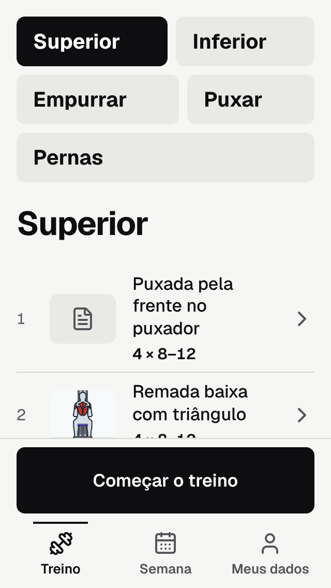

  - **Fato:** na tela de 320 pontos, as 5 abas ocupam 3 linhas. Entre elas e o botão fixo, cabe um exercício e meio.
  - **Fato:** 13 dos 34 exercícios do programa dela **não têm animação**: agachamento livre com barra, supino reto com barra, cadeira extensora, cadeira flexora, puxada pela frente, voador, rosca Scott, hip thrust. São justamente os que toda academia tem.
  - **O que ela estranhou:** dia de pernas com 2 séries de agachamento, para quem se declarou avançada e pediu 75 minutos. Os dias variam de 36 a 65 minutos.

- **A tela de treino não cabe na tela dela:**

  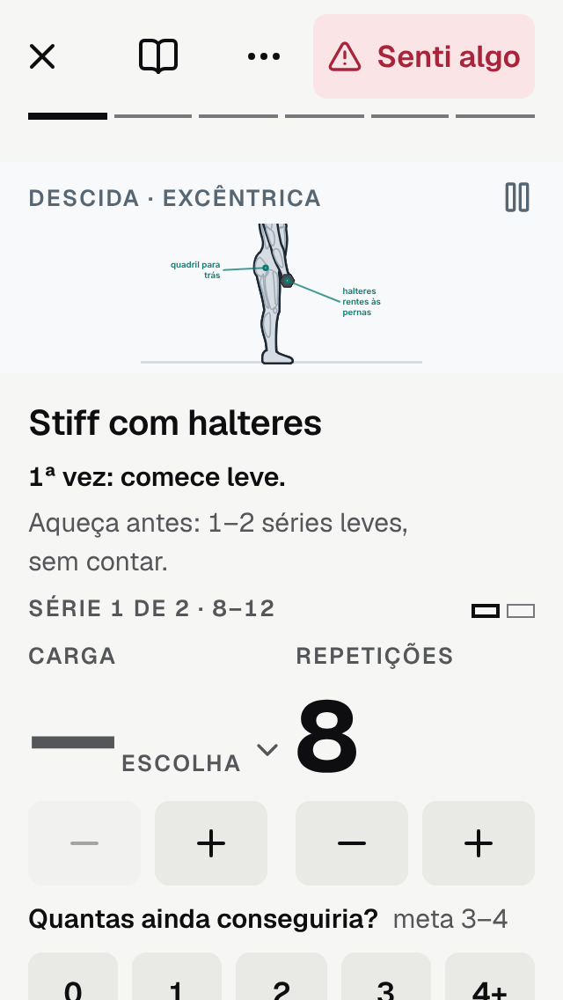

  - **Fato:** o boneco aparece **sem cabeça e sem tronco**; só pernas. E o botão "Série feita" fica fora da tela: é preciso rolar a cada primeira série.
  - Para comparar, o mesmo exercício na tela média:

    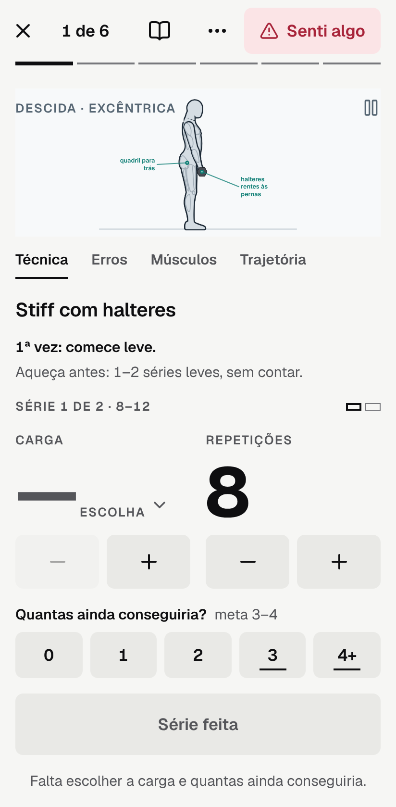

  - **Não é só na tela mais estreita.** O "iPhone SE" do simulador é o de 2016. Medi então a tela de treino nos tamanhos mais comuns:

    | Tela | Exemplo | "Série feita" | Altura do boneco | Abas do guia |
    |---|---|---|---|---|
    | 320 × 568 | iPhone SE antigo | **fora da tela** | 104 | não |
    | 360 × 640 | Android pequeno | cabe | 104 | não |
    | 375 × 667 | iPhone SE atual, iPhone 8 | cabe | **70** | não |
    | 390 × 664 | iPhone 13/14 no Safari, com as barras (aproximação) | cabe | 86 | não |
    | 360 × 740 | Android comum | cabe | 133 | não |
    | 390 × 797 | iPhone 13/14 com o app instalado | cabe | 160 | sim |
    | 412 × 839 | Pixel 7 | cabe | 134 | sim |

    As legendas do boneco saem com letra de **8 pontos** em todos. Só nas telas mais altas aparecem as abas (Técnica, Erros, Músculos). No tamanho do iPhone SE atual, o boneco tem 70 pontos de altura e a cabeça fica atrás do rótulo:

    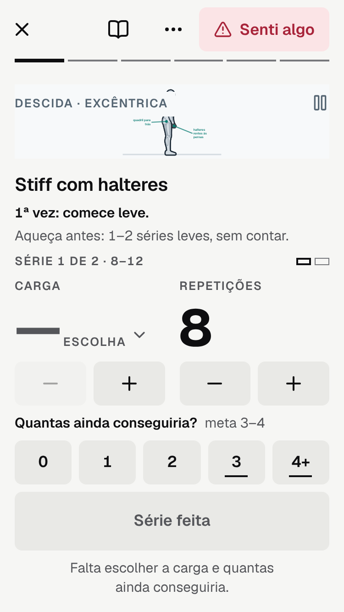

- **O que ela não perdoa:** trocar para a música no meio do descanso e não ser avisada (ver "segundo plano", abaixo). E não ter gráfico de evolução: depois de um treino, a "evolução" de um exercício é uma linha de texto.

---

## P3, 55 anos (pressão alta controlada)

**O que ele esperava:** que alguém dissesse o que fazer na academia, sem complicação.

- Ele leu a lista de saúde, viu "pressão alta" e tocou em "Sim, alguma".
- Veio uma página com as 9 perguntas completas e caixinhas. Marcou duas (pressão alta; remédio para doença crônica).
- Veio uma terceira passada: "Nenhuma destas vale para você? Você não marcou estas 7".
- E então:

  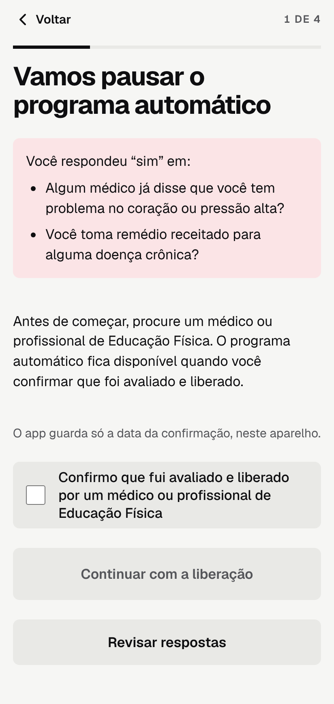

- **Fato:** o app para aqui. Só continua se ele marcar "Confirmo que fui avaliado e liberado por um médico ou profissional de Educação Física".
- **Onde travou:** ele foi honesto e bateu num muro na segunda tela. O muro abre com uma caixinha.
- **Opinião:** entendo o cuidado. Mas, na prática, a tela pune quem responde a verdade e não segura quem não responde. E pressão alta com remédio é muito comum nessa idade.
- **Depois da caixinha: 17 toques até o programa.** Pediu 30 minutos; recebeu um dia de 21 e outro de 19. No primeiro dia, 5 exercícios, 4 deles com 1 série. Três dos nove exercícios sem animação, inclusive o leg press.
- **O que ele não entendeu:** quase todo o vocabulário (ver a lista abaixo).

---

## P4, em casa (um par de halteres e elásticos)

**O que ela esperava:** é para ela que o app diz existir. "Com o que tiver."

- Escolheu "Casa com halteres e elásticos". Tocou em "Gerar meu programa". Veio isto:

  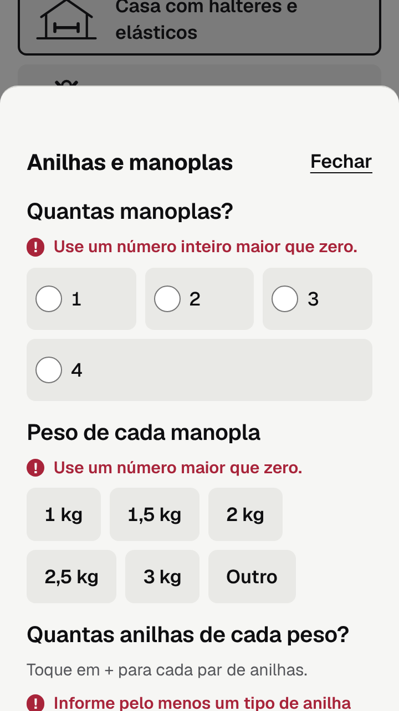

- **Fato:** o atalho de casa supõe halter **de montar** (uma barra curta, a "manopla", com anilhas soltas). Pergunta quantas manoplas, o peso de cada uma e quantas anilhas de cada peso, com 9 pesos de anilha para contar. Depois, quantos elásticos.
- **Onde travou:** ela tem um par de halteres comuns, de 5 kg. Não sabe o que é manopla. Para dizer isso ao app, teria de desmarcar o item, achar "Halteres fixos" e responder outras três perguntas.
- **Toques até o programa: 24.** É a pessoa para quem o app foi pensado, e é a que mais trabalha para entrar.
- **O programa:** em 4 dias, quase tudo com 1 série. No dia 4, cinco de seis exercícios com 1 série, inclusive o de glúteo, que ela pediu para priorizar.
- **O que funcionou:** quase tudo tem animação (21 de 24). Em casa, o guia cobre melhor do que na academia.

---

## Segundo plano: o que acontece quando a pessoa sai do app no descanso

**O que deu para testar e o que não deu.** O navegador de teste não esconde a aba como um celular faz. Então separo o que é certo do que é provável.

**Certo (li no código e conferi na tela):**

- O app **não usa notificação nenhuma**. Em todo o código das telas, os únicos recursos de aviso são: manter a tela ligada, três bipes e vibração (`src/features/treino/Temporizador.tsx:19-46`, `:87-113`, `:172-180`).
- O aviso de fim de descanso é: três bipes de 0,3 segundo, uma vibração, e a tela inteira inverte de cor com "Hora da próxima série".
- O relógio conta pela hora de terminar, não por tique (`Temporizador.tsx:117`). **Na volta, o tempo está certo.** Conferi: depois de 30 segundos fora, o relógio mostrava "+0:17" e "Hora da próxima série".
- Com o app aberto, a tela não apaga durante o treino. Isso é bom e está bem feito.

**Provável (pelas fontes, não por teste meu):**

- No iPhone, não existe vibração a partir de um site, e o som com a tela bloqueada não é confiável.
- No Android, a vibração só é chamada quando o app percebe que o tempo acabou, e isso depende de ele estar acordado.
- Ou seja: **quem troca para o WhatsApp ou para a música no descanso muito provavelmente não é avisado.** Descobre quando volta.

As fontes estão em [`mercado.md`](mercado.md), na parte "O que um web app instalado consegue".

**O que só um teste de verdade resolve:** pôr o app num iPhone e num Android, começar um descanso de 1 minuto, bloquear a tela, e anotar se tocou e se vibrou. São 5 minutos e decidem a questão.

---

## Linguagem: o que um leigo não entende, ou que soa a sistema

| Texto exato | Onde aparece |
|---|---|
| "2 × 8–15", "1 × 6–10" | Programa, sem legenda |
| "RIR 3–4 · descanso 1:45" | Folha do exercício, no programa |
| "DESCIDA · EXCÊNTRICA", "Subida · concêntrica" | Sobre o boneco, no treino e no guia |
| "FIRME" (selo) | Canto do guia |
| "Trajetória" | Aba do guia |
| "acerto da carga" | Descanso e evolução |
| "Calibrar · próxima: 2 kg" | Fim do treino |
| "PLACA" (no lugar de "Carga") | Treino, em máquina |
| "Séries por músculo", "0,5 de 3,5", "mantendo" | Semana |
| "Empurrar", "Puxar", "Corpo todo A/B/C" | Nomes dos treinos |
| "Rotina e divisão" | Meus dados |
| "Quantas manoplas?", "Peso de cada manopla" | Equipamento |
| "Use um número maior que zero.", "Use um número inteiro maior que zero." | Equipamento, em campos ainda não preenchidos |
| "Vamos pausar o programa automático" | Triagem |
| "Exportar meus dados (JSON)", "exporte uma cópia de vez em quando" | Dentro de "Guardar uma cópia" |
| "Este navegador não garantiu guardar seus dados de forma permanente" | Meus dados → "por quê?" |
| "CONSENSO DE ESPECIALISTAS. Prática de treinadores e posicionamentos, sem ensaio que teste este número." | Em avisos que não têm número nenhum (o do navegador, o de "o que o app não faz") |
| "citação conferida por busca; o texto não foi lido" | Fontes, em "o que o app não faz" |
| "Mande este texto para quem te passou o link do app" | Avisar um problema |
| "Versão ece5f79" | Rodapé de Meus dados |
| Nomes: "Remada unilateral com halter, sem banco (mão livre na coxa)", "Crucifixo invertido sentado, com o peito nas coxas, com halteres", "Abdução de quadril em pé com elástico preso sob o outro pé" | Programa |

**Uma coisa que já está certa:** o botão principal diz "Guardar uma cópia", não "Exportar". O jargão só aparece na folha que abre depois.

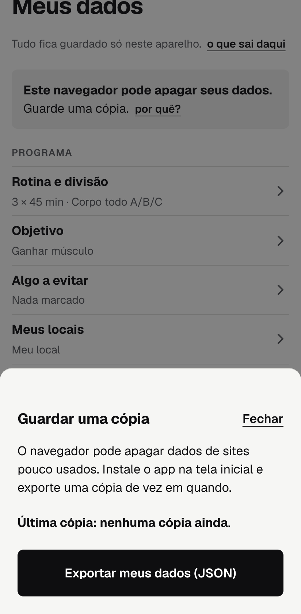

**Outra:** existe um bom glossário ("RIR: quantas repetições ainda sobravam quando você parou"). Ele está em "Meus dados → Entenda o treino → Como ler o treino", a três toques de onde a dúvida nasce.

---

## Estética e personalidade

- **Fato:** preto, branco e cinza. A única cor é o rosa de "Senti algo" e o roxo do equipamento no boneco. Números enormes. Uma só família de letra.
- **Fato:** o app não tem nome. Chama-se "treino-mvp" na aba do navegador e "Treino" no ícone. O ícone é um halter branco num quadrado preto.
- **Onde tem cara própria:** no descanso (o relógio gigante que inverte a tela) e no boneco. São as duas coisas que ninguém confundiria com outro app.
- **Onde parece modelo pronto:** na abertura, no cadastro e em "Meus dados". São listas cinza sobre fundo cinza.

  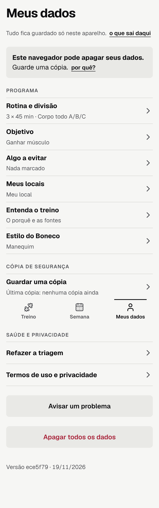
- **Densidade.** Medi a tela de treino numa tela média: 15 controles e cerca de 400 letras visíveis de uma vez, com o boneco espremido em 15% da altura. Na tela estreita, não cabe.
- **Modo escuro:** funciona e fica bonito.

  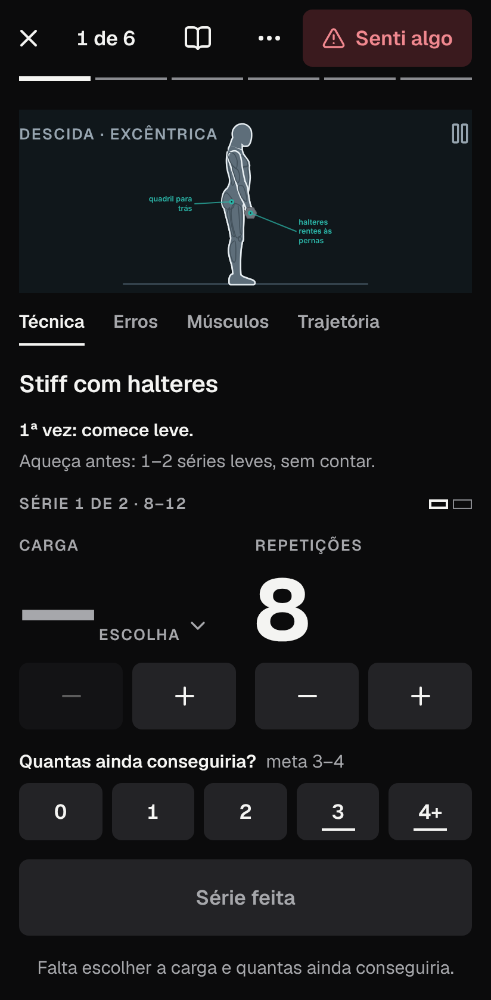

---

## Básicos que o público não perdoa

Aqui o app está **bem acima da média**. Digo uma vez:

| Item | Resultado |
|---|---|
| Áreas de toque | Todas com 44 pontos ou mais, menos 2 links pequenos em "Meus dados" (22 de altura) |
| Verificador de acessibilidade (axe-core) | 0 falhas em programa, semana, dados, guia e treino |
| Leitor de tela | A tela de treino está bem descrita (região "Guia de execução", grupos com nome) |
| Movimento reduzido | Respeitado: o boneco fica parado |
| Modo escuro | Sem falha de contraste |
| Sem internet | Programa, semana, treino e guia abrem |
| Velocidade de abertura | Nota 100 no Lighthouse; primeira imagem em 1,0 s; 206 KiB |
| Instalação | Manifesto correto; no iPhone, o app explica como instalar |
| Tela de 360 pontos | Funciona |
| Tela de 320 pontos | **Falha na tela de treino** (boneco cortado, botão fora da tela) |
| Trocar de celular | Só com a cópia manual. O app avisa do risco em "Meus dados", no iPhone no fim da lista de exercícios, e lembra de fazer a cópia depois de 3 treinos (`src/domain/dados/index.ts:46-54`) |

---

## As animações, uma a uma

**Atenção à versão.** A pedido do Gustavo, no meio da análise, julguei o boneco **novo**, que está no ramo `claude/great-dirac-cabwvh` (commit `0bd04a4`, de 19/11), e não a folha antiga gerada por `scripts/folha-animacao.mjs`. Esse ramo está 315 commits à frente da `main` e ainda não foi juntado. As folhas abaixo foram feitas com a ferramenta do próprio ramo (`scripts/animacao-nova/olhar.mjs`): 6 momentos do movimento, em cada ângulo.

**Limite:** seis imagens paradas mostram se a posição está certa e se o ângulo se lê. Não mostram se o movimento é fluido. Sobre fluidez, a minha confiança é média.

**A pergunta:** um leigo aprende o movimento só olhando?

| # | Exercício | Tipo | Ângulo principal | Segundo ângulo |
|---|---|---|---|---|
| 1 | Agachamento goblet | Peso livre | **Sim** | Fraco: no fundo, as pernas parecem encolher |
| 2 | Agachamento com barra (nova) | Barra | **Sim**, mas a anilha tapa a cabeça | Fraco no fundo |
| 3 | Supino reto com halteres | Peso livre | **Sim** | Mostra bem o cotovelo; o sobe-e-desce não aparece |
| 4 | Stiff com halteres | Peso livre | **Sim**, muito claro | No fundo vira um vulto |
| 5 | Remada curvada com halteres | Peso livre | **Sim** | **Sim** |
| 6 | Puxada pela frente (nova) | Máquina | **Sim** | **Sim** |
| 7 | Leg press (nova) | Máquina | **Sim** | Confuso: o corpo some atrás da plataforma |
| 8 | Voador (nova) | Máquina | **Sim** | **Sim** |
| 9 | Barra fixa | Corpo livre | **Sim** (de costas) | **Não**: de lado, a barra não aparece e o corpo inclina enquanto a legenda diz "corpo parado" |
| 10 | Nórdico | Corpo livre | **Sim** | **Sim** (o sofá como apoio é um bom detalhe) |
| 11 | Flexão de braço | Corpo livre | **Sim** | De cima, quase nada se mexe |
| 12 | Rosca alternada | Peso livre | Sim | Sim |
| 13 | Tríceps na polia com corda | Polia | **Sim** | **Não**: de costas, nada muda entre os quadros |
| 14 | Cadeira extensora (nova) | Máquina | **Sim** | **Sim** |
| 15 | Remada com elástico | Elástico | **Sim** | **Sim** |
| 16 | Hip thrust (nova) | Barra | **Sim**, mas a anilha tapa o quadril | **Sim** |
| 17 | Face pull | Polia | Sim | **Sim** (de cima se vê a corda abrir) |
| 18 | Flexão de joelho na bola | Bola | **Sim** | **Sim** |

Exemplos. Um ângulo principal que ensina:

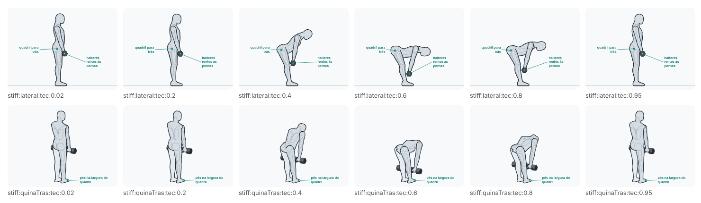

Um segundo ângulo que não mostra nada (linha de baixo):

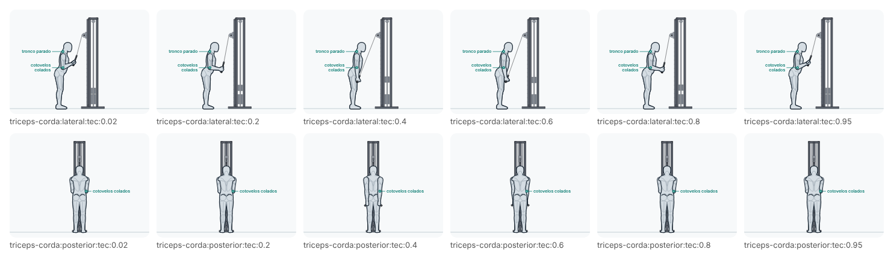

Um segundo ângulo onde quase nada se mexe (linha de baixo):

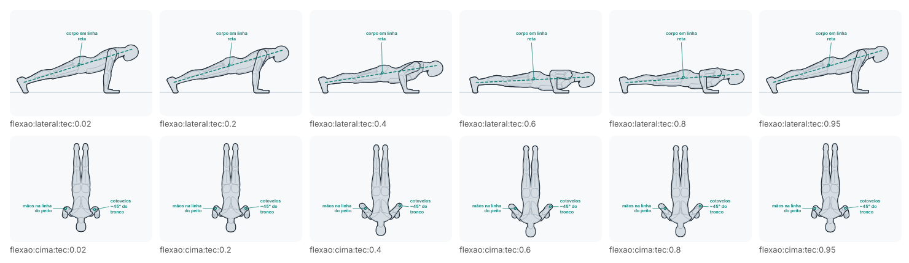

Um ângulo que contradiz a própria legenda (linha de baixo: "corpo parado", com o corpo inclinando):

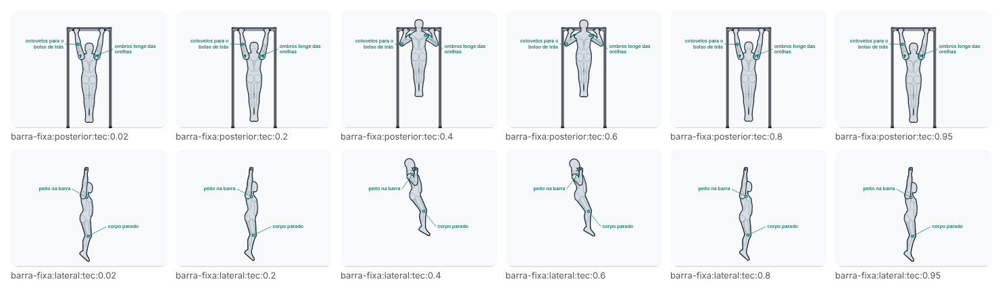

Máquinas novas, bem desenhadas, que **ainda não aparecem no app**:

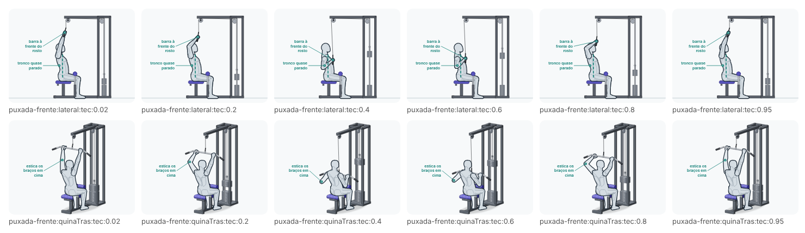

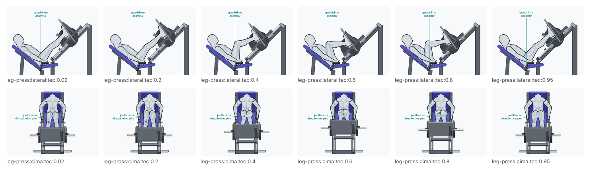

As outras folhas da amostra que guardei: [goblet](capturas/anim-goblet.png), [agachamento com barra](capturas/anim-agachamento-barra.png), [supino reto](capturas/anim-supino-reto.png), [cadeira extensora](capturas/anim-cadeira-extensora.png), [nórdico](capturas/anim-nordico.png), [hip thrust](capturas/anim-hip-thrust.png).

### O que tiro disso

1. **O ângulo principal ensina em 18 de 18.** O desenho é bom, o equipamento está desenhado, as legendas apontam para a coisa certa.
2. **O segundo ângulo falha ou confunde em cerca de 8 de 18.** Sempre pelo mesmo motivo: ele olha na direção do movimento. O braço ou a perna, em vez de dobrar, parece encolher e esticar. É isso que soa "pouco natural".
3. **Os tempos estão coerentes.** Li do motor: descida de 2 a 2,5 segundos, subida de 1 a 1,3. Todas as animações usam a mesma curva de aceleração.
4. **O maior problema das animações não é o desenho. É a entrega:**
   - No ramo há **169 animações aprovadas**, mas o catálogo continua ligando só **90**. As 79 novas, todas de barra e de máquina, estão prontas e **invisíveis**. Conferi na tela do ramo: o agachamento com barra ainda aparece com o ícone de folha.

     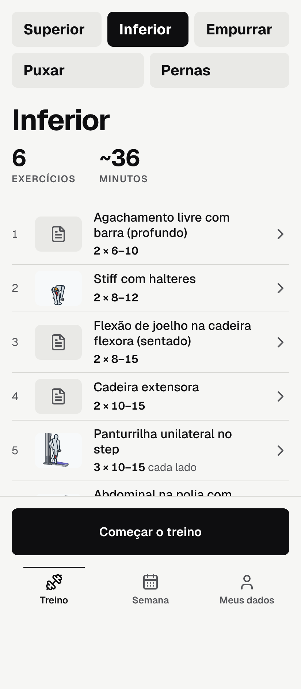

   - No treino, o boneco é pequeno, as legendas saem com letra de 8 pontos, e na tela estreita ele aparece cortado.
