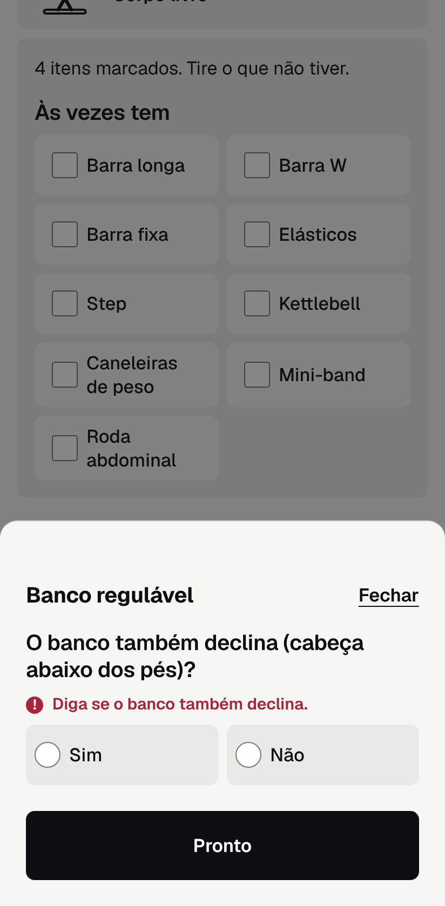
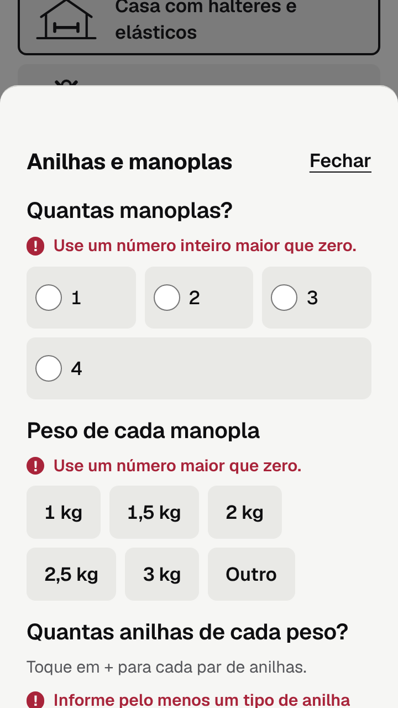
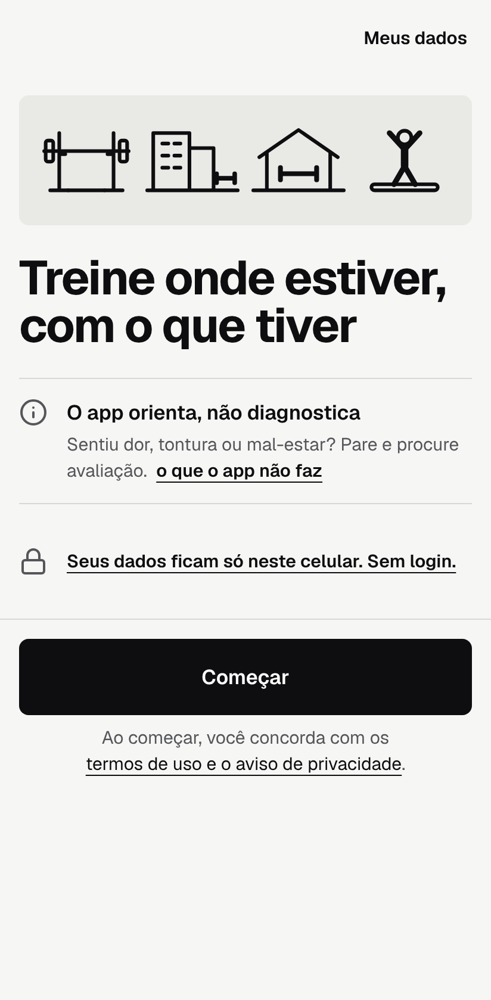
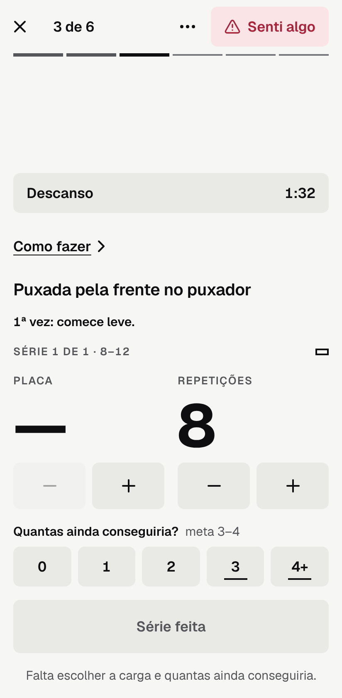
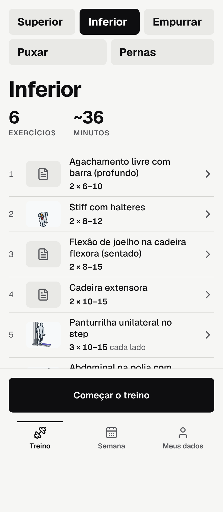
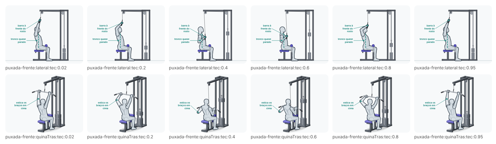
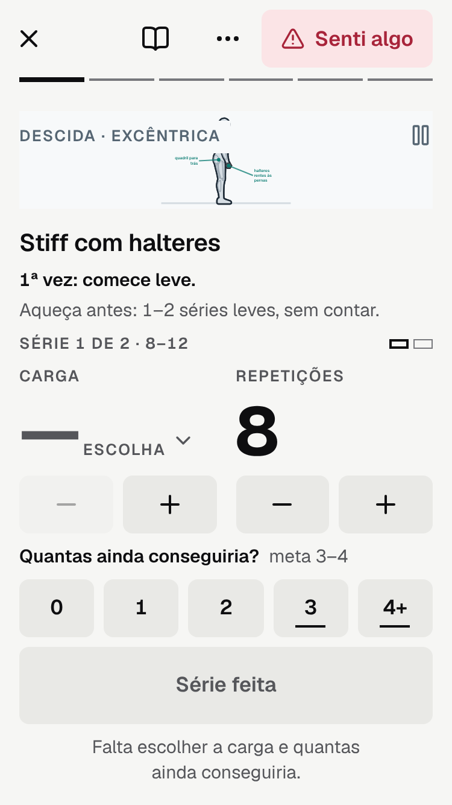
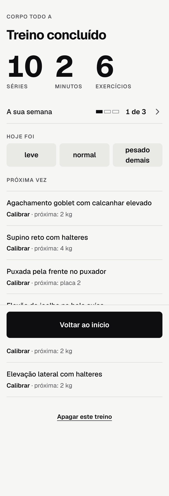
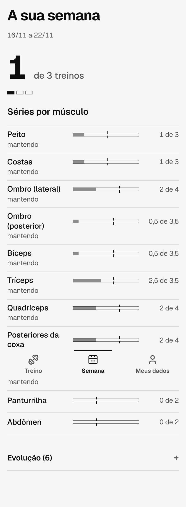
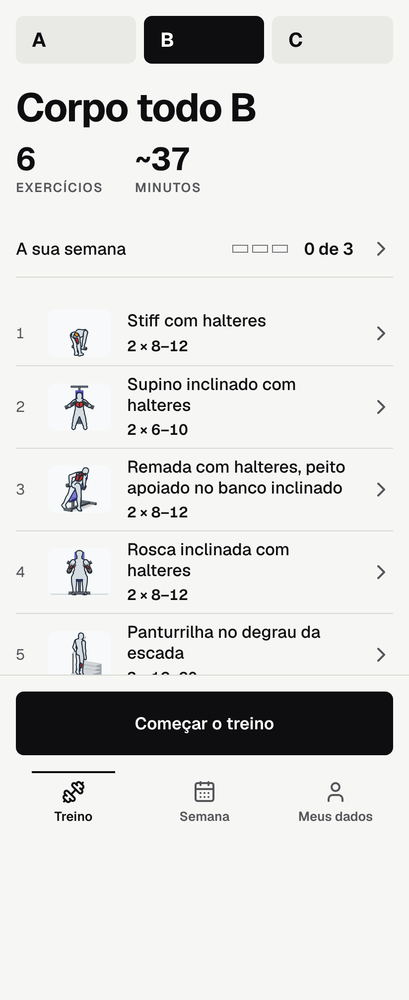

# Análise crítica do treino-mvp

19/11/2026. Só diagnóstico: nada foi alterado no app.

## Em uma frase

**Hoje o treino-mvp é um bom caderno de treino para quem já decidiu usá-lo, e ainda não é um app que um desconhecido entende, termina de configurar e volta a abrir: ele perde a pessoa na porta, entrega pela metade o que tem de mais próprio (o guia animado) e não faz nada para trazê-la de volta.**

A boa notícia vem junto: a parte mais difícil de construir (o registro durante o treino, o descanso, a segurança, a acessibilidade) está bem feita. Os três maiores problemas são de **entrada, entrega e volta**, não de motor.

## Como ler este relatório

- **Fato** é o que vi, medi ou li no código. **Opinião** é o que acho. Estão separados.
- **Confiança:** alta, média ou baixa, em cada achado.
- As provas estão em [`diario-de-uso.md`](diario-de-uso.md) (o uso com 4 personas e as medidas), [`mercado.md`](mercado.md) (a comparação com outros apps, com links) e [`capturas/`](capturas/).

### O que foi avaliado, e em que versão

| O quê | Versão |
|---|---|
| Uso do app (fases 1 e 2) | `main` em `ece5f79` (18/11), versão de produção |
| A `main` durante a análise | Andou até `b55a98b` (19/11). Em telas, mudou só um ajuste de 9 linhas no cartão de texto |
| Animações | Ramo `claude/great-dirac-cabwvh`, em `0bd04a4` (19/11), a pedido do Gustavo no meio da análise. É o boneco novo. Esse ramo ainda não está na `main` |
| App no ar | Responde, mas não confirmei de qual versão ele é |
| Linha de base | `npm run check`: 1.040 testes passam, em 1 min 26 s |

### Corrigido depois da revisão do Gustavo (19/11)

Ao preparar o plano de melhorias, li mais código e achei quatro pontos em que este relatório estava incompleto. Estão corrigidos no texto e marcados com "(corrigido)". Nenhum muda a ordem do ranking.

1. **A volta.** O app tem, sim, uma mensagem para quem volta ("Faz 22 dias do último treino..."), mas só a partir de **14 dias** sem treino (`src/domain/acompanhamento/volta.ts:23-28`). Meu teste foi com 9 dias, e por isso não a vi.
2. **A semana.** A partir da 2ª semana de uso aparecem quadradinhos das "últimas semanas" e uma lista "Subiu nesta semana". A frase "6 de 8 semanas com treino" existe só para leitor de tela (`src/features/acompanhamento/Semana.tsx:79`). Eu só usei uma semana.
3. **Recordes.** O fim do treino mostra recordes e cargas que subiram (`src/features/treino/Resumo.tsx:59`). Não apareceram nos meus dois treinos porque as primeiras séries de cada exercício são de acerto de carga e não contam.
4. **A contagem de toques do projeto.** O teste automático confere "até 11 toques" e pula a tela de equipamento (`tests/e2e/onboarding.spec.ts:151-169`). Os meus 13, 21 e 24 contam tudo.

As decisões do Gustavo e o plano que saiu delas estão em [`decisoes-e-plano.md`](decisoes-e-plano.md).

### Os limites, ditos de saída

1. **Nenhuma pessoa de verdade usou o app nesta análise.** As personas são minhas. Onde só gente resolveria a dúvida, eu digo e proponho o teste mais simples.
2. **Nenhum celular de verdade.** Usei um navegador simulando telas. O Safari do iPhone não foi testado. O que digo sobre som, vibração e tela bloqueada vem do código e de fontes, não de um aparelho na mão.
3. **Li as notas do Gustavo antes da hora.** Elas vinham no mesmo texto do pedido. Gravei o meu ranking no histórico antes de escrever sobre elas ([`rascunho-ranking.md`](rascunho-ranking.md)), e cada linha dele tem uma prova que eu mesmo colhi. Mas não posso dizer que cheguei "às cegas".

---

# Os 3 principais

## 1. A porta: o app pede um inventário antes de mostrar qualquer coisa

### O problema, em linguagem simples

O app promete "treine onde estiver, com o que tiver". Quem treina numa academia completa entra em 13 toques. Quem treina no prédio ou em casa, que é justamente a pessoa da promessa, toca em "Gerar meu programa" e recebe uma lista de perguntas: se o banco declina, qual é o halter mais pesado, quantas "manoplas" tem, quantas anilhas de cada peso. E a tela de abertura, antes disso, não diz o que a pessoa vai ganhar.

### A prova

| | Academia completa | Prédio | Casa |
|---|---|---|---|
| Toques da abertura até ver o programa | **13** | **21** | **24** |
| Perguntas extras depois de "Gerar meu programa" | 0 | 4 | 6 ou mais |

- **Fato:** a folha abre com erros em vermelho ("Use um número maior que zero.") em campos que a pessoa ainda não viu. Eles nascem do toque em "Gerar meu programa" e não somem enquanto ela preenche (`src/features/onboarding/Inventario.tsx:252-259`).
- **Fato:** só "Academia completa" vem com valores típicos preenchidos (`src/domain/taxonomia/atalhos.ts:99`). Um teste fixa que os outros atalhos perguntem tudo (`tests/unit/inventario-form.test.ts:205`).
- **Fato:** o atalho de casa supõe halter de montar. Quem tem um par de halteres comuns precisa desfazer o atalho.
- **Fato:** a abertura não tem nome, e a primeira informação depois do título é um aviso.

  

- **Fato:** não existe "nunca treinei". Quem nunca treinou marca "parei há mais de 6 meses" e passa a ser tratado como quem volta de uma pausa (ver o item 6 do ranking).

### Quem sofre, e em que momento

Todo mundo, nos primeiros 10 segundos (a abertura). E, no segundo minuto, quem não treina numa academia completa. É o público que o plano descreve: "produto para quem treina com equipamento limitado" (`docs/PLANO-MVP.md:8`).

### O melhor argumento a favor de como está

O programa depende desses números. Sem saber que o halter vai até 10 kg, o app pode prescrever 14. Por isso a decisão registrada: "Os detalhes que mudam o programa continuam sendo perguntados" (`docs/devlog.md:446`). E o aviso vem primeiro porque "o que é de segurança não se esconde" (`docs/devlog.md:1911`).

### Por que, mesmo assim, deveria mudar

- A pessoa ainda não viu nada do app. Ela não tem por que fazer um inventário para um produto que não conhece.
- O próprio critério de sucesso do projeto deixou essa tela de fora da conta: "até 1 min e até 15 toques, **sem contar a tela de equipamento**" (`docs/PLANO-MVP.md:30`). O que não é medido não é cobrado.
- O erro de chutar o equipamento é barato de corrigir depois: na hora de anotar a carga, a pessoa já escolhe numa lista. O erro de perder a pessoa na porta não se corrige.
- O diagnóstico do redesenho já pedia outra abertura: "uma frase, o Boneco em movimento (é o produto) e o 'Começar'" (`docs/revisoes/frontend-novo/diagnostico.md:63`). Não foi o que ficou. E em 16/11 saiu dela a única frase que dizia o que a pessoa recebe (`docs/revisoes/textos/proposta.md:46`).

### Por que é mais grave que o 4º (o descanso que não avisa)

O 4º incomoda quem já está treinando com o app. Este impede que a pessoa chegue a treinar. E atinge em cheio o público da promessa.

### Duas propostas

| | A mais barata | A ideal |
|---|---|---|
| **O que é** | Os atalhos "Prédio" e "Casa" passam a vir com valores típicos, como a "Academia completa" já vem. O programa sai na hora. Os detalhes viram um ajuste que o app pede depois, quando importar ("Seu halter mais pesado é 10 kg? Ajustar"). O atalho de casa supõe halteres comuns. Entra a opção "Nunca treinei". A abertura ganha uma frase do que a pessoa recebe e o boneco se mexendo. | "Treino primeiro, perguntas depois": lugar e dias, e o programa aparece. O app aprende o equipamento durante os primeiros treinos, uma pergunta de cada vez, na hora em que ela faz sentido. |
| **Custo** | **Pequeno a médio.** O mecanismo de valores típicos já existe e já aceita halteres e banco. Falta criá-lo para anilhas e elásticos e reescrever um teste. | **Médio a grande.** Muda o cadastro e o primeiro treino. |
| **Risco** | Prescrever uma carga que a pessoa não tem. Reduz-se mostrando só cargas prováveis e perguntando na primeira vez que ela escolher. | O mesmo, mais o de mexer em telas que hoje funcionam. |
| **O que contraria** | A decisão de `devlog.md:446` e o teste que a fixa. | O mesmo. |

A triagem de saúde é outro muro na mesma porta. Ela está à parte (item 7) porque atinge menos gente e a decisão não é só de produto.

### Como saber se melhorou

- **Medida automática:** toques até o programa, nos quatro atalhos. Hoje 13, 21, 24. Meta: 15 ou menos em todos, **contando** a tela de equipamento. **(corrigido)** O teste que já existe confere "até 11 toques" e pula essa tela (`tests/e2e/onboarding.spec.ts:151-169`); é ele que precisa passar a contá-la.
- **Teste com gente:** 5 pessoas que nunca viram o app, cada uma com o seu equipamento. Só observar: quantas chegam ao programa sem ajuda, e em quanto tempo.

**Confiança:** alta nos fatos; média no tamanho do estrago, que só o teste com gente mede.

---

## 2. O guia animado, que é o que o app tem de seu, não chega inteiro a quem treina

### O problema, em linguagem simples

O boneco que mostra o movimento é a razão para escolher este app em vez de um caderno. Mas ele falha em dois lugares. Primeiro: quase metade dos exercícios não tem boneco nenhum, e são os mais comuns de academia. Segundo: durante o treino, o boneco é pequeno demais para ensinar, e não aumenta quando a pessoa toca.

### A prova

**Cobertura (fato):**

- Dos 171 exercícios, **90 têm animação** na `main`. Os 81 sem animação incluem **todos os de barra e todos os de máquina**: agachamento com barra, supino com barra, leg press, cadeira extensora, cadeira flexora, puxada pela frente, voador.
- Na academia completa, isso dá 21 de 34 exercícios animados no programa da persona exigente (5 dias) e 6 de 9 no da persona de 55 anos (2 dias). O primeiro exercício do primeiro dia da exigente já vem sem animação.
- No treino, o exercício sem animação deixa um vazio no lugar do boneco:

  

- **O que mais chama a atenção:** no ramo das animações há **169 aprovadas**, mas o catálogo continua ligando só 90. As 79 novas estão prontas, aprovadas e invisíveis. Abri o app desse ramo: o agachamento com barra continua com o ícone de folha.

  

  E elas são boas:

  

**Tamanho no treino (fato, medido):**

| Tela | Exemplo | Altura do boneco | Abas do guia |
|---|---|---|---|
| 375 × 667 | iPhone SE atual, iPhone 8 | **70 pontos** | não aparecem |
| 390 × 664 | iPhone 13/14 no Safari (aproximação) | 86 | não aparecem |
| 360 × 740 | Android comum | 133 | não aparecem |
| 412 × 839 | Pixel 7 | 134 | aparecem |

- As legendas do boneco saem com letra de **8 pontos** em todas as telas.
- Tocar no boneco **pausa**. Não existe modo ampliado dentro do treino (`src/features/treino/PalcoTreino.tsx:176`). Para ver grande, a pessoa acha o ícone de livro e sai da tela do treino.
- Em telas baixas, o rótulo da fase cobre a cabeça do boneco:

  

**A qualidade do desenho não é o problema.** Na amostra de 18 animações do boneco novo, o ângulo principal ensina em 18 de 18. A tabela completa está no diário.

### Quem sofre, e em que momento

O iniciante, diante de um exercício que nunca fez, com o peso na mão. E qualquer pessoa numa academia, em 4 de cada 10 exercícios.

### O melhor argumento a favor de como está

- **Cobertura:** "Exercício sem animação aprovada aparece como um cartão textual, nunca com uma animação improvisada" (`CLAUDE.md`). É um princípio correto, e eu o manteria.
- **Tamanho:** o redesenho trouxe o boneco para dentro da tela de treino (antes ele era "uma miniatura de 112 px e o guia mora em outra tela", `diagnostico.md:9`) e escolheu de propósito: "em celular baixo é o Boneco que encolhe, nunca o registro" (`proposta.md:318`). Faz sentido: registrar é a ação que se repete.

### Por que, mesmo assim, deveria mudar

- O princípio protege a qualidade, e a qualidade está aprovada. O que falta é o último passo: ligar.
- "O boneco encolhe" é uma boa regra para o tamanho de **repouso**. Não precisa ser a regra para quando a pessoa **pede para ver**. Hoje ela não tem como pedir sem sair do treino.
- Os documentos dizem que a tela "larga a legenda, depois as abas e, por fim, o palco inteiro (nunca um Boneco cortado)" (`docs/devlog.md:1858`). A medida mostra o boneco cortado a 375 × 667. O próprio devlog diz por quê: "nada foi medido num aparelho de verdade" (`docs/devlog.md:1991`).

### Por que é mais grave que o 4º

É o diferencial. Sem ele, o app compete em registro com aplicativos que têm relógio na tela de bloqueio, conta e relógio de pulso. E, para o iniciante, não saber fazer o exercício não é um incômodo: é o fim do treino.

### Duas propostas

| | A mais barata | A ideal |
|---|---|---|
| **O que é** | (a) Juntar o ramo das animações e ligar as 79 aprovadas. (b) Tocar no boneco abre o guia grande **por cima** do treino, com um "fechar"; a pausa vira um botão. (c) Corrigir o rótulo que cobre a cabeça. | O descanso vira a hora de aprender. A tela de descanso tem espaço sobrando: mostrar ali, grande, o movimento da **próxima** série. E, na primeira vez de cada exercício, abrir com o boneco grande antes do registro. |
| **Custo** | **Médio.** Ligar é pequeno; juntar um ramo de 315 commits, 84 atrás da `main`, é o que pesa. O guia grande já existe como tela; falta abri-lo por cima. | **Médio.** Mexe na tela de descanso, que é a melhor do app. |
| **Risco** | A junção do ramo. O app fica mais pesado para baixar (a lista do que guarda para funcionar sem internet passa de 3,9 MB para 6,3 MB). | Estragar a clareza do descanso. |
| **O que contraria** | Nada. Cumpre "Qualidade do guia". | Reinterpreta `proposta.md:318`, sem revogar. |

### Como saber se melhorou

- **Medida automática:** parcela de exercícios com animação nos programas das personas de academia. Hoje cerca de 60%. Meta: 95% ou mais.
- **Medida automática:** altura do boneco quando ampliado. Meta: metade da tela ou mais.
- **Teste com gente:** 3 pessoas que nunca fizeram um exercício. Olham o boneco **sem sair do treino** e fazem. Alguém que entende de treino diz se fizeram certo.

**Confiança:** alta.

---

## 3. Nada traz a pessoa de volta

### O problema, em linguagem simples

O app não tem como chamar a pessoa (não manda aviso nenhum) e, quando ela volta sozinha depois de uma semana, não a recebe. O fim do treino entrega três números e uma lista de cargas. A tela da semana é uma planilha.

### A prova

- **Fato:** fim do treino: "10 séries, 2 minutos, 6 exercícios", "A sua semana 1 de 3", e "Calibrar · próxima: 2 kg".
- **Fato:** a semana mostra "Ombro (posterior) 0,5 de 3,5 · mantendo". Meia série.
- **Fato (corrigido):** simulei a volta 9 dias depois. O app abre no programa, com "0 de 3", sem nenhuma palavra sobre a ausência nem sobre o último treino. Existe uma mensagem de volta, mas ela só aparece com 14 dias ou mais (`src/domain/acompanhamento/volta.ts:23`). Quem falta uma semana, que é o caso mais comum, não é recebido.
- **Fato:** não há notificação em parte alguma do código, nem botão de compartilhar.
- **Fato:** o projeto não mede se as pessoas voltam. A medição com testadores está como "Não feito" (`docs/backlog.md:146`).
- **Ordem de grandeza (fonte vista só pelo resumo):** em apps de saúde e exercício, algo entre 3% e 8% das pessoas ainda usam o app no 30º dia. Ver [`mercado.md`](mercado.md).

### Quem sofre, e em que momento

Todos os que passaram pela porta, no dia seguinte e na semana seguinte.

### O melhor argumento a favor de como está

É uma decisão pensada, e eu a respeito: "**Motivação sem manipulação.** Sem sequência, medalha, confete ou notificação. O que mantém é o registro, a meta e o retorno sobre o próprio progresso" (`docs/revisoes/redesign/proposta.md:47`). E: "nunca uma sequência que zera. Sem vermelho e sem 'você falhou'" (`docs/devlog.md:623`). Além disso, um aviso com o app fechado "só vem por push de servidor, o que quebra o 'tudo no aparelho'" (`docs/revisoes/frontend-novo/referencias.md:432`).

### Por que, mesmo assim, deveria mudar

- A decisão juntou duas coisas diferentes: **manipular** (culpa, sequência que zera) e **avisar** (hoje é dia de treino). Recusar a primeira não obriga a recusar a segunda.
- A pesquisa do próprio projeto diz que, em aplicativos, "mensagens de texto e personalização foram componentes significativamente mais eficazes" (`docs/pesquisa-v2/24-objetivos-e-adesao.md:66`). Isso não foi implementado.
- "O retorno sobre o próprio progresso, que o app já faz" **(corrigido)**: nas duas primeiras semanas, que é quando a pessoa decide se fica, ele quase não aparece. A evolução de um exercício é uma linha de texto, a semana é uma tabela de séries por músculo, e os recordes só começam a contar depois das séries de acerto de carga. Os quadradinhos das últimas semanas só surgem na 2ª semana.
- O que o app tem de bom para mostrar ("1 de 3 treinos", as semanas com treino) está certo e sem culpa. Só está enterrado: a frase "6 de 8 semanas com treino" existe apenas para leitor de tela (`src/features/acompanhamento/Semana.tsx:79`).

### Por que é mais grave que o 4º

O 4º estraga minutos de um treino. Este decide se haverá um segundo treino. E atinge todo mundo.

### Duas propostas

| | A mais barata (sem servidor, sem conta) | A ideal |
|---|---|---|
| **O que é** | (a) **Fim do treino em palavras:** "2º treino da semana. Falta 1." e o que melhorou desde a última vez. (b) **Recepção na volta:** "Seu último treino foi há 9 dias. Hoje é o B." (c) **A semana abre pelas semanas**, e a tabela de músculos vai para uma gaveta. (d) **Um cartão do treino** para mandar pelo WhatsApp, pelo botão de compartilhar do celular. (e) **"Quando é o próximo?"** cria um compromisso na agenda do próprio celular. Quem lembra é a agenda, não o app. | **Aviso de verdade** ("hoje é dia de B"), que exige um servidor pequeno só para mandar o aviso, ou um aplicativo de loja. |
| **Custo** | **Pequeno cada um; médio no conjunto.** Os dados já existem no aparelho. | **Grande.** Servidor, permissão, e no iPhone só funciona com o app instalado na tela de início. |
| **Risco** | O tom escorregar para a culpa. A regra "sem vermelho e sem 'você falhou'" continua valendo. | Sair um endereço de aviso do aparelho. Não é dado de saúde, mas deixa de ser "nada sai daqui". |
| **O que contraria** | Em parte, `redesign/proposta.md:47` (a comemoração). Não contraria a privacidade. | "Tudo no aparelho" e "sem servidor". É uma decisão do Gustavo, com preço. |

### Como saber se melhorou

Hoje não há como, e isso faz parte do problema. O mais simples, sem ferir a privacidade:

- Pedir a 5 ou 10 pessoas do grupo de família e amigos que mandem, depois de 3 semanas, a cópia que o app já sabe gerar (o projeto já tem um leitor: `npm run ler-export`). Contar treinos por semana.
- Ou só perguntar: "você abriu na segunda semana? Por quê?"

**Confiança:** alta nos fatos; média no efeito das propostas.

---

# O ranking completo

**Critério da ordem:** o quanto faz alguém do público geral desistir ou não voltar, vezes quantas pessoas afeta. O custo não entra na ordem: está na coluna.

| # | Problema | Frente | Gravidade | Quem afeta | Prova | Custo de mudar | Confiança |
|---|---|---|---|---|---|---|---|
| 1 | **A porta:** inventário antes de ver o programa; abertura que não diz o que se ganha | Produto, usabilidade | Alta | Todos na abertura; quem não está em academia completa no inventário | 13, 21 e 24 toques; capturas `trava-*` | Pequeno a médio | Alta |
| 2 | **O guia não chega inteiro:** 81 de 171 sem animação (79 prontas e não ligadas); boneco de 70 a 134 pontos no treino, que não amplia | Animação, usabilidade | Alta | Todos; mais o iniciante e quem treina em academia | Contagem do catálogo; tabela de tamanhos | Médio | Alta |
| 3 | **Nada traz de volta:** sem aviso, sem recepção, fim sem recompensa, semana em planilha | Produto | Alta | Todos os que passaram pela porta | Capturas do fim, da semana, da volta | Pequeno a médio (barata); grande (ideal) | Alta nos fatos |
| 4 | **O descanso não avisa fora do app.** No iPhone no silencioso, é provável que nem dentro | Funcionamento | Alta para quem treina; não impede o treino | Quem mexe no celular no descanso: quase todos | `Temporizador.tsx:87-113, 172-180`; fontes em `mercado.md` | Pequeno (remendo); grande (resolver) | Alta no código; **média no efeito real, falta o teste no aparelho** |
| 5 | **O app fala a língua de quem já treina e não explica na hora:** "RIR", "2 × 8–15", "Calibrar", "acerto da carga", "mantendo" | Conteúdo | Média a alta | Iniciantes, em quase toda tela | Lista de textos no diário | Pequeno | Alta |
| 6 | **A primeira sessão do iniciante dá sinais errados:** a carga cai mesmo dentro da meta; quem nunca treinou é tratado como quem volta de pausa e recebe 1 série | Treino | Média a alta | Iniciantes | `calibracao.ts:19-21,50`; `gerador/index.ts:2241` | Pequeno | Alta |
| 7 | **A triagem de saúde para quem responde a verdade** e abre com uma caixinha | Produto | Alta para quem cai nela | Quem tem qualquer condição; é comum depois dos 50 | Captura `triagem-pausa-p3` | Pequeno no código; a decisão é que pesa | Alta nos fatos |
| 8 | **Ninguém de fora usou, e nada foi medido num celular de verdade** | Processo | Alta, por ser a causa de vários outros | Indireto: todos | `2026-11-diagnostico.md:18`; `backlog.md:419`; `devlog.md:1991` | Pequeno (uma semana) | Alta |
| 9 | **Sem nome e sem cara** nas telas de entrada | Estética | Média | Todos, na primeira impressão | Abertura; o app se chama "treino-mvp" | Pequeno a médio | Média (é o item mais próximo de gosto) |
| 10 | **O treino parece curto para quem tem tempo:** pediu 75 minutos, recebe dias de 36 a 65 | Treino | Média | Experientes com tempo | Programa da P2; `backlog.md:382` | Médio | Média |
| 11 | **Trocar de celular ou limpar o navegador apaga tudo**, salvo cópia manual | Funcionamento | Alta quando acontece; rara | Poucos, mas perdem meses | Meus dados; `PLANO-MVP.md:16` | Grande para resolver de vez | Alta |
| 12 | **Três respostas para marcar a 1ª série** de cada exercício | Usabilidade | Baixa a média | Todos, uma vez por exercício | 5 toques medidos | Pequeno | Média |
| 13 | **O segundo ângulo de várias animações não ensina** | Animação | Baixa a média | Quem troca de ângulo | 8 de 18 na amostra | Médio | Média |
| 14 | **O peso de manter:** 166 regras, 951 documentos, 67 mil linhas de teste para 9 mil de telas, 55 ramos | Processo | Baixa para o usuário hoje; alta para a velocidade | Indireto | Contagens abaixo | Sem custo: é parar de somar | Média |
| 15 | Miudezas: evolução sem gráfico; "Avisar um problema" que depende de "quem te passou o link"; rótulo de evidência em avisos que não têm número; "Versão ece5f79" | Vários | Baixa | Poucos | Diário | Pequeno | Alta |

## Notas sobre os itens 4 a 14

**4. O descanso que não avisa.** O aviso de fim é: três bipes, uma vibração e a tela que inverte. Não há notificação. Na volta, o relógio está certo, e com o app aberto a tela não apaga: isso está bem feito. O que falta é avisar quem saiu. O melhor argumento a favor: avisar com o app fechado exige servidor, e o app é um site por ser "estático, barato, rápido" (`PLANO-MVP.md:68`). O preço dessa escolha é que os concorrentes mostram o descanso na própria tela de bloqueio, e um site não consegue. **Um teste de 5 minutos decide a gravidade:** num iPhone e num Android, começar um descanso de 1 minuto, bloquear a tela, anotar se tocou e se vibrou; repetir com o iPhone no silencioso. Se no iPhone no silencioso nada avisar nem com o app aberto, este item sobe para o 3º lugar.

- *Barata:* ao começar o descanso, mostrar uma notificação parada com a hora do fim ("Descanso até 14:32"). Ela não toca no fim, mas fica visível na tela de bloqueio. E trocar o bipe por um som que não dependa da chave do silencioso.
- *Ideal:* aviso por servidor, ou aplicativo de loja. É a mesma decisão do item 3.

**5. A língua.** A decisão de 16/11 (tirar das telas o nível de evidência e a fonte) tem um bom motivo: "Ninguém lê 295 palavras entre uma série e outra" (`devlog.md:2095`). **Concordo com ela.** O que saiu junto, e não precisava, foi o porquê em uma linha, na hora da dúvida. O glossário existe e é bom; está a três toques. Proposta: quatro frases curtas, nos quatro lugares onde a dúvida nasce ("2 séries de 8 a 15 repetições"; "sobrando 3 ou 4"; "semana leve: metade das séries"; "baixei a carga porque...").

**6. A primeira sessão do iniciante.** Dois achados que só o código explicou:

- **A carga cai dentro da meta.** A tela mostra uma meta larga (8 a 15 repetições, sobrando 3 ou 4). Por dentro, o app só aceita o meio dela (`src/domain/progressao/calibracao.ts:19-21,50`). Quem faz 8 repetições sobrando 3 está dentro do que a tela mostra, e o app baixa a carga: 6, depois 4, depois 2 kg. E 8 é o número que a tela já traz preenchido. A pesquisa do projeto admite que os números dessa regra "são do projeto" (`docs/pesquisa-v2/07-progressao-e-acompanhamento.md:126`).
- **Quem nunca treinou recebe 1 série.** Sem a opção "nunca treinei", a pessoa marca "parei há mais de 6 meses" e entra na regra de volta de pausa: 55% das séries, e 2 viram 1 no arredondamento (`src/domain/gerador/index.ts:2241`). O texto fala da "carga que você usava antes da pausa". Isso contraria uma regra do próprio projeto ("série única não é padrão").

Os dois são regras testadas, não acidentes. Mas ninguém as viu com olhos de iniciante.

**7. A triagem.** O melhor argumento é sério: "a prescrição de exercício é atribuição do profissional de educação física (CONFEF)" (`PLANO-MVP.md:209`). E o projeto sabe que o bloqueio é mais rígido que o questionário em que se inspira (`docs/pesquisa-v2/23-dor-pressao-alta-e-gestacao.md:9`). O que critico é o resultado: a tela para quem é honesto e abre com uma caixinha para qualquer um. Uma análise anterior já disse isso: "rígido demais [...] e fraco demais (2 toques e passou)" (`2026-11-diagnostico.md:76`). **Não proponho afrouxar por conta própria**: é uma decisão do Gustavo, de preferência com um profissional. Proponho o que já está pedido e parado: uma terceira saída para quem ainda não foi avaliado (`pedidos-ao-dominio.md:17`). Sobre quanta gente cai aqui: resumos de busca apontam que perto de metade das pessoas de 55 a 64 anos referem pressão alta ([tabela na Revista de Saúde Pública](https://scielosp.org/pdf/rsp/2009.v43suppl2/98-106/en)); **não li a fonte**, confiança baixa no número.

**8. Ninguém de fora, nenhum aparelho.** Está escrito nos próprios documentos: "Até hoje, nenhuma pessoa além do Gustavo usou o app" (`2026-11-diagnostico.md:18`); "o público principal, por agora, é o Gustavo" (`PLANO-MVP.md:6`); nenhum dos 8 critérios de "pronto" mede o uso por outra pessoa; "nada foi medido num aparelho de verdade" (`devlog.md:1991`). Os itens 1, 2, 5 e 6 são do tipo que cinco pessoas mostram em uma tarde.

**9. Nome e cara.** A direção "Placar" tem bons motivos: números grandes ajudam na academia, e tirar a cor resolve a disputa com o boneco (`frontend-novo/proposta.md:58-60`). **Onde ela trabalha, funciona:** o descanso é a tela mais própria do app. Onde não há número grande (abertura, cadastro, Meus dados), sobra cinza sobre cinza, e o custo que a própria proposta previu aparece: "o preto e branco pode parecer frio para quem está começando" (`proposta.md:52`). Não proponho trocar a direção. Proponho dar ao app um **nome**, uma **voz** nos textos e o **boneco na abertura**. O nome está adiado "até a validação com usuários" (`backlog.md:189`); a validação não começa bem sem nome.

**14. O peso de manter.** Fatos:

| O quê | Quanto |
|---|---|
| Telas (`src/features`) | 9.084 linhas |
| Testes | 67.279 linhas |
| Documentos | 951 arquivos, 109 mil linhas |
| Regras | 166: 7 "robusta", 28 "moderada", 15 "um estudo", **116 "consenso"** |
| Ramos no repositório | 55 |
| O ramo das animações | 315 commits à frente da `main`, 84 atrás |
| Devlog | 2.141 linhas |
| Backlog | 510 linhas, cerca de 315 itens, **sem ordem de prioridade** |

O melhor argumento a favor desse jeito de construir: o app é feito em sessões que não lembram umas das outras, e os documentos e testes são a memória. Isso deu resultado onde há certo e errado verificável: acessibilidade, velocidade, funcionar sem internet.

Onde ele falha: **os testes e os documentos guardam decisões, não acertos.** Há um teste garantindo que o atalho de casa pergunte as anilhas. Há um teste garantindo a regra que baixa a carga do iniciante. Há um documento dizendo "nunca um Boneco cortado" enquanto a tela corta o boneco. Sete das 166 regras são "robustas" pelo critério do próprio projeto; o resto é juízo, o que é normal em treino, mas não justifica tanta máquina em volta. **Opinião:** o próximo ganho não vem de mais uma auditoria. Vem de uma semana olhando gente usar.

---

# O que não mexer

Está bom e deve ser protegido. Digo uma vez, com a prova.

| O quê | Prova |
|---|---|
| **O registro a partir da 2ª série:** um toque | 35 toques para 10 séries, numa sessão inteira |
| **A tela de descanso:** relógio enorme, o que vem a seguir, a série seguinte num toque | `capturas/treino-descanso-p1.png` |
| **"Senti algo":** separa "encerra o treino" de "encerra este exercício"; não diagnostica | `capturas/senti-algo-p1.png` |
| **Trocar exercício:** três opções e "prefiro este" | `capturas/trocar-exercicio-p1.png` |
| **Entrar sem conta, sem e-mail, sem pagar** | Dos apps comparados, os que têm fonte pedem conta ou assinatura (ver `mercado.md`) |
| **Acessibilidade** | 0 falhas no verificador em 5 telas; áreas de toque com 44 pontos ou mais |
| **Funciona sem internet; abre rápido** | Programa, treino e guia abrem sem rede; nota 100 de desempenho |
| **Modo escuro e movimento reduzido** | `capturas/treino-modo-escuro.png` |
| **A tela não apaga no treino; o relógio conta pela hora do fim** | `Temporizador.tsx:19-46, 117` |
| **O desenho do boneco novo** | O ângulo principal ensina em 18 de 18 |
| **Os quatro atalhos de equipamento** (a tela; o que vem depois é o problema) | `capturas/equipamento-atalhos-p1.png` |
| **O tom sem culpa** ("nunca uma sequência que zera") | `devlog.md:623` |
| **A decisão de 16/11** de tirar nível de evidência e fonte das telas | As telas ficaram legíveis |
| **O botão "Guardar uma cópia"** e o lembrete depois de 3 treinos | `src/domain/dados/index.ts:46-54` |

---

# Problemas que reaparecem

O que análises anteriores já tinham apontado e continua aí. Problema que volta é sinal forte.

| Problema | Onde já tinha sido dito | Situação |
|---|---|---|
| **Exercícios sem animação** | `2026-11-diagnostico.md:95` (01/11); `auditoria-fable.md:59` ("Mais de um terço das prescrições sem animação", 04/11); `proximos-passos.md:134` (06/11) | "Restam 81 exercícios em cartão de texto" (`backlog.md:215`). Três análises, o mesmo achado |
| **A triagem como barreira** | `auditoria-fable.md:243`; `2026-11-diagnostico.md:76` | Adiada (`backlog.md:39`, `:99`, `:263`) |
| **"RIR" e o jargão** | `auditoria-fable.md:254`; `pedidos-ao-dominio.md:10` | Pendente (`backlog.md:100`, `:145`, `:429`) |
| **O inventário comprido** | `2026-11-diagnostico.md:60` ("27 toques"), `:80` ("lembrar quais pesos de anilha tem") | Atalhos entraram; os detalhes continuam obrigatórios |
| **O boneco pequeno** | `2026-11-diagnostico.md:146`; `auditoria-fable.md:172`; `backlog.md:423` | O Placar o trouxe para o treino, mas a 70–134 pontos |
| **Nenhum usuário além do dono** | `2026-11-diagnostico.md:18`, `:232` (era a 1ª recomendação) | Trocado por decisão: "o público principal é ele mesmo" (`:373`) |
| **Nada testado em aparelho de verdade** | `auditoria-fable.md:5` ("Não testei num celular de verdade"); `backlog.md:419` | "[ ] Teste num iPhone" continua aberto (`devlog.md:1053`) |
| **Tempo abaixo do pedido** | `2026-11-diagnostico.md:61`; `proximos-passos.md:96` | Melhorou; resta "Quem tem muito tempo fica com dias curtos" (`backlog.md:382`) |
| **Sem canal nem medida com quem testa** | `2026-11-diagnostico.md:62` | "Avisar um problema" entrou; a medição, "Não feito" (`backlog.md:146`) |
| **A abertura** | `frontend-novo/diagnostico.md:63` pedia frase, boneco e botão | Ficou sem o boneco e, desde 16/11, sem a frase |

**O que nunca tinha aparecido** em nenhuma análise nem no backlog: o descanso que não avisa fora do app; ampliar o guia dentro do treino; a falta de nome e de cara; compartilhar ou competir; e o custo do próprio processo. Três desses cinco estão nas notas do Gustavo. **Quem treina com o app vê o que as auditorias não viram.**

---

# As notas do Gustavo, uma a uma

Sobre ter chegado "sozinho": ver a ressalva no começo. Para cada nota digo se tenho prova própria.

| Nota | Tenho prova própria? | Concordo? | Muda a ordem? |
|---|---|---|---|
| **1. A apresentação inicial e o formulário são pouco cativantes, com "cara de app" estranha** | Sim: abertura sem nome e sem promessa; inventário; triagem como primeira pergunta | **Concordo, e acho que é mais grave do que a nota diz.** Não é só pouco cativante: para quem treina em casa, é uma trava | Não. Já é o 1º |
| **2. Pouca personalidade, meio genérico** | Sim: sem nome; ícone de halter; cinza nas telas sem número | **Concordo em parte.** No descanso e no boneco o app tem cara. Falta na entrada | Não. Fica em 9º: pesa na primeira impressão, mas ninguém desiste só por isso |
| **3. A animação pequena não abre maior ao tocar; tenho de sair para ver** | Sim: medi de 70 a 134 pontos; o toque só pausa (`PalcoTreino.tsx:176`) | **Concordo totalmente.** | Não. É metade do 2º. A nota não fala da outra metade, que acho maior: as 79 animações prontas e não ligadas |
| **4. Não apita nem avisa se eu não estiver com ele aberto** | Em parte: li no código que não há notificação; não consegui testar num aparelho | **Concordo.** | **Pode mudar.** Está em 4º. Se o teste de 5 minutos mostrar que no iPhone no silencioso nada avisa, sobe para 3º |
| **5. As páginas do treino são claustrofóbicas, apertadas** | Sim: 15 controles e cerca de 400 letras numa tela; em 320 × 568 não cabe | **Concordo, com uma precisão:** o aperto vem de a tela pedir três respostas e ainda guardar o boneco. O descanso, logo depois, é o contrário: sobra espaço | Não. Está dentro do 2º e do 12º |
| **6. Muita linguagem técnica, como "exportar os dados"** | Sim: 20 textos listados | **Concordo, com uma correção:** o botão já diz "Guardar uma cópia". "Exportar meus dados (JSON)" continua na folha seguinte. Os piores não são esse: são "RIR", "Calibrar", "mantendo" | Não. É o 5º |
| **7. O ritmo da animação em alguns ângulos não é natural e é impreciso** | Em parte: em 8 de 18, o segundo ângulo falha. Não vi o movimento correndo, só quadros | **Concordo quanto aos ângulos; discordo que seja ritmo.** Os tempos estão coerentes. O que soa estranho é o ângulo que olha na direção do movimento: o membro parece encolher | Não. É o 13º. O ângulo principal ensina em todas |
| **8. Usar Strava e as plataformas de bem-estar como referência; competição entre amigos** | Sim, na pesquisa de mercado | **Concordo com o problema que a ideia ataca** (o 3º). Sobre a solução, ver abaixo | Não muda a ordem; muda as propostas do 3º |

## A competição entre amigos, a sério

**Que problema ela resolveria.** O 3º: nada traz a pessoa de volta. É um problema real e provado.

**O que a evidência diz.** Há estudos em que a comparação com os outros fez as pessoas aparecerem mais (vistos só pelo resumo; ver [`mercado.md`](mercado.md)). **Todos medem frequência, passos ou corrida. Nenhum mede carga na musculação.** O que a evidência sustenta é competir por **aparecer**.

**Os riscos.**

- **Competir por peso levantado.** Não achei estudo ligando isso a lesão em iniciantes; digo por juízo. O app inteiro se apoia em a pessoa dizer a verdade sobre quanto ainda aguentava. Um placar de carga paga para mentir e para pôr peso antes da hora. Bate de frente com o princípio de segurança.
- **Dois princípios.** "Tudo fica no aparelho" e "sem login, nuvem nem recursos sociais".
- **Outro produto.** Feed, seguidores e comentários pedem conta, servidor e moderação.

**Existe uma versão que preserva a privacidade? Sim.**

| | Versão sem conta e sem servidor | Versão completa |
|---|---|---|
| **O que é** | Um **cartão da semana** ("3 de 3 treinos · 5ª semana seguida"), que a pessoa manda no grupo do WhatsApp pelo botão de compartilhar do celular. O grupo é o placar. Um passo além: o cartão leva um link que, aberto no app do amigo, põe aquela pessoa numa lista "esta semana". | Conta, servidor, placar automático, convites. |
| **Só frequência?** | Sim: treinos na semana e semanas seguidas. Nunca carga. | A decidir. |
| **O que sai do aparelho** | Só o que a pessoa escolhe mandar, na hora, para quem ela escolhe. | Dados de treino de todos, num servidor. |
| **Custo** | **Pequeno a médio.** | **Grande.** E traz deveres de proteção de dados. |
| **O que contraria** | "Sem recursos sociais", na letra. A privacidade, não. | Os dois princípios. |

**Meu parecer.** Vale testar a versão sem servidor, só por frequência, no grupo de família e amigos que já usa o app. Se em 4 semanas as pessoas mandarem o cartão sem ninguém pedir, a ideia provou que tem força, e aí faz sentido discutir o preço da versão completa. Se ninguém mandar, economizou-se um servidor. **Não vale abrir mão do princípio antes desse teste.**

**Sobre usar Strava e as marcas de bem-estar como referência.** O que dá para aprender sem copiar: contar **semanas**, não dias (o Strava e o Hevy fazem assim, e combina com o "sem culpa" daqui); um gesto simples de reconhecimento; um cartão bonito do que foi feito. O que não dá para copiar: a personalidade dessas marcas vem de fotografia, de atletas e de treinadores com nome. A daqui tem de vir do que já é próprio: o boneco, o relógio gigante, e um nome.

---

# Perguntas para o Gustavo

Só as decisões que são suas e que mudam a ordem ou as propostas.

**Respondidas em 19/11.** As respostas e o plano que saiu delas estão em [`decisoes-e-plano.md`](decisoes-e-plano.md).

1. **Para quem é o app agora?** O plano ainda diz "o público principal, por agora, é o Gustavo". Se continuar assim, os itens 1 e 3 perdem peso e o 2 e o 4 sobem. Este ranking supõe desconhecidos.
2. **O app pode chutar o equipamento e corrigir depois?** É o que destrava o item 1. Contraria uma decisão registrada e um teste.
3. **Você aceita um servidor pequeno só para mandar avisos, ou um aplicativo de loja?** Sem um dos dois, o descanso nunca vai avisar com o celular bloqueado, e o app nunca vai lembrar ninguém de treinar. O preço é o "nada sai do aparelho" na forma absoluta.
4. **O ramo das animações entra antes de qualquer outra coisa?** São 315 commits e 79 animações prontas. Quanto mais tempo fora, mais difícil juntar.
5. **A triagem fica como está até um profissional revisar?** Se sim, peço ao menos a terceira saída ("ainda não fui avaliado").
6. **O app ganha um nome agora?** Ele está adiado "até a validação com usuários", e a validação é o próximo passo.
7. **Você topa parar de construir por uma semana para ver 5 pessoas usando?** E fazer o teste de 5 minutos do descanso, num iPhone e num Android?
8. **Você topa testar o cartão da semana no grupo da família, só por frequência?**

---

# Texto sugerido para o devlog

Para colar em `docs/devlog.md`, se fizer sentido.

> ## Análise crítica do app inteiro (19/11/2026)
>
> Um crítico independente usou o app como desconhecido, com quatro personas, antes de ler os documentos do projeto. Depois leu o projeto por dentro, comparou com sete aplicativos e respondeu às minhas anotações de treino. Não mudou nada no app. Está em `docs/revisoes/analise-critica/`.
>
> **O veredito:** o app é um bom caderno de treino para quem já decidiu usá-lo, e ainda não é um app que um desconhecido entende, termina de configurar e volta a abrir.
>
> **Os três principais:**
>
> 1. **A porta.** Quem treina em casa ou no prédio precisa fazer um inventário (halter mais pesado, anilhas) antes de ver o programa: 21 e 24 toques, contra 13 na academia completa. E a abertura não diz o que a pessoa vai ganhar.
> 2. **O guia não chega inteiro.** 81 dos 171 exercícios não têm animação, e são os de barra e de máquina. Há 79 animações aprovadas num ramo que ainda não foram ligadas. No treino, o boneco tem de 70 a 134 pontos de altura e não aumenta ao toque.
> 3. **Nada traz de volta.** O app não avisa, não recebe quem volta, e o fim do treino são três números.
>
> **O que está bom e fica:** o registro com um toque a partir da 2ª série, a tela de descanso, o "Senti algo", a acessibilidade, o funcionamento sem internet, e o tom sem culpa.
>
> **O que mais me fez pensar:** três análises anteriores já tinham apontado os exercícios sem animação, e nenhuma tinha visto o descanso que não avisa fora do app nem a animação que não aumenta. Isso eu vi treinando. O próximo passo não é outra auditoria: é ver cinco pessoas usando, e testar o descanso num celular de verdade.
>
> **Limites da análise:** nenhuma pessoa e nenhum aparelho de verdade; o Safari do iPhone não foi testado.
>
> *Rascunho de post:* "Pedi uma crítica sem gentileza do app que estou construindo. O que mais doeu: 79 animações prontas que ninguém vê, e uma porta de entrada que pede um inventário de anilhas a quem só queria treinar em casa."
