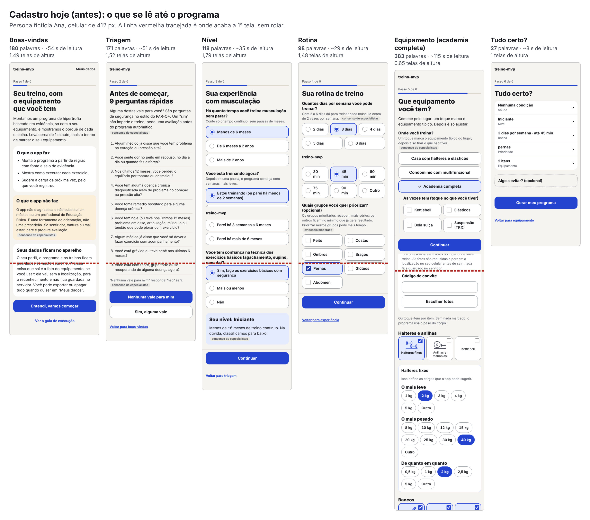

# Design v3: menos leitura no começo (03/11/2026)

> Pedido do Gustavo, depois de abrir no celular a reformulação visual: a 1ª tela "é só um texto corrido"; na triagem "você tem que ficar lendo primeiro tudo para depois falar que nenhuma vale"; a experiência ainda pede leitura demais. Prompt da sessão: `prompts/sessao-design-agentes.md`.
>
> **Nada mudou no app.** O que existe é a medida do antes, as propostas de cada papel e um protótipo navegável com 3 direções: canvas "treino-mvp · design v3 (menos leitura)" (https://claude.ai/artifact/PdXKbEBrRtfnFe8CL9bSZk), fonte em `revisoes/design-v3/canvas/`.
>
> **Como foi feito.** Um agente líder e 4 subagentes em paralelo: pesquisa de UX, estrutura e interação, texto e visual. Os papéis 2 e 5 foram juntados, e o 6 (medição) e o 8 (protótipo) ficaram com o líder, para gastar menos. O guardião das regras (papel 7) revisou a síntese no fim. As entregas de cada papel estão em `revisoes/design-v3/`: `pesquisa.md`, `estrutura.md`, `interacao.md`, `textos.md`, `visual.md` e `medidas.md`.
>
> Selos como em `pesquisa/00-metodo.md`. O que é opinião está marcado **[opinião]**. Todos os números de "depois" são contagem sobre o protótipo, não medida com gente.

## Em uma frase
O problema não é acessibilidade técnica (0 toque pequeno e 0 contraste baixo em todas as telas), é **quantidade de texto e de rolagem**: até o programa, a pessoa encontra de 860 a 980 palavras, e o botão da 1ª tela, da triagem e do nível fica fora da vista. As 3 direções cortam a 1ª tela para 50 a 70 palavras, com o botão à vista, e fazem a triagem caber em telas que se leem de relance, **sem tirar nenhuma das 9 condições nem nenhum critério** (prazos de 12 e 6 meses, "receitado", "pode piorar com exercício", "dito por um médico").

## 1. O antes (medido)

| Tela | Palavras | Leitura | Altura | Botão principal sem rolar? |
|---|---:|---:|---:|---|
| Boas-vindas | 180 | ~54 s | 1,49 telas | não (a 130% da altura) |
| Triagem | 171 | ~51 s | 1,52 | não (a 125%, de propósito) |
| Nível | 118 | ~35 s | 1,79 | não (a 158%) |
| Rotina | 98 | ~29 s | 1,48 | — |
| Equipamento ("academia completa") | 383 | ~115 s | 6,65 | sim (fixo) |
| Tudo certo? | 27 | ~8 s | 1 | sim |
| **Até o programa** | **~860 a 980** | **4,3 a 4,9 min** | | 13 a 17 toques |

Detalhes em `design-v3/medidas.md` (script `scripts/design/palavras.spec.ts`, 412 e 360 px, claro e escuro).

**O que está bom hoje e fica:** o sistema visual da v2 (letra, cores, toques de 48 px ou mais); uma pergunta por tela no começo do nível e da rotina; "academia completa" com valores típicos; 0 caractere digitado; o "Tudo certo?" curto; todas as regras de segurança.

## 2. O que a pesquisa trouxe de novo (resumo de `pesquisa.md`)
| Achado | Selo |
|---|---|
| "Sim ou não" em cada item faz a pessoa pensar em cada um e marcar mais que "marque o que se aplica"; uma lista com um botão "nenhuma" no fim funciona como o "marque o que se aplica" (Smyth et al. 2006; Callegaro et al. 2015, que também alerta para a aquiescência). | moderada |
| Quando falta motivação, a pessoa escolhe a primeira resposta aceitável (satisficing); a triagem vem antes de qualquer recompensa, o pior momento para leitura longa (Krosnick 1991). | robusta |
| Numa lista vertical, o olho pula opções, e as últimas são as menos lidas (Höhne e Lenzner 2015). | um estudo |
| Quando a pessoa pode responder "nenhuma", o padrão de governo põe a opção por último, depois de um "ou", com um rótulo que repete a pergunta (GOV.UK, *Checkboxes*). | consenso |
| Papel e tela dão o mesmo resultado em questionários de saúde; o PAR-Q+ brasileiro foi respondido em parte on-line (Schwartz 2021). | robusta (formato) |
| Leitura silenciosa de texto informativo: ~238 palavras/min em inglês (Brysbaert 2019); em pt-BR há só um estudo pequeno (Messias 2008). Os 200/min das contas são prudentes. | moderada / um estudo |
| Só 35% dos adultos brasileiros estão nos níveis intermediário ou proficiente de letramento (INAF 2024): frase curta, ordem direta, palavra do dia a dia. | moderada |
| Aviso repetido vira papel de parede (habituação); 74% pulam a política de privacidade (Obar 2018). | moderada; um estudo |

**Ponto que muda a conversa:** o atalho "Nenhuma vale para mim" é o formato que **mais** convida a não ler. O PAR-Q+ pede sim ou não em cada pergunta (texto de 2025 NÃO VERIFICADO: o PDF foi bloqueado na rede). Por isso as 3 direções tratam a triagem de jeitos bem diferentes, e a decisão é sua.

## 3. As 3 direções (no protótipo, navegáveis, claro e escuro, com o antes embaixo)

| | **Direção 1 · Três linhas e três blocos** | **Direção 2 · Boneco e uma por tela** | **Direção 3 · Caminho e lista curta** |
|---|---|---|---|
| **1ª tela** | Título e 3 linhas com ícone: o que faz, "Não é consulta médica" (a frase inteira, com o selo) e "Seus dados ficam só neste aparelho". | O Boneco grande em cima (um quadro do motor, sem mudança), título, uma frase e duas linhas: não diagnostica (frase inteira, selo) e dados no aparelho. "Como funciona" abre o resto. | "Seu treino pronto em 4 passos": saúde, você, equipamento, seu treino; embaixo, as mesmas duas linhas de segurança e dados. |
| Palavras na 1ª tela (hoje 180) | **71** | **52** | **72** |
| Botão à vista sem rolar | sim, fixo embaixo | sim, fixo embaixo | sim, fixo embaixo |
| **Triagem** | **3 telas de 3 condições** (coração e circulação; doenças e remédios; agora ou recente). Em cada uma: "Sim, alguma destas" e "Nenhuma destas", do mesmo tamanho e peso. "Sim" abre Sim/Não só nas 3 daquela tela. | **Uma condição por tela**, em letra grande, com Sim e Não lado a lado; o toque responde e segue. Não há "nenhuma". | **Uma tela com as 9**, em 3 grupos com ícone. No fim da lista: "Sim, alguma destas vale", depois um "ou", e "Não tenho nenhuma destas". "Sim" leva às 9 com Sim/Não, como hoje. |
| Palavras por tela da triagem (hoje 171 numa tela de 1,52 alturas) | 54 a 66, sem rolar | 19 a 31 | ~134, ~1,2 alturas **[a medir]** |
| Toques de quem não tem nada (hoje 1) | 3 | 9 | 1 |
| Risco de responder sem ler **[opinião]** | baixo a médio | médio (9 "não" viram ritmo) | médio a alto (uma decisão para 9) |
| Mais perto do PAR-Q+ | médio | **o mais fiel** (sim ou não em cada uma) | o mais distante (como hoje) |
| Muda regra? | **sim**: `seguranca.triagem.nenhuma` (o "nenhuma" vale por bloco) e `.texto` | **sim**: `seguranca.triagem.nenhuma` (o atalho some) e `.texto` | **só** `seguranca.triagem.texto` (o "nenhuma" continua um toque, no fim da lista) |

As 1ªs telas e as triagens podem ser combinadas: por exemplo, a 1ª tela da direção 2 com a triagem da direção 1.

**Descartado:** "Marque o que vale" (cada condição é uma linha que se marca; o botão diz "Nenhuma vale para mim" sem nada marcado). É o mais rápido (1 toque, ~18 s), mas as condições não marcadas viram "não" sem a pessoa responder, e quem tem uma condição não responde as outras 8. Fica registrado em `interacao.md`, formato D.

**Recomendação do líder [opinião]: direção 1.** Para quem não tem nada, são 3 toques em vez de 1, mas é o único formato em que a pessoa vê as condições e os botões juntos, sem rolar, e decide 3 vezes sobre 3 frases curtas em vez de 1 vez sobre 9 frases longas. A direção 2 é a escolha se a prioridade for a fidelidade ao PAR-Q+. A direção 3 é a que menos muda regra.

### O texto das 9 condições (o mesmo nas 3 direções)
Cada condição começa pela palavra-chave, em negrito, e termina com o critério inteiro. Soma: de 118 para 90 palavras. Nenhum critério sai. A tabela completa, com o que se perderia em cada corte que **não** foi proposto, está em `textos.md`, seção 2.1.

| # | Hoje | Proposta |
|---:|---|---|
| 1 | Algum médico já disse que você tem problema no coração ou pressão alta? | **Problema no coração ou pressão alta**, dito por um médico |
| 2 | Você sente dor no peito em repouso, no dia a dia ou quando faz esforço? | **Dor no peito**: parado, no dia a dia ou no esforço |
| 3 | Nos últimos 12 meses, você perdeu o equilíbrio por tontura ou desmaiou? | **Desmaio, ou tontura com perda de equilíbrio**, nos últimos 12 meses |
| 4 | Você tem alguma doença crônica diagnosticada além de problema no coração ou pressão alta? | **Outra doença crônica** diagnosticada, além de coração ou pressão |
| 5 | Você toma remédio receitado para alguma doença crônica? | **Remédio receitado** para doença crônica |
| 6 | Você tem hoje (ou teve nos últimos 12 meses) problema em osso, articulação, músculo ou tendão que pode piorar com exercício? | **Problema em osso, articulação, músculo ou tendão** que pode piorar com exercício, agora ou nos últimos 12 meses |
| 7 | Algum médico já disse que você só deveria fazer exercício com acompanhamento? | **Um médico disse** para você só treinar com acompanhamento |
| 8 | Você está grávida ou teve bebê nos últimos 6 meses? | **Gravidez, ou parto** nos últimos 6 meses |
| 9 | Você está com febre, gripe forte ou se recuperando de alguma doença agora? | **Febre, gripe forte** ou se recuperando de alguma doença, agora |

Na direção 2, cada tela usa o rótulo como pergunta ("Dor no peito?") e o critério inteiro logo abaixo; o rótulo nunca aparece sozinho.

## 4. O resto do cadastro (comum às 3 direções; de `estrutura.md` e `interacao.md`)
| # | Mudança | Efeito estimado | Regra |
|---:|---|---|---|
| C1 | **Nível em 3 telas**, uma pergunta cada; o toque responde e segue (a marca fica à vista 0,3 s; "voltar" desfaz). O resultado ("Iniciante", com o motivo e o selo) aparece no "Tudo certo?". | 118 → ~90 palavras, 0 rolagem, 4 → 3 toques | só tela |
| C2 | **A pergunta de técnica só aparece quando pode mudar o nível** (com menos de 6 meses, ou parado há mais de 6 meses, o nível já sai iniciante; a técnica não é usada em mais nada). | −1 toque para quem começa | só tela (a técnica fica em branco no dado salvo) |
| C3 | **Rotina em 2 telas** (dias; minutos), com avanço automático. | 98 → ~52 palavras, 4 → 2 toques | só tela |
| C4 | **A prioridade vira linha opcional no "Tudo certo?"**, como já é o "Algo a evitar?". | −46 palavras para quem não prioriza; quem prioriza faz 2 toques a mais | só tela |
| C5 | **Equipamento em 2 passos:** "Onde você treina?" (5 cartões, inclusive "pela foto"), depois os ajustes daquele lugar. | academia: 383 → ~70 palavras, 0 rolagem, toques iguais | só tela (`equipamento.atalhos` igual) |
| C6 | **A frase da foto** (reduzida, sem localização, nada no servidor) **fica só na tela da foto**, antes do envio. A 1ª tela diz só "seus dados ficam neste aparelho". | −45 palavras na 1ª tela | só tela |
| C7 | **Regiões e dor de hoje** (quem diz sim em osso ou articulação) em telas próprias; a explicação do efeito da nota vai para o "Tudo certo?"; o aviso de avaliação fica na tela da nota. | ~89 → ~56 palavras | **muda regra (leve)**: `seguranca.triagem.osteoarticular`, `seguranca.dor.programa` |
| C8 | **Selo de uma palavra** ("consenso"), com o nome inteiro só para leitor de tela; **um selo por bloco de regra**, não por frase; tocar abre a regra e a fonte. | −2 palavras por selo | só tela (o selo não some) |
| C9 | **Botão principal sempre embaixo**, também na 1ª tela (na direção 3, os botões da triagem ficam no fim da lista). | o botão sempre à vista | só tela |
| C10 | **Glossário único:** "reserva" (no lugar de RIR na tela), "treino", "perguntas de saúde". | — | só tela |

**Contas do fluxo inteiro (direção 1, estimativa de `estrutura.md`):** "academia completa" de 13 toques e ~980 palavras para **12 toques e ~460 palavras**; "monto a lista" de 17 toques e ~860 palavras para **17 e ~550**; com sim em osso ou articulação, de 25 toques e ~1.260 palavras para **19 e ~550**. A rolagem cai de até 7,8 telas para 0 nas telas de pergunta. O ganho é de leitura e rolagem, quase nada de toques.

## 5. O resto do app (para a rodada seguinte)
Os textos e o visual de "Seu treino", treino, guia, fim e semana têm propostas curtas em `textos.md` (seção 4), `interacao.md` (seção 4) e `visual.md` (seção 5): menos selos repetidos, uma linha de aviso por tela, o mesmo glossário. Ficam para depois do cadastro, como o prompt pede.

## 6. Conflitos entre os papéis e como o líder resolveu
| Conflito | Decisão do líder |
|---|---|
| Menos toques (atalho "nenhuma") × menos leitura forçada (sim ou não em cada uma) | Não decido: são as 3 direções, para você escolher. |
| "Uma cor só para ação" (v2) × botões iguais na triagem | Na triagem não há resposta "certa": os dois botões ficam com o mesmo peso (contorno). O azul cheio fica para "Continuar". |
| Texto curto × evidência visível | O selo fica em toda regra mostrada, com uma palavra; a explicação e a fonte ficam a um toque. "No estilo do PAR-Q+" fica numa linha com o selo, no pé da triagem. |
| Rótulo curto × condição completa | O rótulo nunca aparece sozinho: é o começo em negrito da frase inteira (direções 1 e 3) ou a pergunta com o critério logo abaixo (direção 2). |
| Privacidade enxuta × aviso antes da triagem | A 1ª tela diz que os dados ficam no aparelho; a frase da foto fica onde a foto é enviada. |
| Ordem das condições (os grupos trocam de lugar a 6ª e a 7ª) | Aceito: o número da pergunta não aparece mais na tela, e o dado salvo usa o nome da condição, não a posição. |

## 7. Parecer do guardião das regras
*(preenchido na revisão: seção abaixo)*

## 8. Para decidir (item a item, nada marcado)
Para cada item: entra, não entra, ou entra de outro jeito.

| # | Item | Muda regra? |
|---:|---|---|
| 1 | 1ª tela: direção 1 (três linhas), 2 (Boneco) ou 3 (caminho em 4 passos) | só tela |
| 2 | Triagem: direção 1 (três blocos), 2 (uma por tela) ou 3 (lista curta, "nenhuma" no fim) | **sim** (1 e 2 mudam `seguranca.triagem.nenhuma`) |
| 3 | O texto novo das 9 condições, com a palavra-chave primeiro e os mesmos critérios | **sim** (`seguranca.triagem.texto`) |
| 4 | Os dois botões da triagem com o mesmo peso | só tela |
| 5 | "No estilo do PAR-Q+" e as explicações num "Por que estas perguntas?", com um selo no pé | só tela |
| 6 | Selo de uma palavra, um por bloco de regra (C8) | só tela |
| 7 | A frase da foto só na tela da foto (C6) | só tela |
| 8 | Nível em 3 telas com avanço automático (C1) | só tela |
| 9 | Pular a pergunta de técnica quando ela não muda o nível (C2) | só tela |
| 10 | Rotina em 2 telas (C3) | só tela |
| 11 | Prioridade como linha opcional no "Tudo certo?" (C4) | só tela |
| 12 | Equipamento em 2 passos, com "pela foto" como um dos cartões (C5) | só tela |
| 13 | Regiões e dor de hoje em telas próprias (C7) | **sim (leve)** |
| 14 | Glossário único (C10) | só tela |
| 15 | Metas que viram teste: 1ª tela com até 75 palavras e o botão à vista a 360 px; nenhuma tela de pergunta do cadastro rolando a 412 px; até o programa com até 500 palavras ("academia completa"); toque e contraste como hoje | — |

## 9. Riscos e o que não sei
- **Sem teste com gente.** O protótipo serve para você usar com uma mão e cronometrar. A pesquisa sugere testar as direções 1 e 3 com 5 pessoas de leitura variada e contar quem diz "não" sem ler.
- **Mais "sim" pode bloquear mais gente sem precisar.** Perguntar sim ou não em cada uma (direções 1 e 2) tende a aumentar os "sim" (Callegaro 2015). O acompanhamento só para quem diz sim, como no PAR-Q+, segura esse custo; a triagem com perguntas de acompanhamento continua no backlog.
- **LGPD:** a frase de privacidade encurta na 1ª tela. O dado de saúde é sensível (art. 11); antes de abrir o app para outras pessoas, vale uma leitura jurídica.
- **Domínios bloqueados nesta sessão:** o formulário PAR-Q+ 2025 (southlake.ca), o estudo do BLS (census.gov) e a validação de 2011 (hfjc.library.ubc.ca).
- **Textos em `src/domain/`** têm testes que conferem a frase: mudar o texto exige ajustar esses testes.

## Fontes desta rodada
As referências completas estão em `design-v3/pesquisa.md` (seção "Fontes"); as da v2 continuam em `design-v2.md`.
