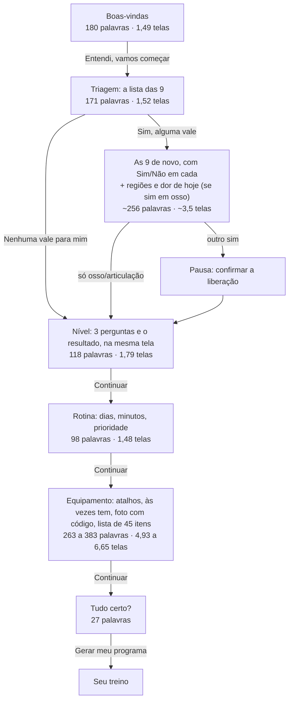
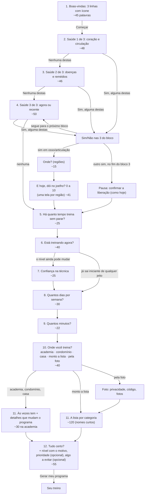

# Estrutura do cadastro (design v3, papel 2: arquitetura da informação)

> Que telas existem, em que ordem, o que cada uma pede e o que pode sumir, juntar ou ir para depois. As medidas de hoje vêm de `medidas-claro.json` (celular de 412 px). As do "depois" são **estimativas** feitas sobre os rascunhos desta proposta: o texto final é do papel 3 (redação), e as medidas de verdade só saem do protótipo.
>
> **Como conto:** palavras = tudo o que está escrito na tela (títulos, opções, botões, selos). Tempo = palavras lidas a 200 por minuto + 1 s por toque **[opinião]** (a mesma aproximação do `palavras.spec.ts`). Toques contados como em `medidas-claro.json`: a prioridade "Pernas" conta como 1 toque no "hoje". Os toques de "Voltar" não contam. "Rolagem" = quanto a tela passa de uma altura de tela (1,49 telas = 0,49 de rolagem).

## Em uma frase
Hoje são 6 telas longas que pedem 4,6 a 5,1 minutos de leitura. A proposta troca por 12 telas curtas, uma pergunta cada, sem rolagem: **menos da metade das palavras, os mesmos toques ou menos, e quem tem uma condição de saúde deixa de ler as 9 perguntas duas vezes.**

## 1. O fluxo de hoje

### O que pesa hoje
- **Boas-vindas:** três caixas de texto corrido. O botão fica a 130% da altura da tela, fora da vista. A privacidade aparece aqui e de novo na foto.
- **Triagem:** a condição fica no meio de frases longas ("Algum médico já disse que você tem problema no coração..."). Não dá para varrer com os olhos. Quem tem alguma condição lê a lista e depois **as mesmas 9 frases de novo**, com Sim/Não: ~427 palavras só na triagem.
- **Nível:** três perguntas que aparecem uma a uma, mas na mesma tela, que cresce até 1,79 telas. O resultado e o "quer começar mais leve?" ficam no fim, antes do botão.
- **Rotina:** a prioridade é opcional, mas vem com uma explicação técnica que todo mundo lê.
- **Equipamento:** quatro coisas numa tela só (atalhos, "às vezes tem", foto com código de convite e a lista de 45 itens). Quem toca "Academia completa" precisa só de "Continuar", mas a tela passa a ter 383 palavras e 6,65 telas de altura, porque a lista inteira aparece marcada.

## 2. O fluxo proposto

A triagem acima usa o formato **A, "Três blocos"**, o que eu recomendo **[opinião]**. Os outros formatos estão em `interacao.md`, seção 2. No fim da seção 4 está a conta com o formato D ("Marque o que vale"), o mais rápido.

A barra de progresso mostra 5 etapas (saúde, experiência, rotina, equipamento, confirmar), não "Passo 7 de 12". Dentro de cada etapa ela anda um pouco a cada tela. Progresso que parece lento piora a experiência (Conrad et al. 2010, **um estudo**, citado na v2).

## 3. Mudança a mudança

| # | O que muda | Por quê | Efeito estimado | Regra |
|---:|---|---|---|---|
| E1 | **Boas-vindas em 3 linhas com ícone:** o que faz, como mostra e o que não faz (não diagnostica; se sentir dor ou tontura, pare), com o selo. Uma linha curta: "Seus dados ficam só neste celular." "Saiba mais" abre o texto de hoje inteiro. "Começar" fixo embaixo. | Mostrar primeiro o essencial e deixar o resto num 2º nível (NN/g, *progressive disclosure*, **consenso**, citado na v2). | 180 → ~45 palavras; 1,49 → 1 tela; o botão fica à vista. | **só tela.** O "não diagnostica" continua dito, com o selo `seguranca.sem-diagnostico`. |
| E2 | **A frase completa da privacidade sai da 1ª tela** e fica só onde a foto é enviada (a tela da foto já tem). Na 1ª tela fica uma linha. | A pessoa precisa saber disso **antes de mandar a foto** (regra 4 do briefing), não necessariamente na 1ª tela. | −45 palavras na 1ª tela. | **só tela.** |
| E3 | **"Ver o guia de execução" sai da 1ª tela** e vai para o "Saiba mais". | Na 1ª visita, é uma saída do cadastro **[opinião]**. | −5 palavras, 1 tocável a menos. | **só tela.** |
| E4 | **Triagem em 3 blocos de 3**, cada um numa tela, com "Nenhuma destas" e "Sim, alguma destas". Cada condição começa pela palavra-chave em destaque ("**Dor no peito.** Parado, no dia a dia ou no esforço."). Quem diz "sim" num bloco responde Sim/Não só nas 3 dele. | Ler 3 frases curtas antes de responder é rápido. Hoje a pessoa lê 9 frases longas para dar uma resposta. | Ver a seção 4 e `interacao.md`. | **muda regra** (`seguranca.triagem.nenhuma`: o "nenhuma" passa a valer por bloco; `seguranca.triagem.texto`: o texto muda). Decisão do Gustavo. |
| E5 | **Regiões e dor de hoje em telas próprias**, uma pergunta por tela. A explicação do efeito da nota ("acima de 5 fica de fora...") sai da tela da nota e aparece no "Tudo certo?", que já mostra o efeito com o selo. O aviso "dor forte, que piora ou dura mais de 1 a 2 semanas pede avaliação" **fica** na tela da nota. | Uma coisa por tela (GOV.UK, **consenso**, citado na v2). | ~89 → ~56 palavras nessas perguntas. | **muda regra (leve)**: muda o que a pessoa vê ao dar a nota (`seguranca.triagem.osteoarticular`, `seguranca.dor.programa`). Decisão do Gustavo. |
| E6 | **Nível em 3 telas**, uma pergunta cada, com avanço automático no toque. O resultado ("Iniciante: menos de ~6 meses de treino contínuo", com o selo) e o "começar num nível mais leve" vão para o "Tudo certo?". | Hoje a tela cresce até 1,79 telas e repete as respostas no resultado. | 118 → ~90 palavras em 3 telas sem rolagem; 4 → 3 toques (some o "Continuar"). | **só tela** (`nivel.classificacao` igual; a pessoa ainda pode baixar o nível). |
| E7 | **A pergunta de técnica só aparece quando ela pode mudar o nível.** Com menos de 6 meses de treino, ou parado há mais de 6 meses, o nível sai "iniciante" de qualquer jeito (`classificarNivel`), e a técnica não é usada em mais nada (conferido no código). | Não perguntar o que não muda o resultado. | −1 toque e ~25 palavras para quem começa (a Ana). | **só tela**, com um ajuste no dado salvo (a técnica fica em branco). O programa não muda. |
| E8 | **Rotina em 2 telas:** dias e minutos, com avanço automático. "Outro" abre o campo numérico e aí pede "Continuar". | Uma pergunta por tela. | 98 → ~52 palavras; 4 → 2 toques. | **só tela.** |
| E9 | **A prioridade sai da rotina e vira uma linha opcional no "Tudo certo?"** ("Prioridade: nenhuma ›"), como já é o "Algo a evitar?". A explicação técnica vai junto, para quem abrir. | É opcional, e hoje todo mundo lê a explicação. Sem escolha, o gerador já trata todos os grupos igual. | −46 palavras para quem não prioriza. Quem prioriza: 1 → 3 toques (abrir, marcar, voltar). | **só tela** (`volume.semanal.minimo-eficaz` igual; o padrão "nenhuma" já existe). |
| E10 | **Equipamento em 2 passos.** 1º: "Onde você treina?" com 5 cartões grandes (academia completa, condomínio, casa, monto a lista, pela foto). 2º: depende do cartão. Academia, condomínio e casa mostram os "às vezes tem" e os detalhes que mudam o programa, com "Ajustar item por item" num link. "Monto a lista" abre a lista de hoje, sem os atalhos e a foto em cima. | Hoje são 4 coisas numa tela de até 6,65 alturas. | Academia: 383 → ~70 palavras em 2 telas, 0 rolagem, 2 toques (igual). Lista: 263 → ~160 palavras, 3,9 → ~2,2 rolagens, 6 → 7 toques (+1, o cartão "Monto a lista"). | **só tela.** `equipamento.atalhos` continua igual: nada vem marcado, os "às vezes tem" aparecem desmarcados, os detalhes continuam perguntados (salvo na academia, como hoje). |
| E11 | **A foto vira um caminho próprio** (cartão "pela foto"): a tela tem a frase da privacidade, o código de convite e "Escolher fotos". As sugestões confirmadas caem na lista. | Hoje o campo de código aparece para todos, inclusive para quem não tem código. | −40 palavras para quem não usa a foto. | **só tela.** |
| E12 | **"Tudo certo?" ganha 2 linhas:** o nível com o motivo e o selo, e a prioridade (opcional). "Gerar meu programa" fixo embaixo. | Recebe o que saiu das outras telas. | 27 → ~55 palavras. | **só tela.** |

### O que eu **não** recomendo
- **Nível numa pergunta só.** Daria 1 toque em vez de 3, mas perde a pausa, que define a readaptação (`readaptacao.gatilho`), ou a técnica, que pode baixar o nível. **Muda regra** (`nivel.classificacao`, `readaptacao.gatilho`) e piora o programa de quem voltou de uma pausa. O ganho (2 toques) é pequeno. O E7 já tira a pergunta quando ela não serve.
- **"Academia completa" sem a tela dos "às vezes tem".** Pouparia 1 toque, mas `equipamento.atalhos` diz que eles aparecem. **Muda regra.**
- **Prioridade só depois do programa** (em "Meus dados"). Tira a escolha do cadastro e obriga a gerar de novo. A linha opcional no "Tudo certo?" custa o mesmo para quem não usa **[opinião]**.

## 4. As contas: antes × depois

### Os três caminhos (formato A na triagem)

| Caminho | | Telas | Toques | Palavras | Rolagem somada | Tempo, se ler tudo |
|---|---|---:|---:|---:|---:|---:|
| **Academia completa** | hoje | 6 | 13 (12 sem prioridade) | ~977 | 7,9 | ~5,1 min |
| | proposta | 12 | 12 (11 com o E7) | ~456 | 0 | ~2,5 min |
| **Monto a lista** (halteres de 1 a 12 kg e banco reto) | hoje | 6 | 17 (16 sem prioridade) | ~857 | 6,2 | ~4,6 min |
| | proposta | 12 | 17 (16 com o E7) | ~546 | ~2,2 | ~3,0 min |
| **Sim em osso/articulação** (joelho, dor 4 hoje; academia completa) | hoje | 7 | 25 | ~1.258 | ~10,4 | ~6,7 min |
| | proposta | 14 | 19 (18 com o E7) | ~545 | 0 | ~3,0 min |

Notas: no "hoje", a tela do formulário da triagem (Sim/Não nas 9, regiões e nota) não está no JSON; ~256 palavras e ~3,5 telas são contagem minha sobre o código (`Triagem.tsx`). Os toques da proposta não contam a prioridade (ela vai para o "Tudo certo?"; quem quiser, +3).

### Palavras por tela (proposta, academia completa)

| # | Tela | Palavras | Toques | Cabe sem rolar? |
|---:|---|---:|---:|---|
| 1 | Boas-vindas (3 linhas) | ~45 | 1 | sim |
| 2 | Saúde 1 de 3 | ~48 | 1 | sim |
| 3 | Saúde 2 de 3 | ~46 | 1 | sim |
| 4 | Saúde 3 de 3 | ~50 | 1 | sim |
| 5 | Há quanto tempo treina | ~25 | 1 | sim |
| 6 | Está treinando agora | ~40 | 1 | sim |
| 7 | Técnica (some com o E7, quando não serve) | ~25 | 1 | sim |
| 8 | Dias por semana | ~30 | 1 | sim |
| 9 | Minutos | ~22 | 1 | sim |
| 10 | Onde você treina | ~40 | 1 | sim |
| 11 | Às vezes tem (academia) | ~30 | 1 | sim |
| 12 | Tudo certo? | ~55 | 1 | sim |
| | **Total** | **~456** | **12** | |

No caminho "monto a lista", a tela 11 vira a lista: ~120 palavras (quase todas nomes de 1 ou 2 palavras, que se varrem), 6 toques e ~3,2 telas de altura. No caminho com condição, entram "Onde?" (~15 palavras, 2 toques) e "E hoje, dói no joelho?" (~41 palavras, 1 toque), e o bloco 3 ganha Sim/Não nas 3 condições (+4 toques).

### Com o formato D na triagem ("Marque o que vale", 1 tela)
| Caminho | Telas | Toques | Palavras | Tempo |
|---|---:|---:|---:|---:|
| Academia completa | 10 | 10 | ~439 | ~2,4 min |
| Monto a lista | 10 | 15 | ~529 | ~2,9 min |
| Sim em osso/articulação | 12 | 14 | ~520 | ~2,8 min |

O D é o mais rápido, mas tem o maior risco de a pessoa responder sem ler (`interacao.md`, seção 2).

### Leitura dos números
- **O ganho grande é em leitura e rolagem, não em toques.** Na academia, os toques caem de 13 para 12; as palavras caem 53%; a rolagem vai a zero.
- **Mais telas, cada uma mais leve.** 12 telas parecem mais que 6 no papel. Com uma pergunta por tela e o toque que segue sozinho, cada tela leva 5 a 15 s **[opinião]**. A barra por etapas evita o "Passo 7 de 12".
- **Quem tem condição ganha mais:** de 25 para 19 toques e de ~6,7 para ~3,0 minutos, porque não relê as 9.

## 5. A 1ª tela: três estruturas

O papel 3 escreve o texto e o 4 desenha. Aqui só o esqueleto.

| Nome | Como é | Palavras | Regra |
|---|---|---:|---|
| **Três linhas** (recomendada **[opinião]**) | Título curto. Três linhas, cada uma com um ícone: monta com o seu equipamento (com a fonte), mostra como fazer, **não diagnostica** (e "se sentir dor ou tontura, pare") com o selo. Uma linha: "Seus dados ficam só neste celular." "Começar" fixo; "Saiba mais" abre o texto de hoje. | ~45 | só tela |
| **Direto ao ponto** | Título, uma frase e "Começar" (~15 palavras). O "não diagnostica" vai para o topo da triagem, onde a pessoa está pensando em saúde. A privacidade, para a foto. | ~15 | só tela, mas o registro do aceite do aviso (`avisoAceitoEm`) passa a ser gravado na triagem: decisão do Gustavo |
| **Mostrar e dizer** | Em cima, a imagem de um treino pronto (o cartão do dia com o Boneco parado). Embaixo, as 3 linhas em letra menor. "Começar" fixo. | ~35 | só tela |

## 6. Riscos e o que eu não sei
- **Os números da proposta são estimativas** sobre rascunhos. Precisam ser medidos no protótipo com o mesmo `palavras.spec.ts` (papel 6).
- **Mais telas podem parecer mais longas** se o avanço automático não for imediato ou se a barra de progresso andar devagar. Precisa de teste com gente.
- **Encurtar a triagem é mudança de regra** em todos os formatos. Os rascunhos dos textos estão em `interacao.md`, seção 2.4, e mantêm cada condição e cada qualificação ("nos últimos 12 meses", "pode piorar com exercício", "há menos de 6 meses").
- **O E7 muda o dado salvo** (a técnica fica em branco quando não é perguntada). O esquema (`storage/esquema.ts`) precisaria aceitar isso.

## Conflitos com outros papéis
1. **Redação (3):** os textos curtos da triagem com a palavra-chave primeiro (`interacao.md`, 2.4) e as 3 linhas da 1ª tela são rascunhos meus para contar palavras. A palavra final é do papel 3. Se o texto crescer, as contas mudam.
2. **Visual (4):** as 3 linhas com ícone pedem 3 ícones novos. Os 5 cartões de "Onde você treina?" pedem desenho (hoje os atalhos são botões só de texto).
3. **Acessibilidade e medição (6):** 12 telas com avanço automático pedem cuidado com o leitor de tela (foco no título a cada tela, WCAG 3.2.2; ver `interacao.md`). As contas daqui precisam ser refeitas no protótipo.
4. **Guardião (7):** E4 e E5 mudam regra; E7 muda o dado salvo. O "Direto ao ponto" muda onde o aviso "não diagnostica" é aceito.
5. **Evidência visível × menos texto:** o resultado do nível (com o selo) sai do momento da resposta e vai para o "Tudo certo?". O selo continua lá, mas a pessoa o vê depois.
6. **Pesquisa (1) e a triagem:** `pesquisa-v2/06` diz que a triagem de hoje para gente que as diretrizes mandariam treinar (pressão controlada, gestação sem complicação). Se a lista de condições mudar, os 3 blocos precisam ser refeitos.
7. **Prioridade no "Tudo certo?":** se o líder ou o papel 1 acharem que a prioridade precisa ser perguntada a todos, ela volta como uma tela com "Pular" (+1 tela, +1 toque).
