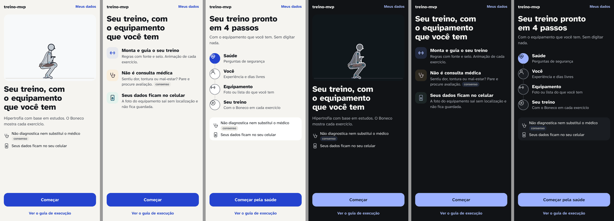
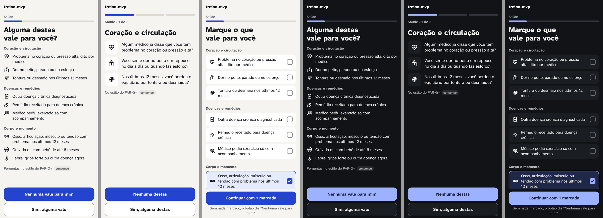

# Design visual (design v3, papel 4, 03/11/2026)

> Papel: hierarquia, letra, cor, espaço, ícones e ilustração. Parte do sistema da v2 (`../design-v2.md`) e o evolui. Não é uma 3ª reformulação.
> Selos como em `docs/pesquisa/00-metodo.md`. As fontes vêm da v2, que leu só resumos. O que é opinião minha está marcado **[opinião]**.
> **Nada mudou no app.** As telas abaixo são esboços em HTML, montados sobre o `src/styles.css` de hoje e medidos no Chromium a 412×915 e a 360×740, nos dois temas. As imagens estão em `visual/`.

## Em uma frase
A base da v2 fica: a letra, as cores e os toques. Mudam três coisas: **ícones no lugar de parágrafos**, **um só elemento pesado por tela** (o título e o botão) e **o botão principal sempre embaixo**, também na 1ª tela e na triagem.

## 1. Por que as telas de hoje pedem leitura (o que vejo nas imagens)
- **Na 1ª tela, quatro blocos têm o mesmo peso:** o parágrafo de abertura e três caixas com título de 20 px e texto corrido. Nada diz por onde começar (`v3-antes/claro/lista-01.png`).
- **A caixa amarela de "não faz" é a mais chamativa.** O que o app não faz ganha mais destaque do que o que ele faz.
- **O botão fica a 130% da altura da tela.** A tela não termina, e a pessoa rola para achar a saída.
- **Não há ícone nem imagem antes do equipamento.** O Boneco, o melhor desenho do app, só aparece depois do cadastro.
- **A triagem é uma lista numerada de 9 frases de 2 a 3 linhas,** todas com o mesmo peso e sem agrupamento. O olho não tem onde parar.
- **O selo diz "consenso de especialistas" (3 palavras), duas vezes na mesma tela.**
- **O progresso é escrito ("Passo 1 de 6").** Não mostra o que vem pela frente.

## 2. O sistema v3 (evolução da v2)

### 2.1 Hierarquia: um elemento pesado por tela
- Por tela, só **o título e o botão principal** usam letra grande em 800. O resto fica em 16 a 19 px. **[opinião]**, apoiada na sinalização (realçar o essencial) e na coerência (tirar o supérfluo): Mayer 2017, **moderada**.
- **Texto corrido não leva caixa com fundo.** No máximo uma superfície branca por tela, e só para agrupar linhas, nunca para um parágrafo.
- **O amarelo (`--warn-soft`) sai do cadastro.** Ele fica só para avisos que pedem uma ação, como o descanso que acabou ou "abaixo da meta". O limite do app vira uma linha com ícone, na mesma altura das outras. **[opinião]**
- **Menos elementos na tela, menos tempo para decidir** (Hick-Hyman, **robusta**). A complexidade visual pesa na primeira impressão (Reinecke et al. 2013, **um estudo**; Lindgaard et al. 2006, **um estudo**).

### 2.2 Letra (a mesma Atkinson Hyperlegible Next, com uma escala menor)
| Uso | Tamanho / peso | Cor | Hoje |
|---|---|---|---|
| Título da 1ª tela | `clamp(28px, 8.2vw, 34px)` / 800, entrelinha 1,1 | `--ink` | 30 px |
| Título de passo | `clamp(26px, 7.4vw, 30px)` / 800 | `--ink` | 30 px |
| Título de linha (ao lado do ícone) | 19 px / 800 | `--ink` | 20 px nas caixas |
| Corpo | 17 px / 400 | `--ink` | igual |
| Detalhe (1 a 2 linhas embaixo do título de linha) | 16 px / 400 | `--muted` | 15 a 17 px |
| Rótulo de grupo | 15 px / 800, sem maiúsculas | `--muted` | 14 px em maiúsculas |
| Selo | 13 px / 600, pílula de 20 px de altura | `--muted` sobre `--surface-2` | igual, mas com 1 palavra |

O `clamp` encolhe o título a 360 px, para caber em 3 linhas. A regra da v2 continua valendo: nunca menos de 16 px no corpo.

### 2.3 Cor: nenhuma cor nova
Só uso os tokens da v2. O que é novo são **combinações** que o app ainda não usava. Calculei todas pela fórmula da WCAG (script em node, fórmula de luminância relativa):

| Combinação nova | Para quê | Claro | Escuro | Mínimo |
|---|---|---:|---:|---:|
| `--accent` sobre `--accent-soft` | ícone do "faz" no ladrilho | 6,35 | 6,96 | 3 (gráfico) |
| `--warn` sobre `--warn-soft` | ícone do "limite" no ladrilho | 5,98 | 8,07 | 3 |
| `--ok` sobre `--ok-soft` | ícone da privacidade no ladrilho | 5,08 | 8,25 | 3 |
| `--ink` sobre `--surface` | ícone da triagem no ladrilho branco | 17,93 | 15,08 | 3 |
| `--muted` sobre `--bg` | ícone solto das garantias; detalhe | 7,35 | 8,85 | 4,5 (texto) |
| `--muted` sobre `--surface` | detalhe dentro da faixa branca | 8,08 | 8,03 | 4,5 |
| `--muted` sobre `--surface-2` | texto do selo | 6,72 | 7,02 | 4,5 |
| `--accent-ink` sobre `--accent` | ícone do 1º marco do caminho; caixa marcada | 7,56 | 7,89 | 3 |
| `--accent` sobre `--bg` | círculo cheio do 1º marco | 6,87 | 8,99 | 3 |
| `--edge` sobre `--surface` | borda da caixa de marcar (triagem 3) | 3,42 | 3,55 | 3 |
| `--accent` sobre `--accent-soft` | borda da linha marcada | 6,35 | 6,96 | 3 |

**Combinação proibida:** borda de controle (`--edge`) sobre `--surface-2` no tema claro dá **2,84:1**, abaixo de 3. Controle com borda fica sobre `--bg` ou `--surface`, nunca sobre `--surface-2`.
Fica só como decoração, sem levar informação: a linha que liga os marcos (`--line` sobre `--bg`, 1,28) e o fundo dos ladrilhos (`--accent-soft` sobre `--bg`, 1,08). O sentido vem do ícone e do texto.

### 2.4 Ícones (desenhados por nós, em SVG, sem biblioteca)
- Grade de 24×24, traço de 2 px, pontas e cantos redondos, sem preenchimento, cor `currentColor`. É o mesmo traço da barra de navegação de hoje.
- **Sempre com texto ao lado.** O ícone ajuda a achar, e o texto diz o que é. **consenso** (NN/g, "Icon usability"; não conferido nesta sessão).
- **Ladrilho** (48×48, cantos de 14, fundo suave) quando o ícone **classifica** algo: faz, limite, privacidade. Fica **solto** (24 px) quando só ilustra uma linha de lista.
- A folha com os 18 ícones está em `visual/icones.png`. O código está no §6.

| Ícone | Desenho (uma linha) | Onde |
|---|---|---|
| halter | o mesmo da barra "Treino": barra com dois pares de anilhas | faz; passo Equipamento |
| play | círculo com um triângulo | passo Seu treino; guia |
| sobe | linha em zigue-zague subindo, com a ponta de seta | carga da próxima vez (reserva) |
| estetoscópio | o "U" das olivas descendo até o diafragma redondo | limite: não é consulta médica |
| celular com cadeado | retângulo de cantos redondos com um cadeado pequeno no meio | dados no aparelho |
| pino riscado | gota de mapa com uma diagonal por cima | foto sem localização (tela do equipamento) |
| pessoa | cabeça redonda e ombros em arco | passo Você |
| coração com pulso | coração com a linha de batimento dentro | triagem 1: coração ou pressão |
| busto com raio | cabeça, ombros e tronco, com um raio no peito | triagem 2: dor no peito |
| espiral | espiral de 5 meias-voltas | triagem 3: tontura ou desmaio |
| prancheta com cruz | prancheta com prendedor e uma cruz no meio | triagem 4: doença crônica |
| cápsula | pílula inclinada a 45°, com a divisória no meio | triagem 5: remédio |
| dupla | duas pessoas lado a lado | triagem 6 nova (7 de hoje): médico pediu acompanhamento |
| osso | osso deitado, com duas bolinhas em cada ponta | triagem 7 nova (6 de hoje): osso, articulação, músculo, tendão |
| carrinho de bebê | capota de quarto de círculo, cesto e duas rodas | triagem 8: gravidez ou parto |
| termômetro | haste com bulbo e o nível subindo | triagem 9: febre ou doença agora |
| visto | o "✓" | linha marcada; passo feito |
| seta | o "›" | linha que abre outra tela |

### 2.5 O selo, mais discreto e ainda presente
- **Uma palavra na pílula:** "consenso", "moderada", "robusta" ou "1 estudo". O resto do nome vai em texto só para leitor de tela: `consenso<span class="sr"> de especialistas</span>`. A v2 já pedia "uma palavra"; o app de hoje mostra três.
- **Um selo por bloco de regra, não por frase.** Fica no fim do bloco, alinhado com o texto, nunca sozinho numa linha.
- **Na triagem, um selo só, no pé:** "Perguntas no estilo do PAR-Q+ · consenso". Ele cobre `seguranca.triagem` e `seguranca.triagem.nenhuma`, que têm o mesmo selo. Hoje são duas pílulas. Precisa do ok do guardião (ver Conflitos).
- Tocar no selo (ou em "de onde vem") abre a regra e a fonte. Isso é do papel de interação. Se o selo virar tocável, a área de toque vai a 44 px por um `::after` invisível; a pílula continua com 20 px.

### 2.6 Espaço e o pé da tela
- Passos de 4, como na v2: 24 entre blocos, 16 entre título e conteúdo, 8 a 14 dentro de uma linha.
- **O botão principal fica sempre no pé** (`.pe`, `position: sticky`), também na 1ª tela e na triagem. Hoje essas duas telas fogem do princípio 2 da v2. Base: Bergstrom-Lehtovirta e Oulasvirta 2014, **um estudo**; Fitts, **robusta**.
- **Sobra espaço vazio entre o conteúdo e o botão no 412×915. Isso é bom:** a tela "acaba", e o vazio mostra que não há mais nada para ler. **[opinião]**

## 3. Primeira tela: 3 direções
Todas usam o mesmo título, o botão "Começar" fixo embaixo e "Ver o guia de execução" como link. Todas dizem, antes do programa, o que o app **faz**, o que **não faz** e onde ficam os **dados**. As 3 tiram o "Passo 1 de 6" desta tela, porque a boas-vindas não é um passo.



### Medidas (Chromium, letra carregada; palavras contadas como em `scripts/design/palavras.spec.ts`)
| | Palavras | Leitura (200/min) | 412×915 | 360×740 | Botão à vista sem rolar |
|---|---:|---:|---|---|---|
| **Hoje** | 180 | ~54 s | 1,49 telas | 1,92 telas | não (está a 130% da altura) |
| **A. Boneco herói** | 37 | ~11 s | 1 tela, o conteúdo acaba em 67% | 1 tela, acaba em 74% | sim, nos dois |
| **B. Três linhas** | 59 | ~18 s | 1 tela, acaba em 50% | 1 tela, acaba em 59% | sim, nos dois |
| **C. Caminho em 4 passos** | 61 | ~18 s | 1 tela, acaba em 63% | 1 tela, acaba em 77% | sim, nos dois |

Os textos são meus, para medir. Quem manda nas palavras é `textos.md`.

### A. "Boneco herói"
```
┌────────────────────────────────────┐
│ treino-mvp               Meus dados│  17/800 · link 15/700 --link
│ ┌────────────────────────────────┐ │
│ │        [Boneco: goblet,        │ │  --stage, cantos 20, altura clamp(180, 30vh, 280)
│ │      quadro parado, músculos]  │ │  <Miniatura> de hoje, estilo A
│ └────────────────────────────────┘ │
│ Seu treino, com o                  │  34/800 --ink (28 a 360 px)
│ equipamento que você tem           │
│ Hipertrofia com base em estudos.   │  17/400 --muted, 2 linhas
│ O Boneco mostra cada exercício.    │
│ ⚕ Não diagnostica nem substitui    │  ícone 22 --muted · 16/400 --ink · selo
│   o médico  (consenso)             │
│ ▯ Seus dados ficam no seu celular  │
│                                    │  (vazio)
│ ┌────────────────────────────────┐ │
│ │           Começar              │ │  56 px, --accent, fixo
│ └────────────────────────────────┘ │
│      Ver o guia de execução        │  48 px, link
└────────────────────────────────────┘
```
- **O que muda:** o Boneco abre o app. A frase diz o que o app faz. O "não faz" e a privacidade viram duas linhas curtas, com ícone.
- **Por quê:** a imagem mostra o produto antes de qualquer frase. A primeira impressão se forma em ~50 ms (Lindgaard et al. 2006, **um estudo**). O que é bonito parece mais fácil de usar (Tractinsky et al. 2000, **um estudo**).
- **Boneco:** um quadro do motor, sem mudança (o mesmo `quadro()` da `Miniatura`), de um exercício com animação aprovada. Usei o goblet. Se ele se mexer, para com `prefers-reduced-motion` (papel de interação).
- **Risco:** é a direção que mais encurta o "não faz" e a frase da foto. A frase completa da foto precisa aparecer no botão de foto do equipamento. **Só tela**, e o texto passa pelo guardião.

### B. "Três linhas" (faz / não faz / privacidade)
```
│ treino-mvp               Meus dados│
│ Seu treino, com o                  │  34/800
│ equipamento que você tem           │
│ ┌──┐ Monta e guia o seu treino     │  ladrilho 48 --accent-soft, halter --accent · 19/800
│ └──┘ Regras com fonte e selo.      │  16/400 --muted
│      Animação de cada exercício.   │
│ ┌──┐ Não é consulta médica         │  ladrilho --warn-soft, estetoscópio --warn
│ └──┘ Sentiu dor, tontura ou mal-   │
│      estar? Pare e procure         │
│      avaliação.  (consenso)        │
│ ┌──┐ Seus dados ficam no celular   │  ladrilho --ok-soft, celular --ok
│ └──┘ A foto do equipamento sai sem │
│      localização e não fica        │
│      guardada.                     │
│            (vazio)                 │
│ [ Começar ]  · Ver o guia          │
```
- **O que muda:** as 3 caixas de hoje viram 3 linhas sem caixa. Cada uma tem um título de 4 a 5 palavras e um detalhe de 1 a 2 linhas. A cor do ladrilho diz o tipo da linha: azul faz, âmbar é limite, verde é privacidade.
- **Por quê:** é o mesmo conteúdo de hoje, com um terço das palavras. Quem só lê os títulos já entende tudo. Base: segmentação e sinalização (Mayer 2017, **moderada**).
- **A mais segura para o guardião:** guarda as 3 mensagens de hoje, inclusive "pare e procure avaliação" e a foto sem localização. **Só tela**, e o texto passa pelo `textos.md`.
- **Risco:** é a menos marcante das três. Não mostra o Boneco. **[opinião]**

### C. "Caminho em 4 passos"
```
│ Seu treino pronto em 4 passos      │  34/800
│ Com o equipamento que você tem.    │  17 --muted
│ Sem digitar nada.                  │
│ (●) Saúde                          │  marco 44 cheio --accent, coração --accent-ink · 19/800
│  │  Perguntas de segurança         │  16 --muted
│ (○) Você                           │  marco 44, borda --edge, ícone --ink
│  │  Experiência e dias livres      │
│ (○) Equipamento                    │
│  │  Foto ou lista do que você tem  │
│ (○) Seu treino                     │
│     Com o Boneco em cada exercício │
│ ┌────────────────────────────────┐ │  1 faixa --surface
│ │⚕ Não diagnostica nem substitui │ │  16/400 · selo
│ │  o médico (consenso)           │ │
│ │▯ Seus dados ficam no celular   │ │
│ └────────────────────────────────┘ │
│ [ Começar pela saúde ]             │
```
- **O que muda:** a tela mostra o caminho inteiro até o treino. Os mesmos 4 ícones viram a barra de progresso dos passos seguintes e as linhas do "Tudo certo?". Assim, a pessoa vê sempre onde está. **[opinião]**
- **Por quê:** mostrar o progresso ajuda quando ele parece andar rápido (Conrad et al. 2010, **um estudo**). Começar já com progresso aumenta a conclusão (Nunes e Drèze 2006, **um estudo**).
- **Depende da estrutura:** só funciona se o cadastro tiver de fato 4 etapas (hoje são 6). Se não tiver, o título muda.
- **Risco:** "não faz" e privacidade ficam curtos, como na A. **Só tela.**

## 4. Triagem: 3 tratamentos
Nos três, as **9 condições continuam visíveis antes de "nenhuma"** e o "sim" leva ao acompanhamento de hoje (regiões e dor de 0 a 10).
Em todos, as 9 ficam em **3 grupos com título**: Coração e circulação (1, 2, 3), Doenças e remédios (4, 5 e a de acompanhamento), Corpo e momento (osso e articulação, gravidez, febre). Para isso, **duas condições trocam de lugar**: a de osso e articulação (6ª hoje) e a de acompanhamento médico (7ª hoje).



| | Palavras | Leitura | 412×915 | 360×740 | Toques para "nenhuma" | Regra |
|---|---:|---:|---|---|---:|---|
| **Hoje** | 171 | ~51 s | 1,52 telas | 1,78 telas | 1 (depois de rolar) | — |
| **1. Lista com ícones**, rótulos curtos | 92 | ~28 s | **1 tela** | 1,24 telas | 1 | **muda regra** (texto) |
| **1. Lista com ícones**, texto de hoje | 146 | ~44 s | 1,13 telas | 1,44 telas | 1 | só tela (mais a ordem) |
| **2. Três blocos**, texto de hoje | ~57 por tela, ~170 no total | ~17 s por tela | 1 tela cada | 1 tela cada | 3 | **muda regra** (`nenhuma`) |
| **2. Três blocos**, rótulos curtos | ~40 por tela, ~120 no total | ~12 s por tela | 1 tela cada | 1 tela cada | 3 | **muda regra** (`nenhuma` e texto) |
| **3. Marque o que vale** | 89 | ~27 s | 1,20 telas | 1,49 telas | 1 | **muda regra** (`nenhuma`: o "sim" se marca direto) |

Os rótulos curtos são **esboços para medir**, não uma proposta de texto (isso é do `textos.md`). Cada um mantém o qualificador que decide a resposta: "dito por médico", "12 meses", "diagnosticada", "receitado", "6 meses", "agora".

### 1. "Lista com ícones" (uma tela, só leitura)
```
│ Saúde ▬▬▬───────────────           │  rótulo da etapa 14 --muted · barra 6 px
│ Alguma destas vale para você?      │  30/800
│ Coração e circulação               │  15/800 --muted
│ ♥ Problema no coração ou pressão   │  ícone 24 --ink · 17/400, linhas de 6+6 px
│   alta, dito por médico            │
│ ⚡ Dor no peito, parado ou no esforço│
│ @ Tontura ou desmaio nos últimos   │
│   12 meses                         │
│ Doenças e remédios                 │
│ ✚ … · 💊 … · 👥 …                   │
│ Corpo e momento                    │
│ 🦴 … · 🛒 … · 🌡 …                  │
│ Perguntas no estilo do PAR-Q+ (consenso) │ 15 --muted · 1 selo
│ [ Nenhuma vale para mim ]          │  56, --accent
│ [ Sim, alguma vale ]               │  56, .btn.sec
```
- **O que muda:** sai a lista numerada de frases longas. Entram 3 títulos de grupo e um ícone por linha. As linhas não se tocam, e só os botões decidem.
- **Por quê:** o olho pula de grupo em grupo e de ícone em ícone, e quem não tem nada percebe isso em segundos. Base: segmentação e sinalização (Mayer 2017, **moderada**). **[opinião]** quanto ao ganho de tempo, que não foi medido com gente.
- **Botões:** a 412 px a lista inteira cabe acima deles. A 360 px, o último grupo fica atrás do pé fixo, e a pessoa poderia tocar "Nenhuma" sem ver os 9. Proposta: nesse caso, os botões ficam no fim da lista, como hoje (ver Conflitos).
- É a **mais perto da regra de hoje** (`seguranca.triagem.nenhuma`: "as 9 condições numa lista curta, todas à vista").

### 2. "Três blocos" (uma tela por grupo)
```
│ ▬▬▬▬  ────  ────                   │  3 traços de progresso (o 1º --accent)
│ Saúde · 1 de 3                     │  15/700 --muted
│ Coração e circulação               │  30/800
│ ┌────┐ Algum médico já disse que   │  ladrilho 56 --surface, ícone 30 --ink · 18/400
│ └────┘ você tem problema no        │
│        coração ou pressão alta?    │
│ ┌────┐ Você sente dor no peito…    │
│ ┌────┐ Nos últimos 12 meses…       │
│ No estilo do PAR-Q+ (consenso)     │
│ [ Nenhuma destas ]                 │
│ [ Sim, alguma destas ]             │
```
- **O que muda:** 3 telas de 3 condições, com "Nenhuma destas" e "Sim, alguma destas". O "sim" abre as 3 perguntas do bloco, uma a uma, com sim e não.
- **Por quê:** cada tela cabe em qualquer celular e pode **manter o texto completo de hoje**: nenhuma condição encolhe. É "uma coisa por tela" (GOV.UK, **consenso**).
- **Custo:** 3 toques em vez de 1, e mais tempo de tela. **Muda regra** (`seguranca.triagem.nenhuma`).

### 3. "Marque o que vale" (linhas tocáveis)
```
│ Marque o que vale para você        │  30/800
│ Coração e circulação               │
│ ┌──────────────────────────────┐   │  linha 56+ --surface, cantos 16
│ │♥ Problema no coração ou…   ☐ │   │  caixa 24, borda 2 --edge (3,42:1)
│ └──────────────────────────────┘   │
│ ┌──────────────────────────────┐   │  marcada: borda 2 --accent, fundo --accent-soft,
│ │🦴 Osso, articulação…        ☑ │   │  caixa cheia --accent com ✓ --accent-ink
│ └──────────────────────────────┘   │
│ [ Nenhuma vale para mim ]          │  o texto muda: "Continuar com 1 marcada"
```
- **O que muda:** a pessoa marca só o que vale, e o mesmo botão responde. Sem nada marcado, ele diz "Nenhuma vale para mim". Com algo marcado, diz "Continuar com N marcadas" e leva direto às regiões e à dor (se for o osso) ou à pausa do programa.
- **Por quê:** some o passo "Sim, alguma vale" e as 9 perguntas de sim e não. Quem tem uma condição faz 2 toques em vez de 10. **[opinião]**
- **Riscos:** o botão fixo aparece antes de a pessoa ver as 9, mais ainda a 360 px. Um botão que muda de texto precisa ser anunciado ao leitor de tela (papel de acessibilidade). **Muda regra** (`seguranca.triagem.nenhuma` e o fluxo do "sim").

### Selo na triagem
Uma linha no pé da lista, 15 px `--muted`: "Perguntas no estilo do PAR-Q+", mais a pílula "consenso". Fica no fim, onde não compete com as condições, mas antes dos botões. O "não diagnostica" e o "um sim não impede o treino" passam para a tela da pausa, que é onde importam. Isso é decisão de estrutura e de texto.

## 5. O resto do cadastro e "Seu treino": o que muda (lista curta)

**Cadastro**
1. **Progresso com ícones.** Uma barra em 4 a 5 trechos, cada um com o seu ícone (coração, pessoa, halter, visto), e o rótulo da etapa em 14 px. Para o leitor de tela, continua "Etapa 2 de 4: Você". Some o "Passo X de 6" escrito.
2. **Título de passo** em `clamp(26, 7.4vw, 30)`. A frase de abertura sai, ou vira 1 linha em `--muted` de até 12 palavras. Texto de ajuda embaixo de uma opção só quando muda a decisão.
3. **Nível:** a caixa azul "Seu nível: Iniciante" deixa de ser caixa. Vira uma linha com ✓ verde ("Nível: iniciante"), e o selo vai para o "Tudo certo?".
4. **Rotina:** dias como 5 botões redondos de 56 px, com o número em 22/800. Minutos como faixa segmentada (30, 45, 60, 75, 90), com o número grande e "min" pequeno. Prioridade em chips, e "Pular" como link.
5. **Equipamento:** os 4 lugares em grade 2×2 de cartões de ~120 px, com ícone de 64×48 (academia, condomínio, casa, monto a lista). A foto vira um 5º cartão com câmera. Embaixo dela, uma linha com o pino riscado: "Sai sem localização e não fica guardada". Os halteres mostram a faixa em 22/800 ("1 a 12 kg") acima dos chips. Faltam ícones para 21 itens (`design.md`). Até lá, cartão só com o nome, como hoje.
6. **"Tudo certo?":** cada linha leva o ícone da sua etapa (24 px, `--muted`), o valor em 18/800 e o rótulo em 14 px. "Gerar meu treino" fica fixo.
7. **Erro:** borda à esquerda em `--alert` e ícone "!" de 20 px. O texto em vermelho fica só na frase do erro.

**Seu treino** (`telas/claro/07-programa.png`)
1. **Saem as 3 faixas empilhadas** acima da lista (aviso dos músculos, semana 1, outro local). Entram um chip "Semana 1 · aprendizado", com o selo dentro do detalhe, e **uma** linha de aviso com ícone e seta ("2 músculos abaixo da meta ›"). O "outro local" vai para Meus dados (estrutura).
2. **Abas "A · B · C"** em letra grande, com o nome do treino em 14 px embaixo. Hoje "Corpo todo C" aparece cortado.
3. **Cartão de exercício inteiro tocável**, com a seta "›". A linha "Detalhes" de 48 px em cada exercício sai: são cerca de 290 px a menos num treino de 6. O número do exercício vai num círculo de 24 px.
4. **"Começar treino A"**, sem o nome completo, para caber numa linha a 360 px.
5. **Resto do app, mais curto:** no guia, os 4 modos com ícone e texto. No fim do treino, os 3 números em 44/800 com ícone pequeno. Na semana e em Meus dados, os mesmos ícones de linha. No treino e no descanso, nada muda além do selo de uma palavra.

## 6. Código para o prototipista (usa só os tokens da v2)
Carregue depois do `src/styles.css`. As classes `.btn`, `.btn.sec`, `.link-sec`, `.progresso` e `.sr` já existem lá.

**Ícones (sprite, uma vez por página):**
```html
<svg width="0" height="0" style="position:absolute" aria-hidden="true">
  <!-- 24×24, traço 2 px, pontas redondas; cor = currentColor -->
  <symbol id="i-halter" viewBox="0 0 24 24"><path d="M6.5 6.5v11M17.5 6.5v11M3.5 9v6M20.5 9v6M6.5 12h11"/></symbol>
  <symbol id="i-play" viewBox="0 0 24 24"><circle cx="12" cy="12" r="9"/><path d="M10 8.5v7l6-3.5z"/></symbol>
  <symbol id="i-sobe" viewBox="0 0 24 24"><path d="M4 18l6-6 4 4 6-8M15 8h5v5"/></symbol>
  <symbol id="i-esteto" viewBox="0 0 24 24"><path d="M5 3v5a4 4 0 0 0 8 0V3M9 12v3a5 5 0 0 0 10 0v-2"/><circle cx="19" cy="11" r="2"/></symbol>
  <symbol id="i-celular" viewBox="0 0 24 24"><rect x="6" y="2" width="12" height="20" rx="2"/><path d="M10 13h4v4h-4zM10.5 13v-1.5a1.5 1.5 0 0 1 3 0V13"/></symbol>
  <symbol id="i-sem-local" viewBox="0 0 24 24"><path d="M12 21s-6-5.5-6-11a6 6 0 0 1 12 0c0 5.5-6 11-6 11zM4 4l16 16"/></symbol>
  <symbol id="i-pessoa" viewBox="0 0 24 24"><circle cx="12" cy="8" r="4"/><path d="M4 21a8 8 0 0 1 16 0"/></symbol>
  <symbol id="i-coracao" viewBox="0 0 24 24"><path d="M12 20s-8-4.6-8-10.5A4.5 4.5 0 0 1 12 7a4.5 4.5 0 0 1 8 2.5C20 15.4 12 20 12 20z"/><path d="M7 12h2.5l1.5-2.5 2 5 1.5-2.5H17"/></symbol>
  <symbol id="i-peito" viewBox="0 0 24 24"><circle cx="12" cy="4.5" r="2.5"/><path d="M4 21v-8a4 4 0 0 1 4-4h8a4 4 0 0 1 4 4v8"/><path d="M13 11.5l-2.5 3.5h3L11 18.5"/></symbol>
  <symbol id="i-tontura" viewBox="0 0 24 24"><path d="M12 12a1.5 1.5 0 0 1 3 0a3 3 0 0 1-6 0a4.5 4.5 0 0 1 9 0a6 6 0 0 1-12 0a7.5 7.5 0 0 1 15 0"/></symbol>
  <symbol id="i-prancheta" viewBox="0 0 24 24"><path d="M9 3h6v3H9zM8 4.5H6v16h12v-16h-2M12 10v6M9 13h6"/></symbol>
  <symbol id="i-capsula" viewBox="0 0 24 24"><path d="M10.5 20.5a5 5 0 0 1-7-7l6-6a5 5 0 0 1 7 7zM8.5 8.5l7 7"/></symbol>
  <symbol id="i-dupla" viewBox="0 0 24 24"><circle cx="8" cy="8" r="3"/><circle cx="16.5" cy="8" r="3"/><path d="M2.5 20a5.5 5.5 0 0 1 11 0M12 15.5a5.5 5.5 0 0 1 9.5 4.5"/></symbol>
  <symbol id="i-osso" viewBox="0 0 24 24"><path d="M8 10.5h8a2.3 2.3 0 1 1 2.6 1.5 2.3 2.3 0 1 1-2.6 1.5H8a2.3 2.3 0 1 1-2.6-1.5A2.3 2.3 0 1 1 8 10.5z"/></symbol>
  <symbol id="i-carrinho" viewBox="0 0 24 24"><path d="M13 3a8 8 0 0 1 8 8h-8zM3 11h18a6 6 0 0 1-6 6H9a6 6 0 0 1-6-6zM3 11 1.5 7"/><circle cx="8" cy="20" r="1.5"/><circle cx="16" cy="20" r="1.5"/></symbol>
  <symbol id="i-termometro" viewBox="0 0 24 24"><path d="M14 14.5V5a2 2 0 0 0-4 0v9.5a4 4 0 1 0 4 0zM12 9v8"/></symbol>
  <symbol id="i-check" viewBox="0 0 24 24"><path d="M5 12.5l4.5 4.5L19 7.5"/></symbol>
  <symbol id="i-chevron" viewBox="0 0 24 24"><path d="M9 6l6 6-6 6"/></symbol>
</svg>
```

**CSS (todas as direções):**
```css
/* Design v3 (proposta): peças novas sobre os tokens da v2 (src/styles.css). Nenhuma cor nova. */
.ic{width:24px;height:24px;fill:none;stroke:currentColor;stroke-width:2;stroke-linecap:round;stroke-linejoin:round;flex:none}
.tela{min-height:100dvh;max-width:560px;margin:0 auto;padding:0 16px;display:flex;flex-direction:column}
.topo-v3{min-height:56px;display:flex;align-items:center;justify-content:space-between;font-size:17px;font-weight:800}
.topo-v3 a{font-size:15px;font-weight:700;color:var(--link);text-decoration:none;min-height:48px;display:inline-flex;align-items:center}
.titulo-v3{font-size:clamp(28px,8.2vw,34px);line-height:1.1;font-weight:800;letter-spacing:-.01em;margin:0;text-wrap:balance}
.titulo-passo{font-size:clamp(26px,7.4vw,30px);line-height:1.15;font-weight:800;margin:0;text-wrap:balance}
.sub-v3{font-size:17px;line-height:1.4;color:var(--muted);margin:0}
.selo-v3{display:inline-block;font-size:13px;font-weight:600;line-height:20px;padding:0 8px;border-radius:999px;background:var(--surface-2);color:var(--muted);white-space:nowrap;vertical-align:1px}
/* a ação principal, colada embaixo, ao alcance do polegar */
.pe{position:sticky;bottom:0;margin:auto -16px 0;padding:12px 16px calc(8px + env(safe-area-inset-bottom));background:var(--bg);display:flex;flex-direction:column;gap:4px}
.pe .btn{min-height:56px}
.pe .link-sec{align-self:center}
.pe.dois{gap:8px}

/* 1ª tela, A: herói com o Boneco */
.heroi{display:flex;flex-direction:column;gap:16px;padding-top:4px}
.heroi-palco{height:clamp(180px,30vh,280px);border-radius:var(--r3);background:var(--stage);display:grid;place-items:center;overflow:hidden}
.heroi-palco svg{height:100%;width:auto;display:block}
.garantias{list-style:none;margin:0;padding:0;display:flex;flex-direction:column;gap:8px}
.garantias li{display:flex;align-items:center;gap:10px;font-size:16px;line-height:1.35;color:var(--ink)}
.garantias .ic{width:22px;height:22px;color:var(--muted)}

/* 1ª tela, B: três linhas com ícone */
.tres{display:flex;flex-direction:column;gap:24px;padding-top:4px}
.linhas-icone{list-style:none;margin:0;padding:0;display:flex;flex-direction:column;gap:20px}
.linhas-icone li{display:grid;grid-template-columns:48px 1fr;gap:14px;align-items:start}
.ladrilho{width:48px;height:48px;border-radius:14px;display:grid;place-items:center}
.ladrilho .ic{width:26px;height:26px}
.ladrilho.faz{background:var(--accent-soft);color:var(--accent)}
.ladrilho.limite{background:var(--warn-soft);color:var(--warn)}
.ladrilho.privado{background:var(--ok-soft);color:var(--ok)}
.linhas-icone b{display:block;font-size:19px;line-height:1.25;font-weight:800;padding-top:2px}
.linhas-icone .det{display:block;font-size:16px;line-height:1.4;color:var(--muted);margin-top:2px}

/* 1ª tela, C: o caminho em 4 passos */
.caminho-tela{display:flex;flex-direction:column;gap:20px;padding-top:4px}
.caminho{list-style:none;margin:0;padding:0;display:flex;flex-direction:column}
.caminho li{position:relative;display:grid;grid-template-columns:44px 1fr;gap:14px;align-items:center;min-height:64px}
.caminho li:not(:last-child)::after{content:"";position:absolute;left:21px;top:52px;bottom:-8px;width:2px;background:var(--line);border-radius:2px}
.marco{width:44px;height:44px;border-radius:50%;display:grid;place-items:center;border:2px solid var(--edge);color:var(--ink);background:var(--surface)}
.caminho li:first-child .marco{background:var(--accent);border-color:var(--accent);color:var(--accent-ink)}
.caminho b{display:block;font-size:19px;line-height:1.2;font-weight:800}
.caminho span{display:block;font-size:16px;color:var(--muted);line-height:1.35}
.ressalvas{display:flex;flex-direction:column;gap:6px;padding:12px 14px;border-radius:var(--r2);background:var(--surface)}
.ressalvas p{margin:0;display:flex;align-items:center;gap:10px;font-size:16px;line-height:1.35}
.ressalvas .ic{width:22px;height:22px;color:var(--muted)}

/* Triagem 1: lista com ícone em 3 grupos (só leitura; os botões decidem) */
.triagem-v3{display:flex;flex-direction:column;gap:16px;padding-top:4px}
.grupo h2{margin:0 0 4px;font-size:15px;font-weight:800;color:var(--muted);letter-spacing:.02em}
.condicoes{list-style:none;margin:0;padding:0;display:flex;flex-direction:column}
.condicoes li{display:grid;grid-template-columns:24px 1fr;gap:12px;align-items:start;padding:6px 0;font-size:17px;line-height:1.3}
.condicoes .ic{color:var(--ink);margin-top:-1px}
.fonte-v3{margin:0;font-size:15px;color:var(--muted);display:flex;flex-wrap:wrap;align-items:center;gap:6px}

/* Triagem 2: três blocos, um por tela */
.bloco-cont{font-size:15px;font-weight:700;color:var(--muted);margin:0}
.bloco{list-style:none;margin:0;padding:0;display:flex;flex-direction:column;gap:12px}
.bloco li{display:grid;grid-template-columns:56px 1fr;gap:14px;align-items:center;font-size:18px;line-height:1.35}
.bloco .ladrilho{width:56px;height:56px;background:var(--surface);color:var(--ink)}
.bloco .ladrilho .ic{width:30px;height:30px}
.pontos-bloco{display:flex;gap:6px}
.pontos-bloco i{height:6px;flex:1;border-radius:99px;background:var(--line)}
.pontos-bloco i.on{background:var(--accent)}

/* Triagem 3: marque o que vale (linhas tocáveis) */
.marcaveis{list-style:none;margin:0;padding:0;display:flex;flex-direction:column;gap:6px}
.marcavel{display:grid;grid-template-columns:24px 1fr 24px;gap:12px;align-items:center;min-height:56px;padding:8px 14px;border-radius:var(--r2);background:var(--surface);border:1.5px solid transparent;cursor:pointer;font-size:17px;line-height:1.3}
.marcavel input{position:absolute;opacity:0;width:1px;height:1px}
.marcavel .caixa{width:24px;height:24px;border-radius:7px;border:2px solid var(--edge);display:grid;place-items:center;color:transparent}
.marcavel .caixa .ic{width:18px;height:18px;stroke-width:3}
.marcavel:has(input:checked){border:2px solid var(--accent);background:var(--accent-soft)}
.marcavel:has(input:checked) .caixa{background:var(--accent);border-color:var(--accent);color:var(--accent-ink)}
.marcavel:has(input:focus-visible){outline:3px solid var(--accent);outline-offset:2px}
.grupo-m h2{margin:8px 0 6px;font-size:15px;font-weight:800;color:var(--muted)}
```

**Marcação (o mesmo `.tela` com topo, `main` e `.pe`; `ic('nome')` = `<svg class="ic" aria-hidden="true"><use href="#i-nome"/></svg>`):**
```html
<!-- selo de uma palavra (qualquer tela) -->
<span class="selo-v3">consenso<span class="sr"> de especialistas</span></span>

<!-- 1ª tela, A: herói -->
<div class="tela">
  <header class="topo-v3"><b>treino-mvp</b><a href="/dados">Meus dados</a></header>
  <main class="heroi">
    <div class="heroi-palco" aria-hidden="true"><!-- <Miniatura animacaoId="goblet"/>: quadro do motor, sem mudança --></div>
    <h1 class="titulo-v3">Seu treino, com o equipamento que você tem</h1>
    <p class="sub-v3">Hipertrofia com base em estudos. O Boneco mostra cada exercício.</p>
    <ul class="garantias">
      <li><svg class="ic" aria-hidden="true"><use href="#i-esteto"/></svg><span>Não diagnostica nem substitui o médico <span class="selo-v3">consenso<span class="sr"> de especialistas</span></span></span></li>
      <li><svg class="ic" aria-hidden="true"><use href="#i-celular"/></svg><span>Seus dados ficam no seu celular</span></li>
    </ul>
  </main>
  <div class="pe"><button class="btn">Começar</button><a class="link-sec" href="/guia">Ver o guia de execução</a></div>
</div>

<!-- 1ª tela, B: três linhas (troque só o <main>) -->
<main class="tres">
  <h1 class="titulo-v3">Seu treino, com o equipamento que você tem</h1>
  <ul class="linhas-icone">
    <li><span class="ladrilho faz"><svg class="ic" aria-hidden="true"><use href="#i-halter"/></svg></span>
      <div><b>Monta e guia o seu treino</b><span class="det">Regras com fonte e selo. Animação de cada exercício.</span></div></li>
    <li><span class="ladrilho limite"><svg class="ic" aria-hidden="true"><use href="#i-esteto"/></svg></span>
      <div><b>Não é consulta médica</b><span class="det">Sentiu dor, tontura ou mal-estar? Pare e procure avaliação. <span class="selo-v3">consenso<span class="sr"> de especialistas</span></span></span></div></li>
    <li><span class="ladrilho privado"><svg class="ic" aria-hidden="true"><use href="#i-celular"/></svg></span>
      <div><b>Seus dados ficam no celular</b><span class="det">A foto do equipamento sai sem localização e não fica guardada.</span></div></li>
  </ul>
</main>

<!-- 1ª tela, C: caminho (troque o <main> e o rótulo do botão: "Começar pela saúde") -->
<main class="caminho-tela">
  <div><h1 class="titulo-v3">Seu treino pronto em 4 passos</h1><p class="sub-v3" style="margin-top:8px">Com o equipamento que você tem. Sem digitar nada.</p></div>
  <ol class="caminho">
    <li><span class="marco"><svg class="ic" aria-hidden="true"><use href="#i-coracao"/></svg></span><div><b>Saúde</b><span>Perguntas de segurança</span></div></li>
    <li><span class="marco"><svg class="ic" aria-hidden="true"><use href="#i-pessoa"/></svg></span><div><b>Você</b><span>Experiência e dias livres</span></div></li>
    <li><span class="marco"><svg class="ic" aria-hidden="true"><use href="#i-halter"/></svg></span><div><b>Equipamento</b><span>Foto ou lista do que você tem</span></div></li>
    <li><span class="marco"><svg class="ic" aria-hidden="true"><use href="#i-play"/></svg></span><div><b>Seu treino</b><span>Com o Boneco em cada exercício</span></div></li>
  </ol>
  <div class="ressalvas">
    <p><svg class="ic" aria-hidden="true"><use href="#i-esteto"/></svg><span>Não diagnostica nem substitui o médico <span class="selo-v3">consenso<span class="sr"> de especialistas</span></span></span></p>
    <p><svg class="ic" aria-hidden="true"><use href="#i-celular"/></svg><span>Seus dados ficam no seu celular</span></p>
  </div>
</main>

<!-- Triagem 1: lista com ícones (um grupo; repita para os outros dois) -->
<main class="triagem-v3">
  <h1 class="titulo-passo">Alguma destas vale para você?</h1>
  <section class="grupo"><h2>Coração e circulação</h2>
    <ul class="condicoes">
      <li><svg class="ic" aria-hidden="true"><use href="#i-coracao"/></svg><span>Problema no coração ou pressão alta, dito por médico</span></li>
      <li><svg class="ic" aria-hidden="true"><use href="#i-peito"/></svg><span>Dor no peito, parado ou no esforço</span></li>
      <li><svg class="ic" aria-hidden="true"><use href="#i-tontura"/></svg><span>Tontura ou desmaio nos últimos 12 meses</span></li>
    </ul></section>
  <p class="fonte-v3">Perguntas no estilo do PAR-Q+ <span class="selo-v3">consenso<span class="sr"> de especialistas</span></span></p>
</main>
<div class="pe dois"><button class="btn">Nenhuma vale para mim</button><button class="btn sec">Sim, alguma vale</button></div>

<!-- Triagem 2: um bloco por tela -->
<main class="triagem-v3">
  <div class="pontos-bloco" aria-hidden="true"><i class="on"></i><i></i><i></i></div>
  <p class="bloco-cont">Saúde · 1 de 3</p>
  <h1 class="titulo-passo">Coração e circulação</h1>
  <ul class="bloco">
    <li><span class="ladrilho"><svg class="ic" aria-hidden="true"><use href="#i-coracao"/></svg></span><span>Algum médico já disse que você tem problema no coração ou pressão alta?</span></li>
    <!-- … as outras 2 do bloco -->
  </ul>
</main>
<div class="pe dois"><button class="btn">Nenhuma destas</button><button class="btn sec">Sim, alguma destas</button></div>

<!-- Triagem 3: marque o que vale (uma linha) -->
<li><label class="marcavel">
  <svg class="ic" aria-hidden="true"><use href="#i-osso"/></svg>
  <span>Osso, articulação, músculo ou tendão com problema nos últimos 12 meses</span>
  <input type="checkbox"><span class="caixa" aria-hidden="true"><svg class="ic"><use href="#i-check"/></svg></span>
</label></li>
<!-- pé: <button class="btn">Nenhuma vale para mim</button> → "Continuar com 1 marcada" (anunciar a troca) -->
```

## 7. Riscos e o que não sei
- **Sem teste com gente.** Os tempos são palavras ÷ 200 por minuto, e quem passa os olhos lê menos que isso. O ganho real dos ícones precisa do celular do Gustavo.
- **Ícones de saúde são ambíguos.** A espiral (tontura) e o busto com raio (dor no peito) são os mais fracos: sozinhos, não se entendem. Por isso, sempre levam o texto ao lado.
- **Carrinho de bebê** para "grávida ou bebê de até 6 meses" é uma escolha neutra. Uma barriga de grávida seria mais direta, mas é mais difícil de desenhar bem com traço. **[opinião]**
- **O herói usa um quadro do Boneco no tamanho de ~270×200.** O enquadramento vem do motor, com margem em volta. Ele não muda: só escolhi o exercício.
- **Letra:** as medidas usaram a Atkinson Hyperlegible Next carregada do Google Fonts, como o app faz hoje. Sem ela, a altura muda pouco.

## Conflitos com outros papéis
1. **Menos texto × "o que o app não faz" (guardião, texto).** As direções A e C resumem o limite em "Não diagnostica nem substitui o médico". A frase "pare e procure avaliação" só fica na B. Precisa dizer se a versão curta cumpre `seguranca.sem-diagnostico` antes do programa.
2. **Privacidade da foto (guardião, estrutura).** A e C deixam "sai sem localização e não fica guardada" para o botão de foto do equipamento. A regra pede só "antes de mandar foto", mas é preciso confirmar.
3. **Botão fixo × passar pelas 9 (interação, guardião).** O código de hoje põe os botões no fim da lista de propósito. Proponho botão fixo em todas as telas, **menos** na triagem 1 a 360 px e na triagem 3, onde os botões ficariam visíveis antes do último grupo.
4. **Rótulos curtos (texto, guardião).** Os rótulos da triagem 1 (versão curta) e da 3 mudam o texto das perguntas: **muda regra** (`seguranca.triagem.texto`). Os meus são só para medir. Quem manda é o `textos.md`.
5. **Ordem das condições (guardião).** Os 3 grupos trocam de lugar a 6ª e a 7ª condições. Nada some, mas a ordem é a do PAR-Q+ adaptado.
6. **Um selo por tela × um selo por regra (guardião, pesquisa).** Na triagem, uma pílula cobre duas regras com o mesmo selo. E o selo de uma palavra ("consenso") se apoia no texto escondido para o leitor de tela.
7. **Caminho em 4 passos × estrutura.** A direção C supõe 4 etapas. O `estrutura.md` propõe 5 (saúde, experiência, rotina, equipamento, confirmar). Com 5, o caminho ganha um marco (pessoa para experiência, relógio para rotina, e "Seu treino" vira o ponto final, sem marco). Isso soma ~64 px, e a tela ainda cabe a 360 px (hoje acaba em 77%). O título passa a ser "em 5 passos".
8. **Triagem 2 × toques (estrutura).** Ela custa 3 toques em vez de 1 para quem não tem nada, em troca de nenhum texto encolher.
9. **Boneco parado × animado no herói (interação).** Animado chama mais a atenção, mas mexe com `prefers-reduced-motion` e com a bateria. Proponho um quadro parado, e o "Ver o guia" leva à animação.
10. **Progresso com ícones × GOV.UK (acessibilidade).** O "Etapa X de N" precisa continuar no texto para o leitor de tela, mesmo que não apareça na tela.
11. **Tirar o "Detalhes" de cada exercício (estrutura).** Se o cartão inteiro abrir o detalhe, o toque que hoje leva ao guia muda de lugar.
