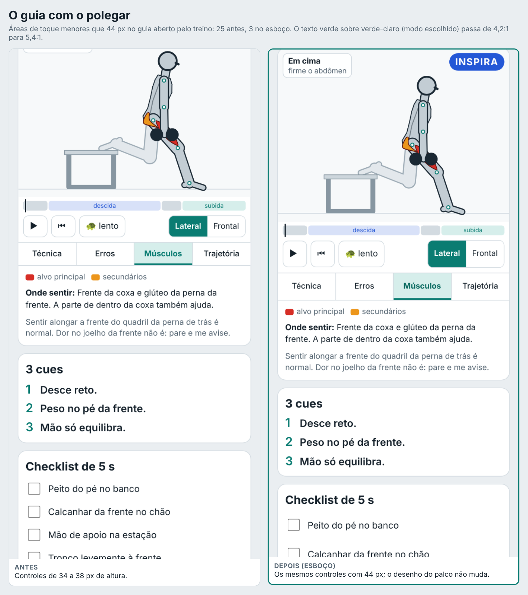
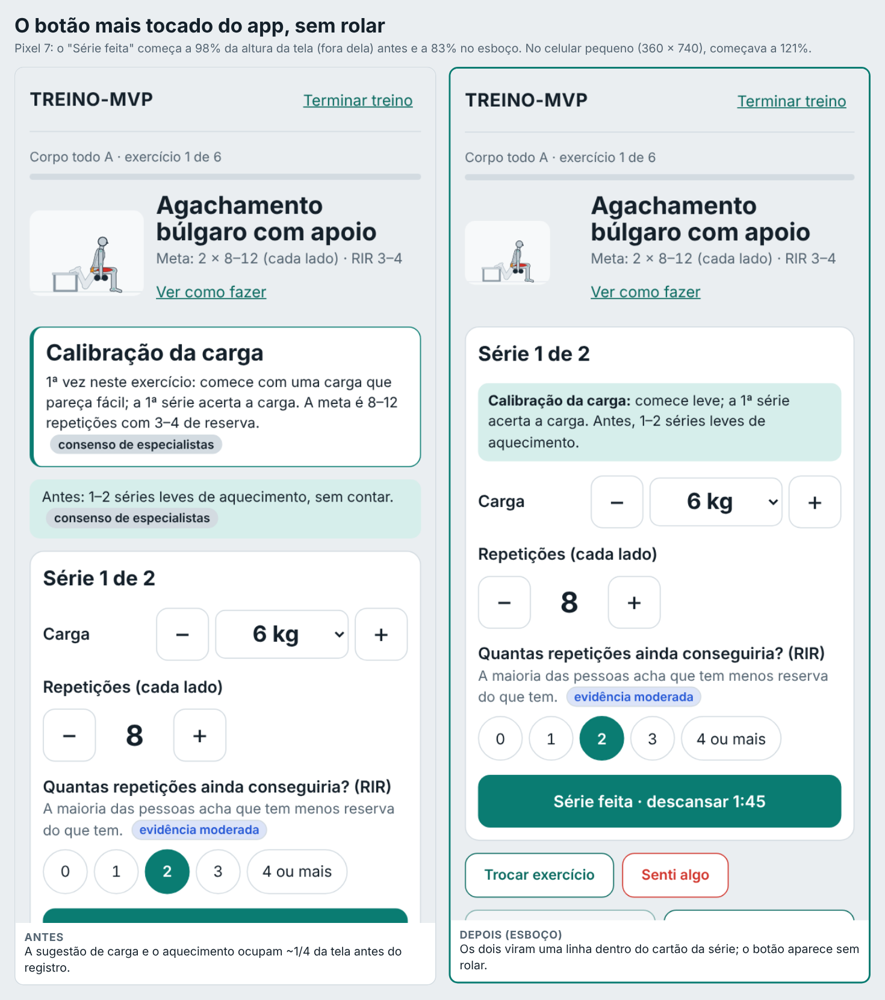
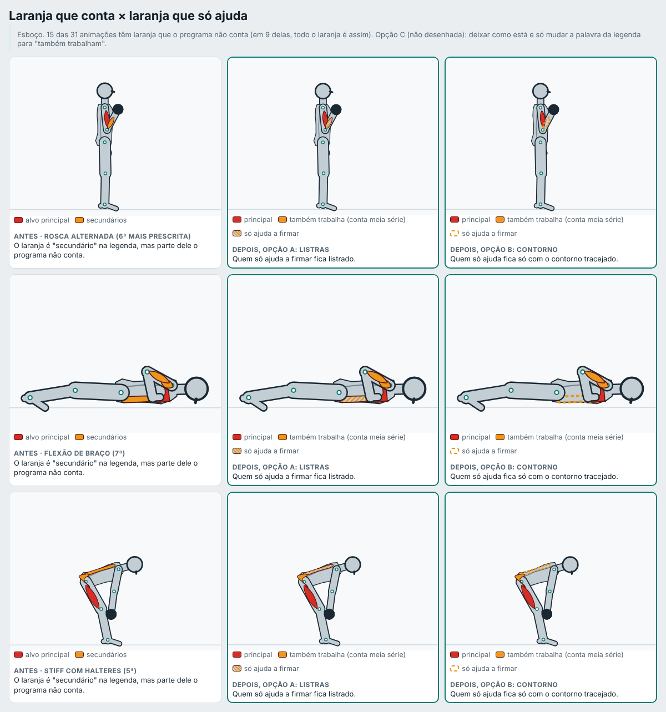
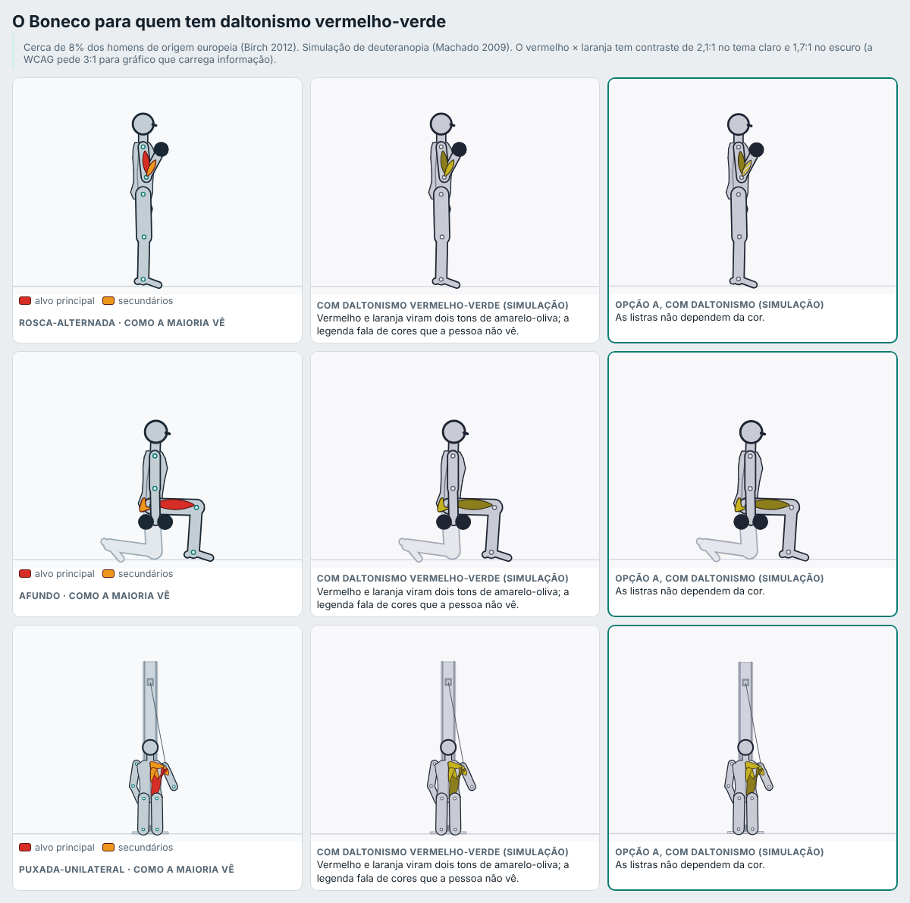
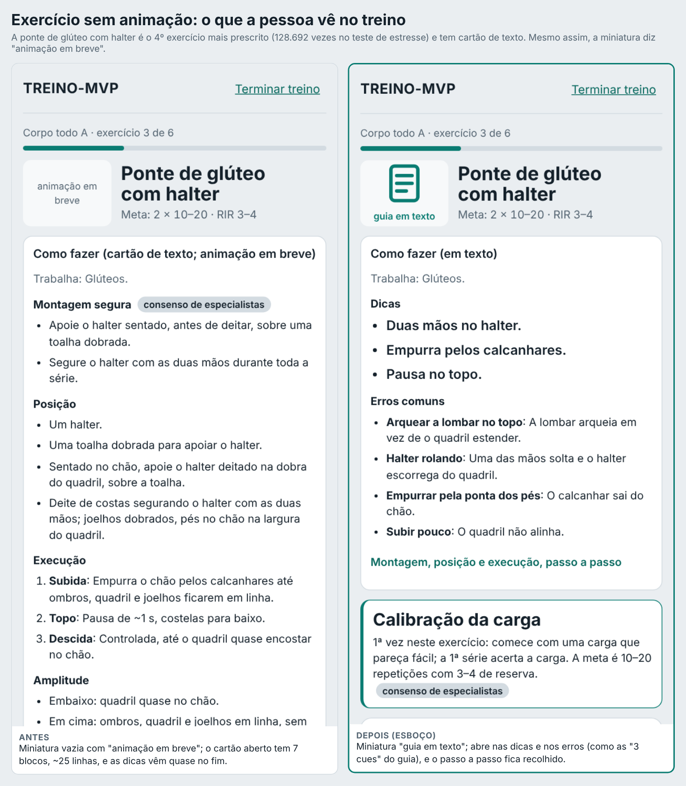
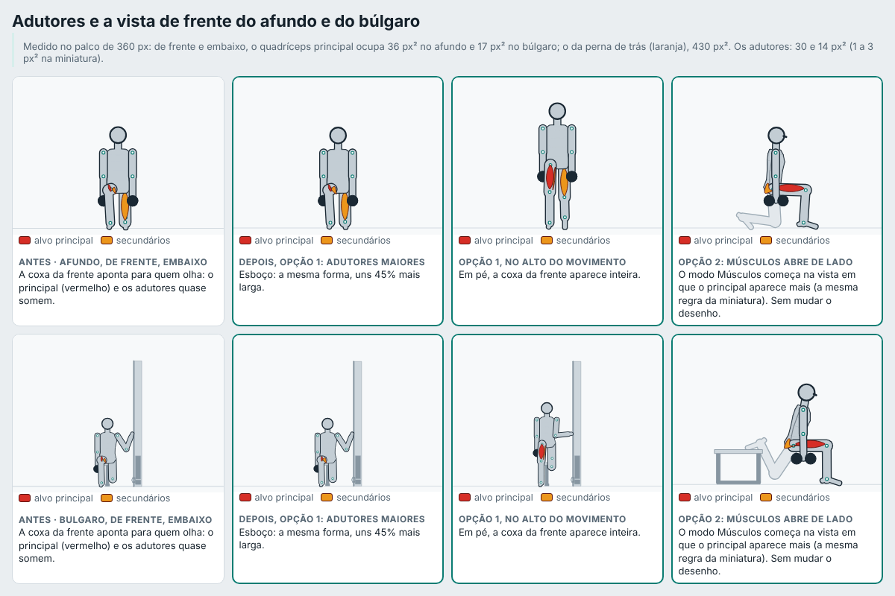
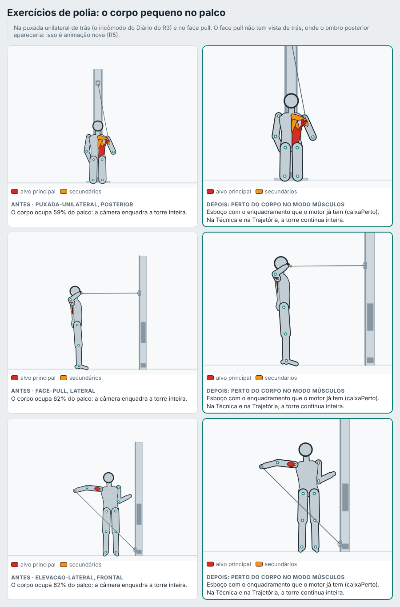
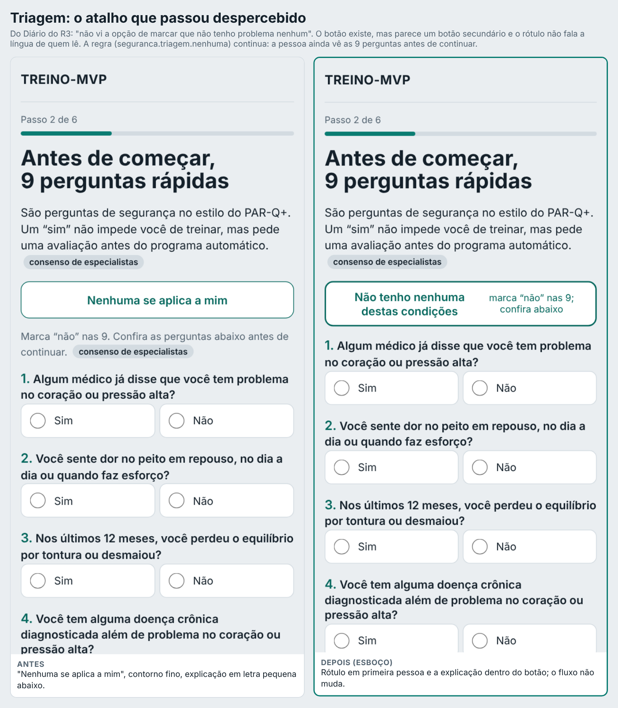
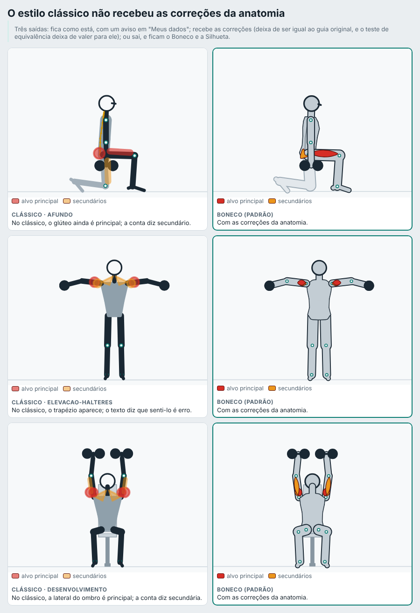

# Revisão de design (03/11/2026)

> **Atualização (03/11/2026):** a pedido do Gustavo, esta revisão foi revista e virou uma proposta de reformulação visual completa em `design-v2.md`. Os achados abaixo continuam medidos e válidos; os itens de tela passam a ser resolvidos pela v2.
>
> Revisão independente das telas e do Boneco, olhando o app como quem treina: no celular, com uma mão, na academia. É a 3ª de 3 sessões (auditoria do treino → anatomia → **design**). Nada mudou no app: cada item espera a decisão do Gustavo.
>
> **Como foi feito.** Tudo por script, com a persona fictícia Ana (e uma variação dela com elásticos):
> - `scripts/design/capturas.spec.ts`: cada tela num Pixel 7 (412 px de largura), no tema claro e no escuro, e num celular pequeno (360 × 740). As imagens ficam em `reports/design/telas/` (fora do git, ~5 MB por tema); os números, em `revisoes/design/medidas-*.json`.
> - `scripts/design/medir.ts`: em cada tela, as áreas de toque menores que 44 px, o contraste de cada texto (a conta da WCAG) e onde fica o botão principal na altura da tela.
> - `scripts/design/boneco.mjs`: o Boneco nos 15 exercícios com animação mais prescritos, mais a puxada unilateral, o face pull, o desenvolvimento e a elevação lateral na polia; cada vista, Técnica e Músculos, no tamanho do palco (360 px) e da miniatura (112 px), e o mesmo quadro simulando daltonismo. Mede a área de cada músculo na tela (`revisoes/design/boneco-medidas.json`).
> - `scripts/design/ajudantes.ts`: em quais animações o laranja mistura o músculo que conta meia série com o que só ajuda (`revisoes/design/ajudantes.json`).
> - `scripts/design/antes-depois.spec.ts` e `antes-depois-boneco.mjs`: o antes e o depois de cada proposta (`docs/img/design-*.png`). **O depois é um esboço** aplicado na página ou no desenho em memória; o app e a linha de base do Boneco não mudaram.
>
> **Selos** como em `docs/pesquisa/00-metodo.md`. Norma (WCAG) entra como **consenso**: é um acordo técnico, não um ensaio. O que é opinião minha está marcado **[opinião]**. A **frequência** vem do teste de estresse da auditoria (149.760 programas; `revisoes/auditoria/inventario.md`): quantas vezes o exercício foi prescrito.

## Em uma frase
Fora do guia, as telas estão **bem resolvidas**: nenhuma área de toque pequena, nenhum contraste baixo no tema claro, nada rola de lado. Os problemas estão em **três lugares**: (1) **o guia**, a tela que ensina, tem de 24 a 31 controles menores que 44 px e nunca entrou no teste de toque; (2) **o treino**: o botão "Série feita", o mais tocado do app, começa fora da tela na 1ª série de cada exercício; (3) **o Boneco** diz tudo só pela cor (vermelho × laranja), que 1 em cada 12 homens não distingue bem, e o mesmo laranja quer dizer duas coisas.

## O que está bom (medido)
| O que | Resultado |
|---|---|
| Áreas de toque | 0 alvo menor que 44 px em todas as telas fora do guia, nos 2 temas e no celular pequeno |
| Rolar de lado | nenhuma tela rola de lado, nem a 360 px |
| Contraste no tema claro | 0 texto abaixo do mínimo fora do guia, salvo 1 rótulo pequeno na evolução (4,2:1) |
| Descanso | fixo embaixo, perto do polegar, com botões de 44 px ou mais (já medido no R3) |
| Movimento reduzido | com `prefers-reduced-motion`, o guia não começa animando; as transições do app são desligadas |
| Tema escuro | as mesmas cores com outra paleta; só 2 textos abaixo do mínimo (achado 9) |
| Miniatura do programa (ponto 4) | **as 6 animações corrigidas pela anatomia continuam com a melhor vista** (afundo, búlgaro, stiff unilateral e desenvolvimento seguem na mesma vista; nas elevações nada mudou). A fração do músculo principal caiu onde o glúteo e a lateral do ombro viraram secundários, mas a vista escolhida continua a de maior fração |
| Boneco no palco | nos exercícios sem polia, o corpo ocupa 80% a 90% do palco |

## Os achados, do mais importante ao menos

Gravidade: **atrapalha** (custa toque, rolagem ou erro), **confunde** (a pessoa entende errado) ou **incomoda** (pior que podia ser). Frequência: quantas vezes aparece.

| # | Achado | Gravidade | Frequência | Esforço |
|---:|---|---|---|---|
| 1 | Guia: 24 a 31 controles menores que 44 px | atrapalha | todo exercício com animação (58% das prescrições), a cada vez que abre o guia | pequeno (CSS + teste) |
| 2 | Treino: "Série feita" começa fora da tela | atrapalha | 1ª série de todo exercício, toda sessão | pequeno |
| 3 | Boneco: só a cor separa principal de secundário; o laranja quer dizer duas coisas | confunde | as 31 animações; 15 com laranja que só ajuda | médio (muda o desenho: folha a folha) |
| 4 | Exercício sem animação: "animação em breve" na miniatura e cartão longo | confunde | 38 com cartão (24% das prescrições) e 37 sem guia (18%) | pequeno |
| 5 | Vista de frente do afundo e do búlgaro: o principal e os adutores somem | confunde | afundo 87.111 e búlgaro 50.234 | pequeno (opção 2) ou médio (opção 1) |
| 6 | Polia: o corpo ocupa 46% a 62% do palco | incomoda | puxada unilateral, face pull, elevação lateral na polia (65.123 juntos) | médio (muda o desenho) |
| 7 | Triagem: o atalho "Nenhuma se aplica a mim" passa despercebido | atrapalha | 1 vez por pessoa (cadastro) | pequeno |
| 8 | Equipamento: 21 de 46 itens sem desenho; 4 telas de altura | atrapalha | 1 vez por pessoa e por local | médio a grande (desenhar ícones) |
| 9 | Contraste de textos pequenos | incomoda | guia (todo exercício) e 3 telas | pequeno |
| 10 | Estilo clássico sem as correções da anatomia | confunde (quem escolher o clássico) | só quem troca o estilo em "Meus dados" | pequeno a médio, conforme a saída |
| 11 | Tela de experiência ("dá para melhorar") | — | 1 vez por pessoa | precisa de detalhe do Gustavo |

---

### 1. O guia não foi feito para o polegar
**O que medi.** No guia aberto a partir do treino ("Ver como fazer"), **25 controles** têm menos de 44 px (24 no celular pequeno); no guia aberto pelo catálogo, de 28 a 31. Os botões de tocar, voltar ao início, câmera lenta, vista (Lateral/Frontal), modo (Técnica/Erros/Músculos/Trajetória) e os chips dos exercícios têm de 34 a 38 px de altura; os itens do "Checklist de 5 s", 34 px; o "Limpar checklist", 18 px. O "‹ Voltar ao treino", a única saída para o treino, tem 31 px e sai no azul padrão do navegador, não no verde do app (o guia fica fora da classe `.app`, que dá a cor dos links).

**Por que importa.** O `CLAUDE.md` pede 44 px. O teste de toque do R3 (`tests/e2e/toque.ts`) cobre as telas do R2 e o treino, **mas não o guia**: por isso passou. A WCAG 2.2 pede no mínimo 24 px (2.5.8, nível AA) e recomenda 44 px (2.5.5, nível AAA) **[consenso]**. Num estudo de uso com o polegar de uma mão só, alvos de 9,2 mm não pioraram o desempenho nem a preferência (Parhi, Karlson e Bederson 2006) **[um estudo]**. Num Pixel 7, 44 px dão uns 7 mm; 9,2 mm são uns 57 px. Ou seja, 44 px já é o piso, não o conforto.

**Proposta.** Todos os controles do guia com 44 px ou mais; o "Voltar ao treino" na cor do app; e o guia entra no teste de toque (`semToquePequeno`). O desenho do palco não muda. Esboço: o mesmo guia com 3 alvos pequenos restantes (as 3 marcas da barra de fases, que não são botões).

### 2. O botão mais tocado começa fora da tela
**O que medi.** Na 1ª série de cada exercício, o "Série feita" começa a **98% da altura da tela** num Pixel 7 (fora dela) e a **121%** no celular pequeno: é preciso rolar para registrar. Acima dele, a caixa da sugestão de carga ("Calibração da carga" ou "Hoje: 8 kg") e a do aquecimento ocupam cerca de 1/4 da tela. Nas séries seguintes, essas caixas somem e o botão sobe.

**Por que importa.** É o toque que a pessoa repete em toda série. Com uma mão, rolar e depois tocar embaixo é o gesto mais difícil. Pessoas usam o celular com uma mão só em boa parte do tempo (49% dos 1.333 usos observados em público por Hoober 2013) **[um estudo, observacional, sem revisão por pares]**.

**Proposta [opinião].** A sugestão de carga e o aquecimento viram uma linha dentro do cartão da série, logo abaixo de "Série 1 de 2", com o selo mantido. No esboço, o botão sobe para 83% da tela. A regra e o texto não mudam, só o lugar.

### 3. O Boneco fala só pela cor, e o laranja diz duas coisas
**O que medi.**
- **Contraste entre as cores dos músculos:** vermelho × laranja dá **2,1:1** no tema claro e **1,7:1** no escuro; o laranja sobre a pele do boneco, **1,5:1** no claro; o vermelho sobre a pele, **1,8:1** no escuro. O contorno escuro (5,7:1 no claro) é o que desenha a forma; a diferença entre principal e secundário está só no tom.
- **Daltonismo:** com a simulação de deuteranopia (Machado, Oliveira e Fernandes 2009), vermelho e laranja viram dois tons de amarelo-oliva; a legenda fala de cores que a pessoa não vê. O daltonismo vermelho-verde atinge cerca de 8% dos homens e 0,4% das mulheres de origem europeia (Birch 2012) **[moderada: revisão de grandes levantamentos populacionais; resumo conferido por busca. Corrigido de "robusta" na revisão v2, `design-v2.md`]**.
- **O laranja que só ajuda (ponto 2):** em **15 das 31 animações**, há laranja de músculo que o programa não conta para aquele exercício (antebraço nas roscas e na barra fixa, lombar nos stiffs, oblíquos nos abdominais, abdômen na flexão, frente do ombro nas elevações, trapézio no desenvolvimento, panturrilha na flexão de joelho na bola). Em **9 delas, todo o laranja é assim**, e a legenda chama de "secundários". Entre elas estão o abdominal no chão, a elevação lateral, o stiff, a rosca alternada e a flexão: 5 dos 7 exercícios mais prescritos.

**Por que importa.** A WCAG pede que a cor não seja o único meio de passar uma informação (1.4.1) e que partes de gráfico necessárias para entender tenham contraste de 3:1 (1.4.11) **[consenso]**. O realce do músculo é o que ensina (`richter2016`, **moderada**): se metade do realce é ambíguo, ensina menos **[opinião]**.

**Propostas (uma escolha, com as folhas aprovadas uma a uma antes de gravar a linha de base):**
- **A. Listras:** quem só ajuda fica listrado de laranja; a legenda ganha 3 itens: "principal", "também trabalha (conta meia série)" e "só ajuda a firmar". As listras também resolvem o daltonismo para esse terceiro nível.
- **B. Contorno:** quem só ajuda fica só com o contorno laranja tracejado, sem preenchimento.
- **C. Só a palavra:** o desenho fica igual; a legenda troca "secundários" por "também trabalham". Não separa os dois tipos, mas deixa de afirmar que todos contam.
- Em qualquer uma: a legenda pode ganhar um rótulo de texto no próprio músculo principal **[opinião, para depois]**.

### 4. Exercício sem animação: a promessa e o cartão longo
**O que medi.**
- Os **38 exercícios com cartão de texto** (24% das prescrições) aparecem no programa e no treino com a miniatura vazia "animação em breve", igual aos 37 que não têm guia nenhum. A ponte de glúteo com halter, o 4º exercício mais prescrito (128.692 vezes), está entre eles. O título do cartão repete "(cartão de texto; animação em breve)".
- O cartão aberto tem **7 blocos e ~25 linhas** (Montagem, Posição, Execução, Amplitude, Dicas, Erros, Carga) e empurra o registro da série para quase 2 telas abaixo. As **Dicas**, que são o equivalente às "3 cues" do guia, vêm quase no fim.
- Os **37 sem guia** (18% das prescrições, quase todos com elástico ou peso do corpo) não mostram nada no treino além do nome; no programa, "Animação em breve. Trabalha…".

**Por que importa.** "Em breve" é uma promessa sem data; o quadrado vazio parece erro de carregamento **[opinião]**. No guia, a hierarquia é: animação → 3 cues → segurança → checklist; o cartão tem outra ordem, e a pessoa entre séries lê o começo **[opinião]**. Mostrar primeiro o essencial e dar o resto sob demanda segue o princípio de sinalização (`richter2016`, **moderada**) e o de segmentar o conteúdo em partes (Mayer, *Multimedia Learning*, princípio de segmentação) **[consenso: livro-texto; não conferi um ensaio específico nesta sessão]**.

**Propostas [opinião].**
- **4a.** A miniatura dos cartões mostra um ícone e "guia em texto"; a dos 37 sem guia, "sem guia ainda". O título do cartão vira "Como fazer (em texto)".
- **4b.** O cartão abre em **Dicas** e **Erros comuns**; **Montagem segura continua sempre visível** (é segurança, com selo); Posição, Execução, Amplitude e Carga ficam num "passo a passo" recolhido. O texto não muda.
- **4c.** Nos 37 sem guia, uma linha no treino: "Sem guia ainda. Se não conhece o exercício, troque por um com guia" com o botão "Trocar exercício" que já existe.

### 5. A vista de frente do afundo e do búlgaro (ponto 1)
**O que medi.** No modo Músculos, de frente e embaixo, a coxa da frente aponta para quem olha: o **quadríceps principal ocupa 36 px²** do palco no afundo e **17 px²** no búlgaro, enquanto o quadríceps da perna de trás (laranja) ocupa **430 px²**. Os **adutores ocupam 30 e 14 px²** (de 1 a 3 px² na miniatura, menos que um ponto). Quem abre o Músculos de frente vê sobretudo o laranja da perna que menos trabalha. A miniatura não usa essa vista (usa a lateral), então o problema aparece só no guia.

**Propostas.**
- **Opção 1: adutores maiores** (esboço: a mesma forma, uns 45% mais larga). Ajuda pouco: no fundo do movimento, a coxa continua de ponta; no alto, os adutores quase não aparecem **[opinião]**. Muda o desenho (folha a folha).
- **Opção 2: o modo Músculos abre na vista em que o principal aparece mais**, a mesma regra que já escolhe a miniatura (`vistaDaMiniatura`). A pessoa ainda pode tocar em "Frontal". Não muda o desenho nem a linha de base. Vale para todos os exercícios: entre os 19 medidos, em 4 a vista inicial do guia não é a de maior fração do principal (supino reto e inclinado, remada apoiada e panturrilha no chão).
- As duas podem entrar juntas.

### 6. Exercícios de polia: o corpo pequeno no palco
**O que medi.** A câmera enquadra a torre inteira. Na **puxada unilateral** (as duas vistas), o corpo ocupa **59%** do palco; no **face pull**, 62% de lado e 46% de cima; na **elevação lateral na polia**, 62%; no búlgaro de frente, 57%. Nos outros exercícios, de 80% a 90%. No face pull, os músculos principais quase não aparecem em nenhuma vista (0,02% do palco de lado; 0% de cima), porque a parte de trás do ombro não fica virada para a câmera. É o incômodo do Diário do R3 (a puxada de trás "vira um triângulo" e o face pull de cima).

**Proposta.** No modo **Músculos**, o enquadramento "perto do corpo" que o motor já tem (`caixaPerto`, do R4). Na Técnica e na Trajetória, a torre continua inteira, porque ela mostra a direção do cabo. Muda o desenho de 3 animações (folha a folha). A vista de trás do face pull, onde o ombro posterior apareceria, é animação nova: fica para o R5.

### 7. Triagem: o atalho que passou despercebido
**O que medi.** "Nenhuma se aplica a mim" existe desde o R1, no topo, mas com o visual de botão secundário (contorno fino), e a explicação ("Marca 'não' nas 9…") fica em letra pequena abaixo. Depois do toque, o "Continuar" fica a 1,8 tela abaixo (2,1 no celular pequeno), porque a regra `seguranca.triagem.nenhuma` pede que a pessoa veja as 9 perguntas antes de seguir. Do Diário: "não vi a opção de marcar que não tenho problema nenhum".

**Proposta [opinião].** Rótulo em primeira pessoa ("Não tenho nenhuma destas condições"), com a explicação dentro do botão e borda mais forte. O fluxo e a regra não mudam: a pessoa continua rolando pelas perguntas, que é o que a segurança pede. Juntar "o que quero evitar" com as perguntas do início (outra sugestão do Diário) muda o fluxo do cadastro: vai para o backlog, não para esta revisão.

### 8. Equipamento: 21 itens sem desenho
**O que medi.** A tela tem de 3,8 a 4,5 alturas de tela. **21 dos 46 itens não têm desenho**, só o nome (kettlebell, banco Scott, banco romano, puxador alto, remada baixa, multifuncional, barra hexagonal, as 11 máquinas, a suspensão…). Os pesos dos halteres aparecem só depois de marcar "Halteres fixos". Do Diário: "demora; não aparecem as imagens dos equipamentos nem os pesos para marcar". Os atalhos ("Academia completa" etc.) ajudam e já existem.

**Proposta [opinião].** Desenhar os 21 ícones que faltam, no mesmo traço dos 25 que existem, começando pelas máquinas mais comuns em academia. Esforço médio a grande (desenho). Não proponho mostrar os pesos antes de marcar: seriam 3 grupos de chips para cada tipo de peso, e a tela ficaria ainda mais longa.

### 9. Contraste de textos pequenos
**O que medi** (o mínimo é 4,5:1 para texto normal e 3:1 para texto grande, WCAG 1.4.3 **[consenso]**):
- Verde sobre verde-claro no guia (o modo escolhido, o número do chip do exercício e o rótulo "subida" da barra de fases, este com 10 px): **4,2:1**.
- Tema escuro: o selo "INSPIRA"/"EXPIRA" no palco: **2,8:1**; "Apagar todos os dados", em "Meus dados": **3,4:1**.
- Evolução: o rótulo "acerto da carga" (12 px): **4,2:1**.

**Proposta.** Escurecer o verde desses textos no tema claro (`--link` em vez de `--accent`: 5,4:1) e ajustar as duas cores do tema escuro. O desenho do Boneco não muda. Teste: o mesmo cálculo de contraste de `medir.ts` vira teste nas telas.

### 10. O estilo clássico (ponto 3)
O clássico continua igual ao guia original e **não recebeu as correções da anatomia**: o glúteo do afundo aparece como principal, o trapézio aparece na elevação lateral e a lateral do ombro é principal no desenvolvimento. Ele também usa vermelho e laranja transparentes, o que piora o achado 3.

**Três saídas** (nenhuma pré-escolhida):
- **Fica como está**, com um aviso em "Meus dados": "o clássico é o desenho do guia original; os músculos do Boneco são os revistos".
- **Recebe as correções**: deixa de ser idêntico ao guia original, e o teste de equivalência (`tests/motor/equivalencia.spec.ts`, `guia-visual.spec.ts`) deixa de valer para ele; precisa de uma linha de base própria.
- **Sai**: ficam o Boneco e a Silhueta; quem tinha escolhido o clássico passa ao Boneco. O código do clássico continua existindo para o teste de equivalência do motor **[opinião: a saída mais simples]**.

### 11. A tela de experiência
Do Diário: "dá para melhorar um pouco". A tela não tem problema medido (0 toque pequeno, 0 contraste baixo). O que vejo **[opinião]**: 10 opções em 3 perguntas, e o resultado ("Seu nível: Iniciante") aparece só embaixo, depois das 3 respostas. Sem saber o que incomodou, não proponho mudança: fica a pergunta para o Gustavo.

## Fora desta revisão (anotado)
- Quais músculos cada exercício trabalha (o texto "Alvo: quadríceps e glúteo" do afundo é da anatomia; `tests/unit/anatomia.test.ts`), a escolha dos exercícios, o gerador, as animações novas (a vista de trás do face pull é R5) e o branch `r3-uso-real`.
- A rodada com especialista do R4 (`revisoes/r4-roteiro-especialista.md`) continua valendo para a "clareza do movimento", o ponto fraco do Boneco segundo o Gustavo.

## Fontes novas
- `wcag22`: W3C. Web Content Accessibility Guidelines (WCAG) 2.2. Recomendação do W3C, 05/10/2023. Critérios 1.4.1, 1.4.3, 1.4.11, 2.3.3, 2.5.5 e 2.5.8. **consenso** (norma técnica).
- `parhi2006`: Parhi P, Karlson AK, Bederson BB. Target size study for one-handed thumb use on small touchscreen devices. MobileHCI 2006:203-210. Resumo conferido por busca em 03/11/2026; texto completo não lido.
- `birch2012`: Birch J. Worldwide prevalence of red-green color deficiency. J Opt Soc Am A 2012;29(3):313-320. PMID 22472762. Resumo conferido por busca em 03/11/2026.
- `machado2009`: Machado GM, Oliveira MM, Fernandes LAF. A physiologically-based model for simulation of color vision deficiency. IEEE TVCG 2009;15(6):1291-1298. doi:10.1109/TVCG.2009.113. Usado só para a simulação nas imagens.
- `hoober2013`: Hoober S. How do users really hold mobile devices? UXmatters, fev. 2013 (observação de 1.333 usos em público). Artigo de coluna, sem revisão por pares; o número de 49% conferido em fontes secundárias.
- Já no projeto: `richter2016` (sinalização, moderada) e `hoffler2007` (`docs/pesquisa/animacoes/r4-estilo-do-boneco.md`).

## A decisão (para o Gustavo, item a item)
Nada vem marcado. Para cada item: entra, não entra, ou entra de outro jeito.

| # | Item | O que muda | Muda o desenho do Boneco? |
|---:|---|---|---|
| 1 | Guia com 44 px, "Voltar ao treino" na cor do app, guia no teste de toque | tela | não |
| 2 | Sugestão de carga e aquecimento dentro do cartão da série | tela | não |
| 3 | Legenda do Boneco: A (listras), B (contorno) ou C (só a palavra) | desenho (A, B) ou texto (C) | A e B: sim, folha a folha |
| 4a | Miniatura "guia em texto" / "sem guia ainda" e o título do cartão | tela | não |
| 4b | Cartão abre nas dicas e nos erros; montagem segura sempre visível | tela | não |
| 4c | Linha "sem guia ainda" com o "Trocar exercício" | tela | não |
| 5 | Opção 1 (adutores maiores) e/ou opção 2 (Músculos abre na melhor vista) | desenho (1) ou tela (2) | 1: sim, folha a folha |
| 6 | Músculos perto do corpo nos exercícios de polia | desenho | sim, folha a folha |
| 7 | Rótulo do atalho da triagem | tela | não |
| 8 | Os 21 ícones de equipamento | desenho de ícones | não |
| 9 | Contraste dos textos pequenos | cores do texto | não |
| 10 | Clássico: fica com aviso, recebe as correções ou sai | opção em "Meus dados" | só se receber as correções |
| 11 | Tela de experiência: o que incomodou? | — | — |

Cada item aprovado entra num branch próprio (`design-correcoes`), com um commit e um teste por correção. Os itens que mudam o desenho só gravam a linha de base do Boneco depois de cada folha aprovada (`node scripts/folha-animacao.mjs <id> --estilo=a`).
