# Diagnóstico do frontend de hoje (12/11/2026)

> O app como está na `main` depois do PR 4 (`3b9d7db`), tela por tela, com a persona fictícia Ana (`tests/personas`): iniciante, halteres fixos de 1 a 12 kg e banco reto, 3 treinos de 45 min. As capturas saem de um script (`scripts/design/frontend-novo/capturas.spec.ts`), em 390 × 844 e 320 × 640, nos temas claro e escuro: 39 telas e estados em cada um dos 4 formatos, em `capturas/antes/`. Junto das imagens ficam as medidas de cada tela (`capturas/antes/medidas-*.json`): altura da página, palavras à vista e se a ação principal aparece sem rolar.
>
> Marcas: **[medido]** vem de script ou de contagem no código; **[visto]** é o que se vê na captura; **[opinião]** é leitura minha. Os blocos A (grade de 8) e B (os 20 cuidados) são os do pedido (`docs/prompts/sessao-frontend-novo.md`, seção 2.2).

## Em uma frase

O app de hoje funciona e passa nos testes de toque e de contraste, mas o que ele tem de único fica pequeno: no treino, o Boneco é uma miniatura de 112 px e o guia mora em outra tela. Em volta dele, quase tudo tem contorno, quase toda regra traz o selo à vista, e os títulos dizem o tipo da tela ("Seu treino", "Meus dados") em vez do que ela mostra.

## 1. O que vale para o app inteiro

### Bloco A: a grade de 8

Contagem no `src/styles.css` (913 linhas), sem o desenho do Boneco **[medido]**:

| O que | Hoje | O pedido |
|---|---|---|
| Valores de espaço (margem, respiro, distância) | 446 | todos na escala 4 · 8 · 16 · 24 · 32 · 48 · 64 |
| Uso do 12 (o token `--e3` e o `12px` escrito à mão) | 91 (13 + 78) | o 12 sai da escala |
| Outros valores escritos à mão fora da escala | 94: `2px` (32), `1px` (16), `22px` (9), `10px` (8), `6px` (4), `3px` (3), `14px` (2) e outros | nenhum |
| Tamanhos de letra diferentes | 15 (os 7 tokens e mais 8 escritos à mão) | só tokens |
| Alturas de toque | 48 (32 usos), 56 (16), 52 (4), 44 (3), 42 (3) | 48, 56 ou 64 |
| Cantos diferentes | 7 (3 tokens, `50%`, `2px`, `3px` e uma combinação) | só tokens |
| Estilo escrito dentro do componente (`style={{…}}`) | 21 lugares em `src/features/` | nenhum |

Parte dos `1px` e `2px` é ajuste de posição e de borda, não espaço entre peças; a conferência automática (`npm run conferir:tokens`, a criar na etapa 2) vai separar os dois casos. O que pesa é o 12: ele é hoje o segundo espaço mais usado do app. A pesquisa mostra que vários sistemas de design usam o 12 (`referencias.md`, "Onde as fontes discordam do pedido"), mas os três protótipos desta etapa foram feitos sem ele e sem nenhum espaço fora da escala. Fica como decisão do Gustavo, com as capturas dos protótipos como evidência.

### Bloco B: os cuidados que mais falham

| # | Cuidado | O que se vê hoje | Onde |
|---:|---|---|---|
| 1 | Selo só quando informa | O selo de evidência informa, mas fica na frente em quase toda tela: há 70 usos de `<Selo>` no código **[medido]**. Aparece ao lado do aviso de privacidade, do intervalo de datas da semana e de frases de ajuda. O pedido diz "a um toque, sem ocupar a frente". | boas-vindas, saúde, nível, rotina, treino, fim, semana, Meus dados, locais |
| 2 | Sem rótulo redundante | "Reconhecer pela foto" duas vezes seguidas na folha da foto; "ainda não treinou nesta semana" repetido embaixo de cada músculo. | `05b`, `14` |
| 6, 7 | O conteúdo real na frente e maior | No treino, o Boneco tem 112 px de largura; o guia grande está em outra tela. Em Meus dados, 60 palavras de texto e um aviso vêm antes da primeira linha útil. | `08`, `16` |
| 8 | Agrupar por distância | 53 declarações de borda no CSS **[medido]**: cada opção, botão, passo e chip tem contorno de 1,5 px. O contorno faz o trabalho que a distância deveria fazer. | todas |
| 9 | Título específico | "Seu treino", "A sua semana", "Meus dados", "Treino concluído". O nome do dia ("Corpo todo A") fica dentro de um cartão pequeno. | `06`, `13`, `14`, `16` |
| 10 | Uma ação principal | No descanso há dois botões cheios na mesma tela: "Pular" e "Série feita". | `09` |
| 12 | Ícones de uma família | Emoji no lugar de ícone no guia (a tartaruga do "Lento", o ❌ dos erros) e 13 desenhos soltos escritos dentro dos componentes **[medido]**. | `12`, `12b` |
| 16 | Quebra de título | No guia, "Agachamen-to búlgaro com apoio" quebra no meio da palavra, espremido pelos botões ‹ ›. A 320 px, "‹ Anterior" e "Próximo ›" quebram com a seta sozinha na linha, e "4 ou mais" quebra dentro do círculo. `text-wrap: balance` aparece em 2 lugares do CSS. | `12`, `11` e `08b` em 320 |
| 19 | Estado em toda espera | As miniaturas do Boneco no início chegam de 0,8 a 1,2 s depois da tela **[medido nesta máquina]**; até lá aparece um quadro vazio, sem indicação. A evolução com um treino só mostra uma linha e o resto da tela em branco, sem dizer o que vai aparecer. | `06`, `15` |

O que já está certo e fica **[medido ou visto]**: uma família de letra só (cuidado 4); números de largura igual em 19 lugares (cuidado 18); nenhum itálico (cuidado 3); 1 degradê só e 12 sombras, todas leves (cuidado 13); o relógio do descanso é o maior elemento da tela (cuidado 7); contraste e toque de 44 px passam nos testes de ponta a ponta (cuidado 15).

### Outros achados gerais

- **A faixa "treino-mvp".** 11 telas (boas-vindas, os 4 passos do cadastro, início, fim do treino, semana, Meus dados, o ajuste de "algo a evitar" e os termos) abrem com uma faixa de cerca de 80 px com o nome de trabalho do projeto **[medido: os usos de `Topo` sem "voltar" em `src/features/`]**. Ela só leva ao início e não diz nada sobre a tela.
- **A ação principal fora da 1ª tela.** A 390 px: na saúde, "Não, nenhuma" fica abaixo da dobra (a página tem 1,4 tela) **[medido]**. A 320 px: o "Começar" das boas-vindas e o "Série feita" dos 6 exercícios do treino ficam fora da 1ª tela **[medido]**, porque nessa largura o painel da série deixa de ficar preso embaixo.
- **Texto cortado.** No exercício "Flexão de joelho deslizando os pés no chão", o seletor de dificuldade mostra "Mais repetiçõe", cortado, e a prescrição ("2 × 8–15") some atrás do painel **[visto, `08c-treino-exercicio-5`]**.
- **O que a pesquisa de PWA achou no código** (`pesquisa/05-pwa-com-cara-de-nativo.md`, lista de 30 itens): faltam o estado pressionado (`:active` tem 0 ocorrências no CSS), `overscroll-behavior`, `touch-action: manipulation`, tirar o realce do toque e travar a rolagem do fundo com a folha aberta. São os sinais que fazem um app instalado parecer "site".

## 2. Tela por tela

Para cada tela: a captura (390 px, claro), o que falha nos blocos A e B, e **o que ela deveria priorizar e hoje não prioriza**. As versões em 320 px e no tema escuro estão nas pastas `capturas/antes/320-*` e `capturas/antes/390-escuro`, com o mesmo nome de arquivo.

### Boas-vindas

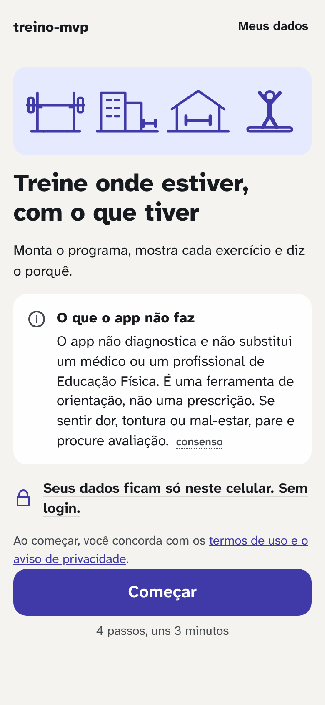

- 89 palavras à vista; o botão aparece a 390 px e fica fora da tela a 320 px **[medido]**.
- A tela não mostra o que o app tem de próprio: nenhum Boneco. Os 4 desenhos do topo são os lugares de treino, que a pessoa só escolhe 4 telas depois.
- "Meus dados" no canto, antes de existir qualquer dado.
- **Deveria priorizar:** uma frase, o Boneco em movimento (é o produto) e o "Começar". O aviso de segurança continua inteiro e à vista.

### Saúde (triagem)

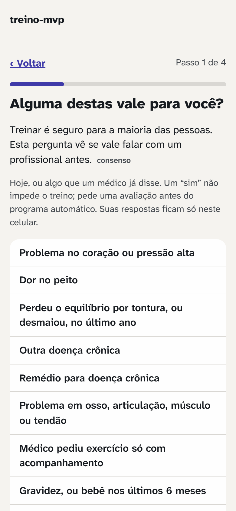

- 112 palavras; as duas respostas ("Não, nenhuma" e "Sim, alguma") ficam abaixo da dobra a 390 e a 320 px **[medido]**. A lista das 9 condições ocupa a tela e empurra a resposta.
- Na tela do "sim" (`02b`), 9 cartões com contorno, cada um com caixa de marcar: lê como formulário longo.
- **Deveria priorizar:** a pergunta e as duas respostas presas embaixo, com a lista rolando por trás. O texto da triagem não muda.

### Nível

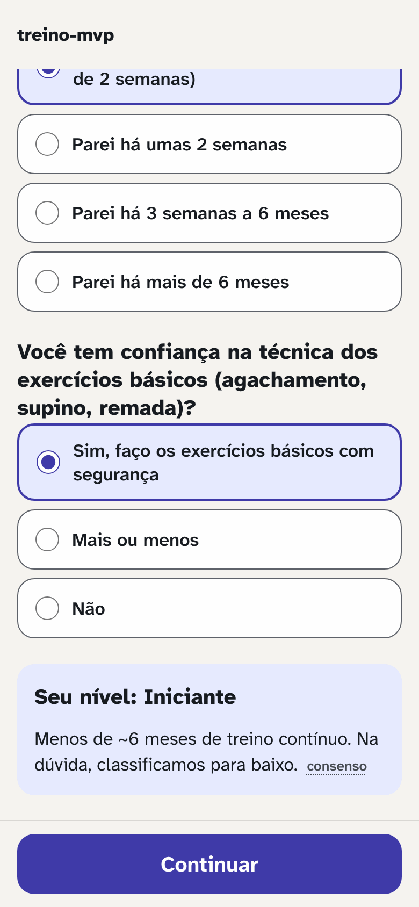

- Três perguntas na mesma página; respondida, a página tem 1,7 tela **[medido]**. O "Continuar" só aparece depois das respostas.
- O resultado ("Seu nível: Iniciante") é o conteúdo da tela e aparece no fim, num cartão lilás com o selo ao lado.
- **Deveria priorizar:** uma pergunta por vez (o redesign de 05 a 08/11 já apontava isso como princípio) e o nível como resposta em destaque.

### Rotina

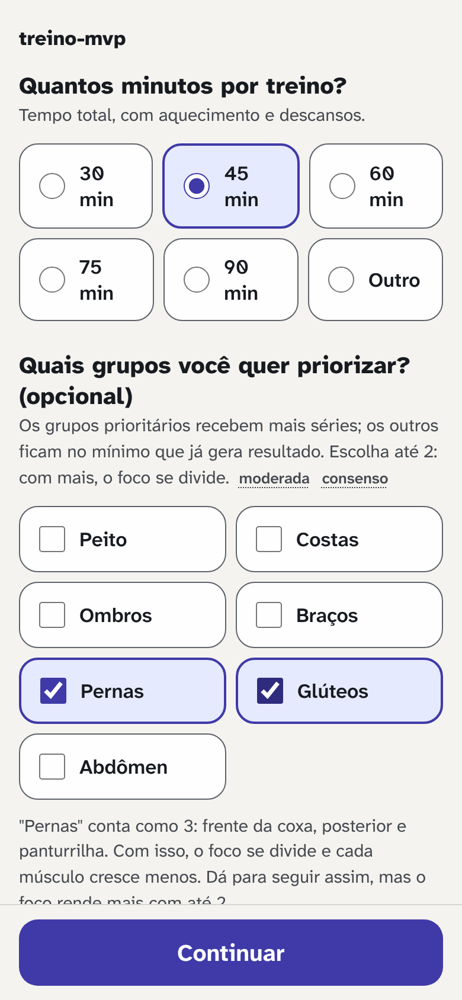

- 106 palavras **[medido]**; dias, minutos e prioridades na mesma página, com 18 opções com contorno (5 de dias, 6 de minutos e 7 de grupos) **[visto]**.
- Dois selos lado a lado ("moderada", "consenso") no meio do texto de ajuda.
- **Deveria priorizar:** os dois números que montam o programa (dias e minutos), grandes e com 1 toque cada. As prioridades são opcionais e podem vir depois, recolhidas.

### Equipamento (com a foto)

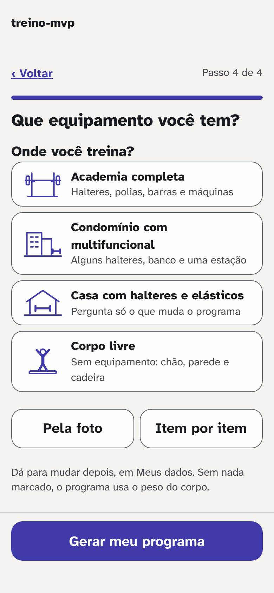

- É a tela mais resolvida do cadastro: 4 lugares com desenho e o botão à vista.
- "Pela foto" e "Item por item" têm o mesmo peso dos lugares.
- A folha da foto (`05b`) abre com 159 palavras **[medido]**, num cartão dentro de um cartão dentro da folha. O texto de privacidade é obrigatório (LGPD) e não muda; o que pesa é a moldura tripla e o título repetido.
- **Deveria priorizar:** o lugar. A foto e a lista ficam como segundo caminho, mais discreto.

### Início (o programa, com o cartão "Hoje")

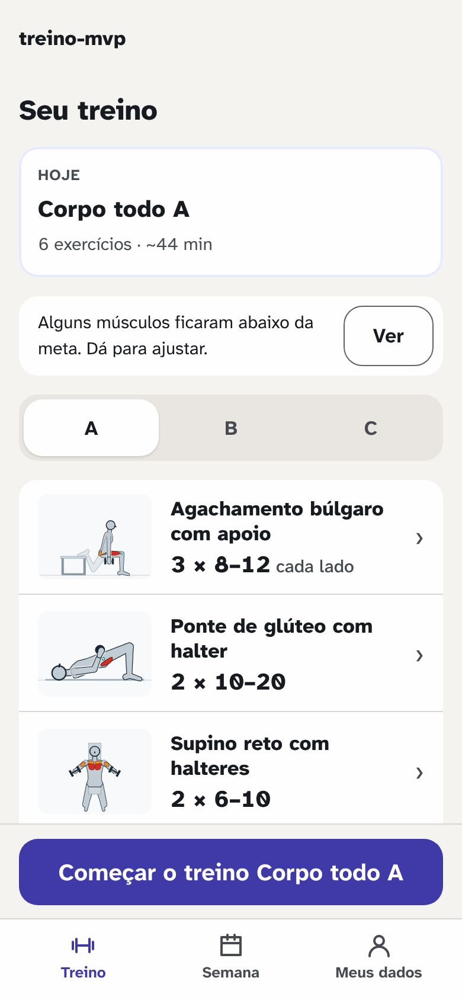

- O título é "Seu treino"; o nome do dia e os números ficam num cartão pequeno com o rótulo "HOJE".
- No primeiro acesso, antes do primeiro treino, o aviso "Alguns músculos ficaram abaixo da meta" tem o mesmo peso do cartão do dia.
- A página tem 2,4 telas **[medido]**; as abas A, B e C dão ao dia de hoje o mesmo peso dos outros dois.
- As miniaturas chegam cerca de 1 s depois, num quadro vazio.
- **Deveria priorizar:** o treino de hoje como título ("Corpo todo A, 6 exercícios, ~44 min"), a lista dele e o "Começar". Os outros dias e os avisos do programa descem.

### A folha do exercício

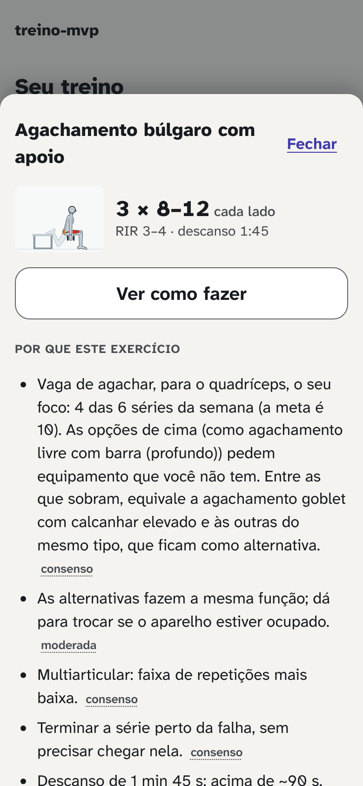

- 128 palavras **[medido]**; "Por que este exercício" abre com um parágrafo de mais de 50 palavras, e há 4 selos à vista **[visto]**.
- O "Ver como fazer", que leva ao Boneco, é um botão discreto.
- **Deveria priorizar:** o Boneco fazendo o exercício e a prescrição. O porquê fica a um toque, como o pedido manda.

### Treino: a série

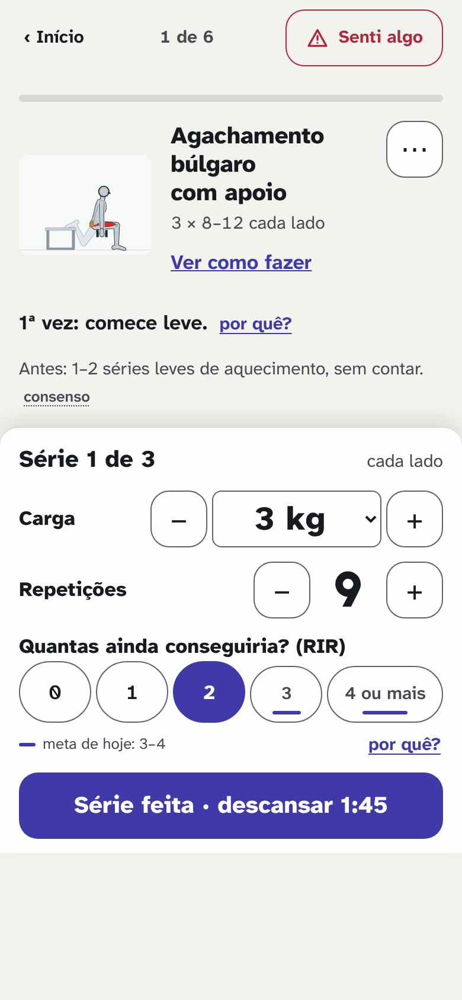

- O Boneco é uma miniatura parada de 112 px; o guia animado está em "Ver como fazer", outra tela. O pedido diz que o guia é a peça central do treino.
- 75 palavras à vista, com dois "por quê?" e um selo. A carga é um seletor do sistema ("Escolha") entre os botões de menos e mais.
- O painel da série, preso embaixo, funciona: carga, repetições, reserva e "Série feita" à vista a 390 px.
- A 320 px o painel solta e o "Série feita" sai da 1ª tela **[medido]**.
- **Deveria priorizar:** o Boneco em movimento no alto, a carga e as repetições como os maiores números, e a ajuda de texto a um toque.

### Treino: o descanso

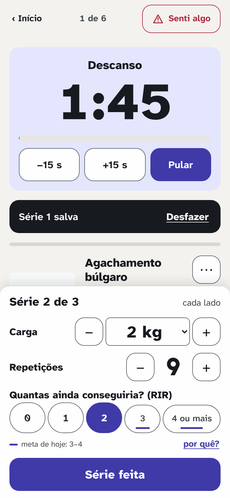

- O relógio (88 px) é o maior elemento: certo.
- "Pular" e "Série feita" são os dois botões cheios da tela. O nome do exercício fica cortado atrás do painel.
- **Deveria priorizar:** o relógio e uma ação só. A pesquisa de leitura à distância sugere um relógio maior para ler com o celular no chão (`pesquisa/07`, extrapolação marcada como tal).

### Treino: "Senti algo" e o "⋯"

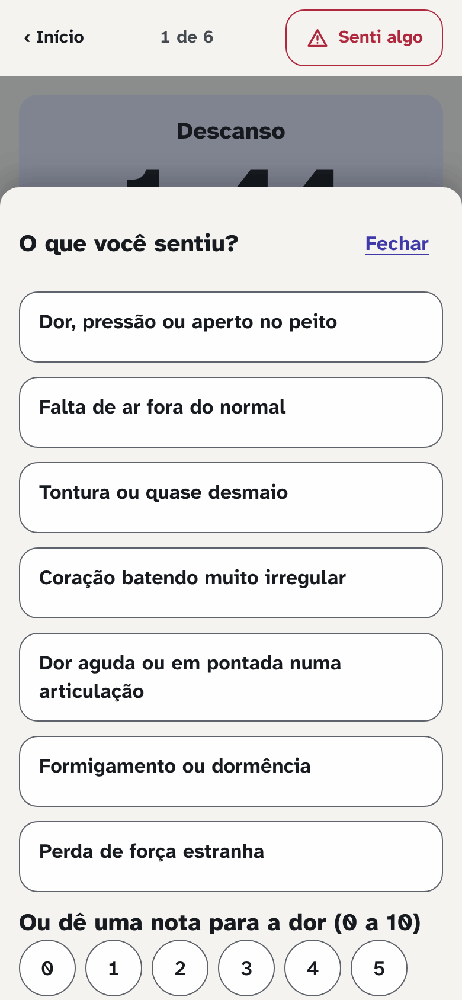

- O "Senti algo" está sempre no topo e a folha abre por cima: certo, e não muda.
- Os 7 sinais são 7 caixas com contorno; a nota de dor fica abaixo da dobra.
- No "⋯" (`11`), "Terminar o treino agora" é um link sublinhado logo abaixo de "Trocar exercício".
- **Deveria priorizar:** o mesmo de hoje. Aqui o trabalho é de acabamento, não de prioridade.

### Guia (os 4 modos)

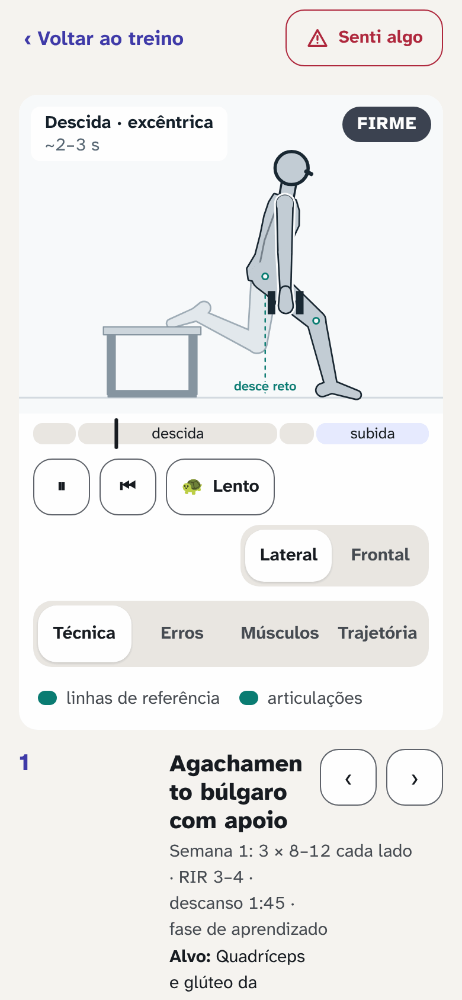

- O palco é o maior elemento: certo. A página tem de 3,4 a 3,7 telas **[medido]**.
- Emoji de tartaruga no "Lento" e ❌ nos erros; o título quebra no meio da palavra; três fileiras de controles (tocar, vista, modos) antes do texto.
- **Deveria priorizar:** o palco e os modos no mesmo lugar em que a pessoa registra a série, sem trocar de tela.

### Fim do treino

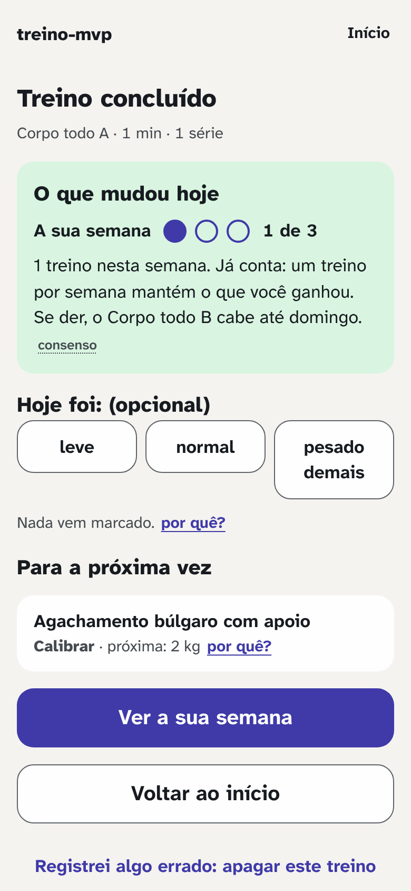

- O título é "Treino concluído". O que interessa ("O que mudou hoje") está no cartão verde logo abaixo: certo.
- "Registrei algo errado: apagar este treino" fica colado nos dois botões de saída.
- **Deveria priorizar:** o que mudou, como título, com o número. O resto está no lugar.

### Semana

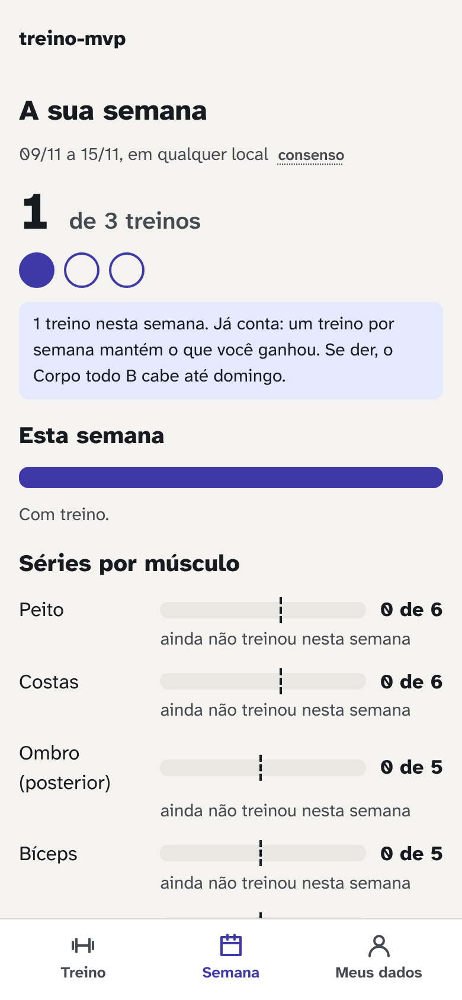

- "1 de 3 treinos" em número grande: certo.
- "Séries por músculo": cada linha repete "ainda não treinou nesta semana". O selo aparece ao lado do intervalo de datas.
- **Deveria priorizar:** os treinos da semana e, por músculo, só a barra e o número.

### Evolução

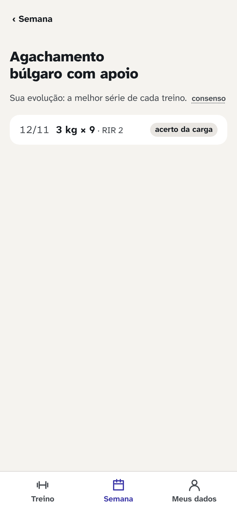

- Com um treino, uma linha e o resto da tela vazio, sem dizer que o gráfico aparece a partir do segundo registro.
- **Deveria priorizar:** o último registro como número grande e uma frase de estado ("o gráfico aparece no próximo treino").

### Locais

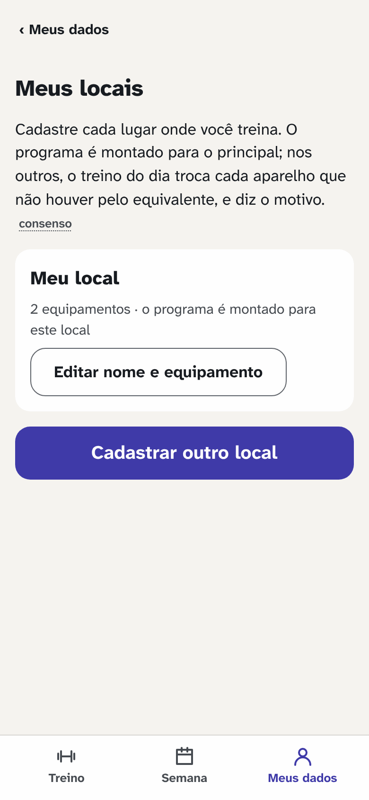

- Um parágrafo de explicação com selo antes do único local.
- **Deveria priorizar:** a lista de locais; a explicação a um toque.

### Meus dados

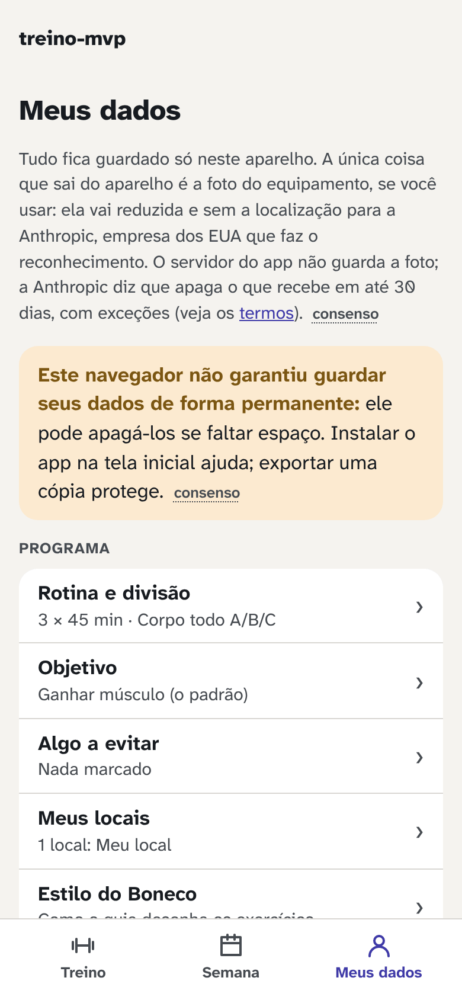

- 145 palavras **[medido]**: um parágrafo de privacidade e um aviso laranja vêm antes da primeira linha do programa.
- **Deveria priorizar:** as linhas (rotina, objetivo, locais, exportar, apagar). O aviso de armazenamento vira uma linha de estado; o texto de privacidade continua a um toque, inteiro.

### Termos

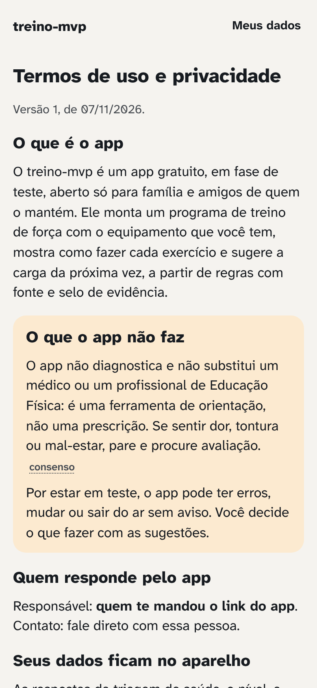

- Texto longo, como deve ser. Falta medida de linha e ritmo de leitura; o cartão laranja repete o aviso das boas-vindas.
- **Deveria priorizar:** leitura. É a tela que menos muda.

## 3. As medidas, por tela (390 px, tema claro)

Tirado de `capturas/antes/medidas-390-claro.json` **[medido]**. "Telas" é a altura da página dividida pela altura da tela.

| Tela | Palavras à vista | Telas | Ação principal sem rolar |
|---|---:|---:|---|
| Boas-vindas | 89 | 1,0 | sim (a 320 px, não) |
| Saúde | 112 | 1,4 | **não** |
| Saúde, quais valem | 136 | 1,8 | **não** |
| Nível, respondido | 67 | 1,7 | sim |
| Rotina, respondida | 106 | 1,7 | sim |
| Equipamento, o lugar | 75 | 1,0 | sim |
| Folha da foto | 159 | 1,0 | (folha) |
| Início | 90 | 2,4 | sim |
| Folha do exercício | 128 | 2,4 | (folha) |
| Treino, a série | 75 | 1,0 | sim (a 320 px, **não**) |
| Treino, o descanso | 93 | 1,4 | sim (a 320 px, **não**) |
| Guia, técnica | 60 | 3,4 | (sem ação) |
| Fim do treino | 88 | 1,0 | (sem ação medida) |
| Semana | 101 | 1,8 | (sem ação) |
| Evolução | 30 | 1,0 | (sem ação) |
| Meus dados | 145 | 1,7 | (sem ação) |
| Termos | 213 | 3,9 | (sem ação) |

## 4. O que não medi

- O Lighthouse, o JavaScript da 1ª tela e os toques do cadastro: são as réguas do antes e depois da etapa 2 (`docs/revisoes/redesign/medidas.md`) e serão medidos no começo dela, na mesma máquina do depois.
- Os estados de erro e de uso sem rede: não foram capturados nesta rodada.
- Letra a 125% e largura de tablet: ficam para a conferência tela a tela da etapa 2.
- As outras personas (Bruno, Carla, Diego, Elisa e Fábio): só a Ana, como o pedido manda.
