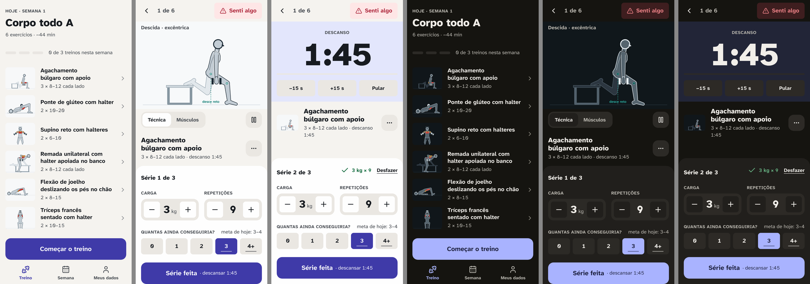
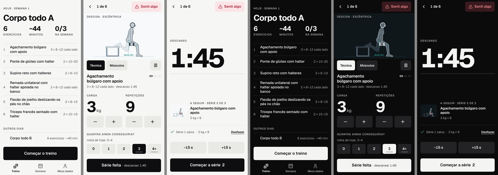
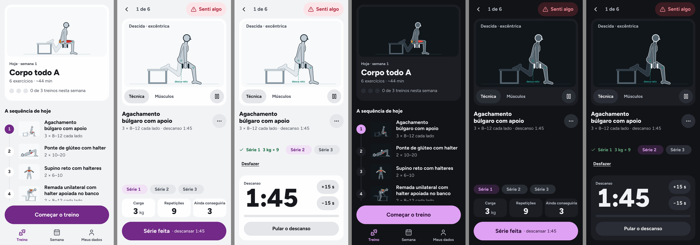
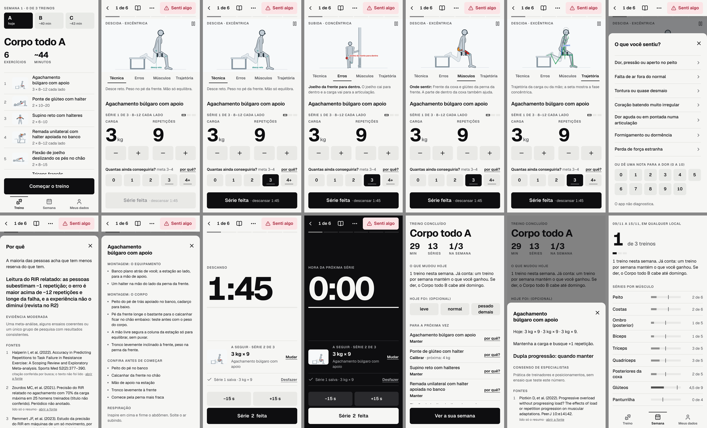
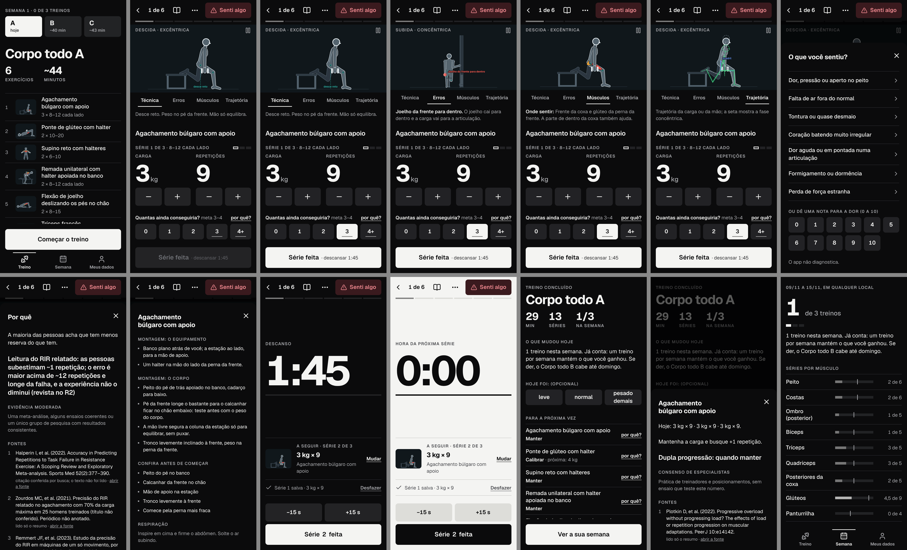

# Frontend novo: a proposta (12/11/2026)

> Fecha a etapa 1 do pedido de 12/11/2026 (`docs/prompts/sessao-frontend-novo.md`, no ramo `claude/epic-darwin-skoen6`). Junta a pesquisa (`referencias.md`, 277 referências em 15 temas; os 7 arquivos de origem em `pesquisa/`), o diagnóstico do app de hoje (`diagnostico.md`, 39 telas capturadas em 4 formatos) e os três protótipos (`prototipos/`). **Nada mudou no app:** `src/` está igual à `main`.
>
> Marcas: **[medido]** por script neste clone; **[fonte: arquivo, selo]** com os selos de `docs/pesquisa/00-metodo.md` (norma técnica entra como consenso de especialistas, não como estudo); **[opinião]** é minha.

## Em uma frase

Três direções para as duas telas que mais importam, o início e o treino, todas com o Boneco animado dentro do treino, sem nenhum contorno, com uma escala só de espaço e sem nenhuma biblioteca nova. Recomendo a **B, "Placar"**. A escolha é do Gustavo, olhando.

## 1. As três direções

Cada uma tem o início e o treino (a série e o descanso), com o programa que o gerador real monta para a Ana e o Boneco do motor, sem mudança (`scripts/design/frontend-novo/prototipo/gerar.mjs`).

| | A · Giz | B · Placar | C · Ficha |
|---|---|---|---|
| A ideia | A identidade de hoje, sem contornos | Preto e branco: a única cor na tela é a do Boneco | O Boneco nunca sai da tela do treino |
| Abrir no celular | https://claude.ai/artifact/2gvvHjMzJjVQoBc25b6Sh3 | https://claude.ai/artifact/1d3HM2c5Ha1fscRcbSXKeV | https://claude.ai/artifact/AqJGkrtFDVoy8garNn7o5t |
| Arquivo | `prototipos/a-giz/index.html` | `prototipos/b-placar/index.html` | `prototipos/c-ficha/index.html` |
| Capturas | `prototipos/capturas/folha-a-giz.png` | `prototipos/capturas/folha-b-placar.png` | `prototipos/capturas/folha-c-ficha.png` |
| Letra (peso do arquivo) | Atkinson Hyperlegible Next, a de hoje (34 kB) | Geist (29 kB) | Figtree (20 kB) |
| Cor de destaque | índigo, a de hoje | nenhuma: o botão principal é da cor do texto | ameixa |
| Início | o dia como título, a lista com miniaturas do Boneco | o dia como título, três números e a lista como tabela | o Boneco do 1º exercício no topo e a sequência numerada |
| A série | Boneco no alto; carga e repetições em 32 px, com menos e mais sempre à vista | Boneco no alto; carga e repetições em 72 px, botões de menos e mais de 56 px | Boneco no alto; a série numa linha já preenchida, e o ajuste abre ao tocar no valor |
| O descanso | o relógio (96 px) entra no lugar do Boneco; o registro continua embaixo | o relógio (128 px) toma a tela | o relógio (88 px) entra no lugar do registro; o Boneco continua |
| Cantos | 8 e 16 | 8 | 16 e 24, botões em pílula |





As páginas publicadas são privadas: só o Gustavo abre. A faixa escura no topo de cada protótipo troca de tela e de tema; ela é do protótipo, não do desenho.

### O que medi nos protótipos

| | A | B | C |
|---|---|---|---|
| Console sem erros, nenhuma tela rola de lado (390 e 320 px, claro e escuro) | sim | sim | sim |
| Treino a 390 × 844: cabe em quantas telas | 1,02 | 1,00 | 1,00 |
| "Série feita" à vista ao abrir, a 390 px | sim | sim | sim |
| "Série feita" à vista ao abrir, a 320 × 640 | **não** (1,30 tela) | **não** (1,20 tela) | sim |
| Menor contraste de texto, nos dois temas | 5,5 : 1 | 5,8 : 1 | 5,5 : 1 |
| Espaço, altura de toque ou canto fora dos tokens | 0 | 0 | 0 |
| Uso do espaço de 12 | 0 | 0 | 0 |

Tudo **[medido]** por `scripts/design/frontend-novo/prototipo/capturar.mjs` e por contagem no CSS. A 320 px, A e B ainda pedem rolagem para chegar ao botão: na reconstrução, o botão principal fica preso embaixo em qualquer largura (hoje o app também falha nisso a 320 px, `diagnostico.md`).

### O que cada uma ganha e perde

**A · Giz.** É a de menor risco: mantém a cor e a letra que o Gustavo escolheu em 06/11 e muda o acabamento (sem contorno, o Boneco no alto, o dia como título). O registro continua à vista durante o descanso, então a série seguinte custa 1 toque. Perde em distinção: é o app de hoje mais bem acabado, e os números continuam de tamanho médio.

**B · Placar.** É a que mais muda a leitura. Carga e repetições em 72 px e relógio em 128 px são os únicos elementos grandes da tela. Sem cor de destaque, o vermelho e o laranja dos músculos do Boneco deixam de disputar com a interface: o cuidado 11 fica resolvido por construção. Perde em três pontos: a lista do início não tem miniaturas do Boneco; o descanso em tela cheia esconde o registro, então começar a série antes de o relógio zerar custa 1 toque a mais; e o preto e branco pode parecer frio para quem está começando **[opinião]**.

**C · Ficha.** É a leitura mais literal de "o guia é a peça central": o Boneco fica na tela na série e no descanso. A série vem numa linha, já preenchida; quem repete a carga registra com 1 toque. Perde em dois pontos: mudar a carga custa 2 toques (abrir o ajuste e tocar no mais), e na 1ª semana a carga muda quase toda série; e o relógio é o menor dos três. A ameixa foi a cor que o Gustavo não escolheu em 06/11 (`docs/revisoes/redesign/proposta.md`, seção 5); a cor pode ser trocada sem mexer na estrutura.

### A minha recomendação: B

1. **Números e alvos maiores são o que a pesquisa mais sustenta para o uso na academia.** Andando, o toque fica 31% mais lento e erra 23% mais, e alvos de 20% a 40% maiores compensam **[fonte: `pesquisa/07`, Schildbach e Rukzio 2010, 16 pessoas, um estudo]**. Parhi 2006 recomenda alvos de 9,2 a 9,6 mm para o polegar **[fonte: `pesquisa/07`, 20 pessoas, um estudo]**. Não há estudo com mão suada nem com a pessoa cansada de treino; a aplicação à academia é extrapolação.
2. **É a que menos parece feita por IA.** Uma decisão forte (sem cor), um ponto focal por tela e nenhuma moldura **[fonte: `pesquisa/04`, lista de 35 itens, consenso de designers]**.
3. **Resolve de vez a disputa de cor com o Boneco**, que em 06/11 obrigou a medir a distância de cada paleta às cores do desenho.
4. **A letra pesa 5 kB a menos que a de hoje** (29 contra 34 kB **[medido]**). É um ganho pequeno, e a letra não entra na conta do teste de peso, que mede só o JavaScript.

O que eu levaria da A para a B, como decisão separada depois da escolha: as miniaturas do Boneco na lista do início.

O que pesa contra a B, para o Gustavo decidir sabendo: ela troca a letra aprovada em 06/11, e a letra de hoje foi escolhida por ser "hiperlegível". A pesquisa não achou nenhum estudo publicado que meça essa vantagem **[fonte: `pesquisa/07`, seção 3]**; a troca não perde uma garantia medida, mas também não há medida a favor da Geist.

## 2. O sistema, comum às três

O que segue vale qualquer que seja a direção escolhida. Onde a direção muda o valor, está dito.

### Espaço, altura e canto (bloco A)

- **Espaço:** 4 · 8 · 16 · 24 · 32 · 48 · 64, como tokens. Dentro de um grupo, 8; entre grupos, 24 ou 32; margem lateral de 16; folhas e diálogos, 24.
- **Altura de toque:** 48, 56 e 64, em `rem`. O botão principal de cada tela tem 64.
- **Canto:** tokens por direção. O canto de dentro é o de fora menos o respiro (um painel de canto 16 com respiro 8 tem botões de canto 8).
- **Conferência automática:** `npm run conferir:tokens` é a primeira entrega da etapa 2, antes de qualquer tela. Ele falha com espaço, altura ou canto fora dos tokens em `src/styles.css` e `src/features/`; o desenho do Boneco fica de fora, com a exceção escrita no script.

Três pontos em que a pesquisa não sustenta o pedido como está. Nenhum trava a etapa 2; estão em "Decisões" no fim.

1. **O 12.** Radix, Atlassian, Carbon, Primer, Material e Apple usam o 12 **[fonte: `pesquisa/02`, seção 4, vários sistemas independentes]**. Os três protótipos foram feitos sem ele **[medido]**, então proponho seguir sem o 12 e trazer de volta só se uma tela pedir, com a captura.
2. **O canto de dentro.** A regra não está em nenhum sistema de design aberto, só em blog de autor **[fonte: `pesquisa/02`, seção 2.6; `pesquisa/04`, opinião de um autor]**. Mantenho a regra, marcada como opinião.
3. **Alturas de 56 e 64.** Os sistemas usam 48 como padrão **[fonte: `pesquisa/02`]**; os estudos de toque em movimento apoiam alvos maiores **[fonte: `pesquisa/07`]**. Mantenho 56 e 64 nos controles do treino.

### Tipografia

- Uma família só, com números de largura igual em tudo que muda (relógio, carga, repetições, tabelas). As três letras candidatas têm o recurso **[medido no arquivo da letra]**.
- De 6 a 7 tamanhos, em `rem`. Corpo de 17 px; nada abaixo de 13 px; campo nunca abaixo de 16 px, para o iPhone não dar zoom **[fonte: `pesquisa/05`, documentação]**.
- Títulos com `text-wrap: balance`; a unidade ("kg") menor e mais clara que o número **[fonte: `pesquisa/06`, consenso]**.
- A letra é servida pelo próprio app, num arquivo variável, com licença SIL OFL. Nenhum pedido externo.

### Cor, claro e escuro

- Papéis, não nomes de cor: fundo, superfície, superfície 2, texto, texto 2, ação, alerta, feito. Os dois temas são desenhados, e o padrão segue o aparelho, com troca à mão em Meus dados **[fonte: `pesquisa/07`, seção "claro ou escuro": a evidência não permite escolher um padrão para a academia]**.
- Uma cor de destaque no máximo, sempre com o mesmo sentido (ação). Na B, nenhuma.
- O palco do Boneco mantém as cores dele, nos dois temas.

### Navegação

- A barra de baixo fica com os 3 destinos de hoje (Treino, Semana, Meus dados), com ícone e rótulo **[fonte: `pesquisa/02`, 3 a 5 destinos, vários sistemas]**.
- A faixa "treino-mvp" sai das 11 telas em que aparece (`diagnostico.md`). O título de cada tela passa a dizer o que ela mostra.
- No treino, o cabeçalho fica como hoje: voltar, a posição ("1 de 6") e o "Senti algo".

### O registro da série

- A carga e as repetições são os maiores números da tela, cada um com menos e mais. Tudo vem preenchido com a última série; a pessoa muda só o que mudou **[fonte: `pesquisa/03`, relato de usuários e análises: é o que mais se elogia nos apps de treino]**.
- A reserva (o "Quantas ainda conseguiria?") continua obrigatória na 1ª série e com a meta do dia marcada, como hoje. O texto é o do app.
- "Série feita" é a única ação principal, presa embaixo em qualquer largura. "Desfazer" aparece junto da série salva.
- A carga deixa de ser o seletor do sistema e passa a ser um passo entre as cargas que a pessoa tem. Isso não muda regra: é a mesma lista que `opcoesCarga` já devolve.

### O temporizador

- O relógio é o maior elemento do descanso. "−15 s", "+15 s" e "Pular" são discretos.
- O fim do descanso avisa por texto e por som; a vibração não existe no iPhone **[fonte: `pesquisa/05`, tabela de suporte]**, então nunca é o único canal.
- O relógio não é lido pelo leitor de tela a cada segundo; só o fim **[fonte: `pesquisa/07`, documentação]**.

### A moldura do guia (o palco do Boneco)

- **O Boneco animado entra na tela do treino.** Hoje ele é uma miniatura de 112 px, e o guia fica em outra tela. É a maior mudança de prioridade da proposta.
- Os controles ficam embaixo do palco, nunca por cima do desenho: os modos (Técnica, Músculos, Erros, Trajetória) e o pausar. A fase do movimento ("Descida · excêntrica") fica no canto do palco, como hoje.
- A rota do guia continua existindo, para o texto completo (dicas, montagem, erros) e para os links de fora.
- Exercício sem animação aprovada continua com o cartão de texto, no mesmo lugar do palco. Nada de animação improvisada.
- Ícones no lugar dos emojis (a tartaruga e o ❌).

### Números e gráficos

- Um número grande por tela; no resumo, de 3 a 4 no máximo, sempre com a comparação escrita **[fonte: `pesquisa/06`, consenso]**.
- Evolução: gráfico de linha em SVG, escrito à mão, com o último ponto destacado e o valor escrito. Com 1 ou 2 registros, mostra os pontos e diz quando a linha aparece **[fonte: `pesquisa/06`, sistema de design]**.
- Semana: uma barra por músculo com "8 de 12" escrito, sem a frase repetida em cada linha.

### Formulários do cadastro

- Uma pergunta por tela, com a resposta em 1 toque quando der; os botões de resposta presos embaixo.
- Opções sem contorno: superfície e distância.
- O texto da triagem e os avisos de segurança não mudam.

### Folhas e diálogos

- A folha de hoje (`src/features/app/Folha.tsx`) já prende o foco, fecha com Esc e devolve o foco: fica, com o estilo novo e respiro de 24.
- Falta travar a rolagem do fundo no iPhone instalado **[fonte: `pesquisa/05`, relato de bug do WebKit]**.

### Estados

- Toda espera tem um estado: a miniatura do Boneco ganha um quadro do tamanho certo com indicação de carregando, no lugar do quadro vazio que hoje dura cerca de 1 s **[medido]**.
- Todo vazio diz o que vai aparecer e o que fazer (a evolução com 1 treino; a semana sem treino).
- Erro e uso sem rede com a orientação escrita, como já existe no salvar.

### Movimento

- Resposta ao toque na hora: estado pressionado em todo botão (hoje não há nenhum no CSS **[medido]**).
- De 100 a 200 ms para folhas e trocas, só com `transform` e `opacity`; nada animado no que se repete a cada série **[fonte: `pesquisa/04`, opinião de autores; `pesquisa/02`, sistemas]**.
- Tudo desligado com `prefers-reduced-motion`. A animação do Boneco é conteúdo e segue as regras dela.

### Acessibilidade

- Os testes de toque, contraste, letra, foco e uso sem rede continuam; nenhum é apagado nem pulado.
- 44 px continua sendo o piso do projeto. A norma pede 24 px no nível AA; 44 é o nível AAA e o padrão da Apple **[fonte: `pesquisa/02`, WCAG 2.2]**.
- Letra a 125% e zoom de 200% conferidos tela a tela.

## 3. O que muda de conteúdo e de prioridade, tela a tela

Vale para qualquer direção. O motivo de cada linha está no `diagnostico.md`.

| Tela | Hoje a tela destaca | Passa a destacar | O que desce ou sai da frente |
|---|---|---|---|
| Boas-vindas | 4 desenhos de lugares e um cartão de aviso | uma frase, o Boneco em movimento e "Começar" | "Meus dados" no canto (não há dado ainda) |
| Saúde | a lista das 9 condições | a pergunta e as duas respostas, presas embaixo | nada; a lista rola por trás |
| Nível | 3 perguntas juntas | uma pergunta por vez e o nível como resposta | o selo, para o "por quê?" |
| Rotina | 18 opções na página | dias e minutos, 1 toque cada | as prioridades, recolhidas (são opcionais) |
| Equipamento | o lugar | o lugar | "Pela foto" e "Item por item", mais discretos |
| Início | "Seu treino" e um cartão pequeno | o dia de hoje como título, a lista e "Começar" | os outros dias e os avisos do programa |
| Folha do exercício | um parágrafo de porquê | o Boneco e a prescrição | o porquê, a um toque |
| Treino, a série | o painel da série | **o Boneco animado** e os números da série | os textos de ajuda, a um toque |
| Treino, o descanso | o relógio e dois botões cheios | o relógio e uma ação só | "Pular", discreto |
| Senti algo, "⋯" | como hoje | como hoje | (só acabamento) |
| Guia | o palco, em outra tela | o palco, dentro do treino; a rota fica para o texto completo | as três fileiras de controles viram uma |
| Fim do treino | "Treino concluído" | o que mudou hoje, com o número | "apagar este treino", longe dos botões |
| Semana | "1 de 3 treinos" | o mesmo | a frase repetida em cada músculo; o selo ao lado da data |
| Evolução | uma linha | o último registro em número grande e o gráfico | (vazio com orientação) |
| Locais | um parágrafo | a lista de locais | a explicação, a um toque |
| Meus dados | um parágrafo e um aviso | as linhas (rotina, objetivo, locais, exportar, apagar) | o aviso vira uma linha de estado |
| Termos | o texto | o texto, com medida de linha | o cartão que repete o aviso das boas-vindas |

**O selo e a fonte.** Continuam em toda regra, com o mesmo texto. O que muda é o lugar: saem do meio das frases e ficam atrás do "por quê?", que já abre a regra, o significado do selo e as fontes. É o que o pedido chama de "a um toque, sem ocupar a frente". Nenhum texto técnico, selo ou fonte muda.

**Nenhuma função se perde.** Tudo o que a lista do pedido cita continua (cadastro, triagem, locais, foto, "Prefiro", "Desfazer", descanso, "Senti algo", tela acesa, fim, semana, semana leve, evolução, os 4 modos, o cartão de texto, o "por quê?", exportar e apagar, o estilo do Boneco, o uso sem rede e a instalação).

## 4. Bibliotecas

**Recomendação: nenhuma dependência nova.**

| Necessidade | O que usar | Peso somado | Licença |
|---|---|---|---|
| Folha e diálogo | a `Folha` que já existe | 0 | do projeto |
| Passo de mais e menos, aviso temporário | escritos à mão | menos de 1 kB cada **[opinião]** | do projeto |
| Gráfico da evolução | SVG à mão (de 1 a 30 pontos) | menos de 2 kB **[opinião]** | do projeto |
| Movimento | CSS e o que o navegador tem (`@starting-style`, View Transitions onde houver) | 0 | não se aplica |
| Ícones | os cerca de 16 desenhos usados, copiados da família Lucide | 6 kB sem comprimir nos protótipos **[medido]** | ISC |
| Letra | um arquivo variável, servido pelo app | 20 a 34 kB, conforme a direção **[medido]** | SIL OFL 1.1 |

Descartadas, com o peso medido em pasta isolada **[fonte: `pesquisa/01`]**:

| Biblioteca | Para quê | Peso (min + gzip) | Por que não |
|---|---|---|---|
| Radix Dialog | diálogo | 14 kB | a `Folha` já faz, e ele sozinho gastaria dois terços da folga da 1ª tela |
| Base UI NumberField | passo numérico | 14 kB | o passo do app anda numa lista de cargas, não num número livre |
| React Aria NumberField | passo numérico | 26 kB | o mesmo, e pesa mais |
| Vaul | folha com arrasto | 22 kB | o autor avisou que não mantém mais; última versão em 12/2024 |
| Sonner | aviso temporário | 9,6 kB | o app tem um aviso só ("Série salva · Desfazer") |
| Motion | animação | 3,3 kB (mini) a 32 kB | o CSS cobre o que a proposta anima |
| uPlot | gráfico | 23 kB | um gráfico de até 30 pontos |
| Remix Icon | ícones | não medido | licença própria, fora das aceitas |

Os apps de treino de código aberto vistos (LiftLog, wger, GymRoutines) têm licença AGPL ou GPL: serviram só para aprender o princípio.

## 5. O plano de reconstrução

Só depois do sim do Gustavo. Uma tela por vez, com conferência no navegador, `conferir:tokens`, `npm run check`, captura de antes e depois, e commit pequeno.

| # | Bloco | O que entra | Por que nessa ordem |
|---:|---|---|---|
| 0 | Medidas de antes | Lighthouse, JavaScript da 1ª tela, palavras à vista, toques do cadastro, ação à vista | as réguas de `docs/revisoes/redesign/medidas.md`, na mesma máquina do depois |
| 1 | Sistema | tokens, `conferir:tokens`, as peças de base, a barra de baixo, os ícones, a letra | toda tela depende disso |
| 2 | Treino e guia | a série, o descanso, "Senti algo", o "⋯", o cartão de texto, o guia | é o uso principal e a maior mudança (o Boneco dentro do treino) |
| 3 | Início e a folha do exercício | o dia como título, a lista, "Prefiro", "Sobre o programa", os avisos | é a porta de todo treino |
| 4 | Fim, semana, semana leve e evolução | o que mudou hoje, as barras, o gráfico | fecham o ciclo do treino |
| 5 | Cadastro | boas-vindas, saúde, nível, rotina, equipamento e a foto | usado uma vez; o mais longo |
| 6 | Meus dados, locais, termos, tela de erro | linhas, exportar e apagar, estilo do Boneco | o que menos muda |
| 7 | Fechamento | `qa.md` com os 20 cuidados por tela, as medidas de depois, devlog e backlog | critério de pronto do pedido |

Ao fim de cada bloco de telas, uma revisão independente por um subagente que recebe só o código, as capturas e os blocos A e B.

**Riscos que já vejo:**

- **O peso.** Medido hoje pelo teste (`tests/e2e/orcamento.spec.ts`): a boas-vindas baixa 154,4 kB de JavaScript comprimido, contra o limite de 175 (folga de 20,6 kB); o programa baixa 202,8 kB, contra 220 (folga de 17,2 kB) **[medido]**. A pesquisa de bibliotecas (`pesquisa/01`) partiu de um número errado que eu passei no briefing, "cerca de 170 de 175 kB", sem ter medido; a nota de correção está no topo daquele arquivo. Com a folga real, uma biblioteca de 14 kB até caberia, mas gastaria quase toda a folga para fazer o que o app já faz; a recomendação de não acrescentar dependência se mantém, agora pelo princípio de simplicidade do `CLAUDE.md` e não por falta de espaço. Pôr o Boneco animado no treino não entra na 1ª tela (o treino já carrega o motor), mas vou medir a cada bloco e mostrar o número.
- **A política de segurança do navegador (CSP)**, que entrou com o PR 4: o frontend novo não pode depender de estilo escrito dentro do HTML fora do que ela permite. Os testes de ponta a ponta já rodam sob ela.
- **O Boneco no treino a 320 px.** Os protótipos A e B não cabem em 1 tela nessa largura; a reconstrução prende o botão embaixo e encolhe o palco.
- **Os testes de ponta a ponta** procuram textos e papéis de hoje ("Seu treino", "Ver como fazer"). Cada um será reescrito para conferir a mesma coisa na tela nova; nenhum será apagado.

## 6. O que não fiz nesta etapa

- **X (Twitter) e Reddit não abriram.** O X devolveu erro e o Reddit é bloqueado pela ferramenta de busca; não usei espelho. Nenhuma referência vem deles; os mesmos autores entraram pelos blogs próprios, e os relatos de usuários vieram de outros fóruns (`referencias.md`, "Limitações").
- **Os protótipos cobrem 2 telas**, como o pedido manda. As outras 15 estão descritas na seção 3, sem desenho.
- **Não medi Lighthouse nem o peso do pacote** nesta etapa; é o bloco 0 da etapa 2.
- **Erros e Trajetória** do guia não estão nos protótipos (só Técnica e Músculos); os 4 modos continuam no app.
- **O `conferir:tokens` ainda não existe.** A contagem do diagnóstico foi feita por um comando avulso.

## 7. Decisões que dependem do Gustavo

Uma por vez. Só a primeira trava a etapa 2.

1. **A direção: A, B ou C.** Recomendo a B, pelos motivos da seção 1. É a decisão desta parada.

As seguintes vêm depois da escolha, cada uma com a captura na hora:

2. **A letra.** Cada direção traz a sua; dá para trocar sem mexer na estrutura (por exemplo, a B com a Atkinson de hoje).
3. **O 12 sai da escala?** Proponho que sim, porque os protótipos não precisaram dele. A pesquisa mostra que vários sistemas o usam.
4. **O guia dentro do treino.** Proponho que o Boneco animado fique na tela do treino e que a rota do guia continue para o texto completo.
5. **O selo atrás do "por quê?".** Proponho tirar o selo do meio das frases e deixá-lo a um toque, com o mesmo texto.
6. **A faixa "treino-mvp".** Proponho tirar. O nome do app continua no ícone e nas boas-vindas.
7. **Os outros dias no início.** Proponho trocar as abas A, B e C por uma lista "Outros dias" embaixo do treino de hoje.
8. **O tema padrão.** Proponho seguir o aparelho, com troca à mão em Meus dados.

## 8. Pedidos ao domínio

Nenhum até aqui. Os protótipos usam só o que o domínio já devolve (`gerarPrograma`, `diaDaSemana`, a lista de cargas do inventário). Se a reconstrução precisar de algo, vai para `pedidos-ao-dominio.md`, com o motivo, como decisão separada.

## 9. Como reproduzir

```bash
npx playwright test -c scripts/design/frontend-novo/playwright.config.ts --trace off
```

```bash
npx vite-node scripts/design/frontend-novo/prototipo/gerar.mjs
```

```bash
node scripts/design/frontend-novo/prototipo/capturar.mjs
```

```bash
python3 scripts/design/frontend-novo/prototipo/folha.py
```

O primeiro comando refaz as capturas do app de hoje; os outros três geram os dados e o Boneco dos protótipos, fotografam as três direções e montam as folhas de comparação.

## 10. A escolha do Gustavo e a B aprofundada (B2)

Em 12/11/2026 o Gustavo escolheu a **B** e pediu para desenvolvê-la mais antes de reconstruir o app. O B2 é esse trabalho: a mesma direção, levada às telas que provam se ela se sustenta como sistema. **O app continua sem mudança.**

- Abrir no celular: https://claude.ai/artifact/DKLFpxiyKJ9c4voJfjNZi1 (página privada)
- Arquivo: `prototipos/b2-placar/index.html` e `prototipos/b2-placar/b2.js`
- Capturas: `prototipos/capturas-b2/folha-claro.png`, `folha-escuro.png` e `folha-320.png` (53 imagens na pasta)




### O que o B2 tem

Quatro telas e quatro folhas: o início, o treino (a série, o guia nos 4 modos, o descanso e o fim do descanso), o fim do treino e a semana; e as folhas "Senti algo", "por quê?", "Como fazer" e "Mais opções".

**Nada foi escrito à mão.** Um script faz a Ana treinar o dia A inteiro no app de verdade, com o relógio do navegador adiantado a cada descanso, e colhe das telas os textos e os números (`scripts/design/frontend-novo/prototipo/colher.spec.ts`). Vêm daí:

- a folha do "por quê?": a regra, o selo, o que o selo quer dizer e as fontes com o estado da leitura;
- os 7 sinais e a nota de dor do "Senti algo";
- o fim do treino: 29 min, 13 séries, o texto de "O que mudou hoje" e a indicação de cada exercício para a próxima vez (4 "Manter" e 2 "Calibrar");
- a semana: "1 de 3 treinos" e as séries por músculo, com a meta de cada um.

Os 4 modos do guia saem do motor, e as legendas de cada modo, de `src/conteudo`.

### O que mudou em relação à B, e por quê

| Mudança | Por quê |
|---|---|
| A lista do início ganhou as miniaturas do Boneco | era a perda que eu tinha apontado na B; com elas, a cor do Boneco é a única da tela também no início |
| Os dias A, B e C viraram três blocos no topo, com o de hoje invertido | servem de troca de dia e de placar da semana ao mesmo tempo; a lista "Outros dias" saiu |
| O guia tem os 4 modos dentro do treino, com a legenda de cada um | o pedido diz que o guia é a peça central do treino; hoje ele está em outra tela |
| O nome, os números, a reserva e o botão formam um bloco preso embaixo | em celular baixo é o Boneco que encolhe, nunca o registro; no teste a 760 px de altura, a linha da reserva ficava escondida atrás do botão antes dessa mudança |
| No descanso, o botão principal é "Série 2 feita" | a B custava 1 toque a mais para começar a série antes de o relógio zerar; agora a série seguinte, já preenchida, custa 1 toque, como no app de hoje. "Mudar" leva aos números |
| Quando o tempo acaba, a tela inteira inverte e o rótulo vira "Hora da próxima série" | é um sinal para ler de longe sem depender de cor nem de som; a vibração não existe no iPhone **[fonte: `pesquisa/05`]** |
| "Como fazer" e "Mais opções" subiram para o topo, ao lado do "Senti algo" | o nome do exercício passou a caber numa linha e o palco ganhou altura |
| O selo saiu do meio das frases e está na folha do "por quê?" | é a decisão 5 da seção 7, já desenhada |

### O que medi no B2

| | 390 × 844 | 320 × 640 |
|---|---|---|
| Console sem erros, nenhuma tela rola de lado (claro e escuro) | sim | sim |
| Treino, a série: cabe em quantas telas | 1,00 | 1,00 |
| "Série feita" à vista ao abrir | sim | sim |
| Descanso e fim do descanso | 1,00 tela, ação à vista | 1,00 tela, ação à vista |
| Os 4 modos do guia à vista no treino | sim | **não** (abaixo de 700 px de altura eles saem do treino) |
| Início, fim do treino e semana | 1,22, 1,38 e 1,30 tela | 1,73, 1,98 e 1,80 tela |
| Menor contraste de texto, com a tela invertida incluída | 5,8 : 1 | o mesmo |
| Espaço fora da escala; uso do 12 | 0; 0 | 0; 0 |

Tudo **[medido]** por `scripts/design/frontend-novo/prototipo/capturar-b2.mjs`. A B (a primeira versão) não cabia em 320 px sem rolar; o B2 cabe.

### O que a colheita mostrou do app de hoje

- **Títulos em inglês no guia.** A tela do guia usa "3 cues", "Setup" e "Checklist de 5 s" como títulos (`src/features/guia/Guia.tsx`). No B2 a folha "Como fazer" usa "Montagem" e "Confira antes de começar". São rótulos de tela, não texto técnico; fica como decisão.
- **O "por quê?" mostra o estado da leitura de cada fonte** ("lido só o resumo", "citação conferida por busca; o texto não foi lido"). O B2 mantém essa linha, palavra por palavra.

### Limites do B2

- O treino do protótipo percorre só o 1º exercício; depois da última série, o botão leva ao fim do treino colhido do app, que é o do treino inteiro.
- "meta de hoje: 3–4" virou "meta 3–4" para a linha caber; a 320 px a meta fica só na marca embaixo dos botões. É mudança de texto de tela e está em "Decisões".
- Faltam desenho: o cadastro, Meus dados, locais, a evolução (o gráfico) e o cartão de texto do exercício sem animação (o dia A da Ana não tem nenhum).
- O modo Erros anima só o 1º dos 3 erros do exercício.
- O Boneco roda a 12 quadros por segundo no protótipo, para o arquivo não pesar; no app ele roda a 30.

### As decisões, agora

1. **O B2 serve de referência para a reconstrução?** Se sim, a etapa 2 começa pelo sistema (tokens, `conferir:tokens`, peças) e pelo treino. Se ainda não, diga o que ajustar olhando o protótipo.

Seguem na fila, uma por vez, as da seção 7 que continuam abertas (a letra, o 12, a faixa "treino-mvp", o tema padrão) e as três novas: os títulos do guia em português, "meta 3–4" no lugar de "meta de hoje: 3–4", e o descanso com "Série 2 feita" como botão principal.
