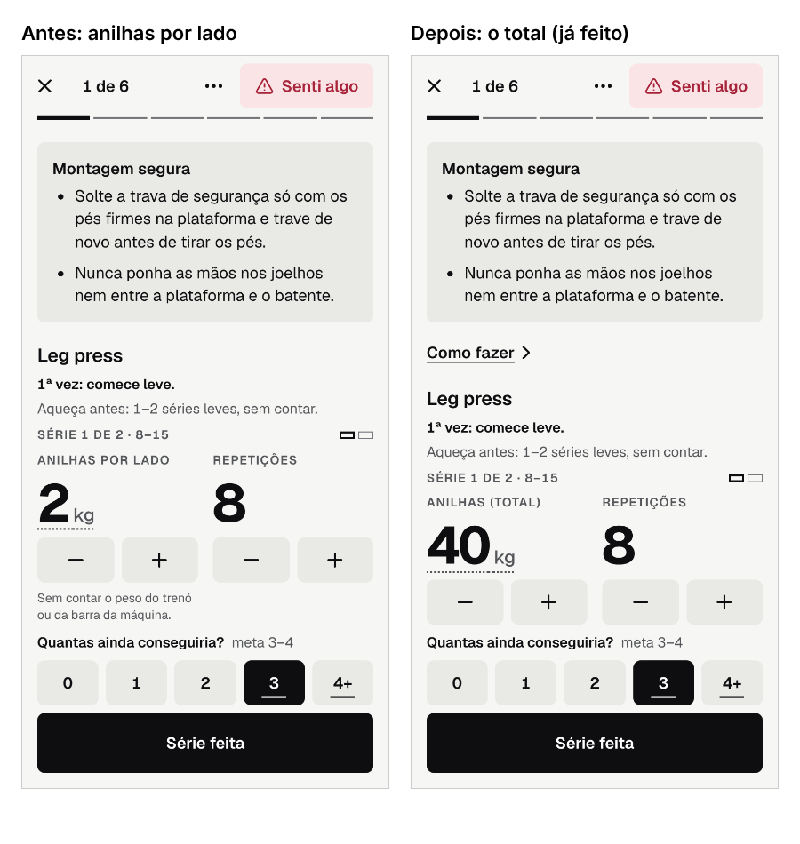
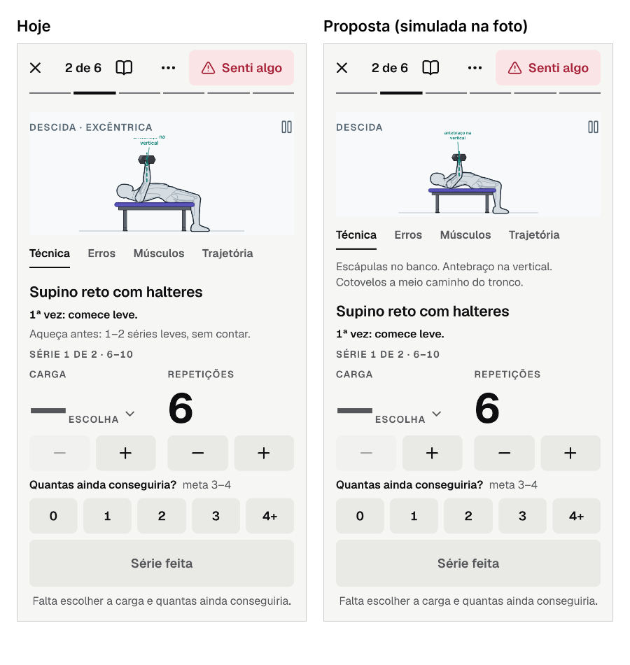
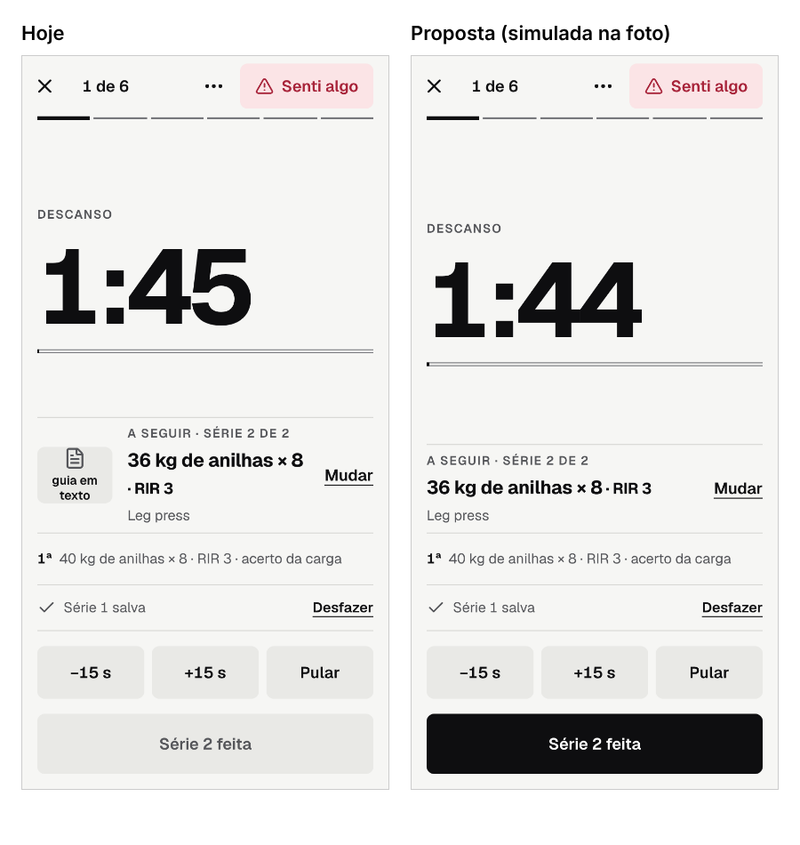

# Cara humana: o que o app mostra e não precisa mostrar

22/11/2026. Pedido do Gustavo na revisão do lote M1: o app está "com muita cara de IA"; "essas frasezinhas são muito desnecessárias"; "esses quadrinhos às vezes mostram coisas que também não precisam"; "entender até que ponto, o que a gente precisa e o que a gente não precisa". O exemplo dele: preencher as anilhas de cada lado do leg press, em vez do total.

## O que foi pesquisado

**Skill pronta:** na conta do Gustavo não há nenhuma skill de design. Existe um projeto aberto, o `ux-skill` (de Laith Aljunaidy, licença MIT), feito para o Claude Code, com uma lista do que dá "cara de IA". Li as duas páginas principais; a maior parte fala de sites de venda (degradê roxo, frases de marketing), que não é o caso daqui. **Não instalei:** aproveitei o que serve a um app e escrevi uma régua própria, curta, em `.claude/skills/cara-humana/SKILL.md`, que passa a valer para toda tela nova ou mudada.

**O que as fontes dizem** (são prática de quem desenha, não estudos; selo "consenso")

| Fonte | O que diz, e serve aqui |
|---|---|
| [Nielsen Norman Group, "The 3 C's of Microcopy"](https://www.nngroup.com/articles/3-cs-microcopy/) (lida) | Cada palavra tem de ter uma função; o mais importante vem primeiro; o tom nunca atrapalha a clareza |
| [Kosta Canatselis, "Spot the Slop"](https://world.hey.com/kostac/spot-the-slop-a-ui-designer-s-guide-to-fixing-ai-defaults-4c448c9c) (lida) | "Tudo visível o tempo todo" é o sinal: mostrar a informação só quando a pessoa precisa. O teste de cada frase: o dono diria isto em voz alta? |
| [`ux-skill`, lista do que evitar](https://github.com/Laith0003/ux-skill/wiki/Anti-AI-slop-ban-list) e [como achar](https://github.com/Laith0003/ux-skill/wiki/How-to-detect-AI-slop-in-your-design) (lidas) | Cartão só onde há um grupo de verdade; uma ação principal por tela; tudo com a mesma altura, o mesmo espaço e o mesmo canto é o que denuncia |
| [Joel Spolsky, 2000](https://www.joelonsoftware.com/2000/04/26/designing-for-people-who-have-better-things-to-do-with-their-lives/) (só o resumo da busca) | Quanto mais palavras na caixa, menos gente lê |
| Um quinto guia (uxdesign.cc) | Não abriu; não usei |

Sobre aplicativos de treino, a busca só trouxe páginas de loja (anúncio, não análise). O que elas repetem: poucos toques, repetir a série anterior, botão principal grande, tela limpa durante a série. O app já faz isso no registro.

## O levantamento: 17 telas, contadas

Roteiro de fotos na versão de 22/11, tela de 390 × 780. "Frases de apoio" são as linhas pequenas e cinzas embaixo dos campos.

| Tela | Palavras | Controles | O que achei |
|---|---:|---:|---|
| Abertura | 66 | 4 | Já enxugada no M1 |
| Triagem | 73 | 2 | É texto de segurança: fica para o M6 |
| Experiência | 51 | 15 | Limpa |
| Rotina | 34 | 37 | Duas frases: "Com aquecimento e descansos." e "Escolha até 2." A segunda faz falta (é um limite); a primeira pode sair |
| Equipamento | 47 | 16 | Limpa depois do M1 |
| Programa | 69 | 12 | Limpa |
| **Treino, registrando** | **95 a 105** | **17 a 18** | **A mais carregada do app. Ver abaixo** |
| Descanso | 51 | 6 | Boa; uma caixa sobra |
| Fim do treino | 40 | 6 | Quadradinhos repetem "1 de 3"; "Calibrar · próxima" não se entende |
| A semana | 59 | 0 | Quadradinhos repetem "1 de 3"; a tabela de músculos (é o M5) |
| Meus dados | 70 | 9 | Uma caixa de aviso que não sai nunca neste navegador |

**A tela do treino, coisa por coisa**

| O que está na tela | Faz falta? | O que proponho |
|---|---|---|
| "Anilhas por lado" + "Sem contar o peso do trenó ou da barra da máquina." | Não: é uma conta ao contrário | **Feito:** "Anilhas (total)", sem a frase |
| "Série 1 de 2 · 8–15" e, ao lado, dois quadradinhos | Um dos dois | Tirar os quadradinhos |
| "meta 3–4" e, embaixo dos botões 3 e 4+, um traço | Um dos dois | Tirar os traços (a frase vira "sobrando 3 ou 4" no M3) |
| "Aqueça antes: 1–2 séries leves, sem contar.", em todo exercício que abre um grupo | Uma vez por treino, no máximo | Mostrar só no 1º exercício do treino (é regra, `tempo.aquecimento`: o texto continua em "Entenda o treino") |
| "DESCIDA · EXCÊNTRICA" em cima do Boneco | Metade | "Descida". O termo técnico sai (e o rótulo deixa de cobrir a cabeça, que é do M2) |
| "1ª vez: comece leve." | Sim | Fica |
| "Falta escolher a carga e quantas ainda conseguiria." | Sim: explica o botão apagado | Fica |
| "1ª 2 kg por lado × 8 · RIR 3 · acerto da carga" | A carga e as repetições, sim; "RIR" e "acerto da carga", não | É o M3 |
| "Montagem segura", a caixa cinza dos exercícios sem animação | É texto de segurança | Fica; some sozinha quando a animação for ligada (M2) |

Nas duas últimas imagens, o lado direito é uma **simulação feita só na foto**: nada disso está no código ainda. No treino, ao tirar os quadradinhos e a frase do aquecimento, sobrou altura e as dicas do movimento ("Escápulas no banco…") voltaram a caber.

## O que já foi feito (22/11)

- **O total das anilhas.** O leg press, o hack, o smith e a panturrilha sentada mostram e pedem o total das anilhas, somando os dois lados. Por dentro o app continua guardando por lado (nada muda nos dados de quem já usa). O menos e o mais põem ou tiram um par. Os textos do guia e a regra `progressao.incremento.maquina-anilha` dizem a mesma coisa. Dois gabaritos das personas foram regravados: muda só a frase ("20 kg por lado" virou "40 kg de anilhas").
- **A régua** (`.claude/skills/cara-humana/SKILL.md`) e um item novo na lista de conferência (`docs/verificacao/lista.md`, item 13).

## O que proponho, à espera do Gustavo

Um corte de cada vez, com a imagem:

1. **Treino:** tirar os quadradinhos da série, os traços sob a meta e o "· excêntrica"; o aquecimento só no 1º exercício.
2. **Descanso:** tirar a caixa "guia em texto" (ela guarda o lugar de um desenho que não existe).
3. **Fim do treino e semana:** tirar os quadradinhos que repetem "1 de 3" (o resto dessas telas é do M5).
4. **Rotina:** tirar "Com aquecimento e descansos."
5. **Daqui para a frente:** cada item da fila (M2 a M6) passa pela régua antes de chegar à revisão, com a contagem de palavras e de caixas, antes e depois.

## O que achei no caminho e não é de cara

Na série de acerto do leg press, quem faz 8 repetições sobrando 3 (dentro da meta que a tela mostra) recebe "Ficou pesada: na próxima série, 0 kg". É o defeito que o item M3 da fila já vai consertar (a regra de acerto da carga), mas vale saber que ele aparece logo no primeiro exercício de quem escolhe "Academia completa".

## Limites

Não usei nenhum aplicativo concorrente: a comparação com eles veio de páginas de loja. A régua é prática de desenho, não estudo. E "cara humana" tem uma parte que nenhuma régua resolve: o nome, a voz e o gosto do dono, que a análise crítica já tinha apontado (item 9 do ranking) e que foram adiados com o nome do app.
