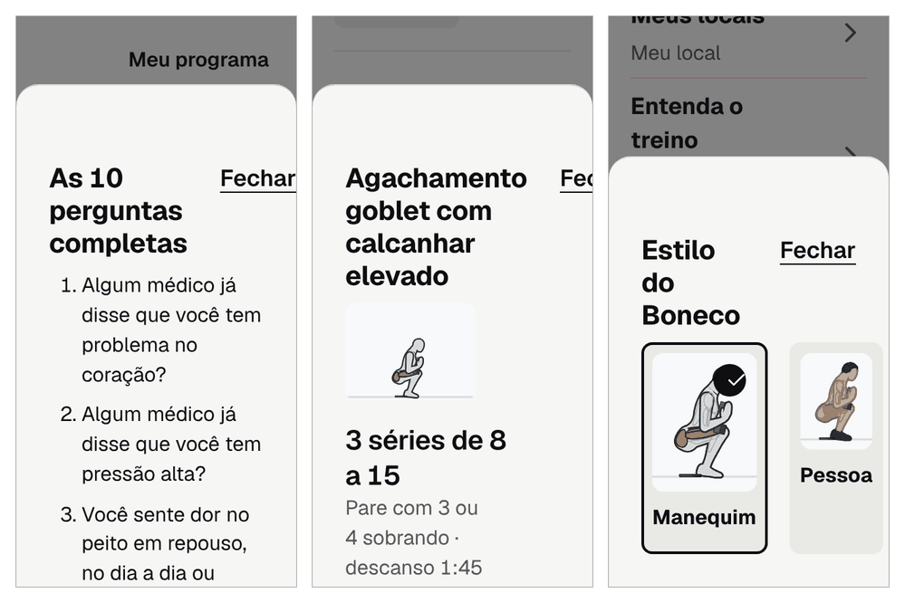

# Pacote D4: mais leve e sem o motor antigo (22 e 23/11/2026)

Registro do pacote D4 da sessão de desenvolvimento 2 (`prompts/sessao-desenvolvimento-2.md`, seção "D4"). Ramo `claude/d4-mais-leve`, fora da `main`, à espera do ok do Gustavo. Feito em paralelo com o D3 (ok do Gustavo em 22/11), sem tocar no gerador, na progressão, nas regras nem nos snapshots.

Para quem usa, nada muda na tela: o app baixa menos, o guia abre mesmo se faltar o texto de outro exercício, e três animações deixam de engasgar na primeira volta.

## 1. O motor de antes, apagado

Na ordem que o pacote pedia, um commit por passo:

| Passo | Commit | O que saiu |
|---|---|---|
| A auditoria de anatomia lê o motor novo | `cd18dcf` | a leitura do desenho vem dos papéis das 171 animações (eram 90); o resumo das marcas não mudou (135 batem, as mesmas 6 a conferir); sai `tests/unit/legenda.test.ts` |
| A pessoa dos cartões de equipamento | `31e51d1` | só um comentário citava o motor de antes; o código já usava as contas do motor novo |
| O laboratório do Boneco | `af4c485` | a rota `/lab/boneco`, a chave `__LAB__`, o CSS `.lab-*` e o teste da rota (257 linhas) |
| As folhas de comparação | `fe927e5` | 15 roteiros que só desenhavam ou comparavam o motor de antes e o `npm run qa:motor` (1.857 linhas); as imagens que eles geraram ficam em `docs/` |
| O código | `09d8441` | `src/engine/` fora de `novo/` (105 arquivos, 6.124 linhas) e os testes dele (602 linhas): 6.744 linhas |
| **As três linhas de base de antes** | **`ef3a193`** | `motor.json`, `novas.json` e `estilo-a.json` (2,6 MB, 40.178 linhas) e o roteiro que gerava a primeira. **Commit separado: apagar gabarito pede o ok do Gustavo**, e ele pode ser desfeito sozinho (`git revert ef3a193`) |
| O CSS do desenho de antes | `fdc57f6` | as classes do desenho clássico (`.bn`, `.tor`, `.eqp`, `.lbl` e outras 42), os estilos A e B e 16 variáveis de cor: a folha de estilo vai de 91,8 para 84,1 kB (sem comprimir) |

No total do ramo: 176 arquivos, 1.124 linhas a mais e 49.589 a menos. Nenhuma tela, roteiro ou teste importa `src/engine/` fora de `novo/` (conferido com uma busca no repositório). A linha de base do motor novo (`motor-novo.json`) não mudou. O guia original (`referencia/`) e o QA dele ficam.

## 2. O peso

Medido no build de produção, em kB comprimidos (gzip) do JavaScript que cada tela baixa, com a persona Ana, numa prévia na porta 4311 (roteiro fora do git, a mesma conta de `tests/e2e/orcamento.spec.ts`):

| Tela | Antes do D4 | Sem os textos de fonte (`98ee4f9`) | Com o guia repartido (`39cb2df`) e no fim | Limite do teste, antes → depois |
|---|---|---|---|---|
| Pacote inicial | 161,4 | 161,4 | **158,4** | 175 → **163** |
| Boas-vindas (com o Boneco da abertura) | 246,2 (18 arquivos) | 240,5 | **237,5** (18) | 250 → **242** |
| Programa (quem volta) | 289,1 (36) | 277,5 | **274,5** (36) | 290 → **279** |
| Guia do goblet | 457,0 (191) | 451,3 | **253,7** (21) | sem limite → **260 kB e 30 arquivos** |

- **Os textos de fonte** (a fonte de cada linha das 175 fichas de movimento, o que a ficha da técnica pede, o que muda em cada erro, a origem das medidas dos corpos) saem do pacote no build (`scripts/animacao-nova/enxugar.mjs`); os arquivos continuam inteiros para a conferência e os testes. A regressão do motor ganhou um teste que compara o motor inteiro com o enxuto nas 171 animações: sem diferença. A instalação guarda 5.185 KiB, eram 6.487.
- **O guia** baixava o texto dos 171 exercícios ao abrir um; agora baixa só o do exercício aberto (`src/conteudo/guia.ts`). Era a pendência do D2: um arquivo que não baixava derrubava o guia.
- A guarda da primeira volta (item 3) acrescenta cerca de 0,15 kB comprimido ao arquivo de cada abdução deitada, baixado só quando o exercício aparece; as telas medidas não mudam.

## 3. A primeira volta pesada

Medida nova: `scripts/animacao-nova/tempo-da-primeira-volta.mjs` (o tempo de cada pose e de cada quadro na primeira volta, sem nada guardado, e na segunda), no computador.

| Animação | Pose, mediana, antes → depois (ms) | Primeira volta inteira, 60 quadros (ms) |
|---|---|---|
| `abducao-deitado` | 27,5 → **0,1** | 1.301 → **142** |
| `abducao-deitado-mini-band` | 27,8 → **2,2** | 1.334 → **243** |
| `abducao-caneleira` | 26,8 → **0,7** | 1.293 → **162** |
| Mediana das 171 | 0,3 | 206 |

- **O que mudou** (`4e612b9`): a perna de baixo das abduções deitadas, achada por tentativa a cada pose, só depende do tronco. Com a bacia sem rolar e a cintura no lugar (o movimento certo e o erro "frente"), ela é a mesma no ciclo todo: passa a ser calculada uma vez e, para o corpo do app, vem guardada no preparo de cada exercício. Nos erros em que a bacia rola ou a cintura sobe, continua calculada na hora.
- **Conferido:** o preparo foi gerado pelo caminho oficial (`node scripts/animacao-nova/preparo.mjs conferir`: "as tabelas conferem"); a regressão visual do motor (3 testes) sem diferença; o relatório do `npm run conferir:animacao` idêntico ao guardado.
- **As outras quatro da lista de 16/11** (ponte com os pés na bola, panturrilha no chão e no degrau, stiff de uma perna) não têm o mesmo caso: a conta pesada delas (o pé na bola, o calcanhar no degrau, a perna livre) muda a cada ponto do ciclo, e não há o que guardar sem guardar o quadro inteiro, o que mudaria os pontos entre os guardados. Medidas agora: de 6,1 a 8,9 ms por pose (eram de 12 a 27 na medida de 16/11, feita de outro jeito). Ficam como estão.

## 4. A margem de 206 px como teste

- `foraDaMargem` e `semPassarDaMargem` (`tests/e2e/criterios.ts`) são a conferência `MARGEM=1` do roteiro, como teste: nada entra na margem de 16 px da página, ou na de 24 px da folha aberta (16 no cabeçalho dela, onde o "Fechar" avança 8 px de propósito). A margem é a folga: o que a respeita tem 16 px de sobra antes de cortar.
- Roda no cenário `zoom200` de `tests/e2e/cenarios.spec.ts`, nos 7 grupos de telas. `tests/e2e/margem.spec.ts` prova que ela acusa uma tela de verdade apertada de propósito em 4 px e cada caso que deixa de fora (a faixa que rola de lado, a folha, o cabeçalho da folha, o bloco já conhecido).
- O item 5 de `verificacao/lista.md` encurtou.

**O que o teste achou nas telas reais** (medido a 206 × 420, na prévia da porta 4311):

- **O "Fechar" das folhas** é empurrado para fora quando o título tem uma palavra longa. Nas folhas dos 14 exercícios do programa da Ana, 12 passam da margem e 4 passam da borda da folha (o "Fechar" sai cortado; dá para rolar a folha de lado): o goblet, 55,6 px; a panturrilha no degrau, 28,3; a flexão de joelho deslizando, 26,8; o abdominal no chão, 24,5. Também a folha das perguntas completas da triagem (23,5) e a dos detalhes do equipamento (37,2).
- **O cartão "Pessoa" do estilo do Boneco** passa 19,7 px da margem da folha.
- O teste de "texto cortado" não pegava o "Fechar" porque a folha rola (ela tem `overflow: auto`), e o que está dentro de algo que rola não conta como cortado.

**Decisão da sessão:** consertar muda a tela, e esta rodada não muda o que a pessoa vê. Os casos de hoje ficam como **conhecidos** no teste (`.folha-cab` até 41 px, `.estilos-boneco` até 24 px: o máximo medido nos cenários, com 4 px a mais para a letra um pouco mais larga do GitHub); qualquer outro elemento, ou o mesmo passando mais, falha. O conserto vai para o Gustavo (abaixo).

## Decisões da sessão (técnicas)

- **As linhas de base antigas num commit só delas** (`ef3a193`), para o ok do Gustavo poder ser dado ou negado sem mexer no resto.
- **Os textos de fonte saem no build, não dos arquivos:** a conferência, as folhas e os testes continuam lendo as fichas inteiras.
- **A guarda da perna de baixo só onde ela não muda no ciclo**: nos erros que rolam a bacia ou sobem a cintura, a conta continua na hora (mais lenta, e certa).
- **A margem com casos conhecidos** em vez de consertar as telas nesta rodada.
- **Os limites de peso descem com a medida**, com folga de um exercício a mais no dia, não de uma função nova no pacote inicial.

## Para o Gustavo

1. **Apagar as três linhas de base do motor de antes** (`ef3a193`): eram os gabaritos do motor que o app não usa desde 16/11. Sem o ok, o commit é desfeito sozinho.
2. **O "Fechar" das folhas a 200% de zoom:** sai da folha em 4 das 14 folhas de exercício da Ana. Opções: o "Fechar" passa para cima do título quando a tela é estreita; ou o título quebra a palavra longa com hífen ("Agacha-mento"). É mudança de tela.
3. **O estilo do Boneco a 200%:** os dois cartões lado a lado não cabem; um embaixo do outro, em tela estreita, resolve.

## O que ficou de fora, e por quê

- **O projeto "celular" dos testes de tela não rodou nesta rodada** (o outro agente podia estar usando a porta 4173): os cenários `zoom200` com a margem e uma cópia de `margem.spec.ts` rodaram por um roteiro fora do git na porta 4311; o `npm run verificar` fica para depois.
- **Juntar os três palcos** (treino, guia, abertura) num componente só: não muda nada para quem usa e mexe em três telas já conferidas.
- **Desenhar as miniaturas na hora de publicar**, para a tela do programa não precisar do motor: mudaria o desenho das miniaturas.
- **Medir num celular de verdade**: a primeira volta foi medida no Chromium do computador.
