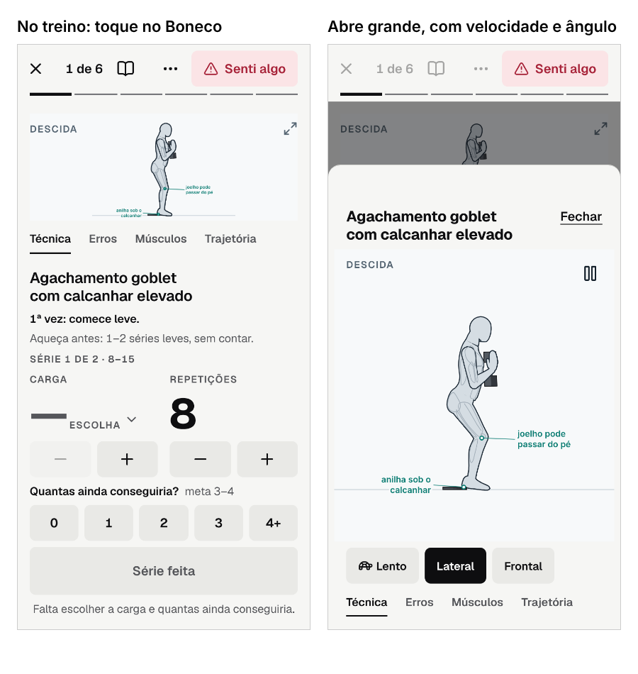
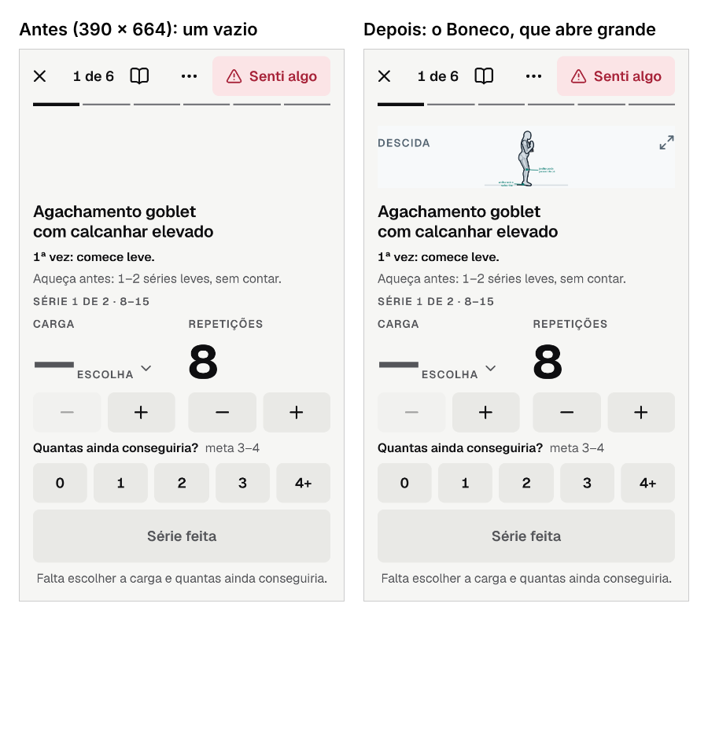
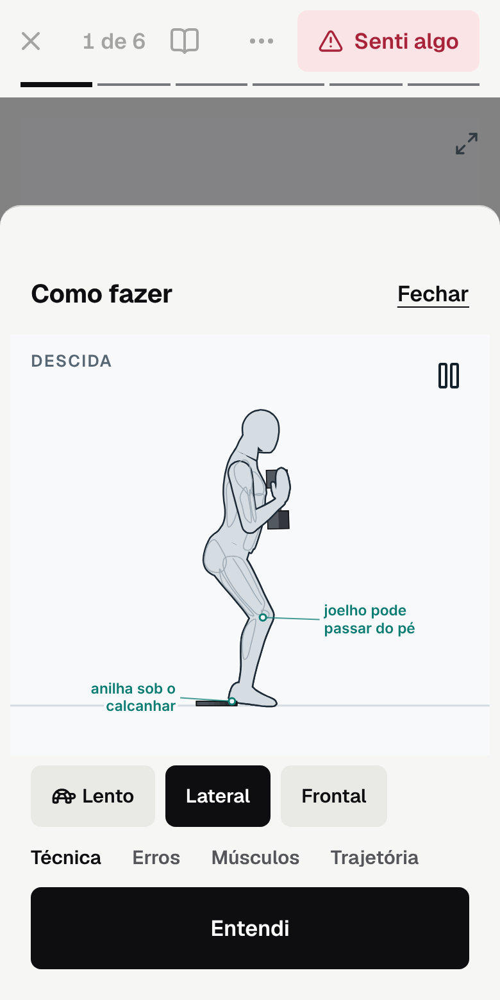

# A tela do treino: quanto dela é o Boneco

22/11/2026. Pedido do Gustavo na revisão do M1: a tela do treino "precisa ser um pouco mais o personagem"; "fazer um estudo sobre a proporção e a atenção na tela"; "quando clicar você consegue entrar já na animação"; e, logo depois, "que apareça aquelas opções tanto de velocidade quanto de ângulo". Ele também disse que a tela está boa no geral e que não precisa mudar por completo. É a primeira parte do lote M2 da análise crítica, adiantada.

## A medida, antes

`node scripts/design/medir-treino.mjs`, no build de produção, no 1º exercício do treino de quem escolhe "Casa" (agachamento goblet). Alturas em pontos de tela.

| Tela | Cabeçalho | Palco | O Boneco | Abas e legenda | Registro | O Boneco na tela |
|---|---:|---:|---:|---:|---:|---:|
| 320 × 568 | 52 | 120 | 103 | 0 | 540 | 18% |
| 360 × 640 | 52 | 120 | 103 | 0 | 518 | 16% |
| 375 × 667 | 52 | 120 | 103 | 0 | 518 | 15% |
| 390 × 664 | 52 | **0** | **0** | 0 | 497 | **0%** |
| 360 × 740 | 52 | 130 | 111 | 0 | 518 | 15% |
| 390 × 780 | 52 | 143 | 123 | 48 | 497 | 16% |
| 412 × 839 | 52 | 130 | 112 | 48 | 569 | 13% |

Três fatos:

1. **O registro leva de 61% a 95% da altura** (de 497 a 569 pontos), em qualquer celular. O Boneco fica com o que sobra: de 13% a 18%.
2. **A 390 × 664 (um iPhone comum com o Safari aberto) o Boneco sumia** e ficava um vazio de uns 110 pontos no lugar. A regra antiga escondia o palco abaixo de certa altura, porque um Boneco muito pequeno não ensinava nada.
3. **O toque no Boneco só pausava.** Para ver grande, mudar o ângulo ou pôr em câmera lenta, a pessoa saía do treino pelo ícone de livro.

Onde vai a altura do registro, a 412 × 839: o nome do exercício em duas linhas, as duas dicas da 1ª série, os dois números grandes (72 pontos de letra), a fileira de menos e mais embaixo deles, a pergunta da reserva com cinco botões, o "Série feita" e a frase do botão apagado.

## O que mudou

1. **Um toque no Boneco abre o guia grande, por cima do treino.** O desenho fica com metade da altura da tela; o Boneco, com cerca de um terço dela (o dobro ou mais do tamanho de repouso). O treino continua por baixo, no mesmo exercício.
2. **No guia grande: a câmera lenta ("Lento") e o ângulo** (Lateral, Frontal e os outros que o exercício tiver), além das quatro abas, da legenda e da pausa, que virou um botão próprio.
3. **O vazio acabou.** O Boneco pequeno agora é a porta do grande, então ele aparece mesmo quando sobra pouco (só some abaixo de 56 pontos).
4. **No repouso, o canto do palco mostra o ícone de ampliar** no lugar do de pausa.

| Tela | O Boneco de repouso | O Boneco ampliado | Na tela |
|---|---:|---:|---:|
| 320 × 568 | 104 | 188 | 33% |
| 360 × 640 | 103 | 213 | 33% |
| 375 × 667 | 103 | 222 | 33% |
| 390 × 664 | 64 (era 0) | 232 | 35% |
| 360 × 740 | 111 | 213 | 29% |
| 390 × 780 | 123 | 232 | 30% |
| 412 × 839 | 112 | 245 | 29% |

O rótulo da fase não cobre o desenho em nenhum dos sete tamanhos (medido).

**Decisões técnicas.** O palco de repouso para de desenhar enquanto o grande está aberto (o app calcula uma volta de animação por vez). O ampliado usa a folha que o app já tem, então o "Senti algo" continua ao alcance por cima dela. Não mexi no motor do Boneco. O ampliado tem um teste de tela em quatro tamanhos (`tests/e2e/treino.spec.ts`).

## O que não mudei, e por quê

**O tamanho de repouso continua de 13% a 18%.** Para o Boneco crescer sem o toque, o registro tem de encolher, e o registro é o que a análise crítica mandou proteger (um toque por série a partir da 2ª). Não mexi nele sem a sua decisão.

## Duas ideias, para você escolher

**A. O registro mais baixo, com o menos e o mais ao lado do número.** Hoje cada número grande tem a sua fileira de botões embaixo. Com os botões dos lados do número, o registro perde uns 64 pontos, e o Boneco de repouso passa de cerca de 110 para cerca de 170 pontos (de 15% para uns 22% da tela). Custo: mexe na tela mais usada do app; os números ficam um pouco menores nos celulares estreitos. Dá para mostrar numa imagem antes de fazer.

**B. Na 1ª vez de cada exercício, o guia grande abre sozinho.** Quem nunca fez aquele exercício vê primeiro o Boneco grande, com um botão "Entendi" que leva ao registro. Da 2ª vez em diante, a tela abre como hoje. Custo: um toque a mais, uma vez por exercício novo. É a ideia que mais muda a "atenção na tela" para quem está aprendendo, sem tocar no registro de quem já sabe.

A minha recomendação é a B primeiro: ela põe o personagem no centro exatamente quando ele faz falta, e não mexe no que funciona.

## A ideia B, escolhida pelo Gustavo e feita em 22/11

Na 1ª vez da pessoa num exercício (nenhuma série dele em treino nenhum), o guia grande abre sozinho ao chegar ao exercício, com a velocidade e o ângulo à vista e o botão "Entendi" preso embaixo. "Entendi" leva ao registro.

- **Abre uma vez** por treino e por exercício: voltar do guia completo ou recarregar a página não abre de novo. Depois da 1ª série feita, nunca mais abre sozinho (o toque no Boneco continua abrindo).
- **Não abre** nos exercícios sem animação (eles já mostram o cartão de texto) nem por cima do relógio do descanso.
- **O desenho cede altura** nessa folha (42% da tela; 35% nos celulares baixos), para "Lento" e os ângulos caberem acima do "Entendi". Aberto pelo toque, continua com 50%.
- **A folha se chama "Como fazer".** O nome do exercício já está na tela, logo atrás.
- **Acessibilidade:** o que recebe o foco do teclado rola para cima do botão preso; com zoom de 200% o botão deixa de ficar preso. Os cenários de toque, contraste e foco coberto passam nos seis formatos.
- **Custo medido:** um toque a mais por exercício novo. Para quem começa do zero num treino de 6 exercícios, são 6 toques no 1º treino de cada dia, e nenhum depois.
- **No celular de 320 × 568,** "Lento" e os ângulos ficam atrás do "Entendi" até rolar a folha.

## O que falta do M2

- Ligar as animações de barra e de máquina (a sessão das animações foi para a `main` em 22/11; o catálogo ainda liga 90 dos 171 exercícios).
- O descanso mostrar o movimento da próxima série.
- Juntar num componente só o palco do treino, o do guia e o Boneco da abertura.

## Limites

Medido num navegador que simula os tamanhos, não num celular de verdade. Só um exercício foi medido (o agachamento goblet, de pé); exercícios deitados ocupam a largura, não a altura, e não medi a diferença.
