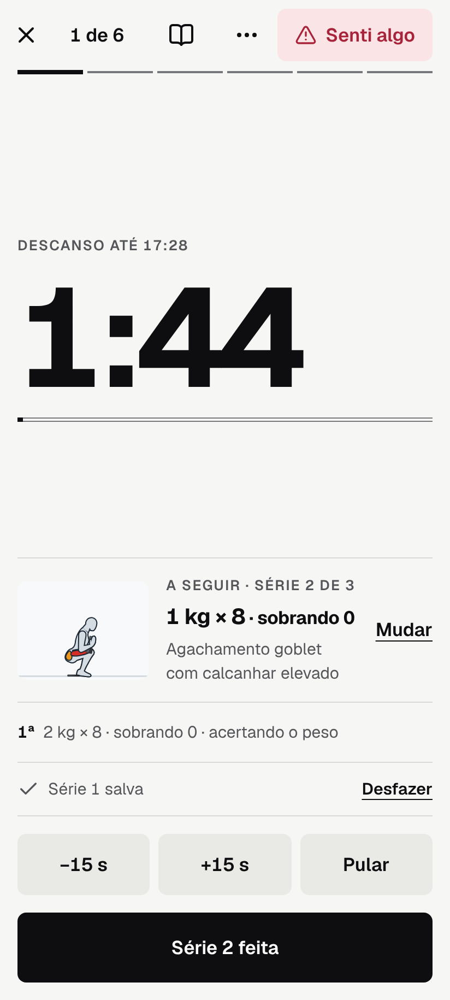
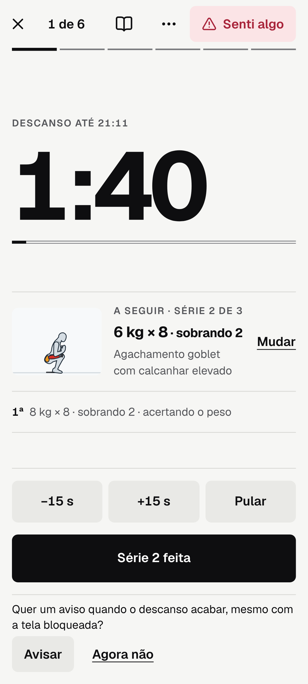
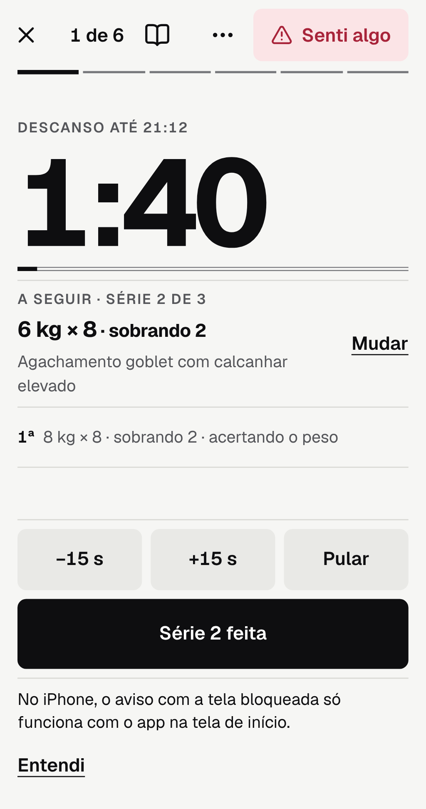

# M4. O descanso avisa: o teste nos aparelhos, as fontes conferidas e o passo 1

> Começado em 22/11/2026, no ramo `claude/m4-o-descanso-avisa`. O roteiro do lote está em `docs/prompts/sessao-melhorias-analise-critica.md` ("M4. O descanso avisa"). Este arquivo guarda o pedido de teste, a tabela medida e as decisões técnicas, com o motivo. Nada daqui está na `main` ainda.

## 1. O teste de 5 minutos (para o Gustavo e para um amigo com iPhone)

**Para que serve:** saber, num celular de verdade, se o fim do descanso avisa. Até hoje isso só foi lido no código e em páginas da internet.

**Como fazer** (igual nos dois celulares; no iPhone, pelo Safari):

1. Abra o app e comece um treino qualquer. Deixe o volume do celular na metade ou mais.
2. Registre uma série. O descanso começa sozinho.
3. Toque em "−15 s" até sobrar perto de 1 minuto.
4. Faça uma das situações da tabela e espere o tempo acabar. Anote o que aconteceu.
5. Toque em "Ok", registre outra série e repita para a situação seguinte.

Em cada quadrinho, escreva **sim** ou **não** para três coisas: **tocou** (deu para ouvir), **vibrou**, **apareceu** (deu para ver algum aviso sem abrir o app).

| Situação | Android: tocou | Android: vibrou | Android: apareceu | iPhone: tocou | iPhone: vibrou | iPhone: apareceu |
|---|---|---|---|---|---|---|
| A. App aberto na tela | | | | | | |
| B. Em outro app (WhatsApp, por exemplo) | | | | | | |
| C. Tela bloqueada | | | | | | |
| D. App aberto, celular no silencioso | | | | | | |
| E. App aberto, com música tocando (Spotify ou outro). **A música parou ou baixou?** | | | | | | |

Duas perguntas a mais, uma linha cada:

- Qual é o celular e a versão do sistema? (No iPhone: Ajustes, Geral, Sobre, "Versão do iOS".)
- O app estava instalado na tela de início, ou aberto pelo navegador?

**Este primeiro teste é com o app como está hoje** (o endereço normal). Depois do passo 1, a mesma tabela é refeita no endereço de teste do ramo.

### Tabela medida: o app de hoje (antes do M4)

*A preencher com as respostas.*

### Tabela medida: depois do passo 1

*A preencher.*

## 2. As fontes, conferidas nas páginas (22/11/2026)

A análise de 19/11 tinha visto parte delas só pelo resumo da busca (`docs/revisoes/analise-critica/mercado.md`). Abri as páginas. O que cada uma diz:

| O que a análise afirmou | O que a página diz | Resultado |
|---|---|---|
| No iPhone, o som gerado pelo site (Web Audio) é calado pela chave do silencioso, e o som de arquivo não é | [WebKit 237322](https://bugs.webkit.org/show_bug.cgi?id=237322): quem abriu o registro relata que `<audio>` e `<video>` tocam com a chave no silencioso, e o Web Audio não. [WebKit 252746](https://bugs.webkit.org/show_bug.cgi?id=252746): Jer Noble, da equipe do WebKit (22/02/2023), diz que foi decisão deles tratar o som do Web Audio como som "ambiente", que obedece à chave, enquanto áudio e vídeo de arquivo a ignoram | **Confirmado.** É comportamento decidido, não defeito a ser consertado |
| No iPhone, página em segundo plano pode congelar | [WebKit 211018](https://bugs.webkit.org/show_bug.cgi?id=211018): web app instalado congelava ao sair da tela (iOS 13); comentários dizem que foi consertado no iOS 14 ou 15 | **Confirmado para o passado.** Hoje, só o aparelho diz |
| No iPhone, o som de web app instalado para em segundo plano | [WebKit 261554](https://bugs.webkit.org/show_bug.cgi?id=261554): o som do site era suspenso ao ir para o fundo; consta como consertado (06/2024; um relato diz iOS 17.5). A página não fala de web app instalado | **Em parte.** Não dá para contar com som com a tela bloqueada sem medir |
| No iPhone, o aviso enviado por servidor pode chegar sem som | [Fórum da Apple, 728022](https://developer.apple.com/forums/thread/728022): relato de 04/2023 (iOS 16.4), sem resposta da Apple e sem solução na página | **Confirmado como relato antigo.** Só o aparelho diz como está hoje |

Achado novo, que a análise não tinha: desde o iOS 17 um site pode dizer ao iPhone que tipo de som toca (`navigator.audioSession.type`). Um engenheiro do WebKit (Jean-Yves Avenard, 25/09/2024, no registro 237322) diz que o padrão do Web Audio é "ambiente" e que, com o tipo "playback", o som não é suspenso. A página da MDN marca o recurso como experimental e não fala da chave do silencioso. Fica como alternativa, se a medida pedir.

## 3. Passo 1 (sem servidor): o que foi feito no ramo

- **Som de arquivo no lugar do Web Audio.** Os mesmos três bipes (880, 880 e 1175 Hz), agora num arquivo de 46 kB (`public/sons/fim-descanso.wav`, gerado por `scripts/som/gerar-fim-descanso.mjs`, sem sorteio: rodar de novo dá o mesmo arquivo). Entra na lista do que o app guarda para funcionar sem rede.
- **A hora do fim na tela:** o rótulo "Descanso" virou "Descanso até 17:28". Muda junto com "−15 s" e "+15 s".

**Decisões técnicas, com o motivo:**

1. **Arquivo, e não Web Audio com `audioSession`.** O arquivo tem o comportamento confirmado por quem faz o WebKit; o outro caminho é experimental e só existe do iOS 17 em diante.
2. **O elemento de som é preparado no toque que começa o descanso** (o "Série feita"). O iPhone só deixa um site tocar som depois de um toque da pessoa; a técnica de carregar o elemento dentro do toque é a que as bibliotecas de som usam. **Isto não tem como ser conferido fora de um iPhone:** é o que a linha A da tabela mede depois do passo 1.
3. **Um elemento só para o app inteiro.** Quem abre o guia no meio do descanso ouve o mesmo som que o toque no treino preparou.
4. **Som atrasado não toca.** Se a página ficou parada em segundo plano e acordou mais de 5 s depois do fim, o som não sai (a tela invertida já diz "Hora da próxima série"). Os 5 s são escolha do projeto [opinião].
5. **Perda aceita:** o Web Audio marcava o som no relógio do próprio áudio; o arquivo depende do relógio da página, que em segundo plano confere 1 vez por segundo no Chrome. O atraso possível é de até 1 s.

**Um risco que só o aparelho mostra, e que pode virar decisão do Gustavo:** no iPhone, o som que ignora a chave do silencioso é da mesma categoria da música. É possível que ele **pare a música** de quem treina de fone (no Android, o esperado é só baixar por um instante). É a linha E da tabela. Se parar, a escolha é de produto: avisar no silencioso e interromper a música, ou não interromper e ficar mudo no silencioso. Há uma terceira via técnica a medir antes (`audioSession`, acima).

**Testes:** `tests/e2e/treino.spec.ts`, "no fim do descanso toca o som de arquivo, uma vez, e o rótulo diz a hora do fim" e "o descanso sobrevive à ida ao guia e o som marcado não toca quando o tempo passa de zero" (este substitui o que conferia os osciladores do Web Audio, que não existem mais; conferi que ele falha quando o som antigo não é desmarcado).

## 4. Passo 2 (aviso com a tela bloqueada): o que foi feito no ramo `claude/m4-passo-2-aviso`

Feito em 22/11/2026, a pedido do Gustavo, antes da tabela do teste. **Fica desligado até as chaves existirem na Vercel** (item 5): sem elas, nada aparece no app e nada muda para quem usa.

**Como funciona, em palavras simples:**

1. No primeiro descanso, o app pergunta se a pessoa quer o aviso. Só depois do toque em "Avisar" o celular mostra o pedido de permissão dele.
2. Com o app aberto, nada sai do aparelho: o som da tela avisa.
3. Quando a pessoa **sai do app** no meio de um descanso (outro app, tela bloqueada), o app manda ao servidor o endereço de aviso do celular e o tempo que falta.
4. O servidor guarda o pedido numa fila gratuita, embaralhado, e na hora certa manda o aviso: "Hora da próxima série. O descanso acabou."
5. Se a pessoa volta antes, o pedido é desfeito e o aviso não sai.

No iPhone pelo Safari, sem instalar, a tela diz o que aquele celular consegue:

**Fontes conferidas nas páginas (22/11/2026):**

| Assunto | O que a página diz |
|---|---|
| Fila gratuita ([preços do QStash, da Upstash](https://upstash.com/pricing/qstash)) | 1.000 mensagens por dia no plano gratuito; atraso de até 7 dias; mensagem de até 1 MB |
| Marcar com atraso ([documentação](https://upstash.com/docs/qstash/features/delay)) | `POST /v2/publish/{destino}` com o cabeçalho `Upstash-Delay` (por exemplo `90s`); a resposta traz `messageId` |
| Desfazer ([documentação](https://upstash.com/docs/qstash/api-reference/messages/cancel-a-message.md)) | `DELETE /v2/messages/{messageId}`; 404 se não existe. A página não diz o que acontece com mensagem já entregue |
| Função da Vercel no plano gratuito ([limites](https://vercel.com/docs/functions/limitations)) | até 300 s. Aqui cada chamada dura menos de 1 s, porque quem espera é a fila |
| Aviso no iPhone ([WebKit](https://webkit.org/blog/13878/web-push-for-web-apps-on-ios-and-ipados/)) | desde o iOS 16.4, para web app na tela de início; a permissão tem de ser pedida em resposta a um toque. **A página não fala de som.** |

**Decisões técnicas, com o motivo:**

1. **Fila (QStash) em vez de uma função que fica esperando.** A fila deixa desfazer o pedido quando a pessoa volta; a função que espera não deixa, e o aviso sairia fora de hora.
2. **O pedido só sai quando a pessoa deixa o app.** Menos dado fora do aparelho, e menos avisos repetidos com o som da tela. Um treino inteiro com o app aberto não manda nada.
3. **O que fica na fila está embaralhado** (AES-256-GCM, com chave derivada da chave privada dos avisos). A Upstash guarda um texto que ela não lê. O mesmo embaralhamento prova, na volta, que o pedido saiu desta função.
4. **Vai o tempo que falta, e não a hora do fim:** relógio errado no celular não muda a hora do aviso.
5. **Só endereços dos serviços de aviso** da Apple, do Google, da Mozilla e da Microsoft são aceitos; no máximo 15 min de atraso; 300 pedidos por dia por IP [opinião]. Sem isso, a função serviria para chamar endereços quaisquer ou gastar a cota da fila.
6. **Segunda trava no aparelho:** o service worker só mostra o aviso do descanso que ainda vale. Se o desfazer não chegou ao servidor, o aviso velho não aparece.
7. **O pedido fica depois do botão principal.** Medido: acima dele, o "Série 2 feita" descia 100 px a 360 × 640. Depois dele, o botão nunca desce (fundo do botão com e sem o pedido: 626 e 626 a 320 × 568; 612 e 624 a 360 × 640; 704 e 823 a 412 × 839). Em tela baixa o pedido fica abaixo da primeira tela; por isso "Meus dados" também deixa ligar e desligar.
8. **Biblioteca `web-push`** (só no servidor, não pesa no app) para a parte de criptografia do aviso, em vez de escrevê-la à mão.
9. **Recusar não muda nada:** "Agora não" e a permissão negada fazem o pedido sumir e não voltar. O treino segue igual.

**O que não dá para conferir daqui:** se o aviso chega de fato num Android e num iPhone, com som e com vibração. O navegador de teste não tem serviço de avisos (a permissão é sempre "negada"; medido). Os testes simulam a permissão e o endereço; a entrega de verdade é a linha C da tabela, depois do item 5.

**Um defeito que escapou da verificação e foi pego no endereço de teste (22/11/2026):** a função quebrava ao iniciar na Vercel, por causa do jeito de importar a biblioteca `web-push` (a versão 4 não tem exportação padrão). Os tipos, os testes e o `npm run verificar` passavam. Consertado; `tests/repo/api-carrega.test.ts` agora carrega cada função no Node, como a Vercel, e a conferência virou o item 15 de `docs/verificacao/lista.md`.

**Limite conhecido:** nos endereços de teste da Vercel (protegidos por login), a fila não consegue chamar a função de volta. O aviso só funciona de ponta a ponta no endereço de produção, ou com a proteção desligada.

**Testes:** `tests/unit/api-aviso.test.ts` (18, as regras do servidor) e `tests/e2e/aviso-descanso.spec.ts` (8: permissão recusada, "Agora não", o botão que não sai do lugar em três tamanhos, o que sai do aparelho e quando, o service worker, o iPhone sem instalar).

## 5. O que precisa do Gustavo para ligar

Três valores no painel da Vercel (projeto `treino-mvp`, Settings, Environment Variables):

| Nome | O que é | De onde vem |
|---|---|---|
| `VITE_AVISO_CHAVE` | a chave pública dos avisos | par gerado uma vez (`npx web-push generate-vapid-keys`) |
| `AVISO_CHAVE_PRIVADA` | a chave privada do mesmo par | idem. **É segredo:** só no painel, nunca no repositório nem em conversa |
| `QSTASH_TOKEN` | a senha da fila gratuita | conta gratuita na Upstash, página do QStash. Se a região não for a padrão, também `QSTASH_URL` |

Depois de salvar, publicar de novo.

**Conferido no endereço de teste do ramo, em 22/11/2026:** o Gustavo pôs as três chaves na Vercel e desligou a proteção por login dos endereços de teste. A função carrega e responde; a chave pública chegou ao app publicado. Jeito de conferir sem ver segredo nenhum: `POST /api/descanso` com uma ação desconhecida responde `desligado` (503) se falta chave e `pedido` (400) se as três existem. Para a senha da fila: `marcar` com um endereço de aviso de mentira (do `fcm.googleapis.com`) e 10 min de prazo devolve o número do pedido, e `desmarcar` com esse número responde 200. Foi o que aconteceu: a fila aceitou marcar e desfazer. **Engano meu no caminho:** supus que desfazer um número inventado responderia "não achei" (404); a fila responde outro erro, a função devolve `fila` (502), e isso me fez achar por alguns minutos que a senha estava errada. Não muda nada para quem usa (o app ignora a resposta do desfazer).

## 6. Decisões do Gustavo que o passo 2 pede

Os textos abaixo estão no ramo como **proposta**. Só valem com o ok dele.

1. **O pedido de permissão:** "Quer um aviso quando o descanso acabar, mesmo com a tela bloqueada?" com os botões "Avisar" e "Agora não". No iPhone sem instalar: "No iPhone, o aviso com a tela bloqueada só funciona com o app na tela de início." com "Entendi".
2. **O texto do aviso:** "Hora da próxima série" e, embaixo, "O descanso acabou."
3. **A frase de privacidade** (em "Meus dados", "o que sai daqui"): "Se você ligar o aviso do descanso: quando você sai do app no meio de um descanso, vão para o servidor do app o endereço de aviso deste celular e o tempo que falta. Nada do treino nem da saúde vai junto. O endereço fica embaralhado numa fila (da Upstash, empresa dos EUA) só até o aviso sair, e o aviso chega pelo serviço de avisos do seu celular (Apple ou Google)."
4. **A frase do `CLAUDE.md`** (Privacidade), proposta: "No MVP, tudo fica no aparelho, com duas exceções que a pessoa liga: a foto do equipamento e o aviso de fim do descanso (o endereço de aviso do celular e o tempo que falta; nada de treino nem de saúde)."

Ainda por ajustar junto com essas decisões, porque são textos de privacidade já aprovados: a frase curta "A única coisa que sai do aparelho é a foto do equipamento" (`src/features/app/privacidade.tsx`), a regra `privacidade.foto` ("é o único dado que sai do aparelho", em `src/conteudo/frases-das-regras.json`) e os termos (`src/features/termos/Termos.tsx`). Com o aviso ligado na produção, elas deixam de ser exatas.

## 7. O que falta no lote

- As tabelas medidas (item 1), antes e depois de cada passo.
- As chaves (item 5) e as quatro decisões (item 6).
- Fechamento: devlog, backlog, plano e a frase do `CLAUDE.md`, com o ok do Gustavo.

## 8. Fechamento (23/11/2026)

Em 23/11/2026 o Gustavo pediu: "quero encerrar por completo o que falta para finalizarmos essa versão inicial, faça tudo que falta". **As quatro decisões do item 6 foram aplicadas como estavam propostas**, sem ele ter lido uma por uma; ele pode vetar qualquer uma depois. Os textos de privacidade que deixariam de ser exatos foram acertados:
- a frase curta (`src/features/app/privacidade.tsx`) não diz mais "a única coisa que sai do aparelho"; com a foto desligada e o aviso ligado, diz "Nada do treino nem da saúde sai do aparelho";
- a regra nova `privacidade.aviso-descanso` (selo consenso; fontes `lgpd`, `upstash-qstash` e `webkit-push2023`, as duas últimas lidas por esta sessão no dia 22), alcançável em "Entenda o treino" e no selo da frase do aviso;
- `privacidade.foto` deixou de dizer "o único dado que sai do aparelho";
- os termos ganharam a seção "O aviso do fim do descanso", que só aparece com o aviso ligado;
- a frase do `CLAUDE.md` (Privacidade), aplicada.

O lote entrou na `main` com o M5 (ramo `claude/m4-m5-juncao`). **As tabelas do item 1 continuam vazias:** só um Android e um iPhone de verdade as preenchem (`docs/roteiro-gente-de-verdade.md`, item 3). Até lá, ninguém sabe se o aviso chega com a tela bloqueada, nem se o som para a música no iPhone (linha E).
