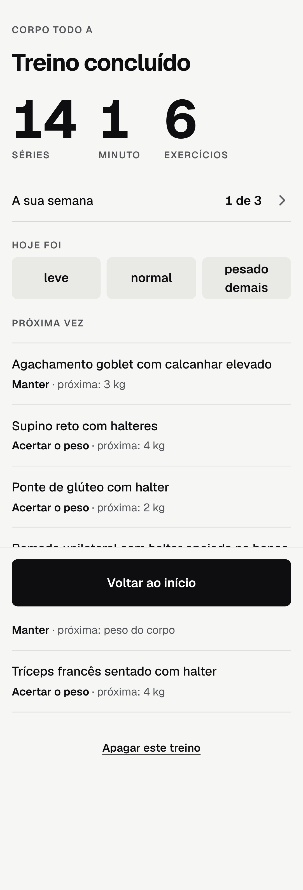
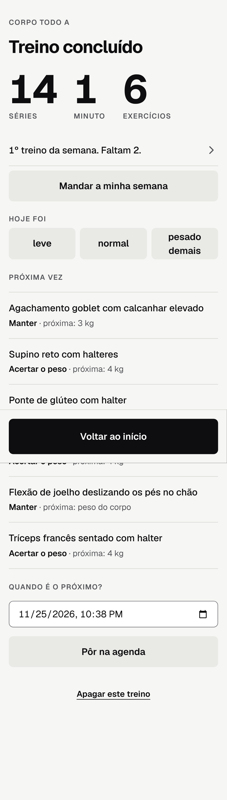
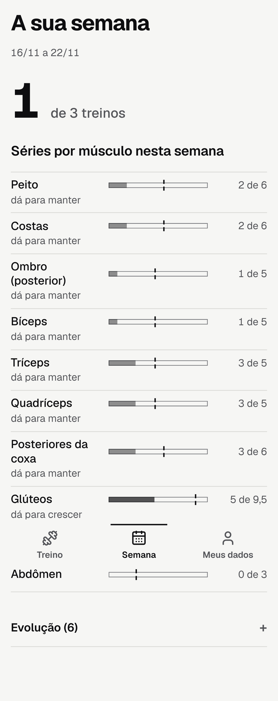
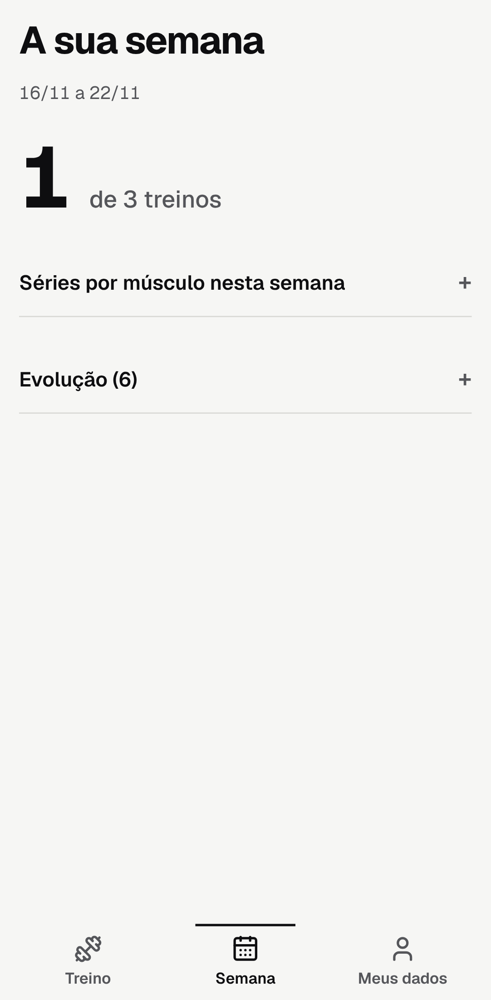
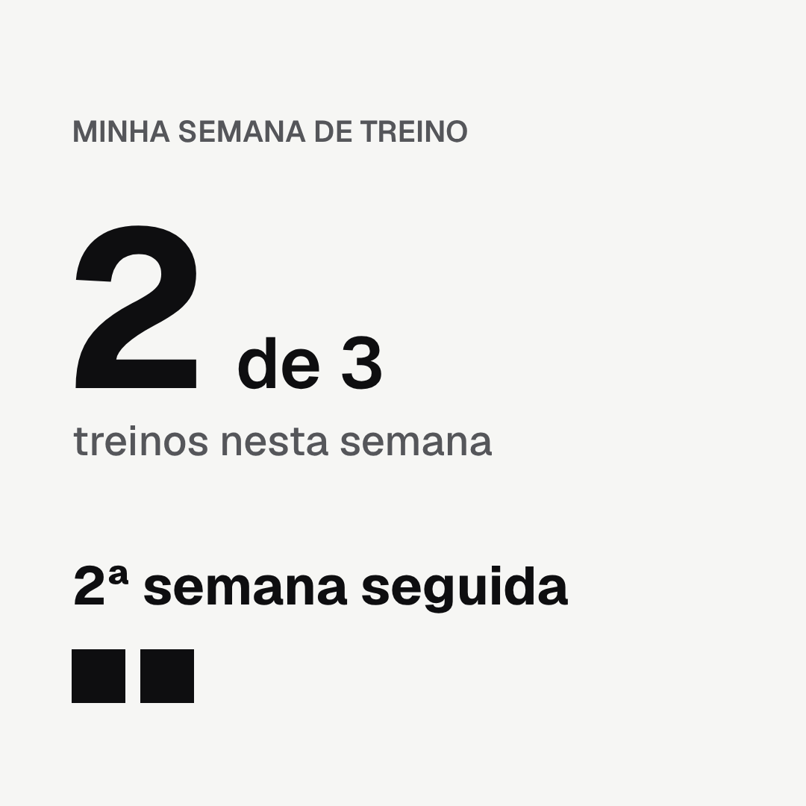

# M5. Um motivo para voltar

> Feito em 22/11/2026, no ramo `claude/m5-um-motivo-para-voltar` (a partir da `main`), a pedido do Gustavo, com o M4 ainda à espera do teste nos aparelhos. O roteiro do lote está em `docs/prompts/sessao-melhorias-analise-critica.md` ("M5. Um motivo para voltar"). Nada daqui está na `main`. Os textos são **proposta**: valem com o ok do Gustavo.

## O que muda para quem usa

| | Antes | Depois |
|---|---|---|
| Fim do treino | "A sua semana · 1 de 3" | "1º treino da semana. Faltam 2." (com "Falta 1." e "Semana completa." conforme o caso) |
| O que melhorou | só a lista de recordes | uma frase antes da lista: "Você subiu a carga em 2 exercícios e bateu 1 recorde." Sem recorde, nenhuma frase |
| Quem volta depois de alguns dias (menos de 14) | nada | "Bom te ver de novo. Faz 9 dias do último treino, e a carga é a mesma." |
| Tela da semana | abria com a tabela de séries por músculo | abre pelos treinos e pelas semanas com treino ("6 de 8 semanas com treino", agora à vista); a tabela foi para uma gaveta |
| Lembrar do próximo treino | nada | "Quando é o próximo?": o dia e a hora já sugeridos e o botão "Pôr na agenda", que cria um compromisso com lembrete de 30 min |
| Mostrar a semana a alguém | nada | "Mandar a minha semana": uma imagem que sai pelo compartilhar do celular |

**O fim do treino, antes e depois:**

 

**A semana, antes e depois** (persona na 1ª semana; a faixa das semanas aparece a partir da 2ª):

 

**O cartão da semana:**

## Decisões técnicas, com o motivo

1. **A recepção não começa aos 3 dias para todo mundo.** O roteiro pede "entre 3 e 13 dias". Com 2 ou 3 treinos por semana, 3 dias é o intervalo normal entre dois treinos, e a pessoa seria "recebida de volta" toda semana. A recepção conta a partir de 2 dias além do intervalo da rotina, nunca antes de 3: 6 dias para quem treina 2 vezes por semana, 5 para 3 vezes, 4 para 4 ou mais. De 14 dias em diante continua valendo a mensagem de volta que já existia (a que muda o treino). [opinião]
2. **A recepção se cala quando a tela já diz outra coisa:** no começo leve, na volta gradual e na semana leve.
3. **A agenda é um arquivo de calendário (.ics),** com horário do relógio do próprio celular (sem fuso), só com o nome do treino e um lembrete de 30 min [opinião]. Sem servidor e sem aviso do app.
4. **A sugestão de data** é o intervalo da rotina (7 dividido pelos treinos da semana, para cima), na mesma hora em que o treino de hoje começou. A pessoa muda antes de pôr na agenda.
5. **O cartão é desenhado no aparelho** e só sai dele quando a pessoa escolhe para onde mandar. Onde o celular não compartilha imagem, a imagem é salva. Leva só frequência: os testes conferem que nada de carga, de exercício ou de saúde vai junto. Não leva o nome do app (adiado em 21/11).
6. **"Semana seguida" só no cartão, e só a partir da 2ª.** A análise mandou proteger "nunca uma sequência que zera". No app continua "X das últimas 8 semanas com treino", que não zera. No cartão, quem tem 2 semanas seguidas ou mais vê "5ª semana seguida"; quem acabou de voltar vê "3 de 4 semanas com treino", e nunca um "1ª semana" que soe como recomeço. Sem treino na semana, não há cartão.
7. **Treino encerrado por sinal de alerta** não oferece cartão nem agenda.
8. **A regra `acompanhamento.mensagens`** ganhou a recepção, no arquivo de regras e na frase de "Entenda o treino" (que ficou em 79 palavras; o limite é 80).

## O que não dá para conferir daqui

- **O arquivo da agenda no iPhone.** No navegador de teste ele é baixado e o conteúdo confere. Num iPhone, sobretudo com o app na tela de início, o caminho de um arquivo baixado até a agenda pode ser diferente. É para medir no aparelho.
- **O compartilhar de verdade** (a tela do WhatsApp). O teste simula o compartilhar do celular e confere o que seria mandado.

## Testes

- Regras (`tests/unit/acompanhamento.test.ts`): as frases do fim do treino; a recepção e os seus limites; as semanas seguidas; o cartão; a sugestão de data; o arquivo da agenda linha por linha.
- Tela (`tests/e2e/acompanhamento.spec.ts`, os três "M5"): a persona que volta depois de 9 dias é recebida, e a de 3 dias não; o cartão sai pelo compartilhar só com a frequência; sem compartilhar, a imagem é salva; o compromisso da agenda com o treino certo, a data sugerida e a data escolhida.
- Atualizados por causa dos textos novos: `treino.spec.ts` (o fim do treino) e dois de `acompanhamento.spec.ts` (a semana e o recorde).

## Decisões do Gustavo, uma de cada vez

1. **Os textos do fim do treino:** "1º treino da semana. Faltam 2." / "2º treino da semana. Falta 1." / "3º treino da semana. Semana completa."; e "Você subiu a carga em 2 exercícios e bateu 1 recorde."
2. **A recepção:** "Bom te ver de novo. Faz 9 dias do último treino, e a carga é a mesma."
3. **O desenho do cartão** (a imagem acima) e o nome do botão, "Mandar a minha semana". E a escolha do item 6: "5ª semana seguida" no cartão, ou só "6 de 8 semanas com treino".
4. **A agenda:** "Quando é o próximo?" e "Pôr na agenda".
5. **A frase do `CLAUDE.md`** (Escopo). Hoje: "fora do MVP ficam [...] recursos sociais". Proposta: "fora do MVP ficam [...] recursos sociais (feed, seguidores, comentários, placar por carga). Desde 22/11/2026, o cartão da semana entra: uma imagem só com a frequência, que a pessoa manda pelo compartilhar do celular, sem conta e sem servidor."

## O que falta para fechar

- As cinco decisões acima.
- O teste da agenda e do compartilhar num Android e num iPhone.
- `docs/PLANO-MVP.md` e o `CLAUDE.md`, com o ok do Gustavo.

## Fechamento (23/11/2026)

Em 23/11/2026 o Gustavo pediu: "quero encerrar por completo o que falta para finalizarmos essa versão inicial, faça tudo que falta". **As cinco decisões acima foram aplicadas como estavam propostas**, sem ele ter lido uma por uma; ele pode vetar qualquer uma depois:
1. Os textos do fim do treino, como propostos.
2. A recepção, como proposta.
3. O cartão como está na imagem, o botão "Mandar a minha semana", e "5ª semana seguida" no cartão (a partir da 2ª semana seguida; no app continua "X das últimas 8 semanas com treino").
4. "Quando é o próximo?" e "Pôr na agenda".
5. A frase do `CLAUDE.md` (Escopo), aplicada.

O lote entrou na `main` junto com o M4 (ramo `claude/m4-m5-juncao`). O teste da agenda e do compartilhar num Android e num iPhone continua com o Gustavo: `docs/roteiro-gente-de-verdade.md`, item 3.
