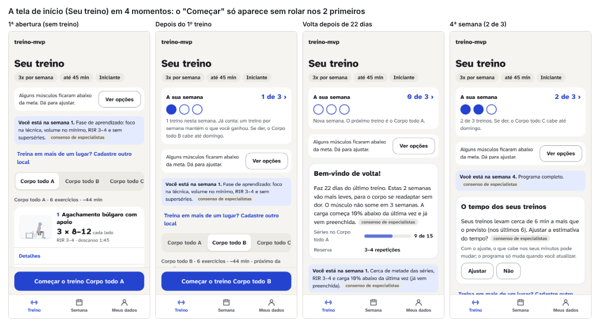
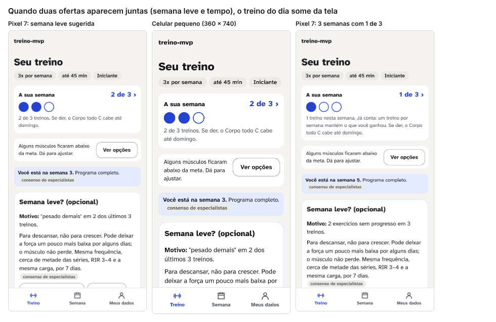
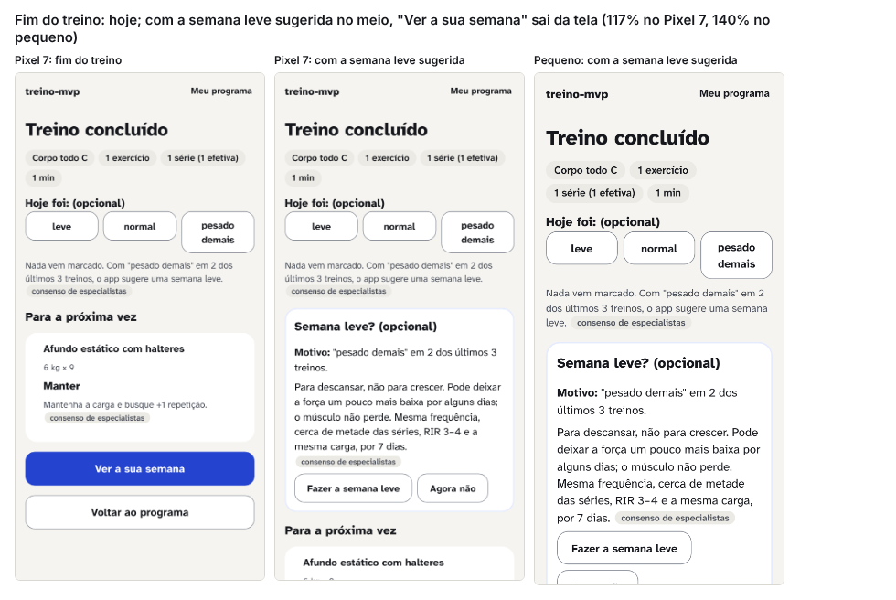
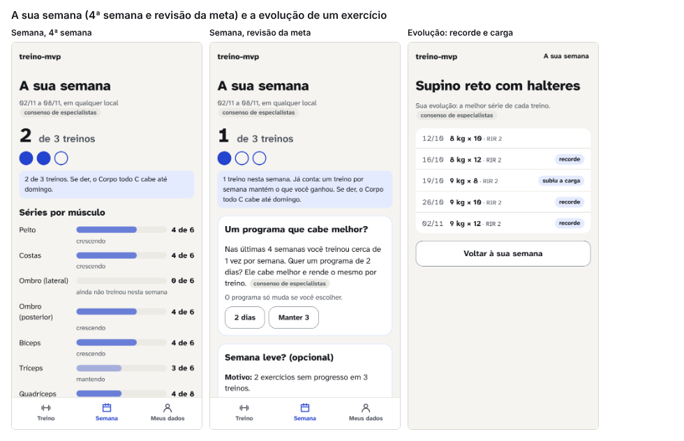
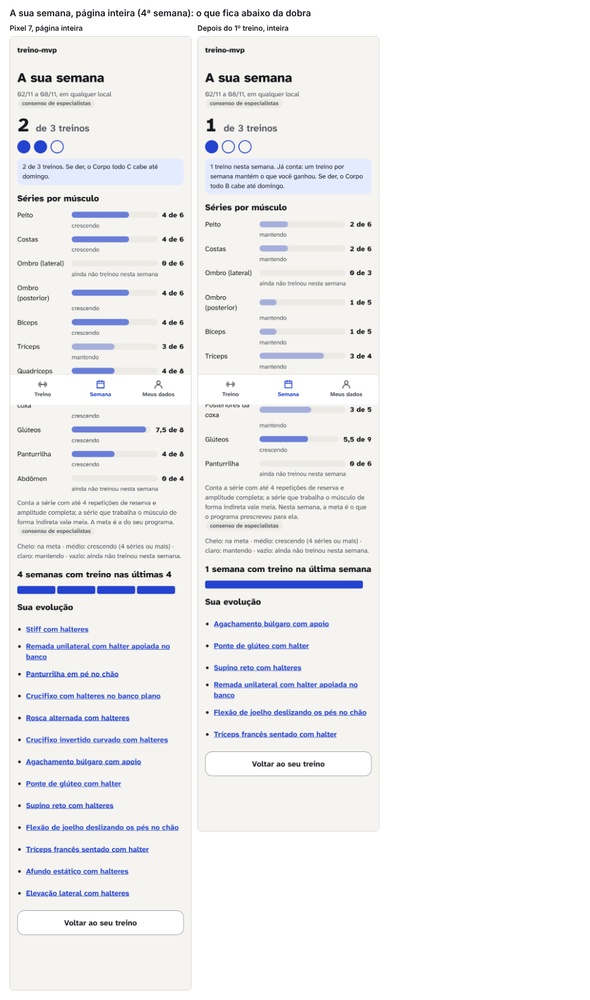

# Redesign, agente 1: retenção e motivação (o que faz a pessoa voltar)

> Pergunta: o que, nas telas de início (`/programa`), fim do treino (`/treino/fim`), semana (`/semana`) e evolução (`/evolucao/:exId`), faz a pessoa abrir o app no dia certo, começar o treino e sentir que progrediu, **sem manipulação**?
>
> Como foi feito (06/11/2026): o app servido em http://localhost:4173 (build do HEAD), medido por script com a persona fictícia **Ana** (iniciante, halteres de 1 a 12 kg, 3 × 45 min) em **18 estados** da jornada, num Pixel 7 (412 × 915) e num celular pequeno (360 × 740), tema claro. Os estados foram montados gravando um histórico fictício direto no aparelho (a mesma técnica de `tests/e2e/acompanhamento.spec.ts`), com o relógio parado numa quinta-feira (05/11/2026, 12:00). Scripts em `scripts/design/redesign/agente-1/` (`momentos.spec.ts` mede e captura; `compor.spec.ts` monta as folhas). Imagens brutas em `reports/design/redesign/agente-1/` (fora do git); números em `reports/design/redesign/agente-1/medidas-<projeto>.json`. Para repetir: `npx playwright test -c scripts/design/redesign/agente-1/playwright.config.ts momentos` (a jornada) e `… momentos -g "fim com semana leve"` (o estado 13c, à parte, em `medidas-fim-semana-leve-<projeto>.json`); depois `… compor --project=pixel7` (as folhas).
>
> Revisão numa 2ª sessão (06/11/2026): conferi cada número deste relatório contra os JSONs da última rodada, medi de novo o fim do treino com a semana leve (estado 13c, que vinha de uma rodada anterior sem registro), refiz a folha do fim do treino (o título não batia com as imagens), corrigi as posições da semana (estados 08 e 11) e reconferi as fontes na web; o que mudou está nas tabelas abaixo.
>
> Selos como em `docs/pesquisa/00-metodo.md` (norma e guia de plataforma entram como consenso). O PubMed está bloqueado nesta rede: o que vi só pelo resumo ou por registro leva **(resumo)**; o que li inteiro leva **(texto completo)**. Nada abaixo foi inventado; onde não achei fonte, está **[opinião]**. Nada mudou no app.

## 1. Em uma frase
O acompanhamento que existe hoje tem o conteúdo certo (semana sem culpa, volta de pausa, sugestão para a próxima vez, recorde por exercício), mas **mostra tudo ao mesmo tempo e na ordem errada**: depois do 1º treino, o botão "Começar" fica fora da tela em 8 dos 10 estados de início medidos no Pixel 7 (9 de 10 no celular pequeno), 4 mensagens disputam a dobra, e o fim do treino não mostra a única coisa que a pessoa acabou de mudar (a semana andou, um recorde aconteceu). A proposta é **um cartão de hoje no topo, uma mensagem por vez, e o fim do treino como o momento em que o progresso aparece**, mais uma pergunta opcional "quando você treina?" para o app saber o dia certo, sem notificação no MVP.

## 2. O que medi

### 2.1 Os 18 estados e o que fica visível sem rolar
A dobra é a altura da tela (915 px no Pixel 7, 740 no pequeno). "Mensagens" são caixas que falam com a pessoa (faixa da semana, aviso de meta, fase, volta, semana leve, tempo, status). "Botões" não contam a barra de navegação. Posição do botão principal em % da altura da tela (100% = começa fora da tela). Todos os 18 estados, nos dois tamanhos: **0 área de toque abaixo de 44 px e 0 texto abaixo do contraste mínimo** [medido].

| Estado (persona Ana) | Alturas de tela (Pixel 7 / pequeno) | Mensagens acima da dobra / total (Pixel 7) | Botões acima da dobra / total (P7; pequeno) | Palavras acima / total | "Começar" (P7 / pequeno) |
|---|---|---|---|---|---|
| 01 Início, 1ª abertura (sem treino) | 2,2 / 2,6 | 2 / 3 | 6/6; 6/6 | 152 / 202 | 84% visível / 82% visível |
| 02 Início, depois do 1º treino (ontem) | 2,4 / 2,8 | 3 / 4 | 6/6; 6/6 | 170 / 231 | 84% visível / **96% fora** |
| 04 Início, 2ª semana, 2 de 3 (com semana leve sugerida: 2 exercícios parados) | 3,1 / 3,8 | 4 / 6 | 3/10; 1/10 | 122 / 326 | **153% / 192%** |
| 05 Início, volta depois de 22 dias | 2,7 / 3,4 | 4 / 5 | 2/6; 1/6 | 127 / 293 | **111% / 137%** |
| 05b Início, volta depois de 20 dias (RIR +1) | 2,6 / 3,2 | 4 / 5 | 5/6; 1/6 | 118 / 263 | **105% / 130%** |
| 06 Início, volta depois de 69 dias (−15%) | 2,7 / 3,4 | 4 / 5 | 2/6; 1/6 | 120 / 286 | **111% / 137%** |
| 07 Início, 4ª semana, 2 de 3, progredindo | 2,7 / 3,3 | 4 / 5 | 4/8; 1/8 | 120 / 282 | **108% / 131%** |
| 10 Início, 3 das últimas 4 semanas com 1 de 3 | 3,1 / 3,9 | 4 / 6 | 3/10; 1/10 | 132 / 349 | **153% / 189%** |
| 12b Início, semana leve sugerida ("pesado demais" 2 de 3) | 3,1 / 3,9 | 4 / 6 | 3/10; 1/10 | 111 / 339 | **150% / 186%** |
| 16 Início, logo depois de terminar um treino | 2,7 / 3,3 | 4 / 5 | 4/8; 1/8 | 121 / 273 | **111% / 137%** |
| 13 Fim do treino (1 série feita) | 1,0 / 1,1 | 0 / 0 | 5/5; 5/5 | 71 no total (o contador "acima da dobra" conta o texto dos botões duas vezes) | "Ver a sua semana": 75% / 85% visível |
| 13c Fim do treino com a semana leve sugerida ("pesado demais" nos 2 treinos anteriores) | 1,4 / 1,6 | 1 / 1 | 5/7; 4/7 | 128 no total | **117% / 140% fora** |
| 03 Semana, depois do 1º treino | 2,2 / 2,6 | 1 / 1 | 0/1 | 91 / 209 | — |
| 08 Semana, 4ª semana | 2,6 / 3,0 | 1 / 1 | 0/1 | 80 / 229 | — |
| 11 Semana, com a revisão da meta e a semana leve | 3,4 / 4,1 | 3 / 3 | 2/5 | 136 / 350 | — |
| 09, 12 Evolução (5 treinos) | 1,0 / 1,0 | 0 | 1/1 | 65–78 | — |

**O que os números dizem** [medido]:
- **O "Começar" só fica visível sem rolar na 1ª abertura e, no Pixel 7, na abertura seguinte ao 1º treino.** Em todos os outros 8 estados de início, começa entre 105% e 153% da altura da tela (130% a 192% no celular pequeno). A barra fixa `acao-fixa` existe, mas só "gruda" quando a lista do dia já está à vista; antes disso, a pessoa precisa rolar 1 a 2 telas passando por faixas e caixas. É o oposto do que a v2 pediu para o treino ("Série feita" fixo em qualquer série).
- **Quatro mensagens acima da dobra** em todo estado depois da 1ª semana: faixa da semana, "Alguns músculos ficaram abaixo da meta" (aparece nos 10 estados de início, sempre com o mesmo texto), a fase ("Você está na semana N…") e uma caixa de oferta (volta, semana leve ou tempo). Com duas ofertas ao mesmo tempo (estados 04, 10, 12b), a tela tem 10 botões e 3,1 a 3,9 alturas.
- **O texto da volta aparece duas vezes** (estado 05): a caixa "Bem-vindo de volta!" diz "Estas 2 semanas vão mais leves… A carga começa 10% abaixo" e, logo abaixo, a fase repete "Cerca de metade das séries, RIR 3–4 e carga 10% abaixo da última vez (já vem preenchida)". 293 palavras na página, 127 acima da dobra, para dizer uma coisa.
- **O fim do treino não mostra o que mudou.** Mostra o resumo (1 exercício, 1 série, 1 min), "Hoje foi", e as sugestões por exercício. A semana (2 de 3 → 3 de 3) e as marcas "recorde" ou "subiu a carga" da sessão não aparecem; a pessoa só as vê se tocar em "Ver a sua semana" e depois em cada exercício. Quando a semana leve é sugerida, a caixa dela entra entre "Hoje foi" e "Para a próxima vez" e empurra "Ver a sua semana" para fora da tela (117%).
- **Na semana, a oferta vem antes do dado.** No estado 11, a revisão da meta e a semana leve ocupam do 45% a ~118% da altura; "Séries por músculo" começa a 120%; "5 semanas com treino nas últimas 5" fica a 222% e "Sua evolução" a 231% (uma lista de nomes de exercício, sem dizer qual subiu). Mesmo sem oferta (estado 08, 4ª semana), "4 semanas com treino nas últimas 4" fica a 144% e "Sua evolução" a 153%: o número que mostra a constância está sempre abaixo da dobra.
- **A evolução cabe numa tela e está certa**: lista da melhor série por treino, com "recorde" e "subiu a carga", sem carga máxima estimada [medido: 0 ocorrência de "estimad"]. Falta o resumo (de 8 kg × 10 a 9 kg × 12 em 3 semanas) e o caminho de volta ao treino (só "Voltar à sua semana").
- **A linha "Você está na semana 4. Programa completo."** ocupa uma caixa inteira para dizer que não há fase (estado 07).











### 2.2 O que está bom e deve ficar (com a medida ou a fonte)
| O que | Por que fica |
|---|---|
| **"1 treino nesta semana. Já conta: um treino por semana mantém o que você ganhou."** (faixa e semana) | É retorno sobre o próprio registro, sem culpa [fonte: Michie 2009 (resumo); Harkin 2016 (resumo); moderada]. Texto já aprovado em `acompanhamento.mensagens`. |
| **"X das últimas 8 semanas com treino"**, nunca uma sequência que zera | Sequência quebrada desmotiva, e mais quando a pessoa se culpa [fonte: Silverman e Barasch 2023 (resumo); um estudo]. A própria Duolingo escreve que quebrar a sequência "é bem desmotivador" [fonte: blog da Duolingo 2022 (texto completo); hábito de mercado]. |
| **A caixa "Bem-vindo de volta!"**: fato + o que muda hoje, sem "você parou" | Autocompaixão se associa a mais comportamento de saúde [fonte: Sirois, Kitner e Hirsch 2015, r = 0,25 (resumo); moderada]; faltar uma vez não atrapalha a formação do hábito [fonte: Lally 2010, via resumo secundário; um estudo]. |
| **"Para a próxima vez"** com Manter/Subir e o motivo | Retorno sobre o desempenho passado é a técnica que mais se associa a autoeficácia em atividade física [fonte: Ashford, Edmunds e French 2010 (resumo parcial); moderada]. |
| **"Hoje foi: leve / normal / pesado demais"**, nada marcado | Autorregistro de 1 toque; o sinal entra na semana leve só com 2 de 3 [medido no e2e do R2]. |
| **Evolução = melhor série de cada treino + marcas**, sem carga máxima estimada | Decisão com medida em `pesquisa-v2/07` (as fórmulas divergem 15 a 52 pontos acima de 12 repetições) [medido lá]. |
| **Barras por músculo com a palavra do estado** (na meta, crescendo, mantendo) | Não depende da cor [medido: as 4 barras têm a mesma cor; e2e do R2]. |
| **0 toque pequeno, 0 contraste baixo** nos 18 estados × 2 tamanhos | [medido]. |

### 2.3 O que está fraco
1. O "Começar" fora da tela em 8 de 10 estados de início (Pixel 7) [medido].
2. Quatro mensagens com o mesmo peso acima da dobra; a de meta é permanente [medido].
3. O fim do treino não mostra a semana que andou nem as marcas da sessão [medido].
4. Na semana, oferta antes do dado; "Sua evolução" é uma lista de nomes [medido].
5. O app não sabe **quando** a pessoa treina (dias da semana): "o Corpo todo C cabe até domingo" é o máximo que ele consegue dizer; não há "hoje é dia de treino" [lido em `src/storage/esquema.ts`: `rotina.diasSemana` é só a contagem].
6. Não há nada entre o fim de um treino e a abertura seguinte (nem lembrete, nem plano). Isso pode ser certo (ver 4.6).

## 3. O que a pesquisa diz

| Afirmação | Selo | Fonte (o que conferi) |
|---|---|---|
| Apps de atividade física têm efeito **pequeno**: g ≈ 0,29 (0,22 corrigido por viés) em 50 ensaios; **metas de comportamento e automonitoramento** são o que separa o que funciona (g = 0,01 sem nenhuma das duas; +0,31 com uma; juntar as duas não soma). | moderada | Eckerstorfer et al. 2018, *JMIR mHealth* 6(11):e10076, PMID 30425028 (resumo) |
| Apps de celular **com gamificação, sozinhos**, aumentam a atividade física de forma pequena a moderada (DMP = 0,34 nos ensaios com grupo controle; 19 estudos, 16 na meta-análise; heterogeneidade alta, I² = 72%). | moderada | Yang, Hu e Koenigstorfer 2022, *Am J Prev Med* 62(4):602-613, doi 10.1016/j.amepre.2021.10.005 (resumo, Europe PMC). É o "Yang" do briefing, provavelmente. |
| mHealth para atividade física: efeitos pequenos e **não significativos** na atividade total (DMP 0,14; 21 ensaios); só 31 das 93 técnicas da taxonomia foram usadas nos ensaios. | moderada | Direito et al. 2017, *Ann Behav Med* 51(2):226-239 (resumo) |
| Apps de passos: +477 passos/dia, não significativo no total; significativo só até 3 meses. | moderada (fraca) | Romeo et al. 2019, *JMIR* 21(3):e12053 (resumo) |
| A taxonomia de 93 técnicas de mudança de comportamento (BCT v1), em 16 grupos, é o vocabulário padrão. | consenso | Michie et al. 2013, *Ann Behav Med* 46(1):81-95 (resumo) |
| **Autorregistro** é a técnica que mais explica o efeito; com meta, retorno ou revisão da meta, o efeito sobe (0,42 × 0,26). | moderada | Michie et al. 2009 (já no projeto, resumo-PubMed) |
| **Acompanhar o progresso** ajuda a chegar à meta (d = 0,40, 138 ensaios, 19.951 pessoas); mais quando o progresso é **registrado** e **mostrado**. | moderada | Harkin et al. 2016, *Psychol Bull* 142(2):198-229, PMID 26479070 (resumo) |
| **Retorno sobre o desempenho passado** se associa a mais autoeficácia; persuasão verbal e monitoramento diário sozinho, não. O efeito médio das intervenções na autoeficácia é pequeno (d = 0,16; 27 estudos, 5.501 pessoas). | moderada | Ashford, Edmunds e French 2010, *Br J Health Psychol* 15(2):265-288 (resumo; o detalhe por técnica via Williams e French 2011) |
| **Motivação autônoma** (a pessoa sente que escolhe) se associa a fazer e manter exercício; intervenções baseadas em autodeterminação têm efeito pequeno a médio, mediado por motivação autônoma e apoio percebido. | moderada | Teixeira et al. 2012 (já no projeto); Ntoumanis et al. 2021, *Health Psychol Rev* 15(2):214-244 (resumo) |
| **Planejar quando e onde** (intenção de implementação) ajuda a cumprir metas: d = 0,65 em 94 testes (2006); a revisão de 642 testes (2024) dá d de 0,27 a 0,66 conforme o desfecho, e as correções por viés (0,35 ou 0,15) só aparecem em fonte secundária. Em atividade física: 0,31 logo depois e 0,24 no seguimento (26 estudos). | moderada | Gollwitzer e Sheeran 2006, *Adv Exp Soc Psychol* 38:69-119 (secundária); Sheeran, Listrom e Gollwitzer 2024/2025, *Eur Rev Soc Psychol* 36(1):162-194, doi 10.1080/10463283.2024.2334563 (resumo; as correções, **não verificadas**); Bélanger-Gravel, Godin e Amireault 2013, *Health Psychol Rev* 7(1):23-54 (resumo secundário, McMaster Optimal Aging) |
| Ligar o comportamento a uma **rotina** ou a um **horário** funciona igual; o que prevê o hábito é repetir o plano. | um estudo (ECR, 192 pessoas) | Keller et al. 2021, *Br J Health Psychol* 26(3):807-824, PMID 33405284 (resumo) |
| **Lembretes** sustentam a repetição, mas **atrapalham** a formação do hábito; pistas ligadas a eventos do dia aumentam a automaticidade; reforço positivo não teve efeito (4 semanas; revisão de 115 apps). | um estudo | Stawarz, Cox e Blandford 2015, CHI, doi 10.1145/2702123.2702230 (resumo) |
| Uma notificação sob medida aumenta a chance de abrir o app nas 24 h seguintes em **3,9%** (8,7% nos fins de semana); o efeito diminui com o tempo. | um estudo (microrrandomizado, 1.255 pessoas) | Bidargaddi et al. 2018, *JMIR mHealth* 6(11):e10123, PMID 30497999 (resumo) |
| **Hábito**: mediana de 66 dias para a automaticidade (18 a 254), em 39 pessoas com bom ajuste de 96; **uma falta isolada não atrapalhou** (queda menor que meio ponto, recuperada logo). | um estudo | Lally et al. 2010, *Eur J Soc Psychol* 40(6):998-1009 (só por resumos secundários: BPS Research Digest e thebehavioralscientist.com; **o original não foi aberto**) |
| Hábito de exercício: o que **inicia** o treino (sair de casa) prevê a frequência, não o que executa; é o começo que precisa virar automático. | um estudo (118-123 pessoas) | Phillips e Gardner 2016, *Health Psychol* 35(1):69-77 (resumo) |
| Novos alunos de academia: ≥ 4 vezes por semana por 6 semanas foi o mínimo para o hábito; consistência (β = 0,21), simplicidade, ambiente e gostar previram o hábito. | um estudo (111 pessoas) | Kaushal e Rhodes 2015, *J Behav Med* 38(4):652-663, PMID 25851609 (resumo) |
| **Primeiros 28 dias**: em 389.481 usuários de um app de musculação (Fitbod), a regularidade nos primeiros 28 dias foi o que mais previu continuar (HR 0,73 por desvio-padrão de dias ativos na semana 11); só **10,1% dos iniciantes** ainda registravam 1 treino por semana aos 12 meses; mediana de abandono de **19 semanas**. Observacional; só entraram quem treinou ≥ 1 vez por semana nos primeiros 28 dias. | um estudo (grande, observacional) | Conti, Marzagão, Galpin e Schoenfeld 2026, *Front Sports Act Living* 8:1855668, doi 10.3389/fspor.2026.1855668 (**texto completo**; 100.709 iniciantes; o efeito cai com o tempo: HR 0,87 na semana 26 e 0,91 na 40; um autor é funcionário do Fitbod, conflito declarado) |
| Academia no Rio de Janeiro (5.240 matrículas): **63% abandonam antes do 3º mês** e menos de 4% seguem por mais de 12 meses. | um estudo (observacional) | Sperandei, Vieira e Reis 2016, *J Sci Med Sport* 19(11):916-920, PMID 26874647 (resumo) |
| **Gamificação** aumenta atividade física pouco a moderadamente (g = 0,42) e cai no seguimento (g = 0,15, ~14 semanas depois); contra controle ativo (app sem jogo), g = 0,23. Os autores: "o efeito diminui com o tempo". | moderada | Mazeas et al. 2022, *JMIR* 24(1):e26779 (**texto completo**, PMC8767479) |
| App com gamificação × app sem: **+489 passos/dia** (IC 64 a 914), "trivial", em 36 ensaios e 10.079 pessoas; o resumo não conclui nada sobre longo prazo. | moderada | Nishi et al. 2024, *EClinicalMedicine* 76:102798, PMID 39764571 (resumo, via Europe PMC) |
| **Sequências ("streaks")** registradas aumentam o engajamento enquanto duram; **quebradas, desmotivam**, mais quando a pessoa se culpa e quando não dá para consertar. | um estudo (série de experimentos) | Silverman e Barasch 2023, *J Consum Res* 49(6):1095-1117 (resumo e cobertura) |
| **Recomeço** ("fresh start"): buscas por dieta, idas à academia e metas sobem depois de marcos de tempo (início da semana, do mês, aniversário). | um estudo (3 estudos de campo) | Dai, Milkman e Riis 2014, *Manag Sci* 60(10):2563-2582 (resumo) |
| **Autocompaixão** se associa a mais comportamentos de saúde (r = 0,25, 15 amostras). | moderada | Sirois, Kitner e Hirsch 2015, *Health Psychol* 34(6):661-669 (resumo) |
| Uso em relance de apps de atividade: estudo de 10 meses com 256 pessoas (Habito); a parte "glanceable" é de um artigo de 2016 do mesmo grupo. | um estudo | Gouveia, Karapanos e Hassenzahl 2015, UbiComp:1305-1316, doi 10.1145/2750858.2804290 (resumo e registro bibliográfico); Gouveia et al. 2016, UbiComp (não lido). Correção à `design-v2.md`: o "relance" é do artigo de 2016. |
| Taxa de aceite de notificação em apps de saúde e fitness: 43,2% no Android e 33,5% no iOS (2024). | hábito de mercado (relatório de fornecedor, sem método publicado) | OneSignal, *Mobile app benchmarks 2024* (página do fornecedor, via busca) |

### 3.1 Os apps de referência (só o que vi em páginas públicas; nada de tela inventada)
Classificação: **evidência** (há estudo que sustenta o padrão), **mercado** (hábito do setor, sem estudo que eu tenha achado) ou **contra o projeto** (vai contra `design-v2.md` §2 e `acompanhamento.mensagens`).

| App | Início | Fim do treino | Histórico | Classificação |
|---|---|---|---|---|
| **Hevy** (hevyapp.com e central de ajuda, texto completo das páginas de recursos) | Aba Calendário com a "sequência ativa" em **semanas** seguidas com ≥ 1 treino e o contador de **dias de descanso** desde o último treino; widgets da tela inicial com o calendário (a página não diz se mostram a sequência). Uma semana perdida zera; uma semana compensada depois "soma à sequência anterior". A própria página admite que é marketing ("ter uma sequência ativa pode ser muito motivador"; "alguns usuários têm sequências além de 100 semanas"). | **Recorde ao vivo**: ao completar a série que supera a melhor anterior, aparece uma faixa; os recordes ficam no treino. | Calendário com os dias em azul; estatísticas por exercício e séries por músculo; relatório mensal; feed social. | Recorde ao vivo = **evidência** (retorno sobre desempenho, Ashford 2010). Sequência semanal que zera = **contra o projeto** (Silverman 2023). Séries por músculo = o que o app já faz. |
| **Strong** (strong.app, texto completo da página) | A página não descreve a tela inicial. | Não descreve. | "Melhores séries" (recordes), "1RM máximo" (a página não diz se é estimado), gráficos avançados (PRO), medidas corporais e % de gordura, agendamento de treinos. Sem sequência, medalha ou conquista na página. | 1RM, se estimado = **contra o projeto** (decisão da `pesquisa-v2/07`). Recordes = evidência. |
| **Fitbod** (páginas de ajuda bloqueadas nesta rede: só o que apareceu nos resumos de busca e em Conti 2026, que usou os dados do app) | Mapa de **recuperação muscular** em % (0 a 100%, calculado de séries, repetições e carga; "recuperado" depois de ~6 dias pela ajuda, 7 por um post do blog), que escolhe "músculos descansados" para o próximo treino; a pessoa pode corrigir o %. "Sequência" em semanas seguidas cumprindo a meta semanal. | Recordes e "conquistas" (achievements). | Registros e recordes; "Insights" (a empresa afirma que quem olha os dados tem 2× mais chance de manter 6 meses; dado do fornecedor, sem método). | Recuperação em % = **mercado** (número sem estudo que valide; o projeto não deve copiar). Sequência e conquistas = **contra o projeto**. Retenção medida (Conti 2026) = o dado mais útil que saiu de lá. |
| **Freeletics** (blog e ajuda, texto completo de uma página) | "Today view": a sessão do dia gerada diariamente pelo Coach. | Pede **nota de técnica** (de ruim a excelente, por exercício ou intervalo); as estrelas de técnica liberam exercícios mais difíceis; usa o tempo do treino como indicador. Lema "não existe falha, só retorno". Reclamações no fórum: o retorno ficou grosso demais (só "excelente ou ruim"). | Não vi a tela de histórico. | Retorno de 1 toque por treino = **evidência** (autorregistro) e é o que "Hoje foi" já faz. Nada sobre sequência encontrado. |
| **Nike Training Club** (nike.com, texto completo da página do app) | Não descreve a tela inicial. | — | Aba Atividade que "registra as suas conquistas": **troféus e emblemas** por ocasiões (aniversário, feriados) e por marcos como total de treinos, frequência e **sequências semanais e mensais**. | **Contra o projeto** (troféus por ocasião; sequência). Um resenhista achou "divertido para iniciantes, não decisivo" (uma opinião). |
| **Duolingo, como contraste** (blog oficial de 31/01/2022, texto completo; cobertura secundária das notificações) | Sequência de **dias** com lição; o streak freeze pausa um dia (até 2). A empresa diz: animações de marco na tela do streak subiram em **+1,7%** a chance de um novo usuário estar lá 7 dias depois; 2 freezes ativos deram **+0,38%** de usuários diários; quem chega a 7 dias tem **3,6×** mais chance de terminar o curso (associação). Notificações "passivo-agressivas" viraram meme; uma delas desliga sozinha ("estes lembretes não parecem estar funcionando"); números de testes só em fontes secundárias (não verificados). | — | — | A própria Duolingo escreve que quebrar a sequência "é bem *des*motivador" e que o medo de perder trava quem ainda não começou. O que ela compensa com freeze e aversão à perda é exatamente o que o projeto decidiu não fazer (`design-v2.md` §2). **Contra o projeto**; os ganhos são de décimos de ponto percentual num produto diário, e o treino é 2 a 4 vezes por semana. |

**Leitura [opinião]:** os quatro apps de musculação fazem a mesma coisa: registro, recorde e um calendário. O que diverge é o **contador de sequência** (Hevy, Fitbod, NTC) e a **recuperação inventada** (Fitbod). O recorde ao vivo do Hevy é a única peça que eu copiaria, e o app já tem o dado para isso (`evolucaoDoExercicio`).

## 4. Achados e propostas: os 5 momentos que mais importam para a volta

A ordem é a da jornada, não a da importância. A evidência de "momento" é fraca em geral (quase nada foi testado em musculação); o que existe aponta para **os primeiros 28 dias** (Conti 2026), o **fim do treino** como o lugar do retorno (Harkin 2016; Ashford 2010) e **a volta depois de faltar** (Lally 2010; Sirois 2015; Silverman 2023).

### 4.1 Momento 1: o fim do treino (o lugar onde o progresso aparece)
- **Tela/estado:** `/treino/fim`, logo depois de "Terminar treino".
- **Problema:** a tela mostra o resumo bruto (séries, minutos) e as sugestões, mas não a única coisa que a pessoa acabou de mudar: a semana andou (2 de 3 → 3 de 3) e, quando houve, um recorde. Com a semana leve sugerida, a caixa dela entra no meio e "Ver a sua semana" sai da tela (117% no Pixel 7, 140% no pequeno). [medido: estados 13, 14 e 13c]
- **Evidência:** acompanhar o progresso ajuda a chegar à meta, mais quando é registrado e mostrado [fonte: Harkin 2016 (resumo); moderada]; retorno sobre o desempenho passado é a técnica ligada a autoeficácia em atividade física [fonte: Ashford 2010 (resumo parcial); moderada]; o Hevy mostra o recorde na hora [hábito de mercado]. Que o fim é o momento de mostrar, e não a abertura seguinte, é [opinião]: é quando a pessoa ainda está com o celular na mão e o esforço fresco.
- **Proposta: componente "O que mudou hoje"**, no topo do fim do treino, acima de "Hoje foi":

```
Treino concluído · Corpo todo C · 42 min
┌──────────────────────────────────────────┐
│ A sua semana   ● ● ●   3 de 3            │  ← as bolinhas já no estado novo
│ Semana completa. Peito e costas na meta. │  ← r.mensagem (texto existente)
├──────────────────────────────────────────┤
│ 1 recorde hoje: supino 9 kg × 12         │  ← só quando houve; senão, a linha some
│ 2 exercícios com carga para subir        │  ← conta das sugestões "subir"
└──────────────────────────────────────────┘
Hoje foi: (opcional)  [leve] [normal] [pesado demais]
Para a próxima vez  ▸ lista por exercício (como hoje)
Semana leve? (opcional)  ← só depois da lista, nunca entre o resumo e a semana
[ Ver a sua semana ]  [ Voltar ao treino ]
```
  - Dados: `semanaDoEstado` já dá `feitos`, `planejados`, `treinos` e `mensagem` (existe; a faixa do início usa). As marcas da sessão saem de `evolucaoDoExercicio` por exercício (existe), mas somá-las por sessão pede uma função pequena (**pedido ao domínio 2**). A contagem de "subir" sai das sugestões que a tela já calcula.
  - Movimento das bolinhas (a 3ª preenche): só sem `prefers-reduced-motion`; sem confete, sem som [princípio do projeto].
- **Efeito esperado:** a semana e o recorde visíveis a menos de 30% da altura em 100% dos fins de treino; "Ver a sua semana" nunca fora da tela (hoje: 117% quando a semana leve aparece).
- **Custo e risco:** pequeno (muda `Resumo.tsx` e um teste e2e); a função de marcas por sessão é pequena e testável com o caso E1 de `pesquisa-v2/07`.

### 4.2 Momento 2: as primeiras 4 semanas (a 1ª abertura depois do 1º treino e as seguintes)
- **Tela/estado:** `/programa`, da 2ª abertura até a 4ª semana.
- **Problema:** depois do 1º treino, o início mostra a faixa da semana, o aviso de meta, a fase de aprendizado e o link de "outro local", e só então as abas e o treino; no celular pequeno o "Começar" já fica fora (96%). A fase de aprendizado ("volume no mínimo, RIR 3–4") é a informação certa, mas vem como uma 3ª caixa igual às outras. [medido: estado 02]
- **Evidência:** a regularidade nos **primeiros 28 dias** é o que mais prevê continuar aos 12 meses; só 10% dos iniciantes seguem 1 ano, e a mediana de abandono é de 19 semanas [fonte: Conti 2026 (texto completo); um estudo grande, observacional]; em academias do Rio, 63% param antes do 3º mês [fonte: Sperandei 2016 (resumo); um estudo]; o hábito leva uma mediana de ~2 meses [fonte: Lally 2010 (secundária); Singh 2024 (já no projeto)]; o que precisa virar automático é **começar** o treino, não executá-lo [fonte: Phillips e Gardner 2016 (resumo); um estudo].
- **Proposta: o "cartão de hoje" no topo, em todos os estados**, e nas primeiras 4 semanas uma linha de contexto no lugar da caixa de fase:

```
Seu treino                      ← título
┌──────────────────────────────────────────┐
│ HOJE · Corpo todo B                      │
│ 6 exercícios · ~44 min                   │
│ Semana 1 de 4 do começo: foco na técnica,│  ← texto da fase, sem caixa própria
│ volume no mínimo, RIR 3–4  [consenso]    │     (o texto e o selo não mudam)
│ [ ▶ Começar o treino Corpo todo B ]      │  ← 56 px, dentro do cartão e fixo embaixo
└──────────────────────────────────────────┘
A sua semana  ● ○ ○  1 de 3 ›  "Já conta…" ← faixa, 1 linha + bolinhas
(uma mensagem do momento, se houver: ver 4.5)
Abas A/B/C e a lista do dia (como hoje)
Avisos do programa (2) ›                    ← o aviso de meta e o de local, recolhidos
```
  - "Semana N de 4 do começo" usa `hoje.semana` e as fases do programa (existe: `fases`, `faseNaSemana`). A semana do programa já **conta só semanas com treino** (`semanaNoBloco`), então quem falta uma semana não vê a contagem andar sem ela: não há "você perdeu a semana 2". [lido no domínio]
  - "Começar" fixo embaixo **em qualquer estado**, não só quando a lista está à vista: a mesma regra do "Série feita" na v2.
- **Efeito esperado:** "Começar" visível sem rolar em 100% dos estados de início nos dois tamanhos (hoje 2 de 10 no Pixel 7, 1 de 10 no pequeno); mensagens acima da dobra de 4 para no máximo 2 (o cartão e a faixa).
- **Custo e risco:** médio (reordena `Programa.tsx` e o CSS do `acao-fixa`; dois testes e2e: "Começar visível sem rolar" em 6 estados × 2 tamanhos). Risco: a pessoa que quer ver a lista antes de começar rola uma vez; é o comportamento de hoje.

### 4.3 Momento 3: o dia de treino chegando (o app saber que dia é)
- **Tela/estado:** `/programa` num dia de treino, e a faixa da semana nos outros dias.
- **Problema:** o app não sabe em que dias a pessoa treina: guarda só "3 dias por semana" (`rotina.diasSemana`). Por isso a mensagem mais específica que ele consegue dar é "Se der, o Corpo todo C cabe até domingo". Não existe "hoje é dia de treino", nem "próximo: sexta". [lido em `src/storage/esquema.ts` e `src/domain/acompanhamento/semana.ts`]
- **Evidência:** decidir **quando e onde** (intenção de implementação) ajuda a cumprir o que se pretende [fonte: Gollwitzer e Sheeran 2006, d = 0,65 (resumo); correções de 2024 para 0,35 ou 0,15, não verificadas; moderada]; em atividade física o efeito é pequeno a moderado [fonte: Bélanger-Gravel 2013 (secundário); moderada]; prender a uma rotina ou a um horário dá no mesmo [fonte: Keller 2021 (resumo); um estudo]; pistas ligadas ao dia funcionam melhor que lembretes [fonte: Stawarz 2015 (resumo); um estudo]; escrever o dia e a hora num formulário subiu a vacinação em 4,2 pontos percentuais (33,1% no controle; só a data, +1,5, não significativo) [fonte: Milkman et al. 2011, PNAS (resumo, PMC3127912); um estudo de campo].
- **Proposta: a pergunta opcional "Quando você treina?"**, depois do 1º treino (a decisão 4 do Gustavo permite perguntas depois do 1º treino), e o uso dela no início e na faixa:

```
(no fim do 1º treino, depois de "O que mudou hoje"; opcional; pode pular)
┌──────────────────────────────────────────┐
│ Quando você costuma treinar? (opcional)  │
│ [S] [T] [Q] [Q] [S] [S] [D]  ← 3 toques │
│ Ajuda o app a dizer "hoje é dia de       │
│ treino". Você muda quando quiser.        │
│ [ Pular ]                                 │
└──────────────────────────────────────────┘

(no início, num dia marcado)        (num dia não marcado)
HOJE · Corpo todo C                 Próximo: sexta · Corpo todo C
                                    (ou "Se der, cabe até domingo", como hoje)
```
  - Nada de "você faltou ontem". Num dia marcado sem treino, a faixa no dia seguinte diz só o próximo (as mensagens de `acompanhamento.mensagens` já cobrem isso).
  - **Pedido ao domínio 1** (dado novo): `rotina.diasPlanejados?: (0..6)[]`, com a migração de versão do estado, e `proximoDiaPlanejado(hoje, dias)`.
- **Efeito esperado:** a faixa e o cartão dizem o dia certo em 100% dos dias para quem respondeu; 3 toques opcionais uma vez. Não dá para medir o efeito na volta antes do uso real (R3).
- **Custo e risco:** médio (estado versionado + migração + 1 função + 2 testes unitários + 1 e2e). Risco: quem treina em dias variáveis pula a pergunta e fica como hoje.

### 4.4 Momento 4: a volta depois de faltar (de 1 treino a 10 semanas)
- **Tela/estado:** `/programa` depois de 14 dias ou mais (estados 05, 05b, 06) e a semana seguinte a uma semana sem treino.
- **Problema:** a caixa "Bem-vindo de volta!" está certa, mas vem **depois** da faixa "0 de 3 · Nova semana" e do aviso de meta, e **antes** da fase que repete o mesmo conteúdo; a pessoa lê 127 palavras acima da dobra e o "Começar" fica a 111% (137% no pequeno). [medido: estado 05]
- **Evidência:** uma falta isolada não atrapalha o hábito [fonte: Lally 2010 (secundária); um estudo]; autocompaixão se associa a mais comportamento de saúde [fonte: Sirois 2015 (resumo); moderada]; depois de uma quebra, culpar-se desmotiva mais [fonte: Silverman e Barasch 2023 (resumo); um estudo]; marcos de tempo (nova semana, novo mês) funcionam como recomeço [fonte: Dai, Milkman e Riis 2014 (resumo); um estudo]; a regra de volta do projeto já é "fato + o que muda" [`readaptacao.durante-uso`, consenso].
- **Proposta: a volta vira o cartão de hoje**, e é a única mensagem da tela naquele dia:

```
┌──────────────────────────────────────────┐
│ Bem-vindo de volta!                      │
│ Faz 22 dias do último treino. Estas 2    │  ← texto da regra, intacto, com o selo
│ semanas vão mais leves… [consenso]       │
│ HOJE · Corpo todo A · 9 de 15 séries ·   │  ← os números da caixa atual, numa linha
│ reserva 3–4 · carga 10% abaixo, já vem   │
│ [ ▶ Começar o treino Corpo todo A ]      │
└──────────────────────────────────────────┘
A sua semana  ○ ○ ○  0 de 3 ›  Nova semana.   ← fica, 1 linha
(o aviso de meta, o tempo e a semana leve não aparecem neste dia)
```
  - A semana seguinte a uma **semana sem treino** (sem pausa de 14 dias): hoje a faixa diz "Nova semana. O próximo treino é o B." e não há aviso. Está certo; proponho só acrescentar a semana no cartão ("Semana 3 de 4 do começo") sem contar a que não teve treino, que é o que o domínio já faz.
  - A fase "Você está na semana 1. Cerca de metade das séries…" **não aparece** enquanto a caixa da volta está na tela (é o mesmo conteúdo, com o mesmo selo). Ver o conflito em 7.
- **Efeito esperado:** palavras acima da dobra de 127 para ~60; mensagens de 4 para 2; "Começar" visível.
- **Custo e risco:** pequeno (`Programa.tsx`; o `Volta` já existe); o e2e do R2 ("volta depois de 22 dias") continua valendo com os mesmos textos.

### 4.5 Momento 5: a 4ª semana e depois (quando a novidade acaba)
- **Tela/estado:** `/programa` e `/semana` da 4ª semana em diante (estados 07, 08, 10, 11).
- **Problema:** na 4ª semana, a fase vira "Você está na semana 4. Programa completo." (uma caixa para dizer que não há nada), e o início empilha semana leve, tempo e ajustes (10 botões, 3,1 telas). Na semana, a oferta (revisão da meta, semana leve) vem antes dos dados; "semanas com treino" fica a 144% (estado 08) e a 222% (estado 11), e "Sua evolução" é uma lista de nomes sem dizer qual subiu. [medido: 07, 08, 10, 11]
- **Evidência:** mediana de abandono de 19 semanas num app de musculação, e o efeito protetor da regularidade inicial enfraquece com o tempo [fonte: Conti 2026 (texto completo)]; 63% param antes do 3º mês na academia [fonte: Sperandei 2016 (resumo)]; o que mantém é o retorno sobre o próprio progresso [fonte: Harkin 2016; Michie 2009 (resumos); moderada]; gamificação some com o tempo [fonte: Mazeas 2022 (texto completo); moderada]. Que o **dado de progresso acumulado** (e não um prêmio) é o que a tela deve mostrar aqui é [opinião, apoiada nas três primeiras].
- **Proposta A: uma mensagem por vez no início** (componente "mensagem do momento"): quando há mais de uma oferta, mostra **uma**, nesta ordem, e as outras ficam numa linha "Mais 2 avisos ›": (1) aviso de dor e segurança (sempre, e nunca recolhido); (2) volta de pausa; (3) semana leve sugerida; (4) revisão da meta; (5) tempo dos treinos; (6) ajustes de meta. A pessoa que responde a uma vê a seguinte na abertura seguinte, nunca na mesma tela [opinião; Hick-Hyman, já no projeto]. O aviso de meta ("Alguns músculos ficaram abaixo…") aparece **uma vez** depois de gerar o programa e depois vive em "Sobre o programa" (onde já está).
- **Proposta B: a semana reordenada**, dado antes de oferta:

```
A sua semana  02/11 a 08/11
2 de 3 treinos   ● ● ○
"2 de 3 treinos. Se der, o Corpo todo C cabe até domingo."
Últimas 8 semanas  ▮▮▮▮▯▮▮▮  7 com treino      ← sobe para perto do número
O que subiu nesta semana                       ← novo; só com marcas
  Supino reto 9 kg × 12  recorde
  Stiff 12 kg × 10  subiu a carga
Séries por músculo  (barras, como hoje)
Um programa que cabe melhor? / Semana leve?    ← as ofertas, depois dos dados
Sua evolução: todos os exercícios ›           ← a lista de 13 nomes, recolhida
```
  - "O que subiu" sai de `evolucaoDoExercicio` para cada id de `exerciciosComHistorico` filtrando os pontos da semana (dados existem; a conta cabe na tela ou numa função pequena: **pedido ao domínio 2**, o mesmo do fim do treino).
- **Proposta C: a evolução com o resumo em cima** e a volta ao treino:

```
Supino reto com halteres
Começou com 8 kg × 10 · hoje 9 kg × 12 · 5 treinos    ← primeiro e último ponto (dados existem)
12/10  8 kg × 10 · RIR 2
16/10  8 kg × 12 · RIR 2   recorde
…
[ Voltar à sua semana ]  [ Ver no treino de hoje ]    ← o 2º só se o exercício está no dia
```
  - Sem gráfico: com 3 a 8 pontos, a lista diz o mesmo e não exige eixo [opinião]; e nada de carga máxima estimada (decisão já tomada).
- **Proposta D: a pergunta de objetivo e prioridades** entra aqui, na 4ª semana, como uma oferta da fila (decisão 4 do Gustavo), e não antes: é o momento em que a pessoa já sabe o que gosta [opinião]. O efeito no gerador fica para o agente 2 conferir.
- **Efeito esperado:** início com no máximo 1 oferta por abertura (hoje até 3); na semana, "semanas com treino" e "o que subiu" acima de 60% da altura (hoje 144% a 222%, e "o que subiu" não existe); evolução com o resumo em 1 linha.
- **Custo e risco:** médio (`Programa.tsx`, `Semana.tsx`, `Evolucao.tsx`; uma função nova com teste; 3 e2e). Risco: a fila esconde uma oferta por uma abertura; nenhuma delas é urgente (a de dor fica sempre à vista).

### 4.6 Lembretes e notificação: propor não ter no MVP
- **Problema:** hoje não há nada entre o fim de um treino e a abertura seguinte. A pergunta do briefing é se vale uma notificação com permissão e sem culpa.
- **Evidência:** lembretes sustentam a repetição mas **atrapalham** a formação do hábito, porque a pessoa passa a depender deles [fonte: Stawarz 2015 (resumo); um estudo]; uma notificação sob medida sobe a chance de abrir o app em 3,9% nas 24 h seguintes, e o efeito cai com o tempo [fonte: Bidargaddi 2018 (resumo); um estudo]; só ~34% (iOS) a ~43% (Android) aceitam notificação em apps de fitness [fonte: OneSignal 2024; relatório de fornecedor]; num PWA, a notificação no iOS (desde o 16.4) só funciona com o app adicionado à tela inicial, e a permissão só pode ser pedida depois de um toque da pessoa [consenso: anúncio do WebKit de fev/2023, visto por cobertura secundária (9to5Mac, Daring Fireball)].
- **Proposta:** **não ter notificação no MVP.** O dia certo vem da pergunta "Quando você treina?" (4.3) e do atalho na tela inicial do celular (PWA instalado: o ícone é a pista ligada ao contexto, que é o que Stawarz recomenda). Se um dia entrar, só assim: a pessoa escolhe o dia e a hora; no máximo 1 por dia de treino; texto neutro ("Hoje: Corpo todo C, ~44 min"); nunca uma 2ª mensagem se ela não abriu; nunca "faz X dias"; desligar em 1 toque.
- **Efeito esperado:** nenhum ganho medido, e nenhuma dependência criada; menos código e nenhuma permissão a pedir.
- **Custo e risco:** zero agora. O risco é o Gustavo sentir falta do lembrete no R3: registrar no Diário e decidir com o uso.

## 5. O que não fazer (com motivo e fonte)
1. **Sequência que quebra** (dias ou semanas seguidas, como Hevy, Fitbod e Duolingo): aumenta o engajamento enquanto dura e desmotiva ao quebrar, mais quando a pessoa se culpa [fonte: Silverman e Barasch 2023 (resumo); um estudo]; a própria Duolingo diz que é "desmotivador" e precisa compensar com freeze [fonte: blog oficial 2022]. O projeto já tem "X das últimas 8 semanas" (`acompanhamento.semana`).
2. **Contador de "dias de descanso desde o último treino"** (Hevy): é a mesma contagem de faltas com outro nome [opinião]; a volta já é tratada por faixas de dias com o que muda de verdade (`readaptacao.durante-uso`).
3. **Medalhas, troféus e conquistas por ocasião** (NTC, Fitbod): gamificação tem efeito pequeno que cai no seguimento [fonte: Mazeas 2022 (texto completo); moderada] e, contra app sem jogo, dá +489 passos/dia, "trivial" [fonte: Nishi 2024 (resumo); moderada]. A posição do projeto já é essa (`design-v2.md` §2).
4. **Notificação de culpa ou de ausência** ("faz 5 dias", "sentimos sua falta", a coruja): lembretes atrapalham o hábito [fonte: Stawarz 2015 (resumo)]; a regra `acompanhamento.mensagens` proíbe "você falhou/perdeu/deveria".
5. **Comparação com outras pessoas, ranking, feed**: fora do MVP (social) e contra `acompanhamento.mensagens`; o que ajuda na literatura é contato humano real, que o app não deve fingir [fonte: Vetrovsky 2022 (já no projeto); moderada].
6. **Carga máxima estimada e "nível de força"**: decisão já tomada com medida (`pesquisa-v2/07`, seção 5).
7. **"Recuperação muscular em %"** (Fitbod): número sem estudo que o valide; viraria regra sem selo [opinião]. O que o app sabe é a dor e o "pesado demais" relatados.
8. **Meta semanal que acusa o calendário** ("você deveria ter treinado terça"): a semana do programa conta semanas com treino; um dia marcado sem treino só vira "próximo: sexta".
9. **Confete, som, animação de festa**: nada na literatura que vi liga isso a aderência; fere `prefers-reduced-motion` e o princípio do projeto. Uma bolinha que preenche basta.
10. **Mudar o programa sozinho** por causa de faltas: já é regra (nada muda sem o toque); a revisão da meta é oferta.
11. **Mostrar mais de uma oferta por abertura**: medido que empilha 10 botões e empurra o treino para 1,5 tela abaixo.
12. **"Você está na semana 4. Programa completo."**: uma caixa para dizer que não há fase. Trocar pelo cartão de hoje (4.2).

## 6. Pedidos ao domínio (decisão separada; cada um com o teste que o valida)
1. **Dias planejados.** `rotina.diasPlanejados?: (0|1|2|3|4|5|6)[]` em `src/storage/esquema.ts` (versão 8 do estado, com migração que deixa ausente) e `proximoDiaPlanejado(hojeDia, dias)` em `src/domain/acompanhamento/`. Teste: Ana com [1, 3, 5] e hoje quinta → sexta; hoje domingo → segunda; sem dias → `undefined` (a mensagem de hoje continua). Opcional: ausente = tudo como hoje.
2. **Marcas por sessão e por semana.** `marcasDaSessao(historico, sessaoId, localDe)` → `{ exId, marca }[]` e `marcasDaSemana(historico, segunda, domingo, …)`, reaproveitando `evolucaoDoExercicio`. Teste: o caso E1 de `pesquisa-v2/07` (supino 8 × 10, 8 × 12, 9 × 8) dá 1 "recorde" na 2ª sessão e 1 "subiu a carga" na 3ª; séries de calibração e amplitude encurtada não contam.
3. **Resumo da evolução.** `resumoDaEvolucao(linha)` → primeiro ponto, último ponto, nº de treinos. Teste: E1 → "8 kg × 10" e "9 kg × 8", 3 treinos. (Poderia ficar na tela; no domínio, fica testado.)
4. **Mensagem do momento.** `mensagemDoMomento(estado, agora)` → uma de `volta | semanaLeve | revisaoMeta | tempo | ajustes | nenhuma`, nesta ordem, mais a contagem das restantes. Pode ficar em `src/features/acompanhamento/acoes.ts` (não é regra de treino), com teste: com volta + semana leve + tempo presentes, devolve `volta` e 2 restantes; o aviso de dor nunca entra na fila (sempre visível).

## 7. Conflitos com "o que não muda"
- **A fase e a volta dizem o mesmo (4.4).** Os dois textos são de regras com selo (`readaptacao.semana1` a `semana3` e `readaptacao.durante-uso`) e, pela decisão 5, os textos ficam intactos. A proposta não muda nenhum texto: **mostra a fase só quando a caixa da volta não está na tela**. Se o Gustavo preferir, os dois ficam, e o cartão de hoje vai para cima deles (perde-se ~1/3 de tela).
- **O aviso de meta vira "uma vez e depois em Sobre o programa" (4.5).** O aviso continua com selo e fonte em "Sobre o programa" (onde já aparece); muda só a frequência com que a faixa aparece no início. Não fere "evidência visível", mas registro aqui porque é um aviso que hoje é permanente.
- **"Semana N de 4 do começo" (4.2)** é um número de progresso do próprio plano, não um prêmio nem uma sequência; mesmo assim, é um contador, e o Gustavo pode achar que roça a posição de `design-v2.md` §2. Se achar, a alternativa é mostrar só o texto da fase, sem o "N de 4".
- **Nada toca o Boneco, o domínio do gerador, a segurança ou os textos das regras.**

## 8. Resumo em 10 linhas para o Gustavo
1. O conteúdo do acompanhamento está certo e deve ficar: semana sem culpa, "já conta", volta de pausa com fato + o que muda, recorde por exercício, "hoje foi".
2. O problema é ordem e quantidade: depois do 1º treino, o "Começar" fica fora da tela em 8 de 10 estados de início (Pixel 7) e em 9 de 10 no celular pequeno.
3. Quatro mensagens com o mesmo peso disputam o topo em todo estado; o aviso de meta aparece em todos os 10, sempre igual.
4. Proposta 1: um "cartão de hoje" no topo (dia, exercícios, minutos, o texto da fase e o "Começar" fixo em qualquer estado).
5. Proposta 2: uma mensagem por vez, em fila (dor sempre; depois volta, semana leve, revisão da meta, tempo, ajustes); as outras numa linha "Mais 2 avisos".
6. Proposta 3: o fim do treino mostra o que mudou (as bolinhas da semana no estado novo, o recorde do dia, quantas cargas vão subir) antes de "Hoje foi" e das sugestões.
7. Proposta 4: a pergunta opcional "Quando você treina?" (3 toques, depois do 1º treino) para o app dizer "hoje é dia de treino" ou "próximo: sexta". Pede um dado novo no estado.
8. Proposta 5: a semana com o dado antes da oferta ("últimas 8 semanas" e "o que subiu" perto do número) e a evolução com o resumo em 1 linha ("de 8 kg × 10 a 9 kg × 12 em 5 treinos").
9. Sem notificação no MVP: lembretes atrapalham o hábito e rendem 3,9% de abertura; o dia certo vem da pergunta e do ícone na tela inicial. Sem sequência, medalha, ranking, confete, recuperação em % ou carga máxima estimada.
10. A evidência de retenção em apps é fraca e de efeito pequeno (g ≈ 0,2 a 0,3); o que tem mais apoio é registro + meta + retorno, que o app já faz. O teste de verdade é o R3: 4 semanas do Gustavo com o cartão de hoje e o fim do treino novo.

## 9. Fontes
Formato: autor, ano, periódico, identificador; o que foi conferido (06/11/2026; reconferido na 2ª sessão pelo Europe PMC, pelas páginas das editoras e por busca). **(texto completo)** = artigo lido inteiro; **(resumo)** = resumo ou registro visto por busca ou Europe PMC; **(secundária)** = só fonte secundária; **não verificado** = não achei o original.

- Ashford S, Edmunds J, French DP (2010). What is the best way to change self-efficacy to promote lifestyle and recreational physical activity? A systematic review with meta-analysis. *Br J Health Psychol* 15(2):265-288, doi 10.1348/135910709X461752. (resumo, Europe PMC: 27 estudos, d = 0,16; o resultado por técnica via Williams e French 2011 no PMC4148031; o detalhe de "experiência vicária" não foi conferido)
- Bélanger-Gravel A, Godin G, Amireault S (2013). A meta-analytic review of the effect of implementation intentions on physical activity. *Health Psychol Rev* 7(1):23-54, doi 10.1080/17437199.2011.560095. (secundária: resumo do McMaster Optimal Aging Portal; 26 estudos, 0,31 e 0,24 no seguimento)
- Bidargaddi N et al. (2018). To prompt or not to prompt? A microrandomized trial of time-varying push notifications… *JMIR mHealth uHealth* 6(11):e10123, PMID 30497999. (resumo)
- Conti F, Marzagão T, Galpin AJ, Schoenfeld BJ (2026). Predictors of long-term resistance exercise adherence: evidence from a large cohort of mobile app users of various experience levels. *Front Sports Act Living* 8:1855668, doi 10.3389/fspor.2026.1855668. (texto completo na página da Frontiers, reconferido: 389.481 usuários, 100.709 iniciantes, 10,12% na semana 52, mediana de 19 semanas, HR 0,73 [0,72–0,74]; Marzagão é funcionário do Fitbod; já citado em `pesquisa-v2/07` com PMID 42638731)
- Dai H, Milkman KL, Riis J (2014). The fresh start effect: temporal landmarks motivate aspirational behavior. *Manag Sci* 60(10):2563-2582, doi 10.1287/mnsc.2014.1901. (resumo)
- Direito A, Carraça E, Rawstorn J, Whittaker R, Maddison R (2017). mHealth technologies to influence physical activity and sedentary behaviors… *Ann Behav Med* 51(2):226-239, doi 10.1007/s12160-016-9846-0. (resumo)
- Eckerstorfer LV et al. (2018). Key elements of mHealth interventions to successfully increase physical activity: meta-regression. *JMIR mHealth uHealth* 6(11):e10076, PMID 30425028. (resumo: 50 ECR, 5.997 pessoas, g = 0,29 e 0,22 corrigido)
- Gardner B, Lally P, Wardle J (2012). Making health habitual: the psychology of 'habit-formation' and general practice. *Br J Gen Pract* 62(605):664-666, PMID 23211256. (resumo)
- Gollwitzer PM, Sheeran P (2006). Implementation intentions and goal achievement: a meta-analysis of effects and processes. *Adv Exp Soc Psychol* 38:69-119, doi 10.1016/S0065-2601(06)38002-1. (secundária: o d = 0,65 em 94 testes). Sheeran P, Listrom O, Gollwitzer PM (2024/2025). *Eur Rev Soc Psychol* 36(1):162-194, doi 10.1080/10463283.2024.2334563 (resumo no repositório da Univ. de Konstanz: 642 testes, d de 0,27 a 0,66; as correções 0,35 e 0,15 **só por glossário secundário, não verificadas**).
- Gouveia R, Karapanos E, Hassenzahl M (2015). How do we engage with activity trackers? A longitudinal study of Habito. UbiComp 2015, doi 10.1145/2750858.2804290. (resumo). Gouveia R et al. (2016). Exploring the design space of glanceable feedback for physical activity trackers. UbiComp 2016. (não lido; é o artigo do "relance")
- Harkin B et al. (2016). Does monitoring goal progress promote goal attainment? A meta-analysis of the experimental evidence. *Psychol Bull* 142(2):198-229, PMID 26479070. (resumo, Europe PMC)
- Kaushal N, Rhodes RE (2015). Exercise habit formation in new gym members: a longitudinal study. *J Behav Med* 38(4):652-663, PMID 25851609. (resumo, Europe PMC)
- Keller J et al. (2021). Habit formation following routine-based versus time-based cue planning: a randomized controlled trial. *Br J Health Psychol* 26(3):807-824, PMID 33405284. (resumo)
- Lally P, van Jaarsveld CHM, Potts HWW, Wardle J (2010). How are habits formed: modelling habit formation in the real world. *Eur J Soc Psychol* 40(6):998-1009, doi 10.1002/ejsp.674. (**secundária**: BPS Research Digest e thebehavioralscientist.com; o original não foi aberto, como já anotado em `pesquisa-v2/07`)
- Mazeas A, Duclos M, Pereira B, Chalabaev A (2022). Evaluating the effectiveness of gamification on physical activity: systematic review and meta-analysis of RCTs. *JMIR* 24(1):e26779, PMC8767479. (texto completo, parcial: resumo, resultados e conclusão)
- Michie S et al. (2013). The behavior change technique taxonomy (v1) of 93 hierarchically clustered techniques. *Ann Behav Med* 46(1):81-95, doi 10.1007/s12160-013-9486-6. (resumo)
- Michie S, Abraham C, Whittington C, McAteer J, Gupta S (2009). Effective techniques in healthy eating and physical activity interventions: a meta-regression. *Health Psychol* 28(6):690-701, PMID 19916637. (já no projeto, resumo-PubMed; não reaberto)
- Milkman KL, Beshears J, Choi JJ, Laibson D, Madrian BC (2011). Using implementation intentions prompts to enhance influenza vaccination rates. *PNAS* 108(26):10415-10420, PMC3127912. (resumo: 4,2 pontos com data e hora; 33,1% no controle)
- Nishi SK et al. (2024). Effect of digital health applications with or without gamification on physical activity and cardiometabolic risk factors… *EClinicalMedicine* 76:102798, PMID 39764571. (resumo, Europe PMC)
- Yang Y, Hu H, Koenigstorfer J (2022). Effects of gamified smartphone applications on physical activity: a systematic review and meta-analysis. *Am J Prev Med* 62(4):602-613, doi 10.1016/j.amepre.2021.10.005, PMID 34893387. (resumo, Europe PMC)
- Ntoumanis N et al. (2021). A meta-analysis of self-determination theory-informed intervention studies in the health domain. *Health Psychol Rev* 15(2):214-244, doi 10.1080/17437199.2020.1718529. (resumo: 73 estudos, efeito pequeno a médio)
- Phillips LA, Gardner B (2016). Habitual exercise instigation (vs. execution) predicts healthy adults' exercise frequency. *Health Psychol* 35(1):69-77. (resumo)
- Romeo A et al. (2019). Can smartphone apps increase physical activity? Systematic review and meta-analysis. *JMIR* 21(3):e12053. (resumo)
- Silverman J, Barasch A (2023). On or off track: how (broken) streaks affect consumer decisions. *J Consum Res* 49(6):1095-1117, doi 10.1093/jcr/ucac029. (resumo e cobertura da universidade)
- Sirois FM, Kitner R, Hirsch JK (2015). Self-compassion, affect, and health-promoting behaviors. *Health Psychol* 34(6):661-669, PMID 25243717. (resumo)
- Sperandei S, Vieira MC, Reis AC (2016). Adherence to physical activity in an unsupervised setting: explanatory variables for high attrition rates among fitness center members. *J Sci Med Sport* 19(11):916-920, PMID 26874647. (resumo, Europe PMC)
- Stawarz K, Cox AL, Blandford A (2015). Beyond self-tracking and reminders: designing smartphone apps that support habit formation. CHI 2015:2653-2662, doi 10.1145/2702123.2702230. (resumo)
- Teixeira PJ et al. (2012); Singh B et al. (2024); Momma H et al. (2022); Bickel CS et al. (2011); Vetrovsky T et al. (2022): já no projeto (`design-v2.md`, `pesquisa-v2/07`), não reabertos.
- Páginas de produto (hábito de mercado, não revisado por pares): Hevy, *Gym consistency* (hevyapp.com; texto completo, reconferido) e *Live PR Notifications* (central de ajuda; resumo de busca); Strong (strong.app; texto completo, reconferido); Fitbod, *Muscle Recovery* (help.fitbod.me e blog: só resumos de busca); Freeletics, *Coach feedback* (blog; texto completo); Nike Training Club (nike.com/gb/ntc-app; texto completo, reconferido); Duolingo, *The habit-building research behind your Duolingo streak* (blog.duolingo.com, 31/01/2022, Osman Mansur; texto completo, reconferido: +1,7%, +0,38%, 3,6×; os números são da empresa); OneSignal, *Mobile app benchmarks 2024* (resumo de busca); WebKit, Web Push para apps da tela inicial no iOS 16.4 (fev/2023; só por cobertura do 9to5Mac e do Daring Fireball).

### O que não consegui verificar
- Lally 2010: só por resumos secundários (BPS Research Digest, thebehavioralscientist.com) e pelo resumo da UCL; o original não foi aberto.
- Sheeran, Listrom e Gollwitzer 2024: as correções por viés (d = 0,35 e 0,15) só aparecem num glossário secundário; o resumo do artigo não as traz.
- Gollwitzer e Sheeran 2006 e Bélanger-Gravel 2013: os números vêm de fontes secundárias (o PubMed e as editoras estão fora de alcance).
- Ashford 2010: o resultado por técnica (retorno sobre o desempenho, experiência vicária) só por Williams e French 2011.
- Silverman e Barasch 2023 e Dai, Milkman e Riis 2014: só resumo e cobertura das universidades; os tamanhos de efeito não foram lidos.
- Fitbod: só trechos da central de ajuda e do blog por busca (as páginas não foram abertas); "conquistas" e a "sequência semanal" do Fitbod vêm desses trechos.
- Hevy *Live PR* e Freeletics (estrelas de técnica, "There is no failure. Only feedback."): por busca e fórum; as telas atuais podem ter mudado.
- Duolingo: os números de notificação (5% de DAU, 3% de retenção) só em fontes secundárias; não os usei como afirmação.
- Notificação de PWA no iOS: o post do WebKit não abriu; só a cobertura de 2023.
- OneSignal 2024: página do fornecedor, sem método publicado.
