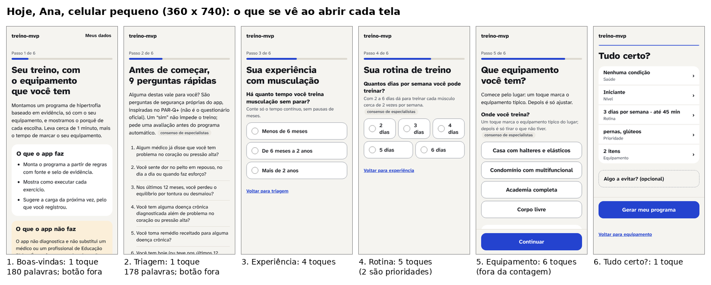
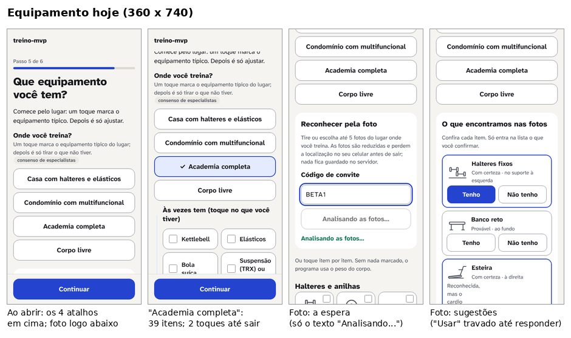
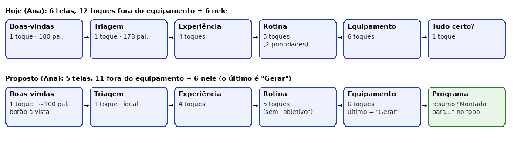

# Redesign, agente 2: cadastro rápido, de verdade e na sensação (06/11/2026)

Para o Gustavo. Pergunta: como o caminho da abertura (`/`) até o primeiro programa (`/programa`) fica mais curto em toques e em tempo, e **parece** ainda mais curto.

## 1. Em uma frase

Hoje o cadastro já é curto em toques (de 10 a 17 fora do equipamento, 0 caractere para quem não tem condição de saúde) [medido], mas o tempo de verdade está na **leitura** (cerca de 470 palavras antes do equipamento, umas 2 vezes o tempo dos toques) e no caminho de quem marca **"sim" na triagem** (29 toques). A proposta tira 1 tela (o "Tudo certo?"), leva "objetivo" e "algo a evitar" para depois do 1º treino, encurta os textos que não são de segurança e troca as 9 perguntas sim/não de quem tem alguma condição por "toque nas que valem". Resultado previsto: de 6 para 5 telas para todos, de 29 para 18 toques no caminho com condição e cerca de 30 s a menos de leitura [estimativa KLM, seção 2].

## 2. O que medi

**Método.** Scripts Playwright em `scripts/design/redesign/agente-2/` (rodam com `npx playwright test -c scripts/design/redesign/agente-2/playwright.config.ts`). Num Pixel 7 (412 × 915) e num celular pequeno (360 × 740), um robô percorre o cadastro de cada persona fictícia pela interface, como `tests/e2e/jornada.ts` faz com a Ana. Dentro da página, o script conta cada toque (`pointerdown`, a mesma regra de `tests/e2e/onboarding.spec.ts`), cada caractere digitado e a rolagem máxima por tela. Arquivos:
- `percursos.ts` (os percursos das 6 personas, a triagem com "sim" e o 2º local do Bruno), `instrumentos.ts` (contadores), `cadastro.spec.ts`, `equipamento.spec.ts` (atalhos, lista, foto com a API simulada), `rolagem.spec.ts`, `klm.mjs` (tempo estimado de uma pessoa), `efeito-gerador.ts` (o que muda no programa sem as perguntas que saem), `montar-imagens.py`.
- Saídas brutas em `reports/design/redesign/agente-2/` (JSON e capturas; fora do git). As 32 medições passaram.
- Correções que fiz nos scripts deixados pelo agente anterior: o nome "Barra longa (olímpica ou comum)" no "algo a evitar", o cartão "Voador" confundido com a estação do multifuncional, o botão "Tenho" confundido com "Não tenho" na foto, e os 4 atalhos medidos cada um num navegador limpo.

**Tempo de uma pessoa (KLM).** O KLM (Keystroke-Level Model, "modelo do nível do toque") estima o tempo de alguém que já sabe o que fazer, somando operadores fixos. Usei:

| Operador | Valor | Fonte |
|---|---|---|
| M: decidir (1 por pergunta respondida e 1 por botão) | 1,35 s | Card, Moran e Newell 1980 [fonte, consenso]; Kieras usa 1,2 s |
| T: mirar e tocar com o dedo | 0,5 s (faixa testada 0,2 a 1,1 s) | **[opinião]**: não achei valor validado de toque. Fica entre 0,08 s (apontar de perto num celular; El Batran e Dunlop 2014, resumo) e 1,1 s (apontar com mouse; Card et al. 1980) |
| K: um caractere no teclado do celular | 0,36 s | Holleis et al. 2007, valor visto só em material de aula citado numa busca (**não conferido no original**) |
| Rolar uma altura de tela | 0,5 s | [opinião] |
| R: troca de tela | 0,06 a 0,08 s | [medido] |
| Gerar o programa | 0,42 a 0,51 s | [medido, neste computador] |
| Leitura (fora do KLM) | 238 palavras/min | Brysbaert 2019, meta-análise, leitura silenciosa em inglês [fonte, robusta (resumo)] |

**Tabela de hoje (Pixel 7; o celular pequeno dá os mesmos toques e mais rolagem).** "Fora do equip." é o que o teste do projeto conta. O tempo do robô é só comparativo: outros 4 agentes rodavam testes no mesmo computador.

| Persona | Toques fora do equip. | Toques no equip. | Caracteres | Telas | Rolagem (alturas de tela; pequeno) | Robô (s) | KLM fora do equip. (s) [T 0,2–1,1] | KLM total (s) | KLM + leitura completa (s) |
|---|---|---|---|---|---|---|---|---|---|
| Ana | 12 | 6 | 0 | 6 | 2,8 (3,6) | 3,6 | 22 [19–29] | 35 | 207 |
| Bruno | 17 | 26 | 2 ("70" min) | 6 | 8,2 (10,2) | 6,4 | 30 [25–40] | 73 | 246 |
| ↳ 2º local do Bruno (`/locais/novo`) | — | 14 | 0 | 1 | 5,0 (6,0) | — | — | 24 | — |
| Carla | 14 | 36 | 0 | 6 | 9,6 (12,1) | 5,5 | 23 [19–32] | 71 | 243 |
| Diego | 12 | 4 | 0 | 6 | 4,8 (6,1) | 3,4 | 22 [19–29] | 32 | 205 |
| Elisa (sem condição, mínimo) | 10 | 2 | 0 | 6 | 0,6 (1,2) | 1,7 | 19 [16–25] | 24 | 198 |
| Fábio | 11 | 2 | 0 | 6 | 3,2 (4,0) | 3,1 | 22 [18–28] | 27 | 200 |
| Bruno com dor 4 no ombro | 29 | 26 | 2 | 7 | 10,4 (13,5) | 5,2 | 53 [44–71] | 96 | 317 |
| Bruno com "sim" no coração (liberado) | 29 | 26 | 2 | 8 | 9,1 (11,9) | 5,3 | 53 [45–71] | 96 | 339 |

Números por tela (Ana): boas-vindas 1 toque e 180 palavras; triagem 1 toque e 178 palavras; experiência 4 toques; rotina 5 (2 são prioridades); equipamento 6; "Tudo certo?" 1 [medido]. O botão de boas-vindas fica fora da vista ao abrir (127% da altura no Pixel 7, 154% no pequeno), e o da triagem também (122% e 147%), este de propósito [medido em `docs/revisoes/redesign/antes/medidas-*.json`].

**O que os números dizem.**
- O critério 1 (até 15 toques e 0 caractere sem condição, fora o equipamento) está cumprido com folga: de 10 a 14 [medido]. O teste do projeto aceita até 13 e a Ana faz 12.
- "Até 1 minuto": só os toques dão de 19 a 23 s [KLM]. Se a pessoa ler tudo, passa de 2 minutos (cerca de 470 palavras antes do equipamento ≈ 2 min de leitura) [estimativa]. **O que pesa é o texto, não o toque.** A boas-vindas diz "Leva cerca de 1 minuto": isso só vale para quem passa os olhos.
- O caminho de quem tem alguma condição é o dobro: as 9 perguntas sim/não custam 10 a 12 toques e 174 palavras, e repetem a lista que a pessoa acabou de ler [medido].
- Resposta do sistema: a troca de tela leva de 60 a 80 ms (abaixo de 0,1 s, parece instantânea) e gerar o programa leva de 0,42 a 0,51 s neste computador [medido]. Num celular médio deve demorar mais [opinião: não medi em aparelho].
- Cada tela nova abre no topo (conferido: rolagem 0 ao abrir triagem, experiência, rotina e equipamento) [medido].

**A tela de equipamento, em separado** [medido, `equipamento-*.json`]:

| Caminho | Toques até sair | O que acontece |
|---|---|---|
| "Academia completa" | 2 (atalho + Continuar) | Marca 39 dos 48 cartões; a página cresce de 4,4 para 6,9 alturas de tela, com 7 blocos de detalhe já preenchidos; nenhum erro ao continuar |
| "Condomínio com multifuncional" | 7 | Marca 4 itens; ao tocar Continuar, aparecem 2 erros ("Use um número maior que zero", "Diga se o banco também declina") |
| "Casa com halteres e elásticos" | 7 | Marca 2 itens; 3 erros ao continuar (manoplas, peso, anilhas) |
| "Corpo livre" | 2 | Desmarca tudo |
| Lista, item a item (Carla, sem atalho) | 87 | Página final com 9,7 alturas de tela; 24 dos 48 cartões ainda sem desenho |
| Carla com o atalho e depois o que falta | 36 | O atalho não marca 10 itens dela: 6 são "às vezes tem" (kettlebell, elásticos, bola, suspensão...), além de multifuncional, anilhas e manoplas, caneleiras e roda |
| Foto (API simulada com 3 s) | 4 + 5 caracteres do código de convite (só na 1ª vez; fica lembrado) | Preparo no aparelho: 54 ms com uma foto artificial (uma foto real demora mais [opinião]); enquanto espera, só o texto "Analisando as fotos…" no botão e no status, sem barra nem tempo; "Usar na lista" fica travado até a pessoa responder cada "Provável" |

**"Academia completa" é honesto?** Em boa parte, sim. Supõe halteres de 2 a 40 kg, polia regulável e o lado conservador nos 3 "sim ou não" dos aparelhos, de modo que nenhum exercício dependa do que o aparelho talvez não tenha. A 1ª série de cada exercício acerta a carga (`equipamento.atalhos`, consenso do projeto). O fraco: **a pessoa não vê o que foi suposto** sem rolar 2,5 telas de detalhes, e a regra diz que os conjuntos vêm de guias e lojas "não verificados" (`src/domain/taxonomia/atalhos.ts`, [opinião]). Nada aqui inventa equipamento que a pessoa não tenha confirmado com o toque, então o atalho não engana. Ele só não explica o que supôs.

**O efeito, no gerador, das perguntas que podem sair** [medido, `efeito-gerador.ts`, perfil das personas com e sem prioridades, objetivo e "algo a evitar"]:

| Persona | Programa hoje | Sem prioridades, objetivo e "evitar" |
|---|---|---|
| Ana (glúteos + pernas) | Corpo todo A/B/C, 46 séries/semana | mesma divisão, 48 séries; 13 dos 14 exercícios iguais |
| Bruno (4 grupos; evita barra longa) | Superior/Inferior 2×, 83 séries | mesma divisão, **60 séries** (−28%) |
| Carla (4 grupos) | Sup./Inf. + Empurrar/Puxar/Pernas, 107 séries | mesma divisão, **66 séries** (−38%) |
| Diego (peito + costas) | Corpo todo, 48 séries | 45 séries, mesmos 15 exercícios |
| Elisa (nada) | igual | igual |
| Fábio (costas) | Sup./Inf. 2×, 42 séries | 40 séries, mesmos 12 exercícios |

Conclusão: **as prioridades mudam muito o programa de quem prioriza vários grupos** e quase nada o de quem prioriza 1 ou 2. O objetivo só muda números em "ficar mais forte" para quem não é iniciante (`perfil.objetivo === 'forca' && nivel !== 'iniciante'` em `src/domain/gerador/index.ts`). Nos outros casos, muda só o texto.

## 3. O que a pesquisa diz

| Afirmação | Selo | Fonte |
|---|---|---|
| Até 0,1 s a resposta parece instantânea; até 1 s o raciocínio não se quebra, mas a pessoa nota a demora; perto de 10 s ela perde a atenção. Acima de 1 s, mostrar que o sistema trabalha; acima de 10 s, mostrar quanto falta | consenso | Miller 1968; Card, Robertson e Mackinlay 1991; Nielsen 1993 (NN/g, "Response Times: The 3 Important Limits", conferido) |
| Indicador de "quanto falta" é preferido em esperas longas | um estudo | Myers 1985, CHI (visto pela citação em NN/g e em Harrison 2007) |
| Pausas parecem mais longas, sobretudo perto do fim; progresso que acelera no fim parece mais rápido (22 pessoas comparando barras de 5,5 s) | um estudo | Harrison, Amento, Kuznetsov e Bell 2007, UIST, p. 115-118 (texto completo conferido) |
| Perto da meta a pessoa acelera; começar com algum progresso já marcado aumenta a conclusão | um estudo cada | Kivetz, Urminsky e Zheng 2006, *J Marketing Research*; Nunes e Drèze 2006, *J Consumer Research* (conferidos na design v2; não reconferi) |
| A barra de progresso só ajuda se parece andar rápido; parecer lenta piora a conclusão | um estudo | Conrad, Couper, Tourangeau e Peytchev 2010, *Interacting with Computers* 22(5) (conferido na design v2) |
| Comece com uma pergunta por página: ajuda a entender e a focar. Agrupe só quando a pesquisa com usuários mostrar que convém. Sempre um "Voltar" no topo | consenso | GOV.UK Design System, "Question pages" (conferido) |
| Formulários costumam pedir mais campos do que precisam (checkout: 8 necessários, 11,3 usados) | consenso | Baymard Institute 2024 (conferido na design v2) |
| Avanço automático (a tela muda sozinha ao responder): sem diferença prática no tempo, em 20.574 respostas; quem tinha o avanço automático corrigiu de 45 a 48% menos respostas, em parte por achar que não dava para voltar | um estudo (experimento randomizado) | Giroux, Tharp e Wietelman 2019, *Survey Practice* 12(1) (conferido) |
| Avanço automático encurtou o tempo só no computador e no tablet, não no celular | um estudo | Selkälä e Couper 2018, *Social Science Computer Review* 36(6) (resumo, por busca) |
| Padrões (o que já vem marcado) mudam muito a escolha final das pessoas | um estudo (observacional, vários países) | Johnson e Goldstein 2003, *Science* 302:1338 (**só fontes secundárias**) |
| Transições de tela inteira no celular costumam durar uns 300 ms; componentes pequenos, uns 100 ms | consenso | Material Design, "Duration & easing" (versão 1, por busca; a página da versão 3 não abriu) |
| Leitura silenciosa de adultos: 238 palavras/min em não ficção (190 estudos) | robusta | Brysbaert 2019, *J Memory and Language* 109:104047 (resumo, por busca) |
| KLM: M = 1,35 s, P = 1,1 s, K de 0,08 a 1,2 s | consenso | Card, Moran e Newell 1980, *CACM* 23(7) (valores conferidos via Wikipedia, que cita a p. 399) |

O que **não sei**: não há valor validado de toque em celular que eu tenha conseguido ler (o PDF de Holleis 2007 e o de Rice e Lartigue 2014 não abriram). Por isso o T do KLM é uma premissa, com a faixa de 0,2 a 1,1 s na tabela. Ninguém mediu este cadastro com pessoas: tudo aqui é robô mais modelo.

## 4. Achados e propostas

### A. "Tudo certo?" deixa de ser uma tela; o resumo vai para o topo do programa
- **Tela/estado:** passo 6, `/comecar/restricoes`.
- **Problema:** é uma tela inteira para 1 toque ("Gerar meu programa") em 5 de 6 personas. O resumo repete o que a pessoa acabou de responder. [medido: 1 toque e 34 palavras para Ana, Carla, Diego, Elisa e Fábio]
- **Evidência:** a página "Check answers" do GOV.UK existe para serviços em que um erro custa caro [fonte: GOV.UK, consenso]. Aqui tudo se muda depois em "Meus dados" e o programa só muda quando a pessoa pede, então errar é barato [opinião].
- **Proposta:** na tela de equipamento, o botão final vira **"Gerar meu programa"**. O programa recém-gerado abre com uma linha "Montado para: Iniciante · 3 × 45 min · 2 itens · Mudar", e cada parte leva à tela certa. **O resumo da dor da triagem (com o selo `seguranca.dor.programa`) vai junto, inteiro, para esse topo**: ver o conflito na seção 7.
- **Efeito esperado:** 6 → 5 telas para todos; 1 toque a menos (o "Continuar" do equipamento e o "Gerar" viram um só); cerca de 9 s a menos de leitura [KLM + leitura].
- **Custo e risco:** médio. Muda `Inventario.tsx` (o botão final grava `restricoes` vazias, se ainda não houver, e gera o programa), `PASSOS` em `src/storage/esquema.ts` (5 passos), `perfilDe()` (aceitar `restricoes` ausente como listas vazias, para estados antigos no meio do cadastro: **sem versão nova nem migração**, com um teste de unidade). Mudam também `jornada.ts` e `onboarding.spec.ts`. O teste de toques passa a não ver o "Gerar", porque ele cai em `/comecar/inventario`: **ajuste o teste para contar esse toque**, senão o número melhora no papel sem melhorar de verdade.

### B. "Objetivo" e "algo a evitar" vão para depois do 1º treino; prioridades ficam (opcionais)
- **Tela/estado:** rotina (objetivo) e "Tudo certo?" (algo a evitar).
- **Problema:** são perguntas opcionais que a pessoa lê e pondera antes de ter visto um treino. Nenhuma persona responde o objetivo; só o Bruno usa "evitar" (2 toques) [medido].
- **Evidência:** cada pergunta a mais custa atenção [fonte: Baymard 2024, consenso]. O efeito no gerador é pequeno: o objetivo só muda números em "força" para quem não é iniciante; "evitar" é preferência, não segurança (a dor é perguntada só na triagem e o "Senti algo" segue no treino) [medido no código].
- **Proposta:** sair do cadastro. Objetivo: em "Meus dados → Mudar a rotina" (o campo já aparece em `/comecar/rotina?de=dados`) e num cartão de uma linha depois do 1º treino ("Quer mudar o foco? Ganhar músculo é o padrão"), a combinar com o agente 1. Algo a evitar: uma entrada nova em "Meus dados" que abre a tela atual de restrições em modo `?de=dados`. **Hoje não existe esse caminho: só dá para mudar refazendo o cadastro inteiro.** **As prioridades ficam na rotina**, opcionais como hoje (ver "O que não fazer").
- **Efeito esperado:** Bruno −2 toques; todos −1 pergunta para ler (≈ 40 palavras de ajuda do objetivo). O programa inicial fica igual para quem não respondia isso.
- **Custo e risco:** pequeno. Estado sem mudança (`objetivo` já é opcional e ausente vale "ganhar músculo"; `restricoes` vazias). Risco: o Bruno vê, no 1º programa, exercícios com barra longa que ele não quer. Mitigação: trocar o exercício no treino (alternativas e "Prefiro este" já existem) e marcar depois.

### C. Triagem com "sim": tocar só nas que valem, em vez de 9 sim/não
- **Tela/estado:** triagem, depois de "Sim, alguma vale".
- **Problema:** a pessoa já leu as 9 condições e respondeu que alguma vale; aí tem de responder as 9 de novo, uma a uma (174 palavras, 10 a 12 toques, 2 alturas de tela) [medido: Bruno ombro 12 toques, Bruno coração 10].
- **Evidência:** "Nenhuma vale para mim" já responde "não" às 9 com um toque, e isso foi aceito como seguro (`seguranca.triagem.nenhuma`) [fonte: regra do projeto, consenso]. A mesma lógica, o não marcado vale "não", serve para quem marca algumas [opinião].
- **Proposta:** "Sim, alguma vale" transforma a mesma lista (mesmo texto, mesma ordem) em caixas de marcar, com "Continuar". As regiões e a nota da dor de hoje aparecem logo abaixo da condição osteoarticular, como hoje. O bloqueio e a liberação ficam idênticos.
- **Efeito esperado:** triagem de 13 para 5 toques (ombro) e de 11 para 3 (coração); caminho com condição de 29 para 18 toques fora do equipamento; KLM total de cerca de 96 s para cerca de 75 s, mais uns 40 s de releitura a menos.
- **Custo e risco:** médio. Muda só `Triagem.tsx`. O estado é o mesmo (`respostas` com `false` nas não marcadas): sem migração, e `avaliarTriagem` não muda. **Mexe na forma da triagem: decisão do Gustavo** (seção 7).

### D. Boas-vindas com metade do texto e o botão à vista
- **Tela/estado:** `/`.
- **Problema:** 180 palavras e o botão fora da vista (127% e 154% da altura) [medido].
- **Evidência:** leitura ≈ 238 palavras/min [fonte: Brysbaert 2019, robusta (resumo)]: só esta tela pede uns 45 s. Mostrar o essencial primeiro e o resto num 2º nível [fonte: NN/g, "Progressive disclosure", consenso, conferido na design v2].
- **Proposta:** manter **intacto** o bloco "O que o app não faz" (`seguranca.sem-diagnostico`). Encurtar a apresentação e o "O que o app faz" (66 → cerca de 20 palavras) e a privacidade (56 → cerca de 20: "Tudo fica neste aparelho. Só a foto do equipamento sai, sem localização, e não é guardada." + "Como cuidamos dos seus dados", que abre o resto). Tirar o "Leva cerca de 1 minuto" ou trocar por "Umas 5 perguntas e o seu equipamento" (o "1 minuto" só vale para quem não lê) [opinião].
- **Efeito esperado:** de 180 para cerca de 100 palavras (−20 s de leitura); o botão visível sem rolar a 360 × 740 (meta para o agente 4 conferir no layout).
- **Custo e risco:** pequeno; textos (decisão 5 do Gustavo permite).

### E. Equipamento: o atalho diz o que supôs e pergunta o que falta antes do erro
- **Tela/estado:** `/comecar/inventario` e `/locais/novo` (layout é do agente 4; aqui, fluxo e toques).
- **Problema:** (1) "Academia completa" não mostra o que supôs sem rolar 2,5 telas; (2) "Condomínio" e "Casa" só mostram o que falta **como erro, depois do Continuar** (2 a 3 erros, uma ida e volta) [medido].
- **Evidência:** validar antes do envio e evitar a sensação de falha [opinião; Baymard trata de validação em linha, que não reconferi].
- **Proposta:** (1) logo abaixo do atalho, uma linha: "Supomos halteres de 2 a 40 kg, polia regulável e o básico dos aparelhos. Mudar", e o botão "Gerar meu programa" já à vista (fica em 2 toques); (2) depois de "Condomínio" ou "Casa", as perguntas que faltam aparecem em seguida, numeradas ("Faltam 2: manoplas, banco"), e o botão diz "Responder 2 que faltam" até estarem respondidas.
- **Efeito esperado:** "Academia completa" em 2 toques e uns 4 s de KLM, mais a leitura de 2 linhas: dentro dos 15 s do critério para quem não lê a página inteira [KLM]; "Condomínio" e "Casa" com 1 toque a menos e nenhuma mensagem de erro.
- **Custo e risco:** pequeno a médio; `Inventario.tsx`.

### F. A espera da foto: estágios reais, tempo e a lista livre enquanto isso
- **Tela/estado:** foto, entre o envio e as sugestões.
- **Problema:** só o texto "Analisando as fotos…", sem barra, sem estimativa, e o botão travado [medido]. A API real não roda aqui; o tempo dela é desconhecido (simulei 3 s).
- **Evidência:** acima de 1 s, mostrar que trabalha; acima de 10 s, quanto falta [fonte: Nielsen 1993, consenso]; pausas parecem mais longas [fonte: Harrison 2007, um estudo].
- **Proposta:** três estágios **reais**, um depois do outro: "Reduzindo e tirando a localização (no seu celular)" → "Enviando" → "Reconhecendo o equipamento". Depois de 10 s, a frase "Pode levar até ~30 s; marque na lista enquanto isso". A lista abaixo continua usável durante a espera, e as sugestões chegam sem apagar o que a pessoa marcou.
- **Efeito esperado:** nenhuma espera acima de 1 s sem progresso visível; a espera vira tempo útil.
- **Custo e risco:** pequeno; `FotoEquipamento.tsx`. Risco: o estágio "Reconhecendo" não tem porcentagem real. Não fingir uma.

### G. Fluxo proposto, tela a tela

| # | Tela | O que pede | Toques (caminho sem condição) | KLM (s) |
|---|---|---|---|---|
| 1 | Boas-vindas | ler o aviso; "Entendi, vamos começar" | 1 | 2 (+ ~25 de leitura) |
| 2 | Triagem | ler as 9; "Nenhuma vale para mim" | 1 | 2 (+ ~45 de leitura, sem mudança) |
| 3 | Experiência | 3 perguntas reveladas uma a uma; vê o nível; "Continuar" | 4 | 8 |
| 4 | Rotina | dias, minutos; prioridades opcionais; "Continuar" | 3 + prioridades | 6 a 12 |
| 5 | Equipamento | atalho, lista ou foto; "Gerar meu programa" | 2 com atalho | 4 a 48 |
| → | Programa | linha "Montado para… Mudar" | 0 | 0,5 (gerar) |

**Toques hoje × proposto, por persona** (fora do equip. = como o teste conta hoje; com o "Gerar" dentro do equipamento, ele somaria 1 a menos no papel, por isso a coluna "comparável" o conta fora):

| Persona | Hoje fora do equip. | Proposto comparável | Hoje total | Proposto total | Telas | KLM total hoje → proposto (s) | KLM + leitura hoje → proposto (s) |
|---|---|---|---|---|---|---|---|
| Ana | 12 | 11 | 18 | 17 | 6 → 5 | 35 → 33 | 207 → ~176 |
| Bruno | 17 | 14 | 43 | 40 | 6 → 5 | 73 → ~67 | 246 → ~211 |
| Carla | 14 | 13 | 50 | 49 | 6 → 5 | 71 → ~69 | 243 → ~212 |
| Diego | 12 | 11 | 16 | 15 | 6 → 5 | 32 → 30 | 205 → ~174 |
| Elisa | 10 | 9 | 12 | 11 | 6 → 5 | 24 → 22 | 198 → ~167 |
| Fábio | 11 | 10 | 13 | 12 | 6 → 5 | 27 → 25 | 200 → ~169 |
| Bruno, dor no ombro | 29 | 18 | 55 | 44 | 7 → 6 | 96 → ~75 | 317 → ~240 |
| Bruno, "sim" no coração | 29 | 18 | 55 | 44 | 8 → 7 | 96 → ~75 | 339 → ~262 |

Opcional, para o Gustavo decidir (não recomendo agora): juntar boas-vindas e triagem numa tela só dá −1 toque e −1 tela para todos, mas um único toque passaria a valer duas coisas ("entendi o aviso" e "nenhuma condição") e a tela ficaria com cerca de 3 alturas.

### H. Regras de "sensação de velocidade" para a implementação
1. **Resposta ao toque em menos de 100 ms:** o rádio, a caixa ou o botão mudam de estado no mesmo quadro (hoje: troca de tela em 60 a 80 ms, ok [medido]). Sem atraso artificial.
2. **Transição de tela de no máximo 200 ms, desligada com `prefers-reduced-motion`.** É mais curta que os ~300 ms do Material [fonte, consenso]; escolhi 200 ms porque são 5 telas seguidas e a resposta fica perto do limite de 0,1 s [opinião]. A revelação da pergunta seguinte (`Revelar`) usa rolagem suave do navegador, sem duração controlada: trocar por rolagem de até 200 ms ou instantânea.
3. **Nunca um indicador girando sem dizer o quê:** toda espera diz o que está acontecendo, com o verbo ("Montando o seu programa", "Enviando as fotos").
4. **Nenhuma espera acima de 1 s sem progresso visível**; acima de 10 s, dizer quanto falta e oferecer o que fazer enquanto isso (foto: a lista). Se gerar o programa passar de 300 ms no aparelho, mostrar "Montando o seu programa…" com os passos reais (divisão → exercícios → séries); nunca uma barra falsa.
5. **Progresso que anda de verdade:** "Passo 1 de 5" e a barra contam só os passos que existem; a barra nunca para perto do fim. O "Gerar" fica no último passo, então o fim chega rápido [fonte: Harrison 2007; Conrad 2010].
6. **Avanço automático só onde a pessoa vê o que escolheu e volta com 1 toque.** No cadastro, isso vale apenas para a revelação da pergunta seguinte **dentro da mesma tela** (como hoje). **Nenhuma troca de tela automática:** não economiza tempo e reduz correções [fonte: Giroux et al. 2019, um estudo].
7. **Nada pré-marcado nas perguntas de saúde, nível, dias e minutos** (padrão fica [fonte: Johnson e Goldstein 2003, um estudo, secundária]); o atalho do equipamento continua sem nenhum selecionado.
8. **Botão principal à vista ao abrir**, exceto na triagem (de propósito: a pessoa passa pelas 9).
9. **"Voltar" no topo** de cada passo, que volta com as respostas guardadas [fonte: GOV.UK, consenso] (hoje há "Voltar para…" no rodapé).

## 5. O que não fazer
- **Tirar as prioridades do cadastro.** Elas mudam o programa de quem prioriza vários grupos em −28% a −38% de séries [medido: Bruno 83 → 60, Carla 107 → 66]. Sem elas, o 1º programa de um intermediário fica bem mais leve do que ele espera. Já são opcionais: não custam toque a quem não quer.
- **Avanço automático entre telas.** Não ganha tempo no celular e faz a pessoa corrigir menos [fonte: Selkälä e Couper 2018 (resumo); Giroux et al. 2019].
- **Juntar experiência e rotina numa tela só.** Ganha 1 toque, mas cria uma tela de ~3 alturas e quebra "uma coisa por vez" [fonte: GOV.UK, consenso].
- **Pré-marcar respostas para "andar mais rápido"** (por exemplo, "Estou treinando", 3 dias, 45 min) [fonte: Johnson e Goldstein 2003]. O ganho é de 1 toque e o risco é um programa errado sem a pessoa perceber [opinião].
- **Barra de progresso acelerada de mentira** ou porcentagem inventada na foto [opinião: engana; ver "Motivação sem manipulação"].
- **Encurtar o texto de segurança** (aviso, triagem, dor) para ganhar segundos.

## 6. Pedidos ao domínio
Nenhum. Tudo o que proponho fica em `src/features/` e em `src/storage/esquema.ts` (`PASSOS` e `perfilDe()`), sem mudança em `src/domain/`. Teste de unidade sugerido para o armazenamento: "um estado v7 com `locais` e sem `restricoes` gera perfil com listas vazias" e "o 1º passo pendente de um estado só sem `restricoes` é nulo".

## 7. Conflitos com "o que não muda"
1. **Forma da triagem (proposta C):** o conteúdo e a ordem das 9 perguntas não mudam, mas a resposta passa de 9 sim/não explícitos a "marque as que valem". A segurança se apoia na mesma lógica já aceita para "Nenhuma vale para mim". **Decisão do Gustavo.**
2. **Lugar do resumo da dor (proposta A):** o texto "Pela triagem: Ombro, dor 4 hoje: o app prefere…", com o selo, sai do "Tudo certo?" e vai para o topo do programa recém-gerado. O texto é igual, e o programa já mostra o aviso da região nos exercícios. **Decisão do Gustavo**, e a combinar com o agente 1 (início).
3. **Teste de contagem de toques:** com o "Gerar" dentro do equipamento, `onboarding.spec.ts` deixa de contar o último toque. Proponho mudar o teste para contá-lo, mantendo o critério honesto.

## 8. Resumo em 10 linhas para o Gustavo
1. Em toques, o cadastro já cumpre o critério: de 10 a 14 fora do equipamento, 0 caractere, sem condição de saúde [medido].
2. O tempo de verdade está na leitura: cerca de 470 palavras antes do equipamento, o dobro do tempo dos toques [medido + estimativa].
3. Proposta 1: o "Tudo certo?" sai; o botão final do equipamento vira "Gerar meu programa" e o resumo aparece no topo do programa (6 → 5 telas).
4. Proposta 2: "objetivo" e "algo a evitar" vão para depois do 1º treino (mudam pouco ou nada no gerador); as prioridades ficam, porque mudam até 38% das séries.
5. Proposta 3: quem tem alguma condição toca só nas que valem, em vez de responder 9 sim/não de novo: de 29 para 18 toques. O texto da triagem não muda; a forma, sim (decisão sua).
6. Proposta 4: a boas-vindas cai de 180 para cerca de 100 palavras, com o botão à vista; o aviso de segurança fica intacto.
7. Proposta 5: "Academia completa" diz em 1 linha o que supôs; "Condomínio" e "Casa" perguntam o que falta antes, sem mensagem de erro.
8. Proposta 6: a espera da foto mostra estágios reais e deixa usar a lista enquanto isso; nada de barra inventada.
9. Regras de velocidade: resposta em menos de 0,1 s, transição de até 0,2 s (desligável), nenhuma espera acima de 1 s sem progresso, nenhuma troca de tela automática.
10. O que não sei: ninguém real foi medido; o tempo do toque no KLM é premissa minha, e a foto real não foi cronometrada.

## 9. Fontes
- Card SK, Moran TP, Newell A (1980). The keystroke-level model for user performance time with interactive systems. *Communications of the ACM* 23(7):396-410. Conferi os valores dos operadores (K, P, H, M) pela Wikipedia, que cita a p. 399; não li o artigo.
- El Batran K, Dunlop M (2014). Enhancing KLM to fit touch screen mobile devices. MobileHCI '14, p. 283-286. Conferido o resumo (strathprints): deslizar ~70 ms, zoom ~200 ms, apontar ~80 ms.
- Holleis P, Otto F, Hussmann H, Schmidt A (2007). Keystroke-level model for advanced mobile phone interaction. CHI '07. **Não conferido**: PDF fora do ar; K = 0,36 s e M = 1,2 s vieram de um resumo de busca sobre material de aula.
- Rice AD, Lartigue JW (2014). Touch-level model (TLM). ACM SE '14, art. 53. **Não conferido** (só a referência; nenhum valor).
- Miller RB (1968). Response time in man-computer conversational transactions. AFIPS FJCC 33:267-277; Nielsen J (1993). *Usability Engineering*, cap. 5. Conferidos pela página da NN/g "Response Times: The 3 Important Limits".
- Myers BA (1985). The importance of percent-done progress indicators for computer-human interfaces. CHI '85, p. 11-17. Visto só pelas citações (NN/g e Harrison 2007).
- Harrison C, Amento B, Kuznetsov S, Bell R (2007). Rethinking the progress bar. UIST '07, p. 115-118. Texto completo conferido (22 participantes; pausas perto do fim parecem mais longas; aceleração no fim é preferida).
- Kivetz R, Urminsky O, Zheng Y (2006). *J Marketing Research* 43(1):39-58; Nunes JC, Drèze X (2006). *J Consumer Research* 32(4):504-512. Conferidos na design v2; não reconferidos agora.
- Conrad FG, Couper MP, Tourangeau R, Peytchev A (2010). *Interacting with Computers* 22(5):417-427. Conferido na design v2.
- GOV.UK Design System, "Question pages". Conferido (uma pergunta por página; agrupar só com pesquisa; "Voltar" no topo).
- Baymard Institute (2024), campos médios no checkout. Conferido na design v2.
- Giroux S, Tharp K, Wietelman D (2019). Impacts of implementing an automatic advancement feature in mobile and web surveys. *Survey Practice* 12(1). Conferido (n = 20.574; sem diferença prática no tempo; 45 a 48% menos correções).
- Selkälä A, Couper MP (2018). Automatic versus manual forwarding in web surveys. *Social Science Computer Review* 36(6):669-689. (resumo, por busca).
- Johnson EJ, Goldstein D (2003). Do defaults save lives? *Science* 302(5649):1338-1339. **Só fontes secundárias.**
- Brysbaert M (2019). How many words do we read per minute? *J Memory and Language* 109:104047. (resumo, por busca: 238 palavras/min em não ficção, 190 estudos).
- Material Design, "Duration & easing" (m1.material.io): ~300 ms nas transições de celular. Por resumo de busca; a página da versão 3 não abriu.
- NN/g, "Progressive disclosure". Conferido na design v2.
