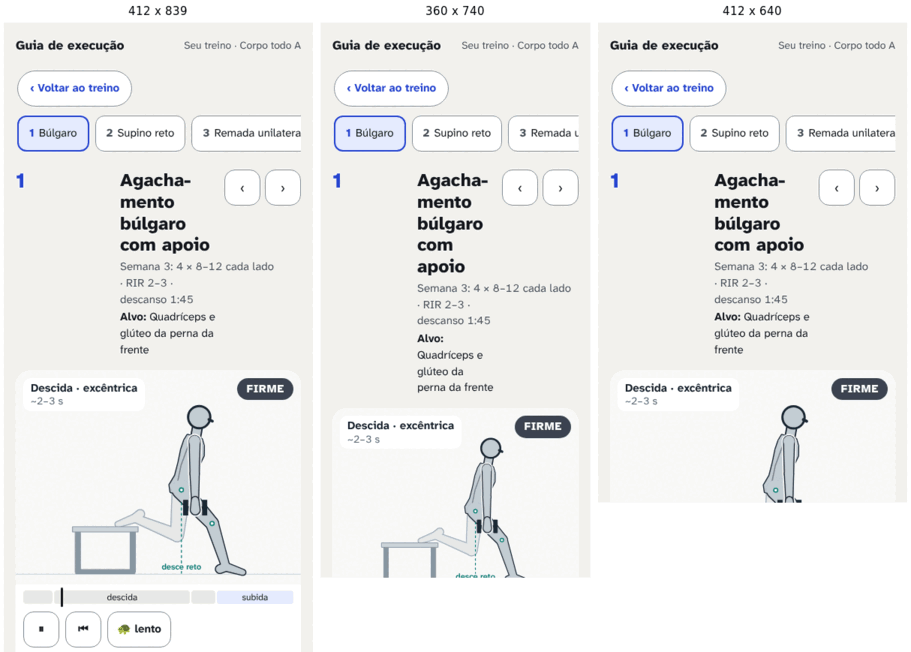
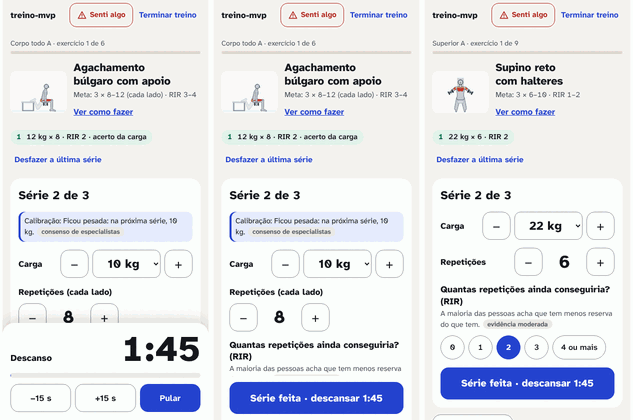
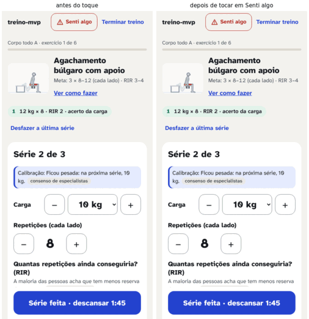
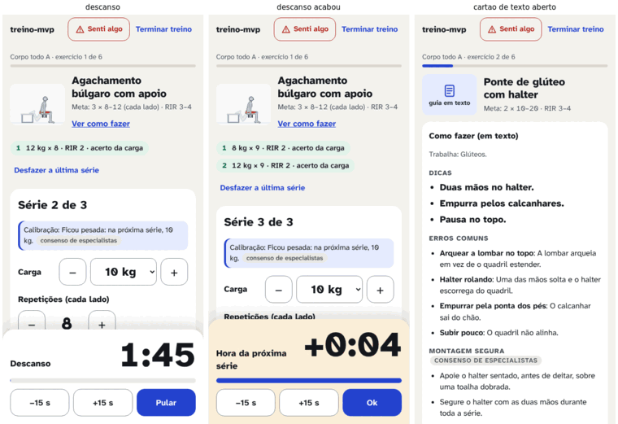
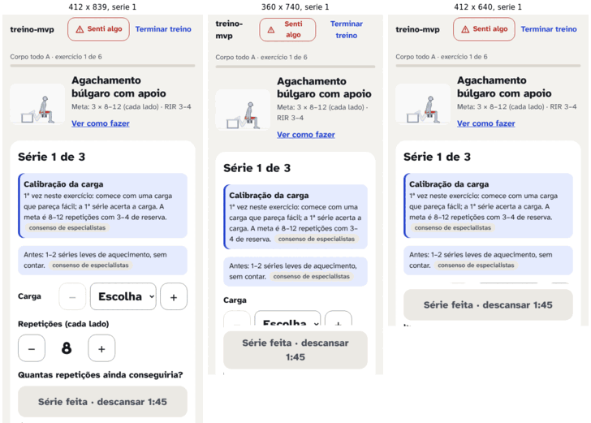

# Agente 3: treino ao vivo e guia, na academia (redesign, 06/11/2026)

Para o Gustavo. Tema: como a tela de treino (`/treino`) e o guia (`/guia/:id`) funcionam com uma mão, de relance, entre séries, com a tela molhada, a luz forte e o barulho da academia. Marcas: **[medido]** (medi neste clone), **[fonte: ..., selo]**, **[opinião]**.

## 1. Em uma frase

O "Série feita" e o "Senti algo" estão sempre à vista, mas o que vem **depois** de tocar neles não está: o painel "Senti algo" e o de troca abrem fora da tela em 24 de 24 casos, o RIR da 1ª série fica escondido atrás do "Série feita" em 24 de 24 casos, o descanso cobre a série seguinte e, no guia, o Boneco começa no meio da tela e os modos, as 3 dicas e a segurança só aparecem rolando; o conserto é de **estrutura** (o que fica fixo e o que abre por cima), não de cor nem de tamanho de letra.

## 2. O que medi

**Método.** Scripts em `scripts/design/redesign/agente-3/` (Playwright 1.63, contra o build servido em 4173):
- `gerar-estados.ts`: gera o estado das 6 personas fictícias pelo próprio domínio (1ª vez em cada exercício = calibração). Os estados "com histórico" vêm de `reports/design/redesign/estados/`.
- `estados.spec.ts` + `apoio.ts`: percorre o treino estado por estado (antes da 1ª série, durante, descanso, 2ª série, troca aberta, "Senti algo" aberto, aviso de dor 4, cartão de texto fechado e aberto, sugestão de carga, drop set, sem guia, troca de local, calibração na 2ª série, descanso que acabou, exercício completo, fim). Para cada um, mede a posição (em % da altura visível) de cada controle, se cabe sem rolar, se o painel de descanso o cobre e em que zona do polegar fica.
- `guia.spec.ts`: o guia aberto pelo treino (Ana: búlgaro; Carla: puxada na polia), nos 4 modos.
- `toques.spec.ts`: conta os toques de um treino inteiro pelo caminho mínimo, nas 6 personas, na 1ª e na 2ª sessão.
- `fonte.spec.ts`: algarismos tabulares e tamanhos de letra.

**Tamanhos.** "412" = `devices['Pixel 7']`, cuja área útil no Playwright é **412 × 839** (a tela tem 915, mas a barra do navegador fica fora). "360" = 360 × 740. Alturas de alcance: 412 × 640 e 412 × 780. Ao todo, **248 telas medidas** (62 por tamanho) e 32 do guia [medido]. Dados brutos em `reports/design/redesign/agente-3/medidas-*.jsonl` e `toques.jsonl` (fora do git).

**Premissa do alcance do polegar** [opinião, apoiada em fonte]: mão direita, uma mão só, base do polegar na borda direita, 30 mm acima da borda de baixo; zona **fácil** até 55 mm da base, **esticar** até 72 mm, **fora** acima disso; escala 412 px ≈ 73,2 mm (largura do aparelho) e 360 px ≈ 65 mm. A forma (um arco em volta da base do polegar) vem do modelo de Bergstrom-Lehtovirta e Oulasvirta (2014). Hoober (2017) avisa que o mapa de "zona do polegar" clássico é incorreto, porque as pessoas mudam a pegada para alcançar o alto; por isso trato "fora" como "pede mudar a pegada", não como "impossível".

**Correções nos scripts deixados pelo agente anterior** (só nos meus scripts): o passo "16" esperava 4 séries no búlgaro (são 3); os laços de "+" travavam em botão desabilitado; `comecar` procurava a 1ª aba em vez do treino sugerido; a contagem de toques apertava "Mais carga" mesmo com a carga já escolhida; as medidas passaram a ser gravadas linha a linha (`.jsonl`) para não se perderem quando um teste falha. Uma lacuna: o seletor da linha "Carga" falhou nos estados com sugestão no topo; ela fica sempre logo acima de "Repetições" (cerca de 110 px acima, medido nos estados 03 e 04), então uso "Repetições" como referência.

### 2.1 Tabela de visibilidade por estado

Posição = topo–base do elemento em % da altura visível (0 = topo; > 100 = abaixo da dobra, só rolando). Faixa = variação entre as 6 personas. **V** inteiro à vista, **P** em parte, **F** fora da tela; zona do polegar: fácil, esticar, fora. "coberto" = atrás do painel de descanso. [medido]

**412 × 839 (Pixel 7)**

| Estado | "Série feita" | "Senti algo" | Relógio | Repetições | RIR (0 a 4+) | Painel aberto |
|---|---|---|---|---|---|---|
| Antes da 1ª série (calibração) | 91–99 V, fácil, **desabilitado** | 1–6 V, fora | — | 74–85 V | **95–105 P** (atrás do "Série feita") | — |
| Durante a 1ª série (preenchida) | 91–99 V, fácil | 1–6 V | — | 74–85 V | 95–105 P | — |
| Descanso | 87–99 **coberto** | 1–6 V | 79–87 V, fácil | 59–81 coberto | 80–101 coberto | descanso 77–100 |
| Descanso acabou (+0:04) | 91–99 **coberto** | 1–6 V | 76–85 V | 76–83 coberto | 97–103 coberto | descanso continua até "Ok" |
| 2ª série | 87–99 V | 1–6 V | — | 59–81 V | 80–101 V/P (vem marcado) | — |
| Trocar exercício aberto | 87–99 V | 1–6 V | — | V | V/P | **106–170 F** (fora da tela) |
| "Senti algo" aberto | 87–99 V | 1–6 V | — | V | V/P | **106–208 F** (fora da tela) |
| Aviso de dor 4 | 91–99 V | 1–6 V | — | 75–97 V | 96–117 F/P | aviso 39–57 V |
| Cartão de texto fechado (Ana) | 91–99 V | 1–6 V | — | 69–76 V | 90–95 V | "Montagem segura" recolhida |
| Cartão de texto aberto (Ana) | **111–118 F** | 1–6 V | — | 143–150 F | 164–170 F | cartão 81–86 V |
| Drop set, última série (Ana) | 91–99 V | 1–6 V | — | 62–68 V | 82–88 V | quedas abaixo |
| Fim do treino | — (1,0 a 1,4 telas) | — | — | — | — | — |

**360 × 740 (celular pequeno)**

| Estado | "Série feita" | "Senti algo" | Relógio | Repetições | RIR | Painel aberto |
|---|---|---|---|---|---|---|
| Antes / durante a 1ª série | 88–98 V, fácil (2 linhas, 78 px) | 1–7 V, fora | — | 90–104 P/V | **113–134 F** | — |
| Descanso | 88–98 coberto | 1–7 V | 76–86 V, fácil | 72–103 coberto | 96–133 F/coberto | descanso |
| Descanso acabou | 88–98 coberto | 1–7 V | 73–83 V | 94–102 P | 118–132 F | descanso |
| 2ª série | 88–98 V | 1–7 V | — | 72–103 V/P | **96–133 F/P** | — |
| Trocar aberto | 88–98 V | 1–7 V | — | — | — | **135–214 F** |
| "Senti algo" aberto | 88–98 V | 1–7 V | — | — | — | **135–269 F** |
| Aviso de dor 4 | 88–98 V | 1–7 V | — | 90–121 F/P | 114–151 F | aviso 45–67 V |
| Cartão aberto | **126–136 F** | 1–7 V | — | 175–182 F | 198–212 F | — |

**Alturas 640 e 780 (largura 412)**

| Estado | "Série feita" 640 / 780 | "Senti algo" | Relógio 640 / 780 | Repetições 640 / 780 | RIR 640 / 780 | "Senti algo" aberto 640 / 780 |
|---|---|---|---|---|---|---|
| Antes da 1ª série | 88–98 V / 90–98 V | 1–8 V, fora | — | **97–111 F/P** / 80–91 V | **125–137 F** / **102–113 F** | — |
| Descanso | coberto / coberto | V | 72–83 V / 77–86 V | coberto | F / coberto | — |
| 2ª série | V / V | V | — | 77–106 P/V / 64–87 V | 105–132 F / 86–108 P/F | 139–272 F / 114–223 F |
| Cartão aberto | 145–155 F / 119–127 F | V | — | F | F | — |

**O que a tabela mostra** [medido]:
- "Senti algo": visível sem rolar em **100%** dos estados de treino nos 4 tamanhos (topo, 1 a 8%). É a parte boa. Mas está na zona "fora" do polegar e a **4 px** do "Terminar treino", que encerra a sessão com um toque, sem confirmação (`Treino.tsx`, `terminar()`).
- O painel que "Senti algo" abre começa **abaixo da dobra em 24 de 24 casos** (6 personas × 4 tamanhos), entre 106% e 159% da altura. Quem toca vê a tela não mudar (imagem 2). O mesmo vale para "Trocar exercício" (24 de 24).
- O RIR da 1ª série (obrigatório: o "Série feita" fica desabilitado até escolher) está **em parte ou totalmente escondido em 24 de 24 casos**. O teste e2e atual passa porque o Playwright rola sozinho até o botão antes de clicar.
- O descanso **cobre** "Série feita", repetições e RIR em todos os tamanhos, e continua cobrindo depois que acaba, até a pessoa tocar em "Ok".
- Com o cartão de texto aberto, o "Série feita" sai da tela (111% a 155%): o único estado em que a regra "Série feita visível sem rolar" falha hoje.
- Nada rola de lado a 360 px (0 de 248) [medido].

### 2.2 Toques por série e por treino (412 × 839, caminho mínimo)

Conta: "Começar" + carga (só quando vem vazia: halter = 2 toques no seletor; placa = 5 toques de "+"; anilha 10 kg por lado; barra 40 kg) + RIR + "Série feita" + "Pular" (ou "Ok") + "Próximo" + "Terminar". O RIR vem marcado da série anterior, então custa 1 toque por exercício. Abrir o guia e voltar (2 toques por exercício com animação) está à parte. [medido]

| Persona (equipamento) | Sessão | Séries | Carga | RIR | Série feita | Pular | Próximo + início/fim | **Total** | **Por série** | Guia (à parte) |
|---|---|---|---|---|---|---|---|---|---|---|
| Ana (halteres) | 1ª | 13 | 10 | 6 | 13 | 12 | 7 | **48** | **3,7** | 10 |
| Ana | 2ª | 15 | 0 | 6 | 15 | 14 | 7 | **42** | **2,8** | 10 |
| Bruno (polia com placas) | 1ª | 28 | 30 | 9 | 28 | 27 | 10 | **104** | **3,7** | 18 |
| Bruno | 2ª (outro dia, exercícios novos) | 24 | 30 | 9 | 24 | 23 | 10 | **96** | **4,0** | 10 |
| Carla (academia) | 1ª | 25 | 30 | 9 | 25 | 24 | 10 | **98** | **3,9** | 18 |
| Carla | 2ª | 24 | 20 | 7 | 24 | 23 | 8 | **82** | **3,4** | 6 |
| Diego (elásticos) | 1ª | 12 | 0 | 6 | 12 | 11 | 7 | **36** | **3,0** | 12 |
| Diego | 2ª | 16 | 0 | 6 | 16 | 15 | 7 | **44** | **2,8** | 12 |
| Elisa (sem nada) | 1ª | 8 | 0 | 4 | 8 | 7 | 5 | **24** | **3,0** | 8 |
| Elisa | 2ª | 10 | 0 | 4 | 10 | 9 | 5 | **28** | **2,8** | 8 |
| Fábio (barra fixa) | 1ª | 6 | 0 | 2 | 6 | 5 | 3 | **16** | **2,7** | 4 |
| Fábio | 2ª | 10 | 0 | 3 | 10 | 9 | 4 | **26** | **2,6** | 6 |

Leitura: **o piso é 2 toques por série** ("Série feita" + fechar o descanso); o resto vem da 1ª vez em cada exercício (carga de polia e placa custa até 5 toques). Fora dessa conta: o RIR da 1ª série pede **rolar** em todos os tamanhos medidos, e a tela pode apagar durante a série (seção 4, Wake Lock), o que soma o desbloqueio do celular.

### 2.3 O guia aberto pelo treino [medido]

| | 412 × 839 | 360 × 740 | 412 × 640 | 412 × 780 |
|---|---|---|---|---|
| Topo fixo (marca, "Voltar ao treino", fila de exercícios) | 180 px (21%) | 180 px (24%) | 180 px (28%) | 180 px (23%) |
| Palco do Boneco (largura × altura) | 380 × 285 | 328 × 246 | 380 × 285 | 380 × 285 |
| Palco na tela | **55–89%** | **69–103%** (corta embaixo) | **72–117%** (metade fora) | 59–96% |
| Reproduzir / vistas | 94–106% (fora) | 108–122% | 123–139% | 101–114% |
| Modos (Técnica, Erros, Músculos, Trajetória) | **108–114%** | 124–131% | 141–150% | 116–123% |
| Legenda do modo | 116–146% | 133–171% | 152–191% | 125–157% |
| No modo Erros: a lista de erros | 116–135% | 133–155% | 152–177% | 125–145% |
| As 3 dicas | 128–169% | 147–198% | 168–221% | 138–181% |
| Caixa "Segurança" | **291–368%** | 331–435% | 381–482% | 313–395% |
| Página inteira | 3,4 a 3,7 telas | 3,9 a 4,4 | 4,4 a 4,9 | 3,6 a 4,0 |

- Toques: trocar de modo = 1 toque, trocar de vista = 1 toque, mas **os dois controles estão abaixo da dobra** em todos os tamanhos; quem toca em "Erros" não vê a lista de erros que apareceu (116% ou mais).
- Os botões de vista ("Lateral", "Frontal", "Por trás") têm **44 px** de altura, abaixo do piso de 48 do projeto (os outros têm 48) [medido].
- O nome do exercício quebra em 4 linhas ("Agacha-/mento/búlgaro/com apoio") porque divide a largura com o número grande e as setas ‹ › (imagem 1).
- O guia aberto pelo treino **não tem "Senti algo"** [medido: `Guia.tsx`].



### 2.4 Letra, legibilidade e algarismos [medido]

- **A Atkinson Hyperlegible Next tem algarismos tabulares.** Largura a 72 px, peso 800: sem `tabular-nums`, "1111" = 131 px e "0000" = 191 px; com `tabular-nums`, as três amostras ("1111", "8888", "0000") = 182 px. Hoje usam `tabular-nums` o relógio, os números dos steppers, a meta, os botões de RIR e as pílulas; **não** usam o "Série N de M" e o seletor de carga ("10 kg", 24 px), que muda de largura quando a carga muda.
- Altura do "x" da letra = 0,50 do tamanho; altura do algarismo em negrito = 0,68 (medido no canvas).
- Tamanhos hoje: relógio 72 px; número das repetições 36; carga no seletor 24; "Série N de M" 24; nome do exercício 22; "Série feita" 20; "Descanso"/"Hora da próxima série" 18; botões do descanso 17; RIR 16; "Senti algo", meta, pílulas, ajuda 15; selo 13.

**A conta da distância.** Leitura fluente pede a altura do "x" a pelo menos 0,2° de ângulo visual [fonte: Legge e Bigelow 2011, robusta (revisão)]. No Pixel 7, 1 px de CSS ≈ 0,16 mm (1080 pixels em 65,9 mm de largura, pela ficha de 416 ppi) [opinião: conta minha, ficha não conferida nesta rodada]. Distância máxima para cada texto chegar a 0,2°:

| Texto (px) | Altura que conta | Até onde dá para ler |
|---|---|---|
| Relógio (72) | algarismo 7,8 mm | ~2,2 m |
| Repetições (36) | algarismo 3,9 mm | ~1,1 m |
| Carga no seletor (24) | algarismo 2,6 mm | ~75 cm |
| "Série 2 de 3" (24) | "x" 1,9 mm | ~55 cm |
| Nome do exercício (22) | "x" 1,8 mm | ~50 cm |
| "Hora da próxima série" (18) | "x" 1,4 mm | ~41 cm |
| "Senti algo", meta, pílulas (15) | "x" 1,2 mm | ~34 cm |
| Selo (13) | "x" 1,0 mm | ~30 cm |

Usar o critério do "x" para algarismos é aproximação minha [opinião]. Na prova da captura a 50% (que simula o dobro da distância de leitura; imagem 5), continuam legíveis o relógio, as repetições, a carga, "Série 2 de 3" e "Série feita"; somem a meta, as pílulas de séries feitas, a ajuda do RIR, o selo e o texto "Descanso" [medido: inspeção das capturas, persona Ana e Bruno]. Com o celular no banco a um braço (~70 cm), **só relógio, repetições e carga** se leem; o aviso "Hora da próxima série" (18 px) não.



## 3. O que a pesquisa diz

| Afirmação | Selo | Fonte |
|---|---|---|
| O polegar alcança uma área limitada, em arco em volta da base; depende da mão e do aparelho. | um estudo (modelo, 20 pessoas) | Bergstrom-Lehtovirta e Oulasvirta 2014, CHI (resumo) |
| Menos de 50% seguram o celular com uma mão; 75% tocam só com um polegar; o centro da tela é o mais visto e tocado; alvos no centro podem ter 7 mm, nos cantos cerca de 12 mm; o mapa clássico da "zona do polegar" é incorreto (as pessoas mudam a pegada). Coloque o que é perigoso longe de outros alvos. | um estudo (observacional, sem revisão por pares) | Hoober 2017, UXmatters, parte 1 (lido) |
| Alvo de 9,2 mm não piorou desempenho nem preferência com o polegar. 9,2 mm ≈ 57 px de CSS no Pixel 7. | um estudo | Parhi, Karlson e Bederson 2006, MobileHCI (resumo) |
| O tempo para tocar cresce com a distância e cai com o tamanho do alvo (lei de Fitts). | robusta | MacKenzie 1992, Human-Computer Interaction |
| A atenção no celular em movimento se divide em rajadas de poucos segundos. | um estudo | Oulasvirta et al. 2005, CHI (resumo) |
| Apps de atividade são usados em relance: abrir, olhar, fechar. | um estudo | Gouveia, Karapanos e Hassenzahl 2015, UbiComp (resumo); o "relance" é de Gouveia et al. 2016 (não lido) |
| Leitura fluente a partir de 0,2° de altura do "x"; faixa fluente de 0,2° a 2°. | robusta (revisão) | Legge e Bigelow 2011, J Vision (lido no PMC) |
| A vibração (`navigator.vibrate`) só funciona com a página visível e depois de a pessoa ter tocado na página; se a página ficar oculta, a vibração em curso para. | consenso (norma W3C) | W3C Vibration API (lido) |
| O Safari do iPhone não tem `navigator.vibrate` (sem suporte até a 27.2). | consenso | caniuse, "Navigator API: vibrate" (lido 06/11/2026) |
| No iPhone, o som da Web Audio segue o modo silencioso por padrão (sessão "ambient"); desde o iOS 17 dá para trocar para "playback". | consenso (equipe do WebKit) | WebKit bug 237322, comentário 6 (lido) |
| Wake Lock: precisa de HTTPS; a trava se solta sozinha quando a página fica oculta e **precisa ser pedida de novo** no `visibilitychange`. | consenso | MDN, Screen Wake Lock API (lido) |
| Wake Lock no iPhone: Safari 16.4+; no app instalado na tela inicial só a partir do iOS 18.4 (antes, não funcionava). Chrome Android, Samsung Internet e Firefox Android: sim. | consenso | caniuse "wake-lock" e dados do MDN (lidos); WebKit bug 254545 (resolvido) |
| Água na tela desloca o ponto de toque detectado; com correção no driver, o acerto melhorou 47,9% e o tempo de seleção caiu 80%. Luva: não achei estudo que dê tamanho de alvo. | um estudo | Tung, Goel, Zinda e Wobbrock 2018, ICMI (resumo) |
| Contraste mínimo 4,5:1 texto, 3:1 controle. | consenso | WCAG 2.2 |

O que **não** sei: se a Web Audio agendada toca com a tela do Android bloqueada (varia por aparelho); se o Wake Lock funciona em todos os iPhones com o app instalado (o caniuse diz 18.4+, um comentário no WebKit diz que parte da correção ficou fora do WebKit); quanto a tela acesa gasta de bateria num treino de 60 min.

## 4. Achados e propostas

### A. "Senti algo" abre fora da tela
- **Tela/estado:** treino, qualquer estado, depois de tocar em "Senti algo".
- **Problema:** o painel abre entre 106% e 159% da altura, abaixo da dobra, em 24 de 24 casos; o foco não vai para ele e a tela não rola. Quem sente dor e toca no botão vê a tela igual. [medido; imagem 2]
- **Evidência:** atenção em rajadas de segundos [fonte: Oulasvirta et al. 2005, um estudo (resumo)]. A regra do projeto pede o caminho de segurança à mão.
- **Proposta:** "Senti algo" abre uma **folha por cima** (sobe de baixo, ocupa até 85% da altura, fundo escurecido), com o título "O que você sentiu?", as 4 opções de sinal (60 px cada, como hoje) e a escala de 0 a 10 em **duas fileiras** (0–5 e 6–10, 56 px). O foco vai para o título; "Fechar" no alto e o gesto de voltar fecham. Os textos de segurança ficam intactos.
- **Efeito esperado:** 0 casos de painel fora da tela; o caminho "tocar → escolher" cabe em 2 toques sem rolar, nos 4 tamanhos.
- **Custo e risco:** médio; muda `Treino.tsx` (componente `Sentir`) e um teste e2e. Risco: folha por cima esconde o registro; ela só existe enquanto aberta.



### B. "Terminar treino" a 4 px do "Senti algo"
- **Tela/estado:** treino, topo, todos os estados.
- **Problema:** "Terminar treino" (encerra a sessão em 1 toque, sem confirmação) fica colado ao "Senti algo" (espaço de 4 px), ambos com 48 px, na zona "fora" do polegar. Um toque errado no alto encerra o treino. [medido: CSS `.brand-acoes{gap:4px}`; posições 134–261 e 265–396 px a 412]
- **Evidência:** cantos pedem alvos de ~12 mm e o que é perigoso deve ficar longe de outros alvos [fonte: Hoober 2017, um estudo].
- **Proposta:** tirar "Terminar treino" do topo. Ele já existe no último exercício (`nav-sessao`); antes do último, vira um item "Terminar agora" no fim da página, com confirmação ("Terminar com 3 de 6 exercícios feitos?"). O topo fica só com "Senti algo", 56 px de altura e pelo menos 16 px livres em volta.
- **Efeito esperado:** 0 alvo destrutivo a menos de 16 px do "Senti algo"; "Senti algo" com 56 × 120 px (≈ 9 × 19 mm).
- **Custo e risco:** pequeno; `Treino.tsx` e o teste que usa o botão do topo.

### C. O RIR da 1ª série fica escondido atrás do "Série feita"
- **Tela/estado:** treino, antes e durante a 1ª série de cada exercício.
- **Problema:** o "Série feita" fica desabilitado até a escolha do RIR, e os botões de RIR ficam em parte atrás dele a 412 × 839 e totalmente abaixo da dobra a 360, 640 e 780 (24 de 24 casos). A pessoa vê o botão principal cinza e precisa descobrir que deve rolar. [medido; imagem 3]
- **Evidência:** Fitts e alcance: o RIR, se ficar logo acima do "Série feita", cai na zona fácil [fonte: MacKenzie 1992, robusta; Bergstrom-Lehtovirta 2014, um estudo]. O teste "Série feita visível sem rolar" passa, mas não mede se o botão pode ser **usado** sem rolar [medido].
- **Proposta:** recompor o cartão da série de baixo para cima, com o "Série feita" fixo e, logo acima dele, **sempre na tela**: RIR (uma fileira de 5 botões de 56 px), repetições e carga. Acima disso, rolando se faltar espaço: a sugestão de carga ou a calibração e o aquecimento (os textos com selo ficam intactos; ver pedido ao domínio 1). A ajuda do RIR ("A maioria das pessoas acha...") fica numa linha abaixo da pergunta, em 15 px, com o selo.
- **Efeito esperado:** carga, repetições, RIR e "Série feita" visíveis sem rolar em 100% das séries a 412 × 640 e a 360 × 740. Conta: barra do topo 60 + progresso 30 + cabeçalho do exercício 90 + "Série N de M" 36 + carga 56 + repetições 56 + pergunta do RIR 24 + RIR 56 + "Série feita" 64 + espaços 80 ≈ 552 px, abaixo de 640 [opinião: conta minha, para conferir no protótipo].
- **Custo e risco:** médio; `Treino.tsx`, `styles.css` e o teste "Série feita visível" (passa a exigir também o RIR à vista).

### D. O descanso cobre a série seguinte e não se fecha sozinho
- **Tela/estado:** descanso e descanso que acabou.
- **Problema:** o painel fixo embaixo (194 px a 412) cobre "Série feita", repetições e RIR; quando o tempo acaba, ele fica (com "+0:04") até a pessoa tocar em "Ok". Por isso cada série custa no mínimo 2 toques. [medido; imagem 4]
- **Evidência:** uso em relance [fonte: Gouveia 2015, um estudo (resumo)]; menos toques por ação repetida (Fitts) [fonte: MacKenzie 1992, robusta].
- **Proposta:** o descanso sobe para o **topo da área de conteúdo**, no lugar do cabeçalho do exercício, e o registro da próxima série fica à vista embaixo, com o "Série feita" ativo. Tocar em "Série feita" registra a série e encerra o descanso (sem "Pular"). Quando o tempo acaba, o painel troca a cor de fundo **e** o texto para "Hora da próxima série" em 32 px e fica assim até a próxima série; não pede "Ok". Os botões −15 s e +15 s continuam (56 px), no painel.
- **Efeito esperado:** de 2 para 1 toque obrigatório por série; nas personas, de 2,6–4,0 para 1,6–3,0 toques por série (Bruno, 1ª sessão: 104 → 77; Ana: 48 → 36). 0 estados em que o relógio cobre o registro.
- **Custo e risco:** médio; `Temporizador.tsx`, `Treino.tsx`, testes de treino. Risco: tocar em "Série feita" sem querer durante o descanso; o "Desfazer a última série" já existe.

### E. Tela que apaga durante a série
- **Tela/estado:** treino, entre "Pular"/"Ok" e o próximo "Série feita".
- **Problema:** o app pede a tela ligada (Wake Lock) **só durante o descanso** e solta ao tocar em "Pular" ou "Ok"; também não pede de novo quando a página volta a ficar visível. Durante a série (30 a 60 s), a tela pode apagar e a pessoa precisa desbloquear o celular para tocar em "Série feita". [medido: `Temporizador.tsx`, `iniciar`/`parar`; sem `visibilitychange`]
- **Evidência:** a trava se solta quando a página fica oculta e precisa ser pedida de novo [fonte: MDN Screen Wake Lock, consenso]; suporte no iPhone instalado só no iOS 18.4+ [fonte: caniuse e MDN, consenso].
- **Proposta:** pedir a tela ligada **ao entrar em `/treino`** e mantê-la até sair da tela, terminar o treino ou abrir o guia (que pede a sua); pedir de novo no `visibilitychange`. Onde a API não existe, um aviso único, discreto, no 1º treino: "Deixe a tela ligada no ajuste do celular durante o treino."
- **Efeito esperado:** 0 desbloqueios por série onde a API existe.
- **Custo e risco:** pequeno; `Temporizador.tsx` (ou um gancho próprio) e um teste e2e com a API simulada. Bateria: [opinião] pequena num treino de 60 min, não medida.

### F. Fim do descanso: vibração e som não são confiáveis
- **Tela/estado:** descanso que acabou.
- **Problema:** no iPhone não há vibração e, com o modo silencioso, o bipe não toca; no Android a vibração só acontece se a página estiver visível. Com a tela bloqueada, ninguém avisa. [fonte: W3C Vibration, caniuse, WebKit 237322, consenso]
- **Evidência:** idem; a academia é barulhenta [opinião].
- **Proposta:** o sinal principal é **visual** (proposta D: cor e texto de 32 px, legível a ~75 cm pela conta da seção 2.4), com a tela acesa (proposta E). Vibração e bipe ficam como reforço. **Respeitar o modo silencioso** do iPhone (não usar `audioSession.type = "playback"` para furar o silencioso) [opinião]. Nada de notificação.
- **Efeito esperado:** o fim do descanso é percebido sem som em 100% dos aparelhos com a tela acesa.
- **Custo e risco:** pequeno.

### G. "Trocar exercício" também abre fora da tela
- **Tela/estado:** treino, troca aberta.
- **Problema:** o painel abre a 106–223%, abaixo da dobra, em 24 de 24 casos. [medido]
- **Proposta:** mesma folha por cima da proposta A, com as alternativas como cartões de 60 px e a estrela de preferido.
- **Efeito esperado:** a 1ª alternativa visível sem rolar nos 4 tamanhos.
- **Custo e risco:** pequeno, se a folha de A for reaproveitada.

### H. Cartão de texto: montagem segura recolhida e "Série feita" que some
- **Tela/estado:** exercício sem animação (Ana: ponte de glúteo; Carla: 7 máquinas).
- **Problema:** no treino, o cartão vem **fechado** (`<details>` sem `open`), então a "Montagem segura" fica recolhida por padrão (conflito com "o que não muda"). Aberto, ele empurra o "Série feita" para fora da tela (111% a 155%). [medido; imagem 4]
- **Proposta:** no treino, a "Montagem segura" aparece **sempre**, em até 3 linhas, acima do registro (com o selo); o resto do cartão (dicas, erros, passo a passo) abre numa folha por cima (como A), sem empurrar o registro.
- **Efeito esperado:** montagem segura visível sem tocar em 100% dos exercícios com cartão; "Série feita" visível com o cartão aberto.
- **Custo e risco:** pequeno a médio; `CartaoTexto.tsx` ganha um modo "treino".

### I. O guia: o Boneco no meio da tela e os controles abaixo da dobra
- **Tela/estado:** guia aberto pelo treino.
- **Problema:** topo fixo de 180 px + título de 115 a 144 px empurram o palco para 55–89% (412), 69–103% (360) e 72–117% (640). Modos, vistas e reprodução ficam abaixo da dobra; no modo Erros, a lista de erros aparece fora da tela; as 3 dicas ficam a 1,3–2,2 telas e a caixa "Segurança" a 3–4,8 telas. As vistas têm 44 px. Não há "Senti algo". [medido; imagem 1]
- **Evidência:** o centro da tela é o mais visto [fonte: Hoober 2017, um estudo]; relance [Gouveia 2015].
- **Proposta (o desenho do Boneco não muda):**
  - Topo de 56 px quando vem do treino: "‹ Treino", o nome curto do exercício numa linha e "Senti algo". A fila de exercícios sai (vem do treino; troca-se de exercício no treino). As setas ‹ › saem do título.
  - Palco logo abaixo, de borda a borda: **412 × 309** a 412 e **360 × 270** a 360 (4:3, como hoje); a fase e a respiração continuam dentro do palco.
  - Logo abaixo do palco, uma fileira só: reproduzir/pausar, voltar ao início, lento e as vistas, todos com **48 px** (as vistas sobem de 44 para 48).
  - Os 4 modos numa barra segmentada de 56 px **logo abaixo**, e o conteúdo do modo (legenda; no modo Erros, os botões de erro) **imediatamente abaixo dela**, para o efeito do toque ficar à vista.
  - Depois, as 3 dicas (19–22 px, negrito) e a montagem/segurança antes do checklist.
  - Conta a 412 × 839: 56 + 309 + 56 + 56 = 477 px (57%); legenda e as 3 dicas até ~85% [opinião: conta minha]. A 640, as dicas ficam na dobra.
- **Efeito esperado:** palco inteiro sem rolar nos 4 tamanhos; trocar de modo e ver o resultado sem rolar a 412 × 839 e a 412 × 780; 1 toque para modo e 1 para vista, sem rolar.
- **Custo e risco:** médio; `Guia.tsx` (modo "do treino") e `styles.css`; a regressão visual do motor não muda (só a moldura).

### J. Letra para ler de longe e algarismos de largura igual
- **Tela/estado:** treino, descanso.
- **Problema:** "Hora da próxima série" (18 px) e "Série N de M" (24 px) não se leem a um braço; o seletor de carga muda de largura. [medido]
- **Evidência:** 0,2° de altura do "x" [fonte: Legge e Bigelow 2011, robusta].
- **Proposta:** relógio 72 → **80 a 96 px** (o "+0:04" cabe a 360 com algarismos tabulares: 5 caracteres de 0,6 em ≈ 290 px a 96, conferir); repetições 36 → **44 px**; carga 24 → **32 px**, com `tabular-nums`; "Série N de M" 24 → **28 px**; "Hora da próxima série" **32 px**. Textos de apoio continuam em 15–16 px: não são para ler de longe.
- **Efeito esperado:** relógio, carga, repetições e o aviso do fim do descanso legíveis a ~1 m pela conta da seção 2.4.
- **Custo e risco:** pequeno; `styles.css`.

### K. Tamanhos de toque
- **Proposta** [fonte: Parhi 2006, um estudo; Hoober 2017, um estudo]: "Série feita" 64 px (fica); steppers 56 (ficam); RIR **48 → 56** (o 2º alvo mais usado; 9,2 mm ≈ 57 px); "Senti algo" **48 → 56**; botões do descanso 56 (ficam); vistas do guia **44 → 48**; espaço mínimo de 8 px entre alvos e 16 px em volta do "Senti algo". Piso de 48 em tudo.
- **Tela molhada e luva:** a água desloca o toque [fonte: Tung et al. 2018, um estudo (resumo)]; não achei estudo sobre luva com tamanho de alvo. Alvos maiores e mais espaçados nos 3 controles da série são a defesa barata [opinião].

### L. Luz forte e barulho
- O sinal de fim do descanso não depende de som (proposta F) nem só de cor (o texto muda) [consenso: WCAG 1.4.1].
- Luz forte: o contraste mínimo já é atendido (0 falhas hoje, segundo o briefing comum); sob sol, mais contraste ajuda, e o tema claro tende a ir melhor que o escuro [opinião, sem fonte]. A escolha de paleta é do agente 5.

## 5. Estado por estado, com rascunho (o que fica fixo e o que rola)

Legenda: `[fixo]` não rola; `~~~` dobra da tela a 360 × 740. Tamanhos: letra / toque.

**Antes e durante a série**
```
[fixo] treino-mvp                     ( ⚠ Senti algo )   56 px, 15→16 px
       Corpo todo A · 1 de 6  ▓▓░░░░░                   14 px
       [miniatura] Agachamento búlgaro                  22 px
                   3 × 8–12 · RIR 3–4 · Ver como fazer  15 px / link 44
       Série 1 de 3                                     28 px
       Calibração: 1ª vez neste exercício... [selo]     15 px (rola se faltar espaço)
       Carga        [ − ]   10 kg   [ + ]               32 px / 56
       Repetições   [ − ]     8     [ + ]               44 px / 56
       Quantas ainda conseguiria? (RIR) [selo]          16 px
       ( 0 )( 1 )( 2 )( 3 )( 4+ )                       18 px / 56
[fixo] [      Série feita · descansar 1:45       ]      20 px / 64
~~~~~~~~~~~~~~~~~~~~~~~~~~~~~~~~~~~~~~~~~~~~~~~~~~~~~~~~
       Trocar exercício · ‹ Anterior · Próximo ›        48
       Terminar agora (com confirmação)                 48
```

**Descanso** (o registro da próxima série continua embaixo)
```
[fixo] treino-mvp                     ( ⚠ Senti algo )
[fixo] Descanso                 1:32                    18 px / relógio 80–96 px
       ▓▓▓▓▓▓▓▓░░░░░░░   [ −15 s ] [ +15 s ]            56
       Série 2 de 3 · Carga 10 kg · 8 · RIR 2 (editáveis)
[fixo] [      Série feita (encerra o descanso)    ]     64
```

**Descanso que acabou**: o mesmo, com o fundo em amarelo-aviso **e** o texto "Hora da próxima série" em 32 px no lugar de "Descanso"; o relógio conta "+0:04". Sem "Ok".

**Senti algo** (folha por cima)
```
       ─────────────  (o treino escurecido atrás)
[fixo] O que você sentiu?                  [ Fechar ]   22 px / 48
       [ Dor no peito, falta de ar...           ]       17 px / 60
       [ Tontura ou batimento irregular         ]       60
       [ Dor articular aguda ou formigamento    ]       60
       [ Perda de força incomum                 ]       60
       Ou dê uma nota para a dor (0 a 10)
       ( 0 )( 1 )( 2 )( 3 )( 4 )( 5 )                   56
       ( 6 )( 7 )( 8 )( 9 )( 10 )                       56
       O app não diagnostica. [selo]
```
(Os textos dos sinais são os de hoje; o rascunho só abrevia.)

**Trocar exercício**: a mesma folha, com "Trocar por:" e as alternativas como cartões de 60 px (nome, motivo, estrela de preferido).

**Cartão de texto** (exercício sem animação)
```
       Ponte de glúteo com halter   [Como fazer ›]      abre a folha
       Montagem segura [selo]: Apoie o halter sentado,  16 px, sempre à vista
       antes de deitar, sobre uma toalha dobrada...
       Série 1 de 2 ... (como acima)
[fixo] [      Série feita      ]
```

**Fim do treino** (fechar a sessão): 1 tela; o Wake Lock é solto aqui; o conteúdo é do agente 1.

**Guia aberto pelo treino**
```
[fixo] ‹ Treino   Búlgaro com apoio   ( ⚠ Senti algo )  56
       ┌──────────── palco 412 × 309 ──────────────┐
       │ Descida · excêntrica            FIRME     │   fase e respiração no palco
       │              (Boneco)                     │
       └───────────────────────────────────────────┘
       ▬▬▬▬▬|▬▬▬▬▬▬▬▬▬▬ linha do tempo
       [⏸][⏮][🐢 lento]   [Lateral][Frontal]          48
       [Técnica|Erros|Músculos|Trajetória]              56
       legenda do modo / botões de erro                 15–16 px
       3 dicas                                          19–22 px negrito
~~~~~~~~~~~~~~~~~~~~~~~~~~~~~~~~~~~~~~~~~~~~~~~~~~~~~~~~
       Segurança · Checklist de 5 s · Detalhes
```
Legenda dos músculos e o erro: continuam como estão no palco (o tracejado vermelho do erro e as cores dos músculos são do Boneco); a legenda em texto fica colada abaixo da barra de modos, e a cor nunca é a única pista (cada amostra tem nome).





## 6. O que não fazer

- **Não** pôr "Senti algo" embaixo, na zona fácil, misturado aos controles da série: seria um alvo perigoso perto do mais tocado [fonte: Hoober 2017, um estudo]. No topo ele é visível e não se aperta sem querer.
- **Não** furar o modo silencioso do iPhone (`audioSession.type = "playback"`) para o bipe tocar: a pessoa escolheu o silêncio [opinião].
- **Não** usar notificação do sistema para o fim do descanso: no iPhone exige servidor de push (fora do MVP) e abre a porta para notificação de cobrança.
- **Não** recolher a montagem segura nem o selo para ganhar espaço.
- **Não** usar gestos de arrastar (deslizar para registrar a série): com a tela molhada, gestos erram mais [fonte: Tung et al. 2018 (resumo)] e não têm rótulo visível.
- **Não** aumentar o palco à custa de rolar a página de lado ou de cortar o Boneco: 4:3 de borda a borda é o máximo sem rolagem lateral.

## 7. Pedidos ao domínio

1. **Resumo curto da calibração e da sugestão** (opcional). Para o cartão da série caber a 640 px, uma linha curta ajudaria ("Calibração: comece leve"), com o texto completo e o selo a um toque. Hoje o texto vem de `sugestaoDoExercicio(...).motivo` (domínio) e é texto de regra com selo, que fica intacto. Teste que validaria: para todo exercício das 6 personas, `resumo` existe, tem até 40 caracteres e usa o mesmo `regraId` do `motivo`. Se o Gustavo preferir não mexer no domínio, a proposta C funciona com o texto inteiro rolando acima do registro.

## 8. Conflitos com "o que não muda"

1. **Hoje** (não nas propostas): a montagem segura do cartão de texto vem **recolhida** no treino (`CartaoTexto` com `open` falso). A proposta H corrige.
2. **Hoje:** o guia aberto pelo treino não tem "Senti algo". Se o guia conta como "estado da tela de treino", a regra de segurança já é quebrada; a proposta I põe o botão no topo do guia. Decisão do Gustavo: o guia é parte do treino?
3. **Hoje:** "Série feita" visível, mas desabilitado com o RIR fora da tela; e invisível com o cartão aberto. A regra é cumprida no papel; as propostas C e H a cumprem no uso.
4. As propostas não mudam o Boneco, os selos nem os textos de segurança.

## 9. Lista de interações que pedem teste e2e

1. "Série feita" **e** o RIR, as repetições e a carga visíveis sem rolar (`toBeInViewport({ratio: 1})`, **sem** clicar antes) em todas as séries, a 412 × 839, 412 × 640 e 360 × 740, nas 6 personas.
2. "Senti algo" visível sem rolar em todos os estados: antes, durante, descanso, descanso que acabou, troca aberta, cartão aberto, drop set, exercício completo, e no guia aberto pelo treino.
3. Ao tocar em "Senti algo", o título "O que você sentiu?" e a 1ª opção ficam na tela e recebem o foco (hoje falha).
4. O mesmo para "Trocar exercício".
5. Com o cartão de texto, a "Montagem segura" visível sem tocar em nada.
6. O descanso nunca cobre o "Série feita"; tocar em "Série feita" durante o descanso registra a série e encerra o descanso.
7. No fim do descanso, o texto muda para "Hora da próxima série" (não só a cor).
8. Wake Lock: pedido ao entrar no treino, pedido de novo depois de `visibilitychange` e **solto** ao terminar o treino e ao sair da tela (com `navigator.wakeLock` simulado).
9. Vibração: chamada só depois de a pessoa ter tocado na página e só com a página visível; nada quebra sem a API (iPhone).
10. Com `prefers-reduced-motion`, a barra do descanso e a folha não animam.
11. "Terminar agora" pede confirmação; nenhum alvo destrutivo a menos de 16 px do "Senti algo".
12. Guia aberto pelo treino: palco inteiro sem rolar nos 4 tamanhos; trocar de modo mostra a legenda sem rolar; vistas com 48 px.
13. Nenhuma rolagem lateral a 360 px em todos os estados (hoje passa: 0 de 248).

## 10. Resumo em 10 linhas para o Gustavo

1. O "Série feita" e o "Senti algo" aparecem sem rolar em quase todos os estados, nos 4 tamanhos (248 telas medidas).
2. Mas o que eles abrem não aparece: tocar em "Senti algo" ou "Trocar exercício" não muda a tela; o painel abre embaixo, fora da vista (24 de 24 casos).
3. Na 1ª série, o RIR fica atrás do "Série feita" ou fora da tela; o botão fica cinza e a pessoa precisa descobrir que deve rolar.
4. O descanso cobre a próxima série e só fecha com um toque: são 2 toques obrigatórios por série; dá para cair para 1.
5. Um treino custa de 16 (Fábio) a 104 toques (Bruno, 1ª vez); 2,6 a 4,0 por série.
6. A tela pode apagar durante a série: o app só a mantém ligada no descanso.
7. No iPhone não há vibração e o bipe respeita o modo silencioso: o aviso de fim do descanso precisa ser visual e grande.
8. A um braço de distância só se leem o relógio, a carga e as repetições; "Hora da próxima série" (18 px) não.
9. No guia, o Boneco começa no meio da tela (e metade fica fora a 640 px), e modos, dicas e segurança só aparecem rolando; proposta: palco no topo, controles logo abaixo.
10. Dois pontos já esbarram nas regras de segurança: a montagem segura vem recolhida no treino e o guia não tem "Senti algo"; "Terminar treino" está a 4 px do "Senti algo", sem confirmação.

## 11. Fontes

- Bergstrom-Lehtovirta J, Oulasvirta A (2014). Modeling the functional area of the thumb on mobile touchscreen surfaces. CHI 2014, p. 1991–2000, doi 10.1145/2556288.2557354. Conferidos título, doi e "20 participantes" por registros bibliográficos; texto não lido (resumo).
- Hoober S (2017). Design for fingers, touch, and people, part 1. UXmatters, mar. 2017. Lido: < 50% com uma mão, 75% com um polegar, centro preferido, 7 mm no centro e ~12 mm nos cantos, mapa clássico "incorreto", afastar o perigoso.
- Parhi P, Karlson AK, Bederson BB (2006). Target size study for one-handed thumb use on small touchscreen devices. MobileHCI 2006, p. 203–210 (resumo; já citado em `design.md`).
- MacKenzie IS (1992). Fitts' law as a research and design tool in human-computer interaction. Human-Computer Interaction 7(1):91–139 (já citado em `design-v2.md`; não relido).
- Oulasvirta A, Tamminen S, Roto V, Kuorelahti J (2005). Interaction in 4-second bursts: the fragmented nature of attentional resources in mobile HCI. CHI 2005, p. 919–928, doi 10.1145/1054972.1055101 (resumo).
- Gouveia R, Karapanos E, Hassenzahl M (2015). How do we engage with activity trackers? UbiComp 2015, doi 10.1145/2750858.2804290 (resumo). Gouveia R et al. (2016), glanceable feedback, UbiComp 2016 (não lido).
- Legge GE, Bigelow CA (2011). Does print size matter for reading? A review of findings from vision science and typography. Journal of Vision 11(5):8, doi 10.1167/11.5.8. Lido no PMC (PMC3428264): consenso de 0,2° de altura do "x"; faixa fluente 0,2° a 2°; fórmula do ângulo.
- Tung YC, Goel M, Zinda I, Wobbrock JO (2018). RainCheck: overcoming capacitive interference caused by rainwater on smartphones. ICMI 2018, p. 464–471 (resumo na página do autor; números 47,9% e 80% conferidos lá).
- W3C. Vibration API (Recomendação). Lido: retorna falso com a página não visível; exige ativação persistente; para a vibração ao mudar a visibilidade.
- caniuse.com, "Navigator API: vibrate" e "Screen Wake Lock API" (lidos em 06/11/2026).
- MDN, Screen Wake Lock API (lido: HTTPS, soltura ao ocultar, pedir de novo no `visibilitychange`, Baseline 2025). WebKit bug 254545 (Wake Lock no app da tela inicial; resolvido; não lido por inteiro).
- WebKit bug 237322, "webaudio api is muted when the iOS ringer is muted", comentário 6 (lido: padrão "ambient"; "playback" desde o iOS 17).
- W3C. WCAG 2.2 (1.4.1 uso da cor; 1.4.3 e 1.4.11 contraste; 2.5.8 tamanho de alvo).
- Ficha técnica do Pixel 7 (416 ppi, 1080 × 2400): usada na conta de mm por px; não conferida nesta rodada.
