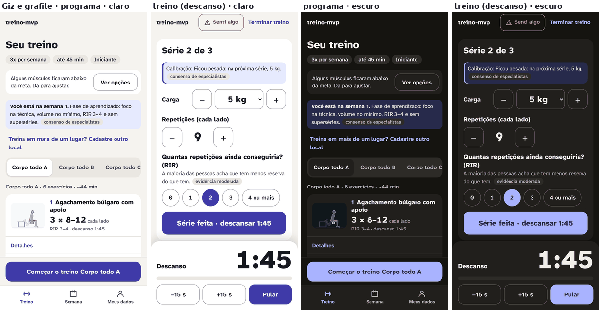
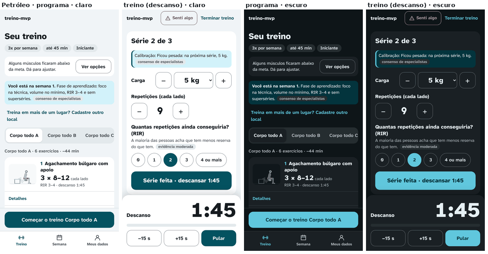
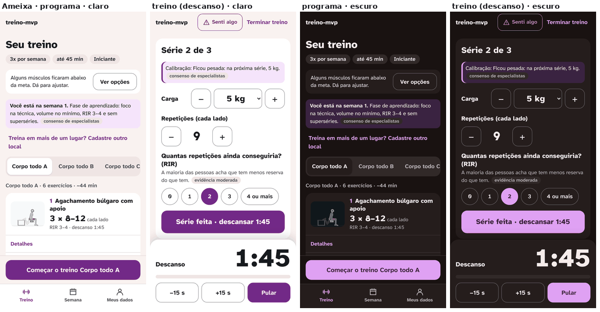
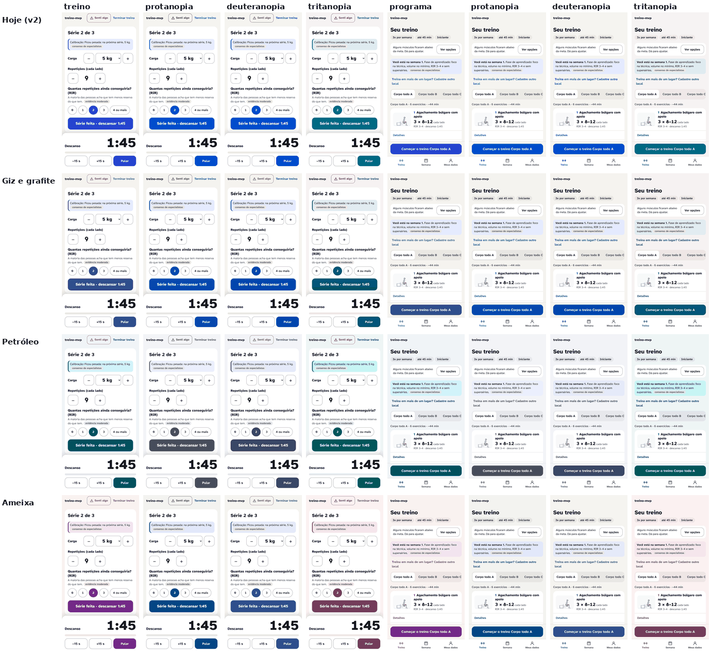
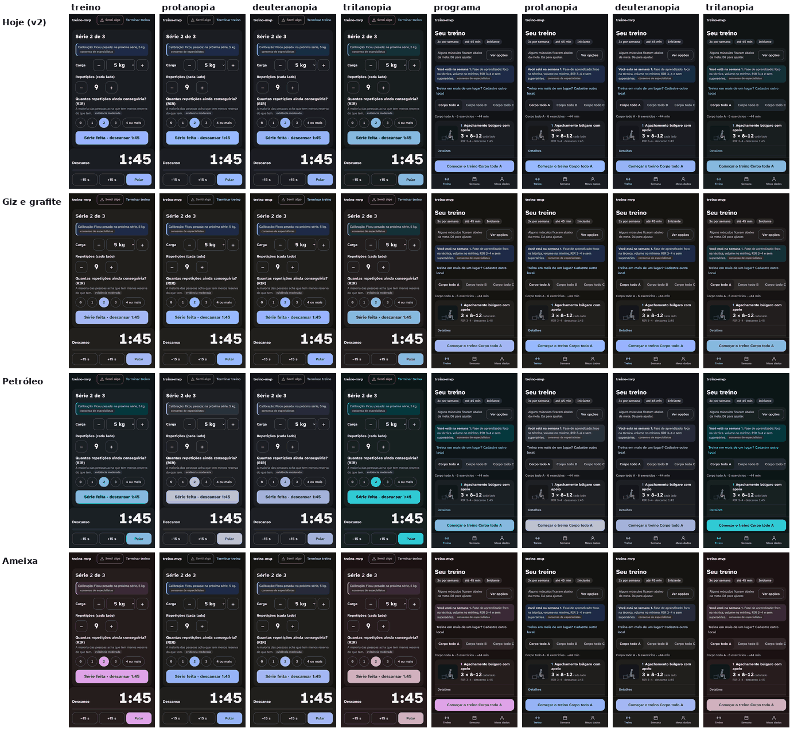
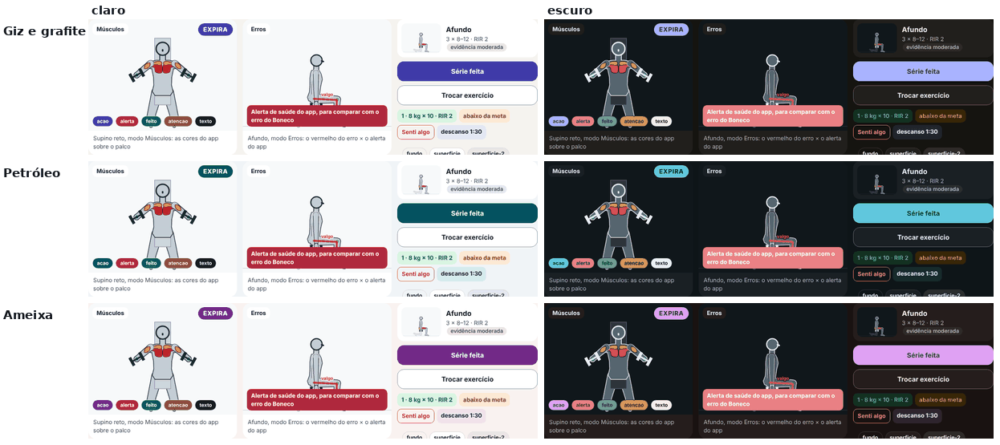
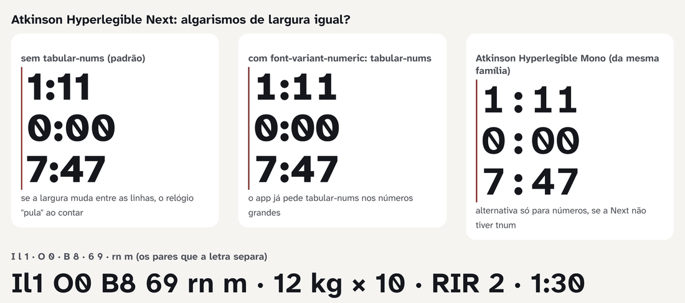
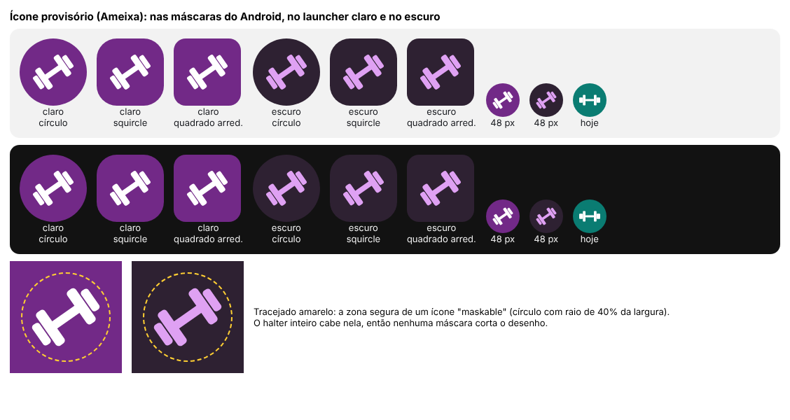

# Redesign, agente 5: cor, tema e identidade (06/11/2026)

Para o Gustavo. Pergunta do briefing: qual paleta, nos temas claro e escuro, dá ao app uma cara própria, se lê bem na academia (sol, suor, olhada rápida) e convive com as cores do Boneco.

Termos usados (uma frase cada):
- **Razão de contraste:** quantas vezes a cor mais clara reflete mais luz que a mais escura, pela conta da norma WCAG. 4,5:1 é o mínimo para texto; 7:1 é o nível "reforçado".
- **Distância de cor (ΔE):** quanto duas cores parecem diferentes, medida no espaço OKLab (×100). Quanto maior, mais diferentes. Abaixo de uns 5, eu trato como risco de confusão quando as duas aparecem lado a lado **[opinião: limiar meu, não é norma]**.
- **Simulação de daltonismo:** a tela recalculada como quem tem protanopia (não vê o vermelho), deuteranopia (não vê o verde) ou tritanopia (não vê o azul), pelo modelo de Machado, Oliveira e Fernandes (2009), o mesmo que `scripts/design/boneco.mjs` já usa.
- **Token:** o nome de uma cor no CSS (por exemplo `--acao`). Trocar o valor do token troca a cor no app inteiro.

## 1. Em uma frase

Recomendo a direção **Ameixa** (botões cor de ameixa, fundo neutro levemente rosado, estados verde, ocre e vermelho): é a única das três que fica longe, nas 4 visões testadas, do azul, do verde-azulado e do verde do Boneco. Ela dá ao app uma cor que não é a de todo app e deixa o botão principal com mais contraste que hoje (8,81:1 no claro, contra 7,56:1). A letra fica a mesma, servida pelo próprio app num arquivo só de 34,0 kB.

## 2. O que medi

**Scripts** (todos em `scripts/design/redesign/agente-5/`, ferramentas de documentação que não entram no app):
- `cor.mjs`: gera as paletas em OKLCH. O tom (matiz) e a intensidade (croma) são escolhidos por mim; a claridade sai de uma busca que acerta o alvo de contraste. O script calcula a razão WCAG de **27 pares** em cada tema, a razão de cada cor do app **sobre o palco** (`--stage`) e a **distância** de cada cor do app às cores do Boneco, na visão normal e nas 3 simulações. Também desenha cada paleta **sobre e ao lado** do palco, usando o Boneco real saído do motor (`src/engine/`, sem mudança). Saídas: `reports/design/redesign/agente-5/paletas.{json,md}`, `tokens-*.css` e `palco-*.png`.
- `telas.spec.ts` (Playwright, Pixel 7, persona **Ana**): percorre o cadastro, aplica cada paleta por cima dos tokens das telas (os do palco ficam como estão) e fotografa o programa, o treino, o descanso e o "Senti algo", nos 2 temas, na visão normal e nas 3 simulações. São 160 capturas em `reports/design/redesign/agente-5/telas/`.
- `letra.spec.ts`: mede no Chromium a largura dos algarismos da Atkinson Hyperlegible Next, com e sem `tabular-nums`, nos 4 pesos.
- `icone.mjs`: mostra o ícone proposto nas máscaras do Android, sobre launcher claro e escuro, e calcula os contrastes.
- `montar.py`: monta as imagens deste relatório.

**Continuidade:** um agente anterior com este papel montou `cor.mjs` e as 3 direções e parou antes de rodar as capturas e escrever o relatório. Eu rodei tudo e mudei uma regra dele: a 1ª versão mirava o mínimo da norma (4,5:1) no botão de ação, e o botão ficava **abaixo** do app de hoje (5,7:1 contra 7,56:1 no claro) **[medido]**. Para uso ao sol isso é piorar, então a ação passou a mirar **7:1** (nível AAA, 1.4.6) e os estados (feito, atenção, alerta) passaram a mirar 5,2:1. Também subi o croma da ação no tema escuro, porque o lilás saía acinzentado.

**Números principais [medido]:**
- As 4 paletas (hoje, Giz, Petróleo, Ameixa) passam nos **27 pares** nos 2 temas. A tabela completa está na seção 4.2.
- Botão de ação (texto sobre o botão): hoje 7,56 / 7,89; nas 3 direções 8,81 a 8,82 no claro e 7,13 a 7,14 no escuro.
- Letra: sem `tabular-nums`, o "1" tem 40,7 px de largura e o "0" tem 64,8 px (corpo de 100 px, peso 400). Com `tabular-nums`, todos os algarismos têm a mesma largura: "1111" e "0000" medem 252,81 px nos pesos 400, 600, 700 e 800.
- Arquivo da letra: o Google entrega **um arquivo variável** que cobre todos os pesos, com 34,0 kB no subconjunto latin (33.996 bytes), mais 19,1 kB no latin-ext. Na medida de base do app (`docs/revisoes/redesign/antes/base.json`), os dois arquivos são baixados: 51,8 kB e 3 pedidos externos por visita.

## 3. O que a pesquisa diz

| Afirmação | Selo | Fonte |
|---|---|---|
| Texto precisa de 4,5:1 (1.4.3); borda de controle, foco e gráfico, de 3:1 (1.4.11); o nível reforçado pede 7:1 para texto (4,5:1 para texto grande) e é AAA (1.4.6). | consenso | W3C, WCAG 2.2; texto do 1.4.6 conferido em 06/11 no *Understanding* do W3C |
| Cor não pode ser o único jeito de passar uma informação (1.4.1). | consenso | W3C, WCAG 2.2 |
| O APCA mede o contraste de outro jeito: leva em conta quem está por cima (texto claro no escuro dá outra conta) e o tamanho e o peso da letra, e corrige o exagero da WCAG 2 com cores escuras. Ele saiu do rascunho do WCAG 3 em 2023, e o rascunho diz que o método de contraste "ainda será definido"; a versão final do WCAG 3 não deve sair antes de 2028. | consenso (fonte secundária) | Roselli A, "WCAG3 Contrast as of April 2026" (blog de especialista); não abri o rascunho do W3C |
| Texto escuro em fundo claro se lê melhor (polaridade positiva). | um estudo (mesmo grupo, com réplicas) | Piepenbrock, Mayr e Buchner 2013, *Ergonomics* (já no projeto) |
| Tema escuro: superfície cinza-escura (#121212 no Material 2) em vez de preto; sombras quase não aparecem no escuro, então a superfície mais "alta" fica mais clara; cores de marca mais claras e menos saturadas. | consenso | Material Design, "Dark theme"; trecho sobre elevação conferido em `material-components-android/docs/theming/Dark.md`. A página m2.material.io não abriu pela ferramenta; o #121212 foi visto só pela busca |
| Daltonismo vermelho-verde: cerca de 8% dos homens e 0,4% das mulheres de origem europeia. | moderada | Birch 2012, *J Opt Soc Am A* 29(3):313-320 (já no projeto) |
| Azul e laranja se distinguem em todos os tipos de daltonismo; vermelho e verde não. | consenso | Okabe e Ito, *Color Universal Design* (já no projeto) |
| Simulação de protanopia, deuteranopia e tritanopia. | um estudo (modelo, não evidência sobre pessoas) | Machado, Oliveira e Fernandes 2009, IEEE TVCG 15(6):1291-1298 (já no projeto) |
| Ao sol, o reflexo na tela soma luz ao preto e ao branco, e o contraste efetivo despenca. Em teste de laboratório com luz forte, celulares antigos ficaram entre 2:1 e 3,2:1 (iPhone 4: 2,016; Galaxy S: 3,155). | um estudo (medição de imprensa técnica, sem revisão por pares) | GSMArena Labs, teste de legibilidade ao sol (descontinuado em 2020); DisplayMate, *Smartphone Displays Under Bright Ambient Lighting*. Ambos vistos só pela busca |
| "Psicologia da cor": a área está no começo, muitos estudos têm amostra pequena e superestimam o efeito, e o próprio autor pede cautela para tirar conclusões práticas. | moderada (revisão narrativa) | Elliot 2015, *Front Psychol* 6:368 (texto completo lido no PMC); Elliot e Maier 2014, *Annu Rev Psychol* 65:95-120 (resumo) |
| "Vestir vermelho faz ganhar" (Hill e Barton 2005, *Nature*): numa reanálise com mais de 6.500 atletas de 1996 a 2020, quem estava de vermelho ganhou 50,5% das lutas, sem efeito significativo. O efeito só aparecia antes de 2005. | um estudo (resumo) | Peperkoorn, Hill, Barton e Pollet 2024, *Scientific Reports* (visto por busca); Pollet e Peperkoorn 2013, *Front Psychol* (UFC, sem efeito; resumo) |
| A licença da Atkinson Hyperlegible Next é SIL Open Font License 1.1: pode ser usada, embutida e servida pelo próprio app, inclusive com fins comerciais. Quem redistribui leva junto o aviso de copyright e a licença, e não pode vender o arquivo da letra sozinho. | consenso (texto da licença) | `OFL.txt` do repositório googlefonts/atkinson-hyperlegible-next e `METADATA.pb` do Google Fonts (`license: "OFL"`), conferidos em 06/11. O site do Braille Institute não abriu (página vazia na ferramenta) |
| PWA: o Chrome pede ícones de 192 e 512 px no manifest; a área segura de um ícone "maskable" é um círculo com raio de 40% da largura; não convém usar `"any maskable"` no mesmo ícone. | consenso | MDN, *Making PWAs installable*; web.dev, *Adaptive icon support in PWAs with maskable icons*; conferidos em 06/11 |

**Sobre a "psicologia da cor" em apps de saúde e esporte (sendo duro):** não achei evidência de que alguma cor de marca motive mais, acalme mais ou faça treinar mais. Frases como "azul passa confiança", "laranja dá energia" ou "verde é saúde" são de marketing, sem base que se sustente **[fonte: Elliot 2015, moderada]**. O exemplo mais famoso no esporte, o do vermelho, não resistiu aos dados mais novos **[fonte: Peperkoorn et al. 2024, um estudo (resumo)]**. O que se sustenta é mais simples: convenção aprendida (vermelho para perigo, verde para pronto) ajuda a reconhecer de relance **[opinião]**, e contraste e separação entre cores são mensuráveis. Por isso as direções abaixo foram escolhidas por **contraste, separação do Boneco e gosto**, nunca por um efeito psicológico.

## 4. Achados e propostas

### 4.1 As 3 direções

As 3 direções têm os **mesmos estados** (feito verde, atenção ocre, alerta vermelho): o significado não muda com a marca. Mudam o fundo neutro, a cor de ação (botões, links, foco) e o painel de descanso.

**A. Giz e grafite.** *Intenção:* o app como papel e lápis: neutros quentes, uma cor só de ação (índigo), e o Boneco como a única coisa colorida da tela.
- Ação: claro `#3F3AA8`, escuro `#A9B3FF`.
- Na prática é o app de hoje um pouco mais fundo e mais calmo. Muda pouco e não dá cara nova **[opinião]**.
- Imagem: `img/agente-5-giz.png`



**B. Petróleo.** *Intenção:* técnico e calmo, como um laboratório de ciência do esporte: neutros frios, ação azul-petróleo e uma cor de marca mais escura para a navegação.
- Ação: claro `#045260`, escuro `#60C7DD`. Marca: `#05424D`.
- Fica no mesmo tom das **juntas e da linha-guia do Boneco** (`--joint` e `--guide`, verde-azulado) e do ícone de hoje.
- Imagem: `img/agente-5-petroleo.png`



**C. Ameixa (recomendada).** *Intenção:* uma cara própria, fora do "azul de app" e do "laranja de academia": neutros levemente rosados, ação ameixa, estados bem separados dela.
- Ação: claro `#722987`, escuro `#DFA1F3`.
- Imagem: `img/agente-5-ameixa.png`



### 4.2 Contraste WCAG de cada par (claro / escuro) [medido]

| par | mínimo | Hoje | Giz | Petróleo | Ameixa |
|---|---|---|---|---|---|
| texto principal no fundo | 4,5 | 16,29 / 16,61 | 15,61 / 15,93 | 15,64 / 15,96 | 15,64 / 15,94 |
| texto principal no cartão | 4,5 | 17,93 / 15,08 | 17,30 / 14,21 | 17,30 / 14,25 | 17,30 / 14,24 |
| texto secundário no fundo | 4,5 | 7,35 / 8,85 | 7,94 / 9,30 | 7,92 / 9,37 | 7,96 / 9,32 |
| texto secundário no cartão | 4,5 | 8,08 / 8,03 | 8,80 / 8,29 | 8,76 / 8,36 | 8,80 / 8,33 |
| selo de evidência | 4,5 | 6,72 / 7,02 | 7,14 / 7,13 | 7,15 / 7,13 | 7,13 / 7,16 |
| ação como texto (link) no fundo | 4,5 | 6,87 / 8,99 | 7,96 / 9,28 | 7,98 / 9,40 | 7,97 / 9,27 |
| texto sobre o botão de ação | 4,5 | 7,56 / 7,89 | 8,82 / 7,14 | 8,82 / 7,13 | **8,81 / 7,13** |
| ação como controle ou foco no cartão | 3 | 7,56 / 8,16 | 8,82 / 8,28 | 8,82 / 8,39 | 8,81 / 8,28 |
| texto na opção marcada (ação suave) | 4,5 | 15,08 / 12,86 | 14,47 / 11,95 | 14,68 / 11,64 | 14,31 / 12,10 |
| feito no fundo | 4,5 | 5,32 / 9,98 | 5,93 / 6,95 | 5,95 / 7,04 | 5,95 / 6,97 |
| feito na própria faixa (série feita) | 4,5 | 5,08 / 8,25 | 5,67 / 5,40 | 5,67 / 5,46 | 5,67 / 5,40 |
| atenção na própria faixa (aviso) | 4,5 | 5,98 / 8,07 | 5,60 / 5,56 | 5,54 / 5,61 | 5,60 / 5,54 |
| alerta no fundo ("Senti algo") | 4,5 | 5,94 / 8,44 | 5,93 / 6,96 | 5,92 / 7,00 | 5,95 / 6,94 |
| alerta na própria faixa | 4,5 | 5,55 / 6,94 | 5,53 / 5,62 | 5,51 / 5,66 | 5,53 / 5,59 |
| texto claro no botão de alerta ("Apagar tudo") | 4,5 | 6,54 / 7,66 | 6,58 / 6,20 | 6,55 / 6,25 | 6,58 / 6,20 |
| borda de controle no fundo | 3 | 3,11 / 3,91 | 3,12 / 3,51 | 3,13 / 3,49 | 3,13 / 3,51 |
| borda de controle no cartão | 3 | 3,42 / 3,55 | 3,46 / 3,14 | 3,46 / 3,12 | 3,46 / 3,14 |
| relógio do descanso no painel | 4,5 | 17,93 / 15,08 | 13,99 / 13,08 | 14,23 / 12,89 | 13,95 / 13,12 |
| barra do descanso no painel | 3 | 7,56 / 8,16 | 7,13 / 7,62 | 7,26 / 7,60 | 7,11 / 7,63 |
| cartão sobre o fundo (só referência) | — | 1,10 / 1,10 | 1,11 / 1,12 | 1,11 / 1,12 | 1,11 / 1,12 |

Os outros 7 pares (texto sobre as 3 faixas suaves e afins) estão em `reports/design/redesign/agente-5/paletas.md`; todos passam.

**Sobre o palco** (cada cor do app contra `--stage`), Ameixa: ação 8,35:1 no claro e 9,07:1 no escuro; alerta, feito e atenção entre 6,23 e 6,82:1 **[medido: `paletas.json`]**. O palco dentro do cartão: 1,06:1 no claro e 1,10:1 no escuro, a mesma moldura quase invisível de hoje.

- **Tela/estado:** Treino, tema escuro: as faixas de "feito", "atenção" e "alerta".
- **Problema:** no escuro de hoje, o verde de "feito" (`#62D2A2`) fica quase igual ao verde do "certo" do Boneco (`--ghost`) para quem tem tritanopia (ΔE 2,5), e o ocre de "atenção" (`#F3B562`) fica quase igual ao laranja do músculo secundário (ΔE 3,2) **[medido]**.
- **Evidência:** as distâncias acima; a regra de não depender só da cor **[fonte: WCAG 2.2, 1.4.1; consenso]**.
- **Proposta:** os estados novos do escuro (feito `#65AE80`, atenção `#C59749`, alerta `#E98084`) se afastam: 7,4 e 7,9 no pior caso.
- **Efeito esperado:** nenhuma cor de estado do app a menos de 7 de uma cor do Boneco no tema escuro.
- **Custo e risco:** o contraste dos estados no escuro cai de 8 a 10:1 para 5,4 a 7:1. Continua acima do mínimo, mas é uma perda real ao sol **[medido]**. Se o Gustavo preferir contraste, dá para manter os estados escuros de hoje e aceitar a proximidade com o Boneco.

### 4.3 Daltonismo: as 3 simulações [medido nas capturas]





O que se vê nas imagens:
- **Giz:** a ação continua azul nas 3 simulações. Nada se perde.
- **Petróleo:** com protanopia e deuteranopia, o botão de ação vira um **cinza-azulado escuro**, com cara de botão desligado. Com tritanopia, a ação fica perto do verde de "feito" (ΔE 6,1 no claro); com protanopia, perto do vermelho de alerta (5,7). No escuro, a ação fica a 2,8 do verde do "certo" do Boneco.
- **Ameixa:** com protanopia e deuteranopia, a ação vira um **azul**. A cor de marca se perde para essas pessoas, mas o botão continua um botão distinto do verde e do vermelho. Com tritanopia, vira um vinho acinzentado, ainda a 15,1 do alerta no claro e 13,0 no escuro.
- **Em todas, inclusive hoje:** para quem tem protanopia, o ocre de "atenção" e o vermelho do músculo principal ficam parecidos (ΔE 2,0 nas direções novas; 3,0 hoje). Isso não vira confusão real porque "atenção" nunca aparece no palco e sempre vem com texto **[opinião]**. Está registrado na seção 7.

**Pior caso nas 4 visões (normal e 3 simulações), claro / escuro [medido: `paletas.json`]:**

| par | Hoje | Giz | Petróleo | Ameixa |
|---|---|---|---|---|
| ação × linha azul da trajetória | **3,4** / 8,8 | 8,7 / 9,6 | 12,1 / 9,8 | 12,7 / 8,0 |
| ação × elástico roxo | **4,7** / **3,8** | 5,0 / **4,7** | 11,3 / **4,7** | 7,9 / **3,8** |
| ação × juntas e linha-guia | 7,3 / 9,0 | 12,8 / 11,0 | 12,7 / 7,4 | 13,3 / 11,2 |
| ação × verde do "certo" | 14,2 / 7,9 | 20,2 / 9,7 | 20,1 / **2,8** | 24,1 / 14,9 |
| ação × vermelho do músculo | 27,3 / 23,7 | 23,4 / 23,6 | 11,1 / 19,2 | 20,9 / 21,8 |
| ação × alerta do app | 28,0 / 16,8 | 18,7 / 16,7 | 5,7 / 12,1 | 15,1 / 13,0 |
| feito × ação | 5,7 / 6,8 | 7,3 / 10,3 | 6,1 / 9,6 | 14,5 / 15,4 |
| alerta × erro do Boneco | 5,8 / 10,6 | 7,2 / 7,3 | 7,2 / 7,4 | 7,2 / 7,2 |
| alerta × vermelho do músculo | 5,6 / 10,7 | 7,2 / 7,4 | 7,2 / 7,5 | 7,2 / 7,3 |

Em negrito, os pares abaixo de 5. A Ameixa tem o melhor pior caso entre ação e Boneco e entre ação e estados. Sobra o elástico roxo no escuro (3,8), que só aparece nos exercícios com elástico e dentro do palco, onde o botão de ação não entra **[opinião]**.

### 4.4 A paleta sobre e ao lado do palco



Cada linha mostra o supino no modo Músculos e o afundo no modo Erros. Por cima do palco vão os chips de ação, alerta, feito, atenção e texto; ao lado, um cartão de exercício, o botão "Série feita", as faixas e o "Senti algo". As cores do palco são as de sempre.

- **Tela/estado:** Guia e treino, palco no modo Erros.
- **Problema:** hoje o alerta de saúde do app (`--alert` `#B3261E`) é **a mesma cor** da faixa de erro de técnica do palco (`.errbanner`, `#B3261E` fixo no CSS) **[medido: `src/styles.css`, linhas 8 e 90]**. "Você fez errado" e "pare, sentiu algo" falam com a mesma cor.
- **Evidência:** convenção vermelho = perigo **[opinião]**; não depender só da cor **[fonte: WCAG 2.2, 1.4.1; consenso]**.
- **Proposta:** não tentar separar por tom. Entre vermelhos não há espaço: qualquer passo fica perto do laranja ou do rosa dos músculos. Separar por **forma e lugar**: o alerta de saúde é sempre um botão com o ícone ⚠, fora do palco, no topo; o erro de técnica fica sempre dentro do palco, com o tracejado. Nas direções novas, o alerta (`#AF283D`, mais vinho) fica a 7,2 do erro do Boneco, contra 5,8 hoje.
- **Efeito esperado:** a cor deixa de ser idêntica, e a distinção principal passa a ser a forma e o lugar.
- **Custo e risco:** pequeno. A cor da `.errbanner` fica onde está (é do palco); só muda `--alerta`.

### 4.5 Recomendação: Ameixa

**Por quê:**
1. Tem a maior distância entre a ação e as cores do Boneco (azul da trajetória, verde-azulado das juntas, verde do certo) e entre a ação e os estados "feito" e "alerta", nas 4 visões **[medido, tabela 4.3]**.
2. Contraste do botão principal acima de hoje no claro (8,81 contra 7,56) e acima de 7:1 no escuro **[medido]**, o que importa ao sol, onde o contraste efetivo cai muito **[fonte: GSMArena Labs; um estudo]**.
3. Dá cara própria: o azul é a cor de ação padrão de muita interface e o laranja é o "jeito de academia", e o laranja nem é possível aqui por causa dos músculos **[opinião]**.

**O que perde quem escolher as outras:**
- **Giz:** a mudança mais segura (a ação continua azul para todos os daltônicos), mas o app continua sem cara própria, e a ação fica a 8,7 do azul da trajetória.
- **Petróleo:** encosta no verde-azulado das juntas e da linha-guia do Boneco e do ícone de hoje. Vira cinza para protanopes e deuteranopes e fica a 2,8 do verde do "certo" no escuro **[medido]**. Eu não escolheria.

**O que se perde com a Ameixa:**
- Para cerca de 8% dos homens (Birch 2012), a ameixa vira azul: a identidade some para eles, a função não.
- Roxo e lilás têm associação cultural de gênero para algumas pessoas. Não achei dado sobre isso em app de treino **[opinião]**: é uma questão de gosto, e é do Gustavo.

### 4.6 Tokens CSS prontos para `:root` (direção recomendada: Ameixa)

Nomes semânticos (o que a cor **faz**, não o tom). Na implementação, os nomes de hoje (`--bg`, `--accent`...) viram apelidos dos novos (por exemplo `--accent:var(--acao)`), para não mexer em centenas de regras de uma vez. Os tokens do palco (`--stage`, `--fig`, `--mus-p`... e o bloco R4) **não entram aqui e não mudam**.

```css
:root{
  --fundo:#F9F2F0; --superficie:#FFFFFF; --superficie-2:#EFE5E4; --linha:#DDD6D4;
  --texto:#171B20; --texto-2:#464B51; --borda-controle:#868A92;
  --acao:#722987; --texto-sobre-acao:#FFFFFF; --acao-suave:#F5E4FB; --foco:#722987; --link:#722987;
  --feito:#0F6B3E; --feito-suave:#D9F5E1;
  --atencao:#7B5612; --atencao-suave:#FCEAD0;
  --alerta:#AF283D; --alerta-suave:#FEE6E6;          /* alerta de saúde: "Senti algo", triagem */
  --descanso:#F1E2F5; --descanso-texto:#171B20;      /* painel do descanso */
  --marca:#722987;                                   /* ícone, theme-color do manifest */
}
@media (prefers-color-scheme: dark){ :root:not([data-theme="light"]){ /* mesmos valores do bloco abaixo */ } }
:root[data-theme="dark"]{
  --fundo:#191211; --superficie:#251D1C; --superficie-2:#312928; --linha:#413837;
  --texto:#F6ECEA; --texto-2:#C0B6B4; --borda-controle:#736A68;
  --acao:#DFA1F3; --texto-sobre-acao:#392240; --acao-suave:#3A2341; --foco:#DFA1F3; --link:#DFA1F3;
  --feito:#65AE80; --feito-suave:#12301E;
  --atencao:#C59749; --atencao-suave:#362508;
  --alerta:#E98084; --alerta-suave:#3E1E1F;
  --descanso:#2E2132; --descanso-texto:#F6ECEA;
  --marca:#DFA1F3;
  color-scheme:dark;
}
```

Junto com os tokens: `theme-color` e `background_color` passam a `#F9F2F0` (claro) e `#191211` (escuro) em `index.html` e no manifest.

**Anexo: as outras direções**

```css
/* Giz e grafite: claro */
--fundo:#F5F3EF; --superficie:#FFFFFF; --superficie-2:#EAE7E2; --linha:#D9D7D3; --texto:#171B20; --texto-2:#464B51;
--borda-controle:#868A92; --acao:#3F3AA8; --texto-sobre-acao:#FFFFFF; --acao-suave:#E6EAFE; --foco:#3F3AA8;
--feito:#0F6B3E; --feito-suave:#D9F5E1; --atencao:#7B5612; --atencao-suave:#FCEAD0; --alerta:#AF283D; --alerta-suave:#FEE6E6;
--descanso:#E3E6FC; --descanso-texto:#171B20; --marca:#3F3AA8;
/* Giz e grafite: escuro */
--fundo:#151410; --superficie:#211F1C; --superficie-2:#2D2B27; --linha:#3C3A36; --texto:#F1EEE9; --texto-2:#BBB8B0;
--borda-controle:#6F6C64; --acao:#A9B3FF; --texto-sobre-acao:#25284A; --acao-suave:#272A4B; --foco:#A9B3FF;
--feito:#65AE80; --feito-suave:#12301E; --atencao:#C6974A; --atencao-suave:#362508; --alerta:#EA8085; --alerta-suave:#3E1E1F;
--descanso:#222537; --descanso-texto:#F1EEE9; --marca:#A9B3FF;
/* Petróleo: claro */
--fundo:#F0F4F7; --superficie:#FFFFFF; --superficie-2:#E3E9EC; --linha:#D4D8DB; --texto:#171B20; --texto-2:#474B52;
--borda-controle:#868A92; --acao:#045260; --texto-sobre-acao:#FFFFFF; --acao-suave:#D2F2FA; --foco:#045260;
--feito:#0F6B3E; --feito-suave:#D9F5E1; --atencao:#7E5600; --atencao-suave:#FCEAD0; --alerta:#AF293D; --alerta-suave:#FEE6E6;
--descanso:#D2EEF4; --descanso-texto:#171B20; --marca:#05424D;
/* Petróleo: escuro */
--fundo:#0E1518; --superficie:#1A2024; --superficie-2:#252D30; --linha:#343C40; --texto:#E7F0F5; --texto-2:#B2BABF;
--borda-controle:#656D71; --acao:#60C7DD; --texto-sobre-acao:#00313B; --acao-suave:#03343D; --foco:#60C7DD;
--feito:#66AF81; --feito-suave:#12301E; --atencao:#C6984A; --atencao-suave:#362508; --alerta:#EA8185; --alerta-suave:#3E1E1F;
--descanso:#0F2B31; --descanso-texto:#E7F0F5; --marca:#04343D;
```

Os valores em OKLCH de cada cor estão em `reports/design/redesign/agente-5/paletas.md`.

- **Tela/estado:** todas.
- **Problema:** o app não tem cara própria; o ícone de hoje usa `#0A7C72`, **a cor das juntas do Boneco** (`--joint`) **[medido: `public/icon.svg` e `src/styles.css`, linha 11]**.
- **Evidência:** tabela 4.3 **[medido]**; WCAG 2.2 **[consenso]**.
- **Proposta:** trocar só o bloco de tokens do topo de `src/styles.css`, as duas `theme-color` de `index.html` e as cores do manifest.
- **Efeito esperado:** 27 de 27 pares passam nos 2 temas; o botão principal sobe para 8,81:1 no claro.
- **Custo e risco:** pequeno: um bloco de CSS e 2 arquivos de configuração. `tests/e2e/contraste.ts` confere o resultado. Risco: alguma cor fixa no CSS fora dos tokens (como `.breath` e `.errbanner`) continuar azul ou vermelha; isso é de propósito no palco (seção 7).

### 4.7 A letra: veredito



**Veredito: fica a Atkinson Hyperlegible Next, servida pelo próprio app num arquivo variável só (latin, 34,0 kB), sem Google Fonts.**

- **tnum (algarismos de largura igual):** funciona **[medido]**. Sem o recurso, "1111" mede 162,8 px e "0000" mede 259,2 px; com `font-variant-numeric: tabular-nums`, os dois medem 252,81 px nos 4 pesos. O app já pede `tabular-nums` em 10 regras, inclusive no relógio do descanso (`.tclock-mini`) e no seletor de carga **[medido: `src/styles.css`]**. O relógio não "pula" ao contar. A Atkinson Hyperlegible Mono não é necessária.
- **Licença:** SIL Open Font License 1.1 **[fonte: `OFL.txt` do repositório oficial; `METADATA.pb` do Google Fonts; consenso]**. Pode ser servida pelo app. Ao copiar o arquivo para `public/fonts/`, vai junto o `OFL.txt`. O arquivo não é vendido sozinho. Não conferi a página do Braille Institute (não abriu).
- **Peso dos arquivos [medido]:**

| opção | arquivos | kB |
|---|---|---|
| hoje (Google Fonts, como o app baixa) | CSS + latin + latin-ext, 3 pedidos externos | 3,8 + 33,2 + 18,6 = **55,6** (base.json) |
| variável, só latin, servida pelo app (**proposta**) | 1 | **34,0** (cobre os pesos de 200 a 800) |
| estáticos latin, 4 pesos (400, 600, 700, 800) | 4 | 12,1 + 12,7 + 12,7 + 12,6 = 50,1 |
| estáticos latin, 3 pesos (400, 700, 800) | 3 | 37,5 |

O arquivo variável é o menor para 3 pesos ou mais. Ele também cobre o 500, que o CSS usa em 4 regras e que hoje sai do mesmo arquivo variável **[medido: contagem no CSS]**. O português cabe todo no subconjunto latin (á, ã, ç, é, õ ficam entre U+00C0 e U+00FF); procurei em `src/` caracteres do latin-ext e não achei nenhum **[medido]**. Ainda assim, a medida de base mostra o navegador baixando o latin-ext; não descobri por quê **[não sei]**.

- **Tela/estado:** todas, na primeira visita e sem internet.
- **Problema:** 3 pedidos a servidores do Google por visita (o IP da pessoa vai para fora) e 18,6 kB de um subconjunto que o português não usa **[medido: base.json]**. Sem internet, a letra depende do cache do navegador **[opinião: o service worker de hoje só lista `icon.svg` em `includeAssets`, `vite.config.ts`]**.
- **Evidência:** licença OFL **[consenso]**; servir a letra do próprio app conta como ponto positivo **[briefing comum, LGPD]**.
- **Proposta:** `public/fonts/AtkinsonHyperlegibleNext-latin.woff2` + `OFL.txt`; um `@font-face` com `font-weight:200 800`, `font-display:swap` e `unicode-range` do latin; `<link rel="preload" as="font" crossorigin>`; tirar os 3 `<link>` do Google em `index.html`; o service worker guarda o arquivo.
- **Efeito esperado:** 0 pedidos externos; −21,6 kB por primeira visita (55,6 → 34,0); a letra também funciona sem internet.
- **Custo e risco:** pequeno: um arquivo binário novo no repositório (letra pública, não é dado pessoal) e um teste e2e que confere `document.fonts` com a família carregada. Risco: um caractere fora do latin cair na letra do sistema; o teste pega.

**Alternativas:** nenhuma com ganho medido. A letra do sistema tem tnum (medi: 259,38 px fixos), mas o app perderia o desenho que separa I, l e 1, e O e 0 (veja a imagem). Não proponho trocar.

### 4.8 Nome provisório (item separado da tabela de decisões; quem decide é o Gustavo)

| nome | por quê | contra |
|---|---|---|
| **Série** | é a unidade do treino e a palavra que mais aparece na tela ("Série feita") | genérico: difícil de achar em busca e em loja |
| **Na Medida** | o treino sob medida para o equipamento que a pessoa tem, e a medida da evidência | 2 palavras; sem cara de academia |
| **Repete** | verbo do treino; curto, falado, em português | soa informal; pode lembrar "repetitivo" |

Não conferi o registro no INPI, nas lojas de apps nem os domínios **[não verificado]**. Conferir antes de adotar. Hoje o manifest diz `name: 'treino-mvp'` e `short_name: 'Treino'`.

### 4.9 Ícone de app

Arquivos: `docs/revisoes/redesign/img/agente-5-icone-claro.svg` (fundo ameixa `#722987`, halter branco) e `agente-5-icone-escuro.svg` (fundo ameixa escuro `#2E2132`, halter lilás `#DFA1F3`). O halter fica inclinado (−35°), para não ser o halter reto de todo ícone de treino **[opinião]**.



Contraste **[medido: `icone.mjs`]**:
- Desenho sobre o fundo: claro 8,81:1, escuro 7,63:1 (hoje 5,07:1).
- Ícone claro sobre launcher claro: 7,87:1; sobre launcher escuro: 2,13:1.
- Ícone escuro sobre launcher escuro: 1,23:1. A borda some, mas o halter lilás continua visível. Por isso o ícone **do manifest** é o claro, e o escuro serve para a aba do navegador no tema escuro.
- O halter inteiro cabe na zona segura (círculo com raio de 40%), então nenhuma máscara corta o desenho.

- **Tela/estado:** tela inicial do celular, instalação do PWA.
- **Problema:** o manifest de hoje tem um único SVG com `purpose: 'any maskable'` e `sizes: 'any'` **[medido: `vite.config.ts`]**. O Chrome pede ícones de 192 e 512 px **[fonte: MDN; consenso]**, e usar "any" e "maskable" no mesmo ícone é desaconselhado **[fonte: web.dev; consenso]**.
- **Proposta:** PNG de 192 e 512 (`purpose: any`, com cantos arredondados) e PNG de 512 sangrado (`purpose: maskable`), gerados a partir do SVG claro; o SVG fica como favicon; `theme_color` em ameixa. Se o nome escolhido pedir, o halter dá lugar a uma inicial. Fica para depois do nome.
- **Efeito esperado:** ícone instalável em qualquer Android, sem corte nas máscaras e sem compartilhar cor com o Boneco.
- **Custo e risco:** pequeno: 3 PNG e o bloco `icons` do manifest.

## 5. O que não fazer

- **Marca laranja, coral ou vermelha:** briga com o vermelho e o laranja dos músculos e com o alerta de saúde, que é o que o briefing pede para separar **[medido: o laranja do músculo secundário é `#ec961c`]**.
- **Marca verde:** briga com "feito" e com o verde do "certo" do Boneco.
- **Marca azul-petróleo ou verde-azulada:** é a cor das juntas e da linha-guia (direção B; tabela 4.3).
- **Preto puro no escuro** (#000): o Material recomenda cinza-escuro **[consenso]**; as 3 direções usam fundo em torno de L 19% em OKLCH.
- **Escolher cor por "psicologia"** ("violeta motiva", "azul acalma"): sem base (seção 3).
- **Trocar a letra** por outra sem ganho medido.
- **Adotar o APCA como critério agora:** saiu do rascunho do WCAG 3 e os testes do projeto (`tests/e2e/contraste.ts`) usam a WCAG 2.2. Eu não calculei os valores APCA destas paletas **[não medido]**.

## 6. Pedidos ao domínio

Nenhum. Cor, tema, letra, nome e ícone não pedem dado novo ao `src/domain/`.

## 7. Conflitos com "o que não muda"

1. **Alerta de saúde × erro de técnica do palco.** Hoje são a mesma cor (`#B3261E`). Proponho separar pela forma e pelo lugar (4.4); a cor da faixa do palco não muda. **Decisão do Gustavo.**
2. **A pílula de respiração** (`.breath`, `#1F3CB8` fixo) fica sobre o palco e continua azul na Ameixa. Não está na lista de cores internas do palco, mas está dentro dele. Deixar como está (mais seguro) ou pintar com `--acao`? Eu deixaria **[opinião]**. **Decisão do Gustavo.**
3. **Ameixa × elástico roxo do Boneco** (`--elastic`) no tema escuro: ΔE 3,8 com protanopia. Só se encontram nos exercícios com elástico, e a ação não entra no palco. Aceito o risco **[opinião]**.
4. **Atenção × vermelho do músculo principal com protanopia:** ΔE 2,0 nas direções novas (3,0 hoje). "Atenção" fica fora do palco e sempre com texto.
5. **Estados no escuro:** afastá-los do Boneco custa contraste (de 8 a 10:1 para 5,4 a 7:1; seção 4.2).

## 8. Resumo em 10 linhas para o Gustavo

1. Fiz 3 paletas, Giz (índigo), Petróleo (verde-azulado) e Ameixa, e medi 27 pares de cores em cada tema: todas passam na norma.
2. Recomendo a **Ameixa**: é a que fica mais longe das cores do Boneco e a que tem cara própria.
3. O botão principal fica com mais contraste que hoje (8,8:1 contra 7,6:1 no claro), o que ajuda ao sol.
4. Para daltônicos vermelho-verde, a ameixa vira azul: o botão continua claro, só a "cor da marca" some para eles.
5. O Petróleo usa a mesma cor das juntas do Boneco e vira cinza para daltônicos: eu não escolheria.
6. "Psicologia da cor" não tem base para escolher a marca; escolhi por medida e por gosto.
7. A letra fica a mesma: os números têm largura igual (o relógio não pula) e a licença (OFL) deixa o app servi-la.
8. Servir a letra do próprio app: um arquivo de 34 kB, 0 pedidos ao Google, funciona sem internet.
9. Nomes para escolher: **Série**, **Na Medida** ou **Repete** (registro e lojas ainda não conferidos).
10. Ícone novo: halter inclinado em ameixa, que cabe em todas as máscaras do Android; decidir também se a pílula de respiração e a faixa de erro do palco ficam como estão.

## 9. Fontes

- W3C (2023). *Web Content Accessibility Guidelines (WCAG) 2.2*, critérios 1.4.1, 1.4.3, 1.4.6, 1.4.11. Texto do 1.4.6 (7:1, AAA) conferido em 06/11/2026 no *Understanding WCAG 2.2*.
- Roselli A (2026). *WCAG3 Contrast as of April 2026*, adrianroselli.com. Visto por busca: o APCA saiu do rascunho de julho de 2023 e o método de contraste do WCAG 3 está "a definir". Não abri o rascunho do W3C.
- Google. Material Design, *Dark theme* (m2.material.io; #121212 visto só pela busca) e `material-components-android/docs/theming/Dark.md` (elevação no escuro, lido em 06/11).
- Piepenbrock C, Mayr S, Buchner A (2013). *Ergonomics*. Já no projeto (`design-v2.md`).
- Birch J (2012). *J Opt Soc Am A* 29(3):313-320. PMID 22472762. Já no projeto.
- Okabe M, Ito K. *Color Universal Design*. Já no projeto.
- Machado GM, Oliveira MM, Fernandes LAF (2009). *IEEE TVCG* 15(6):1291-1298. doi:10.1109/TVCG.2009.113. Matrizes de severidade 1,0 usadas em `telas.spec.ts` e `cor.mjs`.
- Ottosson B (2020). *A perceptual color space for image processing* (OKLab). Fórmulas em `cor.mjs`; não reconferido nesta sessão.
- Elliot AJ (2015). Color and psychological functioning: a review of theoretical and empirical work. *Front Psychol* 6:368. PMC4383146; texto completo lido (amostras pequenas, área "nascente", cautela com aplicação).
- Elliot AJ, Maier MA (2014). Color psychology. *Annu Rev Psychol* 65:95-120. doi:10.1146/annurev-psych-010213-115035. Resumo.
- Hill RA, Barton RA (2005). *Nature* 435:293. Citado via a reanálise abaixo.
- Peperkoorn LS, Hill RA, Barton RA, Pollet TV (2024). *Scientific Reports*. Visto por busca (resumo): 50,5% de vitórias de vermelho, sem efeito significativo.
- Pollet TV, Peperkoorn LS (2013). Fading red? *Front Psychol* 4:643. Resumo.
- GSMArena Labs, teste de legibilidade ao sol (contrastes de 2,016 a 3,155 em celulares antigos); DisplayMate, *Smartphone Displays Under Bright Ambient Lighting Shoot-Out*. Vistos por busca; medições de imprensa técnica, sem revisão por pares.
- Atkinson Hyperlegible Next Project Authors (2020-2024). `OFL.txt` (SIL Open Font License 1.1), github.com/googlefonts/atkinson-hyperlegible-next, e `METADATA.pb` em github.com/google/fonts (`license: "OFL"`, eixo wght de 200 a 800). Conferidos em 06/11/2026.
- Arquivos woff2 medidos em 06/11/2026: fonts.gstatic.com (variável latin, 33.996 bytes; latin-ext, 19.092 bytes) e cdn.jsdelivr.net/npm/@fontsource/atkinson-hyperlegible-next (estáticos latin por peso).
- MDN, *Making PWAs installable* (ícones de 192 e 512 px). web.dev, *Adaptive icon support in PWAs with maskable icons* (zona segura de 40%; não misturar "any" e "maskable"). Conferidos em 06/11/2026.

**Não consegui verificar:** a página de licença do Braille Institute (abriu vazia); a página do Material 2 sobre tema escuro (abriu vazia; o #121212 veio da busca); o rascunho atual do WCAG 3 no W3C (só pela análise do Roselli); o texto completo de Peperkoorn et al. 2024 e de Elliot e Maier 2014 (só os resumos); os testes ao sol do GSMArena e do DisplayMate (só por busca). O registro dos 3 nomes (INPI, lojas, domínios) não foi conferido.
