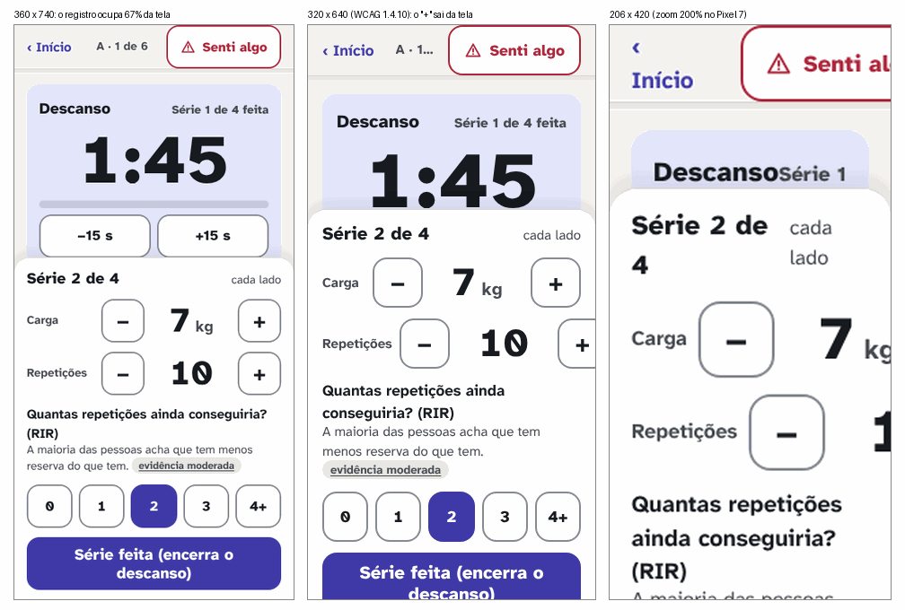
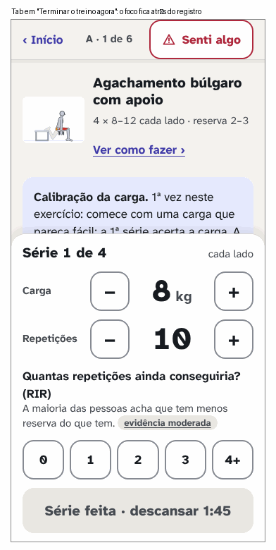
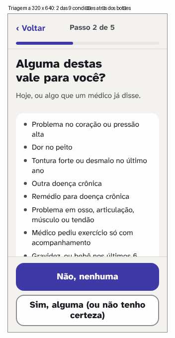
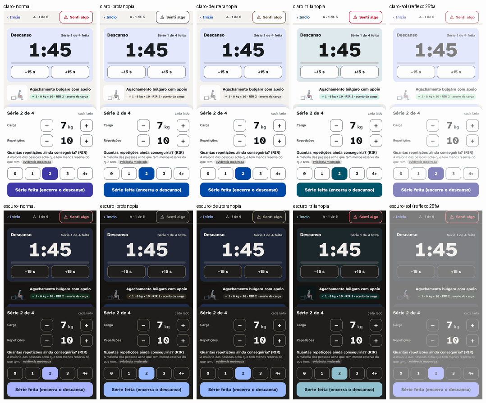

# Agente 6: crítica independente, acessibilidade e medição (06/11/2026)

## 1. Em uma frase

O protótipo passa nos testes automáticos (0 falha WCAG do axe-core em 60 telas, 0 toque abaixo de 48 px, "Senti algo" sempre à vista de 360 px para cima), mas **quebra quando a pessoa aumenta a letra ou usa o teclado**: a 320 px e com zoom de 200% o treino rola de lado e o registro fixo cobre de 78% a 91% da tela; o foco do teclado some atrás do registro e escapa das folhas; o fim do descanso não é anunciado ao leitor de tela; e, na triagem, o "Não, nenhuma" fica à mão antes de a pessoa ver as 9 condições em tela estreita.

## 2. O que medi

**Método.** Protótipo servido como no Artifact (função `servir` de `scripts/design/redesign/prototipo/capturas.spec.ts`), Playwright 1.63 com o Chromium de `/opt/pw-browsers`, Pixel 7 (412 × 839), 360 × 740, 320 × 640 (o reflow da WCAG) e 206 × 420 (o Pixel 7 com zoom de 200%: a largura útil cai pela metade). O app de hoje em http://localhost:4173. Não li a `proposta.md`.

**Scripts** (em `scripts/design/redesign/agente-6/`; dados brutos em `reports/design/redesign/agente-6/`):
- `critica.spec.ts`: (1) axe-core 4.14 (o mesmo motor de acessibilidade do Lighthouse 13.6; usei o que já estava no cache do `npx lighthouse`, nada instalado) nas 30 telas, claro e escuro, regras WCAG 2.0 a 2.2 A/AA e boas práticas; (2) árvore de acessibilidade (`ariaSnapshot` e a árvore completa do Chromium pelo CDP) de 11 telas; (3) foco nas 6 folhas e diálogos (30 Tabs cada, Escape, para onde o foco volta); (4) foco coberto pelas barras fixas (Tab por 14 telas, 9 pontos por alvo); (5) reflow e zoom em 4 tamanhos, 12 telas, e a letra do sistema em 200%; (6) espaçamento de texto (WCAG 1.4.12) em 17 telas; (7) folga entre alvos vizinhos em 9 telas; (8) capturas para daltonismo e sol; (9) CPU 1×, 4× e 6× mais lenta (CDP), no guia do protótipo **e no guia do app de hoje** (o motor de verdade); (10) o app sem internet e os pedidos externos do protótipo.
- `zoom-detalhe.spec.ts`: posição exata das peças do treino a 360, 320 e 206 px; capturas do foco coberto e da triagem a 320 px.
- `cor-sol.py`: simulação de protanopia, deuteranopia e tritanopia (matrizes de Machado, Oliveira e Fernandes 2009, severidade máxima) e de reflexo do sol (luz somada à tela, em espaço linear); contraste efetivo dos pares de cor da Giz e grafite com 10%, 25% e 50% de reflexo.
- `imagens.py`: as 4 imagens deste relatório.

**Números principais [medido]:**

| Medida | Resultado |
|---|---|
| axe-core, 60 telas (30 × 2 temas), regras WCAG A/AA | **0 violação**. Boas práticas: `region` em 24 telas (a base e o registro ficam fora de qualquer região), `skip-link` em 4 (falso positivo: link `#…`). "Incompletos" para revisão humana: `aria-prohibited-attr` em 4 (rótulo num `div` sem papel, a lista de séries feitas), `label-content-name-mismatch` em 14 (o selo e o "‹ Início"; conferi: o nome contém o texto visível, passa na 2.5.3) |
| Treino a 360 × 740: altura do registro fixo | 437 a 441 px: **67%** da tela fixa (cabeçalho + registro); sobra uma faixa de 244 px para exercício, descanso e montagem |
| Treino a 320 × 640 | **rola de lado**; o "+" das repetições vai até 334 px (14 px fora); 78% da tela fixa; "A · 1 de 6" cortado com reticências |
| Treino com zoom de 200% (206 × 420) | rola de lado; "Senti algo" cortado ("Senti al"); registro de 562 px numa tela de 420 (91% fixa); relógio do descanso coberto |
| Letra do sistema em 200% (raiz 32 px) | **nada muda**: o corpo fica 15 px e o botão 20 px; o CSS tem 247 medidas em px e 0 em rem |
| Triagem: a 9ª condição à vista sem rolar | sim a 360 × 740 e 412 × 640; **não** a 320 × 640 e com zoom de 200% (2 das 9 ficam atrás dos botões fixos, imagem 3) |
| Foco do teclado totalmente coberto (WCAG 2.4.11) | treino 6 de 19 alvos, descanso 5 de 20, montagem segura 4 de 18, início 3, rotina 2, equipamento 2, triagem com "sim" 1, fim 1, meus dados 1; guia, semana, experiência 0 |
| Folhas e diálogos: Tabs que saem da folha (de 30) | "Senti algo" 10, "Trocar" 20, "Terminar" 26, selo 28, exercício 17, "Apagar tudo" 26: **o foco não fica preso em nenhuma** |
| Foco ao abrir a tela | título (`h1`) em triagem, treino, montagem, fim; **corpo da página** em descanso, "hora da próxima série" e guia (não têm `h1`) |
| Espaçamento de texto 1.4.12 (17 telas) | 0 texto cortado, 0 rolagem lateral, "Senti algo" e "Série feita" inteiros: **passa** |
| Folga entre alvos vizinhos | RIR, steppers, ±15 s, as 7 opções de "Senti algo": 8 px entre alvos de 56 px; modos do guia 4 px entre alvos de 48 px; "Apagar tudo" e "Cancelar" 8 px. Tudo acima do mínimo da 2.5.8 (24 px de alvo) |
| CPU 6× mais lenta | guia do protótipo 60 quadros/s; **guia do app de hoje 57,5 quadros/s** (p95 16,8 ms; pior quadro 33 ms); abrir "Senti algo" 35 ms; trocar de tela 23 ms |
| App de hoje sem internet | abre e mostra a tela (service worker); a letra veio do cache do navegador da visita anterior; 0 pedido falhou |
| Pedidos externos do protótipo | só `fonts.googleapis.com` e `fonts.gstatic.com` (os mesmos do app de hoje): nada novo |
| Contraste com reflexo de 10% / 25% (claro) | texto secundário 7,94 → 4,78 / 3,24; "Senti algo" 6,58 → 4,43 / 3,17; borda de controle 3,12 → 2,60 / 2,16 |
| Contraste com reflexo de 10% / 25% (escuro) | texto secundário 9,30 → 4,01 / 2,54; "Senti algo" 6,20 → 3,03 / 2,06; borda de controle 3,51 → 1,91 / 1,47; botão de ação 7,14 → 3,61 / 2,40 |

O reflexo de 10%, 25% e 50% é uma premissa minha, não uma medida de sol de verdade **[opinião]**; a faixa bate com o que a imprensa técnica mediu em celulares sob luz forte (2:1 a 3,2:1 no preto e branco) citada pelo agente 5 **[fonte: GSMArena Labs, via agente 5; medição de imprensa, sem revisão por pares]**.

**Limites.** O protótipo não é o app: o Boneco do protótipo são quadros prontos (`boneco.js`, 1,7 MB, gerados do motor por `gerar.mjs`), então o desempenho do app só se mede na implementação. A CPU lenta do CDP não simula GPU fraca nem memória curta. Não testei com TalkBack nem VoiceOver de verdade: a árvore do Chromium mostra o que o leitor recebe, não como ele lê. Ninguém real foi medido.

## 3. O que a pesquisa diz

| Afirmação | Selo | Fonte |
|---|---|---|
| Reflow: o conteúdo cabe em 320 px de largura sem rolar nos dois sentidos (1.4.10); texto a 200% sem perder conteúdo (1.4.4); foco não totalmente escondido por conteúdo do autor, como barras fixas (2.4.11); mensagem de status anunciada sem receber foco (4.1.3); ordem do foco que preserva o sentido (2.4.3) | consenso | W3C, WCAG 2.2 (critérios citados pelo número; o briefing já os lista) |
| Em questionário, "marque as que valem" (check-all) produz **menos** "sim" do que "sim ou não" para cada item (escolha forçada): em 16 comparações, as pessoas marcaram mais opções e gastaram mais tempo na escolha forçada; os autores atribuem ao processamento mais raso da lista | um estudo (16 experimentos) | Smyth, Dillman, Christian e Stern 2006, *Public Opinion Quarterly* 70(1):66-77, doi 10.1093/poq/nfj007 (resumo, via repositório da UNL) |
| O mesmo num painel de 4.581 adultos: 19% contra 13% na mesma pergunta de saúde; o Pew passou a usar escolha forçada. Ressalva dos autores: não se sabe qual dos dois formatos é o mais exato | um estudo (experimento randomizado) | Pew Research Center 2019, "When online survey respondents only 'select some that apply'" (página lida) |
| Revisão sistemática dos dois formatos (a mesma direção) | moderada (revisão) | Callegaro, Murakami, Tepman e Henderson 2015, *International Journal of Market Research* (**só pela busca**; o número "1,42 vezes" que aparece nos resumos **não foi conferido**) |
| O PAR-Q+ pede para ler cada pergunta e marcar SIM ou NÃO em cada uma | consenso (formulário) | PAR-Q+ (versões 2011 a 2025, cópias públicas vistas pela busca; a página oficial eparmedx.com não foi aberta) |
| Daltonismo vermelho-verde em cerca de 8% dos homens de origem europeia | moderada | Birch 2012, *J Opt Soc Am A* 29(3) (já no projeto, via agente 5) |
| Simulação de daltonismo | um estudo (modelo) | Machado, Oliveira e Fernandes 2009, *IEEE TVCG* 15(6) (já no projeto) |

## 4. Achados e propostas

### Bloqueia

**B1. Treino a 320 px e com zoom de 200%: rola de lado e o registro come a tela**
- **Tela/estado:** treino, descanso, montagem segura e "hora da próxima série".
- **Problema:** a 320 × 640 a tela rola de lado e o "+" das repetições fica 14 px para fora; a 206 × 420 (zoom de 200% no Pixel 7) o "Senti algo" sai cortado, o relógio fica atrás do registro e o registro fixo tem 562 px numa tela de 420 [medido: `reflow-zoom.json`, `zoom-detalhe.json`, imagem 1]. Mesmo a 360 × 740, o registro fixo ocupa 67% da tela [medido]. Nenhum dos agentes 1 a 5 mediu 320 px nem zoom [medido: busca por "320", "zoom" e "200%" nos 5 relatórios].
- **Evidência:** WCAG 2.2, 1.4.10 e 1.4.4 [fonte: W3C; consenso]; "sem rolagem lateral" e "Senti algo sempre visível" são regras do projeto.
- **Proposta:** (1) o registro só fica fixo quando cabe: se a altura dele passar de ~45% da tela (tela baixa, letra grande ou zoom), ele volta ao fluxo da página e só o "Série feita" fica fixo embaixo, com o "Senti algo" fixo em cima; (2) abaixo de ~360 px de largura, carga e repetições empilham (rótulo em cima, stepper embaixo); (3) o cabeçalho do treino pode quebrar em 2 linhas em vez de cortar "A · 1 de 6".
- **Efeito esperado:** 0 rolagem lateral a 320 px; "Senti algo", "Série feita" e o relógio inteiros a 206 × 420; pelo menos metade da tela livre para o exercício e o descanso.
- **Custo e risco:** médio; CSS do treino e um teste e2e novo a 320 × 640 e a 206 × 420 (hoje `toque.ts` só mede 360 e 412).

**B2. Triagem: o "Não, nenhuma" fica à mão antes de a pessoa ver as 9 condições**
- **Tela/estado:** triagem, a pergunta geral.
- **Problema:** os dois botões ficam fixos embaixo. A 320 × 640 e com zoom de 200%, 2 das 9 condições (gravidez e febre/doença) ficam atrás deles e o "Não, nenhuma" já pode ser tocado [medido: imagem 3]. Hoje o app põe os botões **depois** da lista, de propósito ("a pessoa passa pelas 9 antes de responder", comentário em `Triagem.tsx`), e os agentes 2 e 4 mantiveram essa exceção; o protótipo não.
- **Evidência:** princípio de segurança do projeto; ver o parecer na seção 4.1.
- **Proposta:** na triagem, a base não é fixa: os botões vêm logo depois da 9ª condição (como hoje).
- **Efeito esperado:** em qualquer tamanho, as 9 condições passam pela tela antes do "Não, nenhuma"; custo de 0 toque a 360 × 740 (a lista inteira já cabe).
- **Custo e risco:** pequeno; uma classe na tela e um teste e2e (a 9ª condição acima do botão a 320 × 640).

**B3. O foco do teclado some atrás do registro fixo**
- **Tela/estado:** treino (1ª série, descanso e montagem segura), início, rotina, equipamento, triagem com "sim", fim, meus dados.
- **Problema:** ao chegar pelo Tab em "‹ Anterior", "Próximo", "Trocar exercício", "Terminar o treino agora" e nos selos, o alvo fica **inteiro** atrás do registro: 6 de 19 alvos no treino, 5 de 20 no descanso [medido: `foco-coberto.json`, imagem 2]. Quem usa teclado, acionador (comum em quem tem pouca força ou tremor) ou o "acesso por botão" do Android pode acionar "Terminar o treino agora" sem vê-lo.
- **Evidência:** WCAG 2.2, 2.4.11 (nível AA) [fonte: W3C; consenso].
- **Proposta:** `scroll-padding-bottom` (e `-top`) iguais à altura do registro, da base e do cabeçalho, calculados na hora; com isso o navegador rola o alvo para cima das barras.
- **Efeito esperado:** 0 alvo coberto nas 14 telas medidas.
- **Custo e risco:** pequeno; CSS e uma medida no teste e2e (o mesmo laço de `foco-coberto`).

### Grave

**G1. A pergunta da saúde com caixas: o "não" vira implícito** (detalhe no parecer, 4.1)
- **Tela/estado:** triagem, depois de "Sim, alguma".
- **Problema:** cada condição deixa de ter "sim" ou "não"; o que não for marcado conta como "não". O agente 2 justifica com "a mesma lógica do 'Nenhuma vale para mim'" e marca isso como [opinião].
- **Evidência:** marcar a partir de uma lista dá menos "sim" do que perguntar item a item [fonte: Smyth et al. 2006, um estudo; Pew 2019, um estudo]. O PAR-Q+ pede SIM ou NÃO em cada pergunta [fonte: formulário PAR-Q+; consenso].
- **Proposta:** manter as caixas (é mais rápido), mas fechar com uma confirmação explícita: "Você **não** marcou: (as que sobraram, com o texto completo). Nenhuma destas vale para você?" e os botões "Isso, nenhuma destas" e "Voltar e marcar".
- **Efeito esperado:** cada condição passa por um "não" explícito; +1 toque (de 18 para 19 no caminho com condição, pela conta do agente 2), ainda 10 a menos que hoje.
- **Custo e risco:** pequeno; só `Triagem.tsx` e um teste. Muda a regra `seguranca.triagem.nenhuma` (decisão do Gustavo, já tomada) e pede o texto da confirmação no mesmo padrão dos textos de segurança.

**G2. O fim do descanso não chega ao leitor de tela**
- **Tela/estado:** descanso e "hora da próxima série".
- **Problema:** o relógio tem `aria-live="off"`; "Hora da próxima série" aparece sem região de status; a tela não tem título (`h1`) e o foco cai no corpo da página ao trocar de estado [medido: `aria-snapshot.txt`, `leitor-modal.json`]. Quem não vê a tela não sabe que o descanso acabou.
- **Evidência:** WCAG 2.2, 4.1.3 (mensagens de status) [fonte: W3C; consenso].
- **Proposta:** uma região `role="status"` que diz só 3 coisas: "Descanso de 1 minuto e 45", "Faltam 10 segundos" e "Hora da próxima série"; o relógio continua mudo a cada segundo (anunciar todo segundo atrapalha [opinião]). O nome do exercício vira o `h1` também no descanso e no guia.
- **Efeito esperado:** 3 anúncios por descanso; foco no título em todas as telas do treino.
- **Custo e risco:** pequeno; `Temporizador.tsx`. Somar ao som e à vibração que o agente 3 propôs.

**G3. Folhas e diálogos deixam o foco escapar**
- **Tela/estado:** "Senti algo", "Trocar", "Terminar o treino", selo, exercício, "Apagar tudo".
- **Problema:** as folhas se declaram modais (`aria-modal="true"`), mas o Tab sai delas em 10 a 28 de 30 toques e o foco vai para trás do véu escuro, onde não se vê [medido: `folhas-foco.json`]. Fechar com Escape funciona; o foco volta ao selo quando a folha foi aberta por ele [medido], mas volta ao título, e não ao botão, quando a folha abre por troca de endereço (caso do "Senti algo"; pode ser só um efeito do protótipo).
- **Evidência:** WCAG 2.2, 2.4.3 e 2.4.11 [fonte: W3C; consenso].
- **Proposta:** usar o `<dialog>` do próprio HTML com `showModal()` (prende o foco e devolve ao fechar, sem biblioteca). **Atenção ao "Senti algo":** numa folha modal de verdade, o botão "Senti algo" do cabeçalho fica fora do alcance do leitor de tela. Na árvore do Chromium ele continua visível com a folha aberta [medido], mas no VoiceOver o `aria-modal` costuma esconder o resto da página [opinião, não testei]. Por isso toda folha do treino precisa ter o seu próprio "Senti algo" (ou a folha não pode ser modal).
- **Efeito esperado:** 0 Tab fora da folha; "Senti algo" ao alcance com qualquer folha aberta, também para o leitor de tela.
- **Custo e risco:** pequeno a médio; uma peça comum (`ui.tsx`).

**G4. A letra do sistema não aumenta nada**
- **Tela/estado:** todas.
- **Problema:** 247 medidas em px e 0 em rem; com a letra da raiz em 200%, o texto não muda [medido]. A pessoa com baixa visão só tem o zoom da página, e o zoom é justamente onde o treino quebra (B1).
- **Evidência:** WCAG 1.4.4 aceita o zoom do navegador [fonte: W3C; consenso]; quanto o Chrome do Android repassa a letra do sistema à página varia por versão [opinião, não verifiquei].
- **Proposta:** letras e alturas de toque em `rem` (17 px = 1,0625 rem); espaços podem ficar em px.
- **Efeito esperado:** quem aumenta a letra no navegador ou no sistema recebe letra maior; os testes de B1 cobrem o resultado.
- **Custo e risco:** médio; mexe em todo o CSS, mas é troca mecânica e o redesign já reescreve os tokens.

**G5. Ao sol, o tema escuro perde mais e a borda dos controles some primeiro**
- **Tela/estado:** treino (steppers, RIR, ±15 s, "Senti algo"), nos dois temas.
- **Problema:** com 10% de reflexo, a borda dos controles cai para 2,60:1 (claro) e 1,91:1 (escuro), abaixo do mínimo de 3:1; com 25%, o "Senti algo" no escuro fica em 2,06:1 e o texto do botão de ação em 2,40:1 [medido: `contraste-sol.json`, imagem 4]. A borda (`#868A92`, 3,12:1) é o par mais justo da paleta no claro.
- **Evidência:** WCAG 1.4.11 (3:1) [fonte: W3C; consenso]; o reflexo como luz somada é modelo meu [opinião].
- **Proposta:** borda de controle no claro em `#5F636B` (5,44:1; 3,82:1 com 10% de reflexo) e, no escuro, em `#9C998F` (6,47:1); "Senti algo" sempre com o ícone e a borda de 2 px (já tem). Não forçar tema: registrar que o claro aguenta mais o sol.
- **Efeito esperado:** nenhum controle abaixo de 3:1 com 10% de reflexo no claro.
- **Custo e risco:** pequeno; 2 tokens. A tela fica um pouco mais "riscada" [opinião].

**G6. Ninguém propôs orçamento para o JavaScript**
- **Tela/estado:** o app inteiro, num celular barato.
- **Problema:** hoje o Lighthouse dá de 59 a 71 de desempenho e de 2,7 a 5,1 s de tela travada (bloqueio total) por rota [medido: `antes/base.json`]; o pacote único tem 1.060 kB (269 kB gzip) e leva o motor do Boneco e a biblioteca para todas as telas [fonte: `medidas.md`]. Os 5 relatórios propõem peças, folhas e 24 ícones novos e nenhum fala de orçamento [medido: busca por "orçamento", "bundle" e "Lighthouse" nos 5]. A animação não é o gargalo: o guia do app mantém 57,5 quadros/s com a CPU 6× mais lenta [medido].
- **Evidência:** a meta de 90 é critério do pedido do redesign (`medidas.md`).
- **Proposta:** junto com o redesign, separar o motor do Boneco e a biblioteca num pedaço carregado só no treino e no guia (o `import()` do próprio Vite, sem dependência nova); orçamento: o JS da tela inicial abaixo de 150 kB gzip e o bloqueio total abaixo de 600 ms na medida de `base.mjs` [opinião sobre os números; medir antes e depois].
- **Efeito esperado:** a 1ª tela deixa de pagar pelo motor; o número real só sai na implementação.
- **Custo e risco:** médio; mexe nas rotas (`App.tsx`), não no domínio.

### Pequeno

- **P1. Selo de evidência é um alvo de ~22 px** (13 px de letra, 2 px de folga em cima e embaixo) [medido no CSS]. Passa na 2.5.8 por estar no meio da frase, mas é a porta para a fonte e fica colado à fileira do RIR. **Proposta:** área de toque invisível maior (`::after` com 44 px de altura), sem mudar o desenho.
- **P2. Diálogo "Apagar tudo":** o botão vermelho vem em cima e primeiro, a 8 px do "Cancelar"; em "Terminar o treino agora?", o botão cheio é "Terminar" [medido: `alvos-vizinhos.json`]. **Proposta:** "Cancelar" e "Continuar treinando" primeiro e cheios; a ação que perde algo embaixo, em contorno.
- **P3. No descanso, "Série feita (encerra o descanso)" já vem ativo**, com o RIR marcado na série anterior (o app de hoje também herda o RIR [lido: `Treino.tsx`, linha 333]). Um toque sem querer encerra o descanso e grava a série. **Proposta:** durante o descanso, o botão pede o RIR desta série (nada marcado) ou desfazer por 5 s.
- **P4. Rótulos:** a lista de séries feitas tem `aria-label` num `div` sem papel (o leitor ignora) [medido: axe, 4 telas]; o Boneco e o parágrafo ao lado repetem o nome do exercício [medido: `aria-snapshot.txt`]; base e registro fora de qualquer região [medido: axe `region`, 24 telas]. **Proposta:** `role="list"`, `alt` vazio na miniatura quando o nome está ao lado, registro dentro do `main`.
- **P5. "Série feita" desligado sem dizer por quê** (1ª série, antes do RIR) [medido: árvore]. **Proposta:** `aria-describedby` com "Escolha quantas repetições ainda conseguiria".
- **P6. Daltonismo:** para protanopia e deuteranopia o "Senti algo" perde o vermelho e vira um cinza-oliva parecido com um botão comum [medido: imagem 4]; o ícone ⚠ e o texto ficam, então passa na 1.4.1. A legenda de músculos do guia (vermelho × laranja) depende só da cor da amostra, e esse par é o que mais se aproxima nessas simulações [medido]. A cor é do Boneco: ver seção 7.
- **P7. Cabeçalho cortado:** "A · 1 de 6" (320 px) e "Passo 2 de 5" (zoom 200%) somem em reticências [medido].

### 4.1 Parecer sobre a pergunta geral da saúde

**O que não muda de risco.** O "Não, nenhuma" com 1 toque já existe no app ("Nenhuma vale para mim") e a regra `seguranca.triagem.nenhuma` já foi aceita [lido: `regras.md`]. O "Sim, alguma (ou não tenho certeza)" é uma **melhora**: quem está em dúvida tem para onde ir **[opinião]**.

**O que aumenta o risco, em ordem:**
1. **O "não" implícito na tela "Quais valem".** Listas de marcar dão menos "sim" que perguntas item a item, de forma consistente em vários experimentos **[fonte: Smyth et al. 2006; Pew 2019; um estudo cada]**. Num questionário de segurança, um "sim" perdido é um encaminhamento que não acontece. A ressalva honesta: não se sabe qual formato é o mais exato **[fonte: Pew 2019]**, mas aqui o erro que importa é o falso "não".
2. **A decisão com o texto curto.** Hoje a lista mostra as 9 perguntas completas; no protótipo, a pessoa decide com as versões curtas e o texto completo fica atrás de um link. Uma versão curta **estreita** a pergunta: "Tontura forte ou desmaio no último ano" contra "perdeu o equilíbrio por tontura ou desmaiou"; o "forte" deixa de fora a tontura que a pessoa não acha forte **[medido: comparação de `CURTA` com `src/domain/triagem`]**. As outras 8 ficam iguais ou mais amplas (mais amplo é o lado seguro).
3. **Os botões fixos** (B2): em tela estreita ou com zoom, dá para responder sem ver as 9 **[medido]**.
4. **Sumiu a frase que tira o medo:** hoje a tela diz "Um 'sim' não impede o treino; pede uma avaliação". No protótipo ela não está na 1ª tela. Quem acha que um "sim" bloqueia tem motivo para negar **[opinião]**.

**Para ser segura, precisa de:** (a) confirmação explícita das não marcadas (G1); (b) botões depois da lista, não fixos (B2); (c) tirar o "forte" da tontura (ou usar o texto completo nessa linha); (d) a frase "um sim não impede o treino" de volta na 1ª tela; (e) nada pré-marcado na tela "Quais valem" (o protótipo vem com "Problema em osso…" e "Ombro" marcados como exemplo; no app, nada marcado); (f) testes: a 9ª condição acima do "Não, nenhuma" a 320 × 640; respostas `false` só depois da confirmação. **Com isso, o meu parecer é que a forma é aceitável**; sem (a), (b) e (c), não.

## 5. O que está bom e deve ficar (com a medida)

- **0 violação WCAG A/AA no axe-core** em 60 telas e 0 contraste baixo no tema do celular [medido]; o espaçamento de texto da 1.4.12 não corta nada [medido].
- **"Senti algo" inteiro e por cima de tudo** em todos os estados do treino e no guia aberto pelo treino, de 360 px para cima, inclusive com as folhas abertas (a folha abre abaixo do cabeçalho) [medido: medidas do protótipo e as minhas].
- **Montagem segura aberta** no treino sem animação e no guia; só o "checklist de 5 segundos" fica recolhido [lido no protótipo].
- **Selo em toda regra mostrada**, com o nome acessível "evidência moderada: ver de onde vem" (passa na 2.5.3) e a folha "De onde vem isto" [medido: árvore].
- **Alvos grandes e afastados:** 48 a 64 px, 8 px entre vizinhos que fazem coisas diferentes; nada abaixo do piso de 48 [medido].
- **Movimento reduzido:** uma regra global desliga animações e o Boneco não começa tocando [lido: `index.html`].
- **Desempenho da animação:** o motor de hoje aguenta CPU 6× (57,5 quadros/s); as folhas abrem em 35 ms nessa CPU [medido].
- **Sem internet:** o app de hoje abre pelo service worker [medido]. Servir a letra pelo próprio app (agente 5) tira os 3 pedidos ao Google e garante a letra mesmo com o cache do navegador limpo.
- **Privacidade:** só personas fictícias (Ana, Bruno) no protótipo e nos relatórios; nenhum pedido externo novo; nada de `privado/` [medido: busca e pedidos de rede].
- **Motivação:** semana sem cobrança, "Já conta", sem sequência, medalha ou confete [lido no protótipo].

## 6. O que não fazer

- **Não fixar tudo embaixo.** Barra fixa ajuda o polegar, mas cada barra fixa custa tela para quem usa zoom; a regra é "fixo só se couber" (B1).
- **Não anunciar o relógio a cada segundo** ao leitor de tela; 3 anúncios bastam (G2).
- **Não resolver o foco com uma biblioteca de diálogo:** o `<dialog>` do HTML já prende e devolve o foco (G3).
- **Não abrir a triagem com o "não" pré-escolhido** nem dar mais peso visual ao "Não, nenhuma" do que hoje.

## 7. Conflitos com "o que não muda"

- **Cor do Boneco e daltonismo (P6):** o vermelho do músculo principal e o laranja do secundário ficam próximos para protanopia e deuteranopia, e a legenda do guia depende só dessas cores. O Boneco não muda; a saída do lado de fora do palco é escrever na legenda o que cada cor é **e** onde fica ("alvo principal: coxa da frente"). Decisão do Gustavo.
- **Textos de segurança:** as 9 versões curtas da triagem são texto de segurança reescrito. O Gustavo aprovou a forma, mas a regra "ficam intactos os textos de segurança" pede que as curtas não estreitem nenhuma pergunta (a "tontura forte", 4.1).

## 8. Afirmações dos outros agentes que não se sustentam

| Relatório | Trecho | Motivo |
|---|---|---|
| agente 2 | Proposta C: "A mesma lógica, o não marcado vale 'não', serve para quem marca algumas [opinião]" | A literatura de questionários mostra o contrário: marcar numa lista dá menos "sim" que perguntar item a item (Smyth et al. 2006; Pew 2019). A lógica do "Nenhuma vale" (1 decisão sobre 9 itens lidos) não é a mesma de 9 caixas em branco. |
| agente 1 | Resumo, linha 9: "lembretes atrapalham o hábito e rendem 3,9% de abertura" | Em Bidargaddi et al. 2018 o 3,9% é um **aumento relativo** (razão de risco 1,039) na chance de **registrar algo no app** nas 24 h seguintes, não uma taxa de abertura de 3,9% (a tabela do próprio agente 1 está certa; o resumo, não). "Atrapalham o hábito" vem de um estudo só (Stawarz et al. 2015) e aparece no resumo com tom de regra. |
| agente 4 | Resumo, linha 9: "5 deles cobrem 81% do uso" | No corpo, o próprio agente diz que a coluna conta exercícios por item e "é uma ordem, não uma parcela exata". Não é medida de uso. |
| agente 5 | "Giz: a ação continua azul nas 3 simulações. Nada se perde." | Na tritanopia a ação vira um verde-azulado escuro, e o vermelho do "Senti algo" vira cinza-oliva na protanopia e na deuteranopia [medido: imagem 4]. Nada de **função** se perde (o ícone e o texto ficam), mas a cor de alerta se perde. |
| agente 5 | Ao sol: "[fonte: GSMArena Labs; um estudo]" | Medição de imprensa técnica, vista só pela busca, sem método publicado: o selo "um estudo" é forte demais; seria "relato técnico". |
| agente 5 | "Servir a letra do próprio app: … funciona sem internet" como ganho | Correto como garantia, mas hoje o app sem internet já mostrou a letra, vinda do cache do navegador [medido]. O ganho real é não depender do cache nem do Google, não "passar a funcionar". |
| agentes 2 e 4 × protótipo | "Botão principal à vista ao abrir, exceto na triagem (de propósito)" (agente 2); "a triagem é a exceção, por segurança" (agente 4) | Os relatórios se sustentam; o **protótipo** não seguiu: a triagem tem os botões fixos (B2). |
| medidas do protótipo (`depois/medidas-*.json`) | "Senti algo" e "Série feita" à vista em todos os estados | Certo nos 4 tamanhos medidos (360 a 412 px), mas a medida olha só a altura, não os lados, e não cobre 320 px nem zoom, onde a regra quebra (B1). |

Conferi por amostragem e se sustentam: Conti, Marzagão, Galpin e Schoenfeld 2026 (existe, *Front Sports Act Living*, doi 10.3389/fspor.2026.1855668, e trata da regularidade nos primeiros 28 dias); os números de Bidargaddi 2018 na tabela do agente 1; os contrastes da Giz na tabela do agente 5 (os meus cálculos batem: 3,12, 5,93, 6,58, 7,14 e 8,82).

## 9. Pedidos ao domínio

Nenhum. A confirmação da triagem (G1) usa o mesmo estado (`respostas` com `false`); só a tela muda.

## 10. Resumo em 10 linhas para o Gustavo

1. Nos testes automáticos o protótipo vai bem: 0 falha de acessibilidade em 60 telas, toques grandes, "Senti algo" sempre à vista a partir de 360 px.
2. O problema aparece com letra grande: a 320 px e com zoom de 200%, o treino rola de lado, o "+" some e o registro cobre de 78% a 91% da tela.
3. Conserto: o registro só fica preso embaixo quando cabe; se não couber, só o "Série feita" fica fixo.
4. Quem usa teclado ou acionador perde o foco atrás do registro (6 botões no treino); um ajuste de CSS resolve.
5. As folhas não prendem o foco, e cada folha do treino precisa do seu próprio "Senti algo" para o leitor de tela.
6. O fim do descanso não é anunciado ao leitor de tela: proponho 3 avisos curtos por descanso.
7. Ao sol, o tema escuro perde mais; a borda dos botões é a 1ª a sumir: escurecer 2 cores resolve no claro.
8. A pergunta geral da saúde é aceitável com 3 condições: confirmar as não marcadas, botões depois da lista e tirar o "forte" da tontura.
9. Ninguém propôs orçamento de JavaScript; hoje a tela trava de 2,7 a 5,1 s num celular simulado: separar o motor do Boneco.
10. O que não sei: não testei com TalkBack ou VoiceOver de verdade, nem com pessoas, nem o desempenho do app redesenhado.

## 11. Fontes

- W3C, *Web Content Accessibility Guidelines (WCAG) 2.2*, critérios 1.3.1, 1.4.1, 1.4.3, 1.4.4, 1.4.10, 1.4.11, 1.4.12, 2.4.3, 2.4.11, 2.5.3, 2.5.8, 4.1.2, 4.1.3 (os números e o sentido de cada um; não reabri o texto hoje).
- Smyth JD, Dillman DA, Christian LM, Stern MJ. 2006. Comparing check-all and forced-choice question formats in web surveys. *Public Opinion Quarterly* 70(1):66-77. doi 10.1093/poq/nfj007. Conferido: o resumo (16 comparações; mais opções marcadas e mais tempo na escolha forçada), via digitalcommons.unl.edu/sociologyfacpub/674. **(resumo)**
- Pew Research Center. 2019. *When online survey respondents only "select some that apply"*. Conferido na página: 4.581 adultos, 19% contra 13%, e a ressalva de que não se sabe qual formato é o mais exato.
- Callegaro M, Murakami MH, Tepman Z, Henderson V. 2015. Yes-no answers versus check-all in self-administered modes. *International Journal of Market Research*. **Só pela busca**; o número "1,42" não foi conferido.
- PAR-Q+ (formulário, versões 2011 a 2025): a instrução "answer each one honestly: check YES or NO", vista em cópias públicas pela busca; a página oficial (eparmedx.com) não foi aberta.
- Bidargaddi N et al. 2018. To prompt or not to prompt? *JMIR mHealth and uHealth* 6(11):e10123. doi 10.2196/10123. Conferido pela busca: razão de risco 1,039 para registrar no app nas 24 h seguintes, 1.255 pessoas, 89 dias. **(resumo)**
- Conti, Marzagão, Galpin e Schoenfeld. 2026. *Frontiers in Sports and Active Living*, doi 10.3389/fspor.2026.1855668. Conferido só que existe e o tema (regularidade nos primeiros 28 dias); os números são do agente 1.
- Machado GM, Oliveira MM, Fernandes LAF. 2009. *IEEE TVCG* 15(6):1291-1298 (matrizes de simulação; já no projeto).
- Birch J. 2012. *J Opt Soc Am A* 29(3):313-320 (já no projeto, via agente 5).
- GSMArena Labs, teste de legibilidade ao sol (via agente 5; não conferido por mim).

**Não consegui verificar:** o número de Callegaro et al. 2015; a página oficial do PAR-Q+; o comportamento do VoiceOver e do TalkBack com `aria-modal` (não testei em aparelho); quanto o Chrome do Android repassa a letra do sistema à página.
