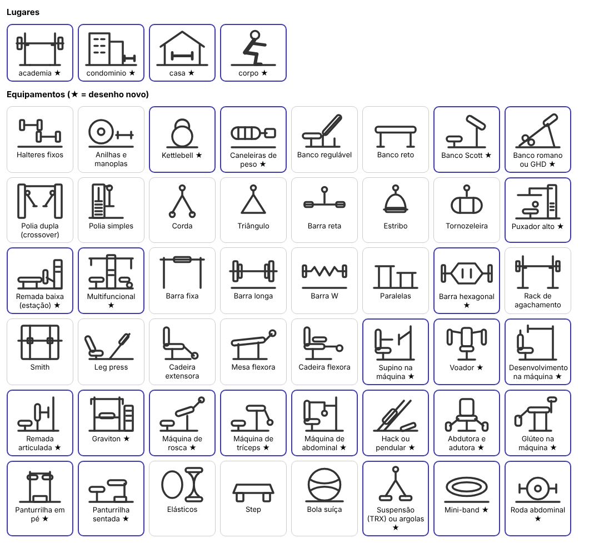
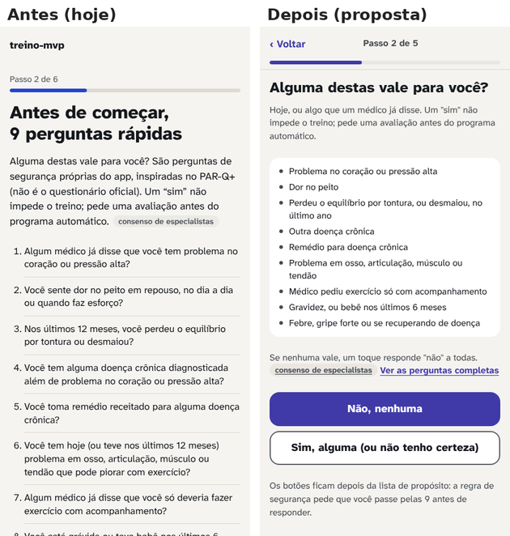
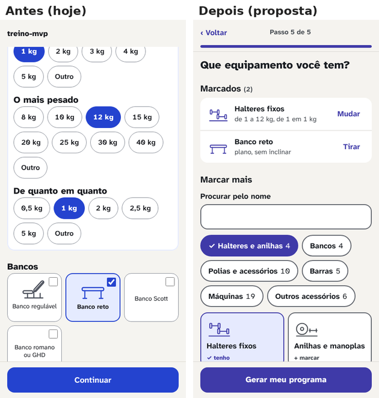
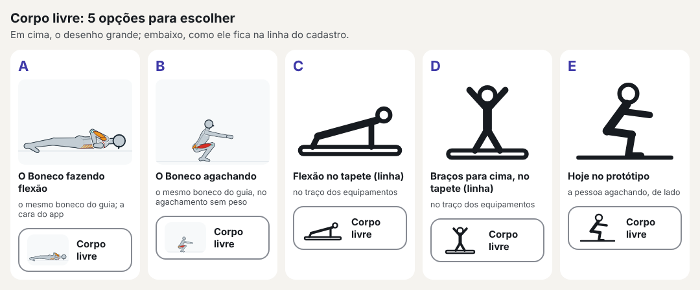
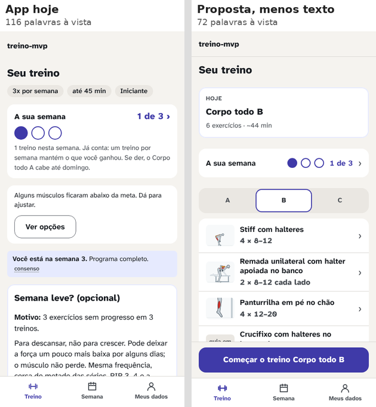
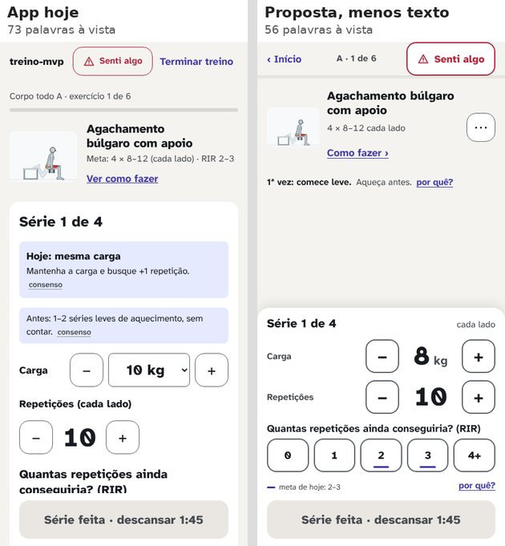
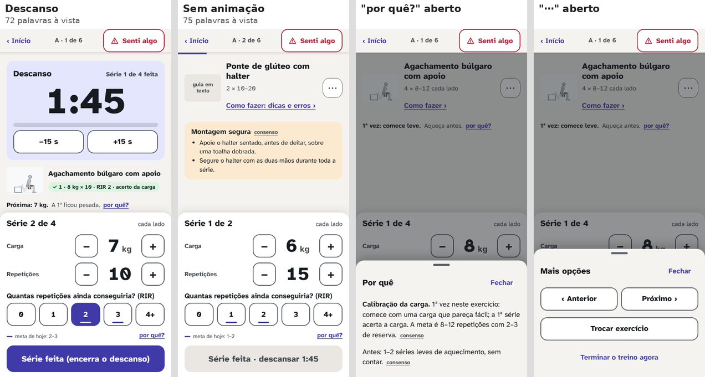
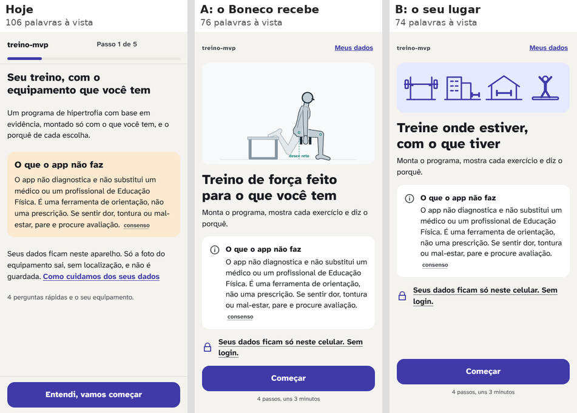
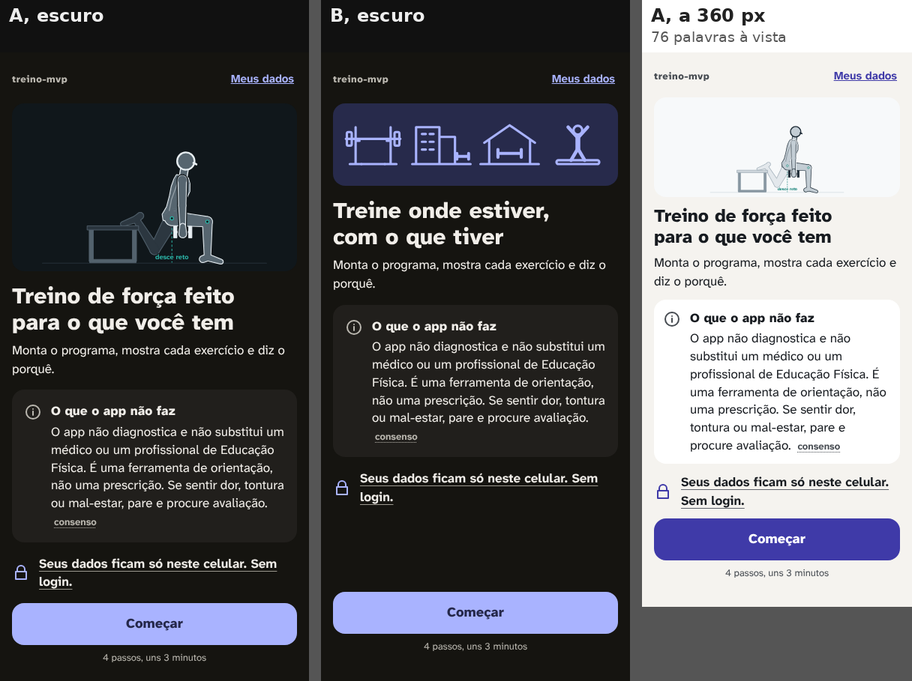

# Redesign do treino-mvp: a proposta (06/11/2026)

> Síntese dos 5 relatórios dos agentes (`agente-1-retencao.md` a `agente-5-cor.md`), das medidas do app de hoje (`medidas.md`, `antes/`) e do protótipo (`prototipo/`, também publicado como Artifact: https://claude.ai/artifact/5U6uCLS7wT6GsUHYCsQg56). Nada mudou no app: esta é a Fase 2. A crítica independente (agente 6) e a tabela de decisões vêm nas Fases 3 e 4.
>
> Marcas: **[medido]** (por script, neste clone), **[fonte: ..., selo]** (selos de `docs/pesquisa/00-metodo.md`; norma técnica como consenso), **[opinião]**. Quando a afirmação vem de um relatório, o relatório está citado; as fontes completas ficam nele.

## Em uma frase

O app de hoje passa em todos os testes de toque e contraste, mas na academia ele esconde o que a pessoa acabou de pedir: o "Senti algo" abre fora da tela, a reserva (RIR) da 1ª série fica atrás do botão, o descanso cobre a próxima série, o "Começar" do início fica fora da 1ª tela, e o guia começa com o Boneco no meio da tela. A proposta refaz a **estrutura** (o que fica fixo, o que abre por cima, a ordem das mensagens) e dá ao app uma **identidade** própria, com menos peças e as mesmas regras.

## 1. Como foi feito

- **Fase 1 (medir e pesquisar):** 5 agentes em paralelo, cada um com um briefing (`briefings/`) e sem a hipótese do orquestrador. Ao todo: 300 telas do app de hoje capturadas por script (6 personas, claro, escuro e 360 px), 248 estados do treino em 4 tamanhos, 32 percursos do cadastro, o inventário de 113 variantes de componentes, 27 pares de cor em 4 paletas e 3 simulações de daltonismo, e o Lighthouse por rota. Cada relatório foi conferido contra os dados brutos antes de entrar (os números citados aqui foram recontados).
- **Fase 2 (sintetizar e prototipar):** esta proposta e o protótipo, gerado a partir do próprio app: o programa da Ana sai do gerador real, os textos de regra e de segurança saem dos módulos do app e o Boneco sai do motor, sem mudança (`scripts/design/redesign/prototipo/gerar.mjs`).
- **Reproduzir:** os comandos estão em `medidas.md`; o protótipo, em `npx vite-node scripts/design/redesign/prototipo/gerar.mjs` e `npx playwright test -c scripts/design/redesign/prototipo/playwright.config.ts`.

## 2. O que medi no app de hoje (o ponto de partida)

| O que | Resultado | Onde |
|---|---|---|
| Toque abaixo de 44 px, contraste abaixo da WCAG, rolagem lateral | 0 nas 300 telas | `antes/medidas-*.json` |
| "Senti algo" visível sem rolar | 100% dos estados do treino | agente 3, 2.1 |
| O painel que "Senti algo" e "Trocar exercício" abrem | **fora da tela em 24 de 24 casos** | agente 3, achados A e G |
| A reserva (RIR) da 1ª série, obrigatória para salvar | **atrás do "Série feita" ou fora da tela em 24 de 24 casos** | agente 3, achado C |
| Descanso | cobre o registro da série seguinte; **2 toques obrigatórios por série** | agente 3, achado D |
| Montagem segura no exercício sem animação | **recolhida por padrão no treino** (fere "o que não muda") | agente 3, achado H; conferido em `CartaoTexto.tsx` |
| Tela acesa | só no descanso; apaga durante a série | agente 3, achado E; conferido em `Temporizador.tsx` |
| "Terminar treino" | a 4 px do "Senti algo", sem confirmação | agente 3, achado B |
| "Começar" do início visível ao abrir | **2 de 10 estados no Pixel 7, 1 de 10 a 360 px** | agente 1, recontado |
| Mensagens com o mesmo peso no topo do início | 4, e o aviso de meta em todos os 10 estados | agente 1, 2.3 |
| Cadastro, sem condição de saúde | 10 a 14 toques, 0 caractere; ~470 palavras a ler antes do equipamento | agente 2, recontado |
| Guia aberto pelo treino | palco a 55–89% da altura (412), metade fora a 640 px; modos e dicas só rolando; sem "Senti algo" | agente 3, 2.3 |
| Variantes de componentes | ~113; 19 tamanhos de letra (até 12 numa tela), 17 espaços, 16 cantos | agente 4, recontado no CSS |
| Selo de evidência | não abre nada no celular (a regra fica num `title`) | agente 4, 4.7 |
| Lighthouse, desempenho (celular simulado) | **59 a 73**, abaixo da meta de 90 em todas as rotas | `medidas.md` |
| Lighthouse, acessibilidade | 93 a 100 | `medidas.md` |
| Letra | 3 pedidos ao Google Fonts por visita, 55,6 kB | `antes/base.json`, agente 5 |

## 3. Os princípios (poucos, cada um com fonte ou marcado como opinião)

1. **O que a pessoa toca mora embaixo; o que ela abre aparece na hora, por cima.** A série inteira (carga, repetições, RIR e "Série feita") fica num painel preso embaixo; "Senti algo", troca, detalhes e fontes abrem numa folha que sobe e nunca abre fora da tela. *[fonte: Bergstrom-Lehtovirta e Oulasvirta 2014, um estudo; MacKenzie 1992 (Fitts), robusta; medido: 24 de 24 painéis fora da tela hoje]*
2. **Segurança no mesmo lugar, sempre.** "Senti algo" no topo direito de toda tela do treino e do guia aberto pelo treino, com 56 px de altura e nada destrutivo a menos de 16 px; nenhuma folha ou diálogo cobre o botão. A montagem segura nunca vem recolhida. *[fonte: Hoober 2017, um estudo (afastar o perigoso); regra do projeto]*
3. **Os números são lidos de longe.** Relógio 88 px, carga e repetições 44 px, o fim do descanso escrito em 32 px (não só a cor). *[fonte: Legge e Bigelow 2011, robusta (0,2° de altura do "x"); medido: a um braço, hoje só relógio, carga e repetições se leem]*
4. **Uma coisa por vez, também nas mensagens.** No cadastro, uma pergunta por tela (já é assim). No início, um cartão "Hoje" e no máximo uma oferta por abertura; no fim do treino, primeiro "o que mudou hoje". *[fonte: GOV.UK "Question pages", consenso; Hick-Hyman, robusta; Harkin 2016, moderada (mostrar o progresso)]*
5. **A evidência fica e passa a abrir.** O selo continua ao lado de toda regra, com o mesmo texto; um toque mostra a regra, o que o selo quer dizer e as fontes. *[princípio do projeto; NN/g "Progressive disclosure", consenso]*
6. **Menos peças, uma identidade.** 16 componentes, 7 tamanhos de letra, 6 espaços, 3 cantos; uma cor de ação longe das cores do Boneco. *[fonte: Reinecke 2013, um estudo (complexidade visual); medido: agente 4 e agente 5]*
7. **Motivação sem manipulação.** Sem sequência, medalha, confete ou notificação. O que mantém é o registro, a meta e o retorno sobre o próprio progresso, que o app já faz. *[fonte: Mazeas 2022, moderada; Silverman e Barasch 2023, um estudo; posição do projeto em `design-v2.md` §2]*

## 4. Conflitos entre os relatórios e como resolvi

| # | Conflito | Decisão | Motivo |
|---:|---|---|---|
| 1 | Relógio: 64 px (agente 4, escala única) × 80 a 96 px (agente 3, leitura de longe) | **88 px** | A conta de distância do agente 3 (Legge e Bigelow, robusta) pesa mais que a regularidade da escala; o "+0:04" cabe a 360 px com algarismos de largura igual [medido no protótipo]. |
| 2 | Números da série: 40 px (agente 4) × repetições 44 e carga 32 (agente 3) | **44 px para os dois** | Um degrau só; a carga também é lida de longe [opinião]. |
| 3 | Descanso: folha embaixo (agente 4) × painel no topo, com o registro à vista e "Série feita" que encerra o descanso (agente 3) | **o do agente 3** | Medido: de 2 para 1 toque obrigatório por série; 0 estado em que o descanso cobre o registro. |
| 4 | Cabeçalho do treino: "Sair · 1 de 6 · Senti algo" (agente 4) × tirar o "Terminar" do topo (agente 3) | **"‹ Início" à esquerda (sai sem terminar; o treino fica salvo), "Senti algo" à direita; "Terminar" no fim da página, com confirmação** | Junta os dois: a saída fica longe do botão de segurança, e o gesto destrutivo pede confirmação. |
| 5 | Texto do selo: curto nos esboços (agente 4) × longo hoje | **manter o texto de hoje** | `00-metodo.md`: "o texto exibido repete o selo da regra" (recomendação do próprio agente 4). |
| 6 | Objetivo e prioridades: perguntar na 4ª semana (agente 1) × tirar ou manter no cadastro (agente 2) | **Objetivo sai do cadastro (Meus dados e uma oferta depois do 1º treino); prioridades ficam** | Sem prioridades, o Bruno cai de 83 para 60 séries por semana e a Carla de 107 para 66 [medido, recontado]; o objetivo só muda números em "força" para quem não é iniciante. |
| 7 | Folhas no treino × "Senti algo" sempre à vista | **toda folha e diálogo do treino abrem abaixo do cabeçalho** | Medido no protótipo: "Senti algo" visível e não coberto em todos os estados, inclusive com folha ou diálogo aberto, a 412, 360 e 640. |
| 8 | Alerta de saúde com a mesma cor da faixa de erro do palco (agente 5) | **separar por forma e lugar; o alerta muda de tom (vinho)** | Entre vermelhos não há espaço sem chegar perto dos músculos; a cor do palco não muda. |
| 9 | Estados no escuro: mais longe do Boneco (agente 5) × mais contraste ao sol (agente 3, opinião) | **os do agente 5, como proposta, e o item vai para a decisão** | Os novos ficam entre 5,4 e 7:1 (acima do mínimo); o ganho de distância ao Boneco é medido, o do sol é opinião. |

## 5. O sistema visual

### Cor: três direções; a preferida do Gustavo é Giz e grafite
As três passam nos 27 pares medidos nos dois temas; os estados (feito, atenção, alerta) são iguais nas três. Muda o fundo neutro e a cor de ação. Detalhe, razões e simulações em `agente-5-cor.md`. O agente 5 recomendou Ameixa; o Gustavo, ao ver o protótipo, preferiu **Giz e grafite** (06/11), que passou a ser a cor padrão do protótipo. A barra de cima ainda troca a direção.

| Direção | Ação (claro / escuro) | Botão principal | O que perde |
|---|---|---|---|
| **Giz e grafite** (a preferida do Gustavo) | `#3F3AA8` / `#A9B3FF` | 8,82:1 / 7,14:1 | é a mais próxima do app de hoje; a ação fica a 8,7 do azul da trajetória do Boneco (Ameixa: 12,7). Continua azul para os daltônicos |
| Ameixa (recomendada pelo agente 5) | `#722987` / `#DFA1F3` | 8,81:1 / 7,13:1 | para daltônicos vermelho-verde a ameixa vira azul (a função fica) |
| Petróleo | `#045260` / `#60C7DD` | 8,82:1 / 7,13:1 | encosta nas juntas do Boneco; vira cinza para protanopes |


O palco do Boneco usa as cores de sempre (`--stage`, `--fig`, `--mus-p`...): nenhuma muda.

### Letra
Fica a **Atkinson Hyperlegible Next**: tem algarismos de largura igual (medido), licença OFL e pode ser servida pelo próprio app num arquivo variável de 34 kB, no lugar de 3 pedidos ao Google (55,6 kB). O ganho é não depender do Google nem do cache do navegador (o crítico mediu: o app de hoje, sem internet, já mostra a letra pelo cache).

| Degrau | Tamanho / peso | Uso |
|---|---|---|
| Relógio | 88 / 800 | só o descanso |
| Número | 44 / 800 | carga, repetições, números do fim e da semana |
| Título | 24 / 800 | um por tela |
| Pergunta | 20 / 700 | perguntas, seções, nome do exercício |
| Corpo | 17 / 400 (700 em botão) | texto, botões, opções |
| Apoio | 15 / 400 | ajuda, segunda linha |
| Rótulo | 13 / 700 | passo, barra inferior, selo |

Nunca abaixo de 13 px; campo nunca abaixo de 16 px (zoom do iPhone).

### Espaço, canto, toque
Espaço **4 · 8 · 12 · 16 · 24 · 32**; canto **8 · 16 · pílula**; borda **1 e 2 px**; toque **48** (chip, segmentado, barra), **56** (botão, opção, linha, RIR, "Senti algo") e **64** ("Série feita", barra inferior). O piso continua 48.

### As 16 peças
Cabeçalho (de passo, de casa, de tarefa) · barra inferior · base fixa · botão (primário, secundário, terciário, perigo) · superfície (neutra, informação, aviso, alerta, feito) · lista de linhas · opção em linha · chip · segmentado · cartão de equipamento · campo · stepper · pílula e selo · progresso · recolher · folha e diálogo. Cada uma com os estados normal, pressionado ou escolhido, desabilitado, foco e, onde houver, erro e carregando; nada depende só da cor. A tabela de antes e depois está em `agente-4-organizacao.md`, 4.3.

### Movimento
Resposta ao toque no mesmo quadro (menos de 100 ms); folha e diálogo em 200 ms; nenhuma troca de tela automática; tudo desligado com `prefers-reduced-motion`; nenhuma espera acima de 1 s sem dizer o que está acontecendo (a foto mostra as etapas reais). *[fonte: Nielsen 1993 e NN/g "Response Times", consenso; Giroux 2019, um estudo; regras do agente 2, seção H]*

### Navegação
```
SEM BARRA (tarefa)                              COM BARRA [Treino | Semana | Meus dados]
Boas-vindas → Saúde → Experiência → Rotina      Início (Treino): cartão "Hoje", semana, 1 mensagem, dias,
  → Equipamento ("Gerar meu programa")            lista; o exercício abre uma folha; "Começar" fixo
Treino: ‹ Início · A · 1 de 6 · Senti algo      Semana → Evolução (a barra fica, Semana acesa)
  ├─ Ver como fazer → Guia (‹ Treino · Senti algo)   Meus dados → Locais (a barra fica)
  ├─ Senti algo, Trocar: folhas abaixo do cabeçalho
  └─ Terminar (confirma) → Fim → Semana
```

## 6. Tela a tela: o antes e o depois

O protótipo tem 32 telas e estados. Abaixo, as que mais mudam; todas as imagens estão em `img/ad-*.png` (claro, e as do treino também no escuro e a 360 px).

### Treino (o foco a)
- **Série:** o painel da série fica preso embaixo, com carga, repetições, RIR e "Série feita" sempre à vista; acima, o exercício e a sugestão com selo (rolam se faltar espaço). **Medido no protótipo:** "Série feita", RIR e "Senti algo" à vista e não cobertos em 100% dos estados de série, a 412 × 839, 360 × 740 e 412 × 640 (hoje o RIR fica escondido em 24 de 24 casos).
- **Descanso:** o relógio de 88 px vai para o topo do conteúdo; o registro da próxima série continua embaixo, já preenchido, e "Série feita" encerra o descanso. Quando o tempo acaba, a cor **e** o texto mudam ("Hora da próxima série", 32 px); não pede "Ok".
- **Senti algo e Trocar:** folhas que sobem por cima, abaixo do cabeçalho. Os 7 sinais e a escala de dor em duas fileiras de 56 px; os textos de segurança são os de hoje.
- **Exercício sem animação:** a montagem segura aparece sempre, com o selo; dicas e erros abrem numa folha sem empurrar o registro.
- **Terminar:** sai do topo e pede confirmação.
- **Tela acesa** durante todo o treino, pedida de novo quando o app volta (não aparece em imagem; vai para o teste e2e).


### Guia (o foco a)
O palco do Boneco no topo, de borda a borda (412 × 309); logo abaixo, tocar, lento e a vista; os 4 modos numa barra de 56 px e, colado nela, o que o modo mostra (legenda, a lista de erros); depois as 3 dicas em 20 px e a montagem, aberta. "Senti algo" no cabeçalho. O desenho do Boneco é o do motor.


### Cadastro (o foco b)
- 6 → 5 telas: o "Tudo certo?" sai; o botão do equipamento vira "Gerar meu programa", e o programa abre com "Montado para: ... Mudar".
- Boas-vindas com cerca de metade do texto e o botão à vista; o aviso de segurança intacto.
- **Saúde em uma pergunta** (retorno do Gustavo, 06/11): "Alguma destas vale para você?", com as 9 condições escritas em poucas palavras logo abaixo; "Não, nenhuma" segue com 1 toque, e "Sim, alguma (ou não tenho certeza)" leva à tela em que a pessoa marca só as que valem, cada uma com a pergunta completa embaixo (de 29 para 18 toques no caminho do Bruno com dor). As perguntas completas também ficam a um toque na 1ª tela. Muda a regra `seguranca.triagem.nenhuma` e cria 9 textos curtos de segurança: ver a seção 12.
- O objetivo sai para depois; as prioridades ficam.
- Equipamento: "Onde você treina?" primeiro, com 4 desenhos novos (o "Corpo livre" é uma pessoa, não mais um boneco de palito solto); "Academia completa" diz em 1 linha o que supôs; "Item por item" abre a lista refeita: primeiro o que está marcado (com "Mudar" e "Tirar"), depois uma busca pelo nome, as categorias como chips e uma grade de cartões em 2 colunas que dizem "tenho" quando marcados. A foto mostra as etapas reais e deixa usar a lista enquanto analisa.
- Toques por persona, hoje → proposto (contando o "Gerar" fora do equipamento, como o teste conta hoje): Ana 12 → 11, Bruno 17 → 14, Carla 14 → 13, Diego 12 → 11, Elisa 10 → 9, Fábio 11 → 10 (agente 2, recontado).


### Início, fim do treino e semana (o foco c)
- **Início:** um cartão "Hoje" no topo, com a fase dentro dele; a faixa da semana em 1 linha; no máximo 1 oferta por abertura, as outras em "Mais 2 avisos"; "Começar" preso embaixo em qualquer estado. A volta depois de uma pausa vira o próprio cartão de hoje.
- **Fim do treino:** primeiro "O que mudou hoje" (a semana já no estado novo, o recorde, quantas cargas sobem), depois "Hoje foi" e "Para a próxima vez".
- **Semana:** o dado antes da oferta: treinos da semana, últimas 8 semanas, o que subiu, séries por músculo (cheio é feito, tracejado é a meta, o número escrito) e só então as ofertas.
- **Evolução:** o resumo em 1 linha em cima ("de 8 kg × 10 a 9 kg × 12 em 5 treinos").


### O resto (o foco d)
Meus dados em 3 grupos de linhas, com "Apagar todos os dados" por último e confirmado num diálogo; Locais com a barra inferior; os 24 ícones de equipamento que faltam desenhados no traço de hoje, com o nome sempre escrito (até lá, um contorno tracejado).

## 7. Medidas do protótipo

`depois/medidas-*.json`, pelas mesmas regras de `scripts/design/medir.ts`. A tabela abaixo é a da Fase 2; depois da crítica, as medidas passaram a cobrir 7 cenários (320 px, zoom de 200% e letra a 125% entraram), todos limpos: ver a seção 13.

| Medida | Claro 412 × 839 | Escuro | 360 × 740 | 412 × 640 |
|---|---:|---:|---:|---:|
| Telas e estados | 32 | 32 | 32 | 32 |
| Com toque abaixo de 44 px | 0 | 0 | 0 | 0 |
| Com contraste abaixo da WCAG | 0 | 0 | 0 | 0 |
| Que rolam de lado | 0 | 0 | 0 | 0 |
| Estados do treino com "Senti algo" à vista e não coberto (com o guia) | 8 de 8 | 8 de 8 | 8 de 8 | 8 de 8 |
| Estados de série com "Série feita" e RIR à vista e não cobertos | 4 de 4 | 4 de 4 | 4 de 4 | 4 de 4 |
| Altura da tela ocupada pelo painel da série | 49% | 49% | 59–60% | 64% |

O que **não** dá para medir no protótipo e fica para a implementação: o tempo de resposta real, o Lighthouse (o protótipo não tem o motor rodando nem o pacote do app), a tela acesa, e a cronometragem do cadastro no celular (fim do lote do cadastro, decisão de 05/11).

## 8. Pedidos ao domínio e ao estado guardado (decisões separadas)

| # | Pedido | De onde | Teste que o valida |
|---:|---|---|---|
| 1 | `fontes.json` (as fontes por extenso, de `docs/pesquisa/fontes.md`), para o selo abrir a referência | agente 4 | toda chave de `regras.json` existe no arquivo |
| 2 | Dias planejados (`rotina.diasPlanejados`, versão 8 do estado, com migração) para "hoje é dia de treino" | agente 1 | Ana com seg, qua, sex e hoje quinta → "próximo: sexta" |
| 3 | Marcas por sessão e por semana (recorde, subiu a carga) para o fim do treino e a semana | agente 1 | o caso E1 de `pesquisa-v2/07` |
| 4 | Resumo curto da calibração e da sugestão (opcional; sem ele, o texto inteiro rola acima do registro) | agente 3 | até 40 caracteres e o mesmo `regraId` |
| 5 | `restricoes` ausente vale como listas vazias (para "algo a evitar" sair do cadastro), sem versão nova | agente 2 | estado v7 sem `restricoes` gera o perfil |

Os pedidos 2 a 4 mudam ou acrescentam domínio; nenhum entra num lote de design sem decisão própria.

## 9. Fora do escopo dos agentes, mas medido: o desempenho

O Lighthouse de hoje dá 59 a 73 de desempenho no celular simulado, abaixo da meta de 90 do pedido. A causa medida é o processamento do JavaScript (de 1,4 a 5,1 s de bloqueio), não a rede: o app é um pacote único de 1 MB, com o motor do Boneco e a biblioteca em todas as telas. **Proposta [opinião, com custo medido depois]:** carregar o motor do Boneco e o guia só quando a tela pede (o próprio Vite faz isso, sem dependência nova), e servir a letra pelo app. É um lote técnico à parte, com medida antes e depois.

## 10. O que não fazer (juntado dos 5 relatórios)

- Sequência que quebra, medalha, confete, ranking, notificação de ausência ou "faz X dias" (agente 1, seção 5).
- Avanço automático entre telas e respostas pré-marcadas (agente 2).
- "Senti algo" embaixo, misturado aos controles da série (agente 3).
- Furar o modo silencioso do iPhone para o bipe tocar; gestos de arrastar para registrar (agente 3).
- Menu escondido, ícone sem rótulo, recolher dentro de recolher, folha sobre folha (agente 4).
- Marca laranja, vermelha ou verde; escolher cor por "psicologia" (agente 5).
- Encurtar texto de segurança ou de regra com selo para ganhar espaço (todos).

## 11. Riscos e o que eu não sei

- **Ninguém de verdade usou nada disto.** São medidas de robô, modelo e opinião com fonte. O Gustavo decide pelas imagens (decisão de 05/11); o teste com uma mão vem no app real, lote a lote.
- **O painel da série preso embaixo ocupa 49% da tela no Pixel 7, 60% a 360 px e 64% a 412 × 640** [medido]. O exercício e a sugestão rolam acima dele. Medi que os controles ficam à vista; não medi se a pessoa estranha ler a sugestão rolando [opinião].
- **A cor Ameixa** é gosto antes de ser medida: a medida diz que ela funciona; não diz que agrada. Roxo tem associação cultural de gênero para algumas pessoas (agente 5, sem dado).
- **Tela acesa no iPhone instalado** só a partir do iOS 18.4 (agente 3, caniuse); antes disso, um aviso único.
- **Fontes:** a maior parte foi lida só pelo resumo (o PubMed segue bloqueado); cada relatório lista as que não conseguiu verificar.
- **O tamanho do trabalho:** é uma reescrita de `src/features/` (~5.950 linhas) e `src/styles.css`, em lotes. A estimativa por lote vai na tabela de decisões.

## 12. O retorno do Gustavo sobre o protótipo (06/11) e o que mudou

| O que ele disse | O que mudou no protótipo |
|---|---|
| "Não quero nada com essa barrinha lateral, que é claramente de IA." | Os avisos e alertas perderam a faixa colorida da esquerda; ficam só no tom do fundo, com o título em negrito. |
| "Não quero tantas perguntas seguidas, como as 9 perguntas rápidas; quero uma pergunta geral, mais rápida." | A saúde virou uma pergunta só, com as 9 condições em poucas palavras embaixo. Quem não tem nenhuma responde com 1 toque; quem tem marca só as que valem na tela seguinte. |
| "O desenho do Corpo livre está muito ruim." | Os 4 desenhos do "Onde você treina?" foram refeitos no mesmo traço; o "Corpo livre" é uma pessoa inteira, de braços e pernas abertos. |
| "A parte de conferir a lista dá para melhorar." | A lista virou: o que está marcado em cima (com "Mudar" e "Tirar"), a busca pelo nome, as categorias como chips e uma grade de 2 colunas com o estado escrito ("tenho"). |
| "A cor que eu mais gostei foi Giz e grafite." | Giz e grafite virou a cor padrão do protótipo; Ameixa e Petróleo continuam na barra de cima para comparar. |
| 2ª rodada: "o desenho do Corpo livre está meio ruim; no item por item, alguns não têm desenho e não é fácil identificar." | Os 4 lugares foram redesenhados de novo, na mesma área dos desenhos de equipamento; o Corpo livre é uma pessoa agachando, vista de lado. Os **24 equipamentos sem desenho ganharam um**, no traço dos 25 de hoje, e a lista do protótipo passou a usar os 48 itens e as 6 categorias do app (com o nome completo para o leitor de tela). A folha de aprovação está em `img/icones-equipamento.png` (★ = desenho novo); cada desenho novo passa pela sua aprovação antes de ir para o app. |
| 2ª rodada: "no treino, quando começa, o texto parece cortado pelo telefone (o 4 × 8–12 cada lado)." | Era um defeito do protótipo: na lista de exercícios do início, a miniatura do Boneco ocupava a largura da linha inteira e empurrava o texto para fora do cartão. Corrigido. O script de medidas ganhou uma checagem nova, "texto cortado" (que sai da tela ou do cartão), que pega esse defeito em 6 telas da versão anterior e em 0 da atual. A checagem antiga de rolagem lateral não pegava, porque o cartão escondia o excesso. |

**Ressalva sobre a pergunta geral da saúde [opinião, com base no projeto].** As 9 perguntas existem porque uma pergunta geral sozinha deixa passar quem não se reconhece nela (pressão alta controlada, remédio de uso contínuo); é a razão de o app seguir o estilo do PAR-Q+ (`docs/pesquisa/07-seguranca-triagem-niveis.md`). Por isso a pergunta geral mostra as 9 condições escritas, em poucas palavras, e "não tenho certeza" conta como "sim". O que muda de regra, para a decisão do Gustavo na tabela:
- `seguranca.triagem.nenhuma`: hoje a pessoa vê as 9 perguntas inteiras antes do "Nenhuma vale para mim"; na proposta, vê as 9 condições em forma curta (as inteiras ficam a um toque e reaparecem na tela do "sim").
- 9 textos curtos novos de segurança, escritos por mim a partir das perguntas do app, sem mudar o conteúdo. A revisão de um profissional de Educação Física continua de lado, por decisão anterior do Gustavo (`docs/backlog.md`).
- Nada muda no bloqueio, na liberação, na dor por região nem no estado guardado: as respostas continuam as mesmas 9, com "não" nas que não forem marcadas.

**Medido depois do retorno:** as 32 telas continuam com 0 toque abaixo de 44 px, 0 contraste baixo, 0 rolagem lateral e 0 texto cortado, nos 4 tamanhos, e o "Senti algo" segue à vista em todos os estados do treino. A checagem de texto cortado vale também para o app, na implementação.






### Adendo da Fase 3 (06/11): o desenho do Corpo livre
O Gustavo ainda não gostou do desenho do Corpo livre (a pessoa agachando) e pediu para registrar como adendo da Fase 3. Fica **não aprovado**: volta com novas opções lado a lado, para a escolha dele, antes da tabela de decisões. Os outros 3 lugares e os 24 equipamentos novos seguem como proposta, também com aprovação item a item.

As 5 opções, lado a lado, com o desenho grande e como ele fica na linha do cadastro (`scripts/design/redesign/prototipo/opcoes-corpo-livre.mjs`): **A** o Boneco do motor fazendo flexão e **B** agachando sem peso (o mesmo quadro das miniaturas do app, sem mudar o desenho); **C** flexão no tapete e **D** braços para cima no tapete, em linha; **E** o desenho de hoje no protótipo. [opinião] O Boneco dá ao cadastro a mesma cara do guia, mas a 64 px a flexão vira uma linha deitada; entre os de linha, C e D se leem melhor nesse tamanho.



## 13. A crítica independente (Fase 3)

O agente 6 avaliou o protótipo e os 5 relatórios sem ler esta proposta (`agente-6-critica.md`). Os testes automáticos já passavam (0 violação WCAG A/AA no axe-core em 60 telas), mas ele achou 3 problemas que **bloqueiam** e 6 **graves**, quase todos onde nenhum agente tinha medido: 320 px, zoom de 200%, teclado e leitor de tela. Conferi cada um nos dados dele e todos se sustentam.

### O que foi corrigido no protótipo

| # | Problema (gravidade) | Correção | Medido depois |
|---|---|---|---|
| B1 | Treino a 320 px rolava de lado; com zoom de 200%, "Senti algo" cortado, relógio coberto e o painel da série com 91% da tela (bloqueia) | O painel da série só fica preso embaixo quando cabe (até 55% da altura); se não, volta à página e só o "Série feita" fica fixo. Abaixo de 360 px, o cabeçalho quebra em 2 linhas e os botões em coluna; o relógio e os números acompanham a largura. Abaixo de 280 px (zoom), saem os desenhos de apoio e as fileiras quebram | 320 × 640 e 206 × 420: 0 rolagem lateral; "Senti algo", "Série feita" e relógio inteiros em todos os estados; a parte fixa cai de 78% para 13% (320) e de 91% para 31% (zoom) |
| B2 | Triagem: botões fixos; com zoom, 2 das 9 condições ficavam atrás do "Não, nenhuma" (bloqueia) | Os botões voltam a ficar depois da lista, como no app de hoje | A 9ª condição passa antes do botão a 320 e 360 px |
| B3 | O foco do teclado ficava atrás do painel fixo em 25 de 168 alvos (bloqueia, WCAG 2.4.11) | `scroll-padding` na altura das barras fixas, recalculado a cada tela | 0 de 160 alvos cobertos |
| G1 | Na tela "Quais valem", o "não" era implícito (grave) | Ao continuar, um diálogo lista as não marcadas, com a pergunta completa: "Nenhuma destas vale para você?" (+1 toque). Nada vem marcado; a região da dor só aparece com "osso, articulação, músculo ou tendão" marcado. A tontura perdeu o "forte" ("Perdeu o equilíbrio por tontura, ou desmaiou, no último ano"), e a frase "Um 'sim' não impede o treino; pede uma avaliação antes do programa automático" voltou à 1ª tela | O caminho com condição fica com 19 toques pela conta do agente 2 (18 + a confirmação; hoje são 29) |
| G2 | O fim do descanso não chegava ao leitor de tela (grave) | Uma região de status fala só 3 vezes: o início do descanso, "faltam 10 segundos" e "hora da próxima série"; o nome do exercício é o título também no descanso | — (o leitor de tela real fica para o teste no aparelho) |
| G3 | O foco escapava das folhas e diálogos (grave) | O resto da tela fica inerte e o Tab dá a volta dentro da folha; no treino, o "Senti algo" do cabeçalho continua no laço. A ordem dos diálogos mudou: a ação que não perde nada vem primeiro e cheia | Tab fora da folha: 0 de 30 fora do treino; no treino, só o "Senti algo" (de propósito) |
| G4 | A letra do sistema não aumentava nada (247 medidas em px, 0 em rem) (grave) | Letras e alturas de toque em rem | Com a letra a 125%: 0 toque pequeno, 0 contraste baixo, 0 texto cortado |
| G5 | Ao sol, a borda dos controles caía abaixo de 3:1 com 10% de reflexo (grave) | Borda mais escura no Giz e grafite: `#5F636B` no claro, `#9C998F` no escuro | 0 contraste baixo nos 7 cenários |
| P1, P2, P4, P5, P7 | Selo com alvo pequeno; ordem dos botões nos diálogos; rótulos; "Série feita" desligado sem dizer por quê; cabeçalho cortado (pequenos) | Área de toque invisível de 44 px no selo; ordem trocada; lista de séries como lista e miniatura muda quando o nome está ao lado; o motivo do botão desligado para o leitor de tela; cabeçalho que quebra | — |

**As medidas do protótipo agora cobrem 7 cenários** (claro e escuro no Pixel 7, 360 × 740, 412 × 640, 320 × 640, zoom de 200% e letra a 125%), 224 capturas: 0 toque abaixo de 44 px, 0 contraste baixo, 0 rolagem lateral, 0 texto cortado e 0 alvo com o foco coberto; "Senti algo" e "Série feita" à vista em todos os estados do treino. A reserva (RIR) fica à vista sem rolar nos 4 cenários de 360 px para cima; a 320 px e com zoom, o painel volta à página e a reserva pede rolar.

### Onde discordei do crítico, e por quê
- **G3, a folha modal com o próprio "Senti algo":** ele propôs o `<dialog>` modal do HTML e um "Senti algo" dentro de cada folha do treino. Isso deixaria 2 botões "Senti algo" na tela, um deles morto (o do cabeçalho, inerte atrás do diálogo). Preferi o contrário: no treino, a folha não é modal para o leitor de tela, o cabeçalho continua vivo e o Tab passa por ele. O risco que fica é o que ele mesmo marcou como não testado: como o VoiceOver e o TalkBack tratam isso no aparelho. Vai para o teste e2e e para o teste no celular do Gustavo.
- **B1, o limite do painel preso:** ele sugeriu soltar o painel acima de ~45% da altura; usei 55%. Com 45%, a 412 × 640 a reserva (RIR) sairia da tela, e mantê-la ao lado do "Série feita" é o achado C do agente 3 (hoje ela fica escondida em 24 de 24 casos). O preço: a 412 × 640, a parte fixa fica em 60% da tela. [opinião, com a medida dos dois lados]

### O que fica para decidir (não corrigido no protótipo)
- **G6, o orçamento do JavaScript:** a meta do crítico (o JS da 1ª tela abaixo de 150 kB comprimido e menos de 600 ms de bloqueio) vira o lote técnico da seção 9.
- **P3, o "Série feita" ativo no descanso com a reserva herdada:** um toque sem querer grava a série. As saídas são pedir a reserva de novo (+1 toque por série) ou um "Desfazer" por 5 s. Entra na tabela.
- **P6, a legenda dos músculos do guia:** vermelho e laranja se aproximam na protanopia e na deuteranopia; a cor é do Boneco, que não muda neste redesign.

### Afirmações dos agentes que não se sustentaram (registradas; os relatórios ficam como estão)
- **Agente 2:** o "não marcado vale não" seguiria a lógica do "Nenhuma vale". Listas de marcar dão menos "sim" que perguntar item a item (Smyth et al. 2006; Pew 2019); daí a confirmação do G1.
- **Agente 1:** "lembretes rendem 3,9% de abertura" é, na fonte, um aumento relativo de 3,9% na chance de registrar algo nas 24 h seguintes (Bidargaddi 2018); e "atrapalham o hábito" vem de um estudo só.
- **Agente 4:** "5 ícones cobrem 81% do uso" é uma ordem de prioridade, não uma parcela de uso (o próprio corpo do relatório diz isso).
- **Agente 5:** "Giz: nada se perde" no daltonismo exagera: o "Senti algo" perde o vermelho na protanopia e na deuteranopia (fica o ícone e o texto); o selo "um estudo" para o teste de sol do GSMArena é forte demais; e a letra servida pelo app não é um ganho "sem internet" (o cache já cobria), e sim não depender do Google.

## 14. Para decidir (Fase 4)

Cada linha traz o que muda, a evidência, o que muda de regra ou dado, o custo em lotes, o risco e a minha recomendação. **Nada vem marcado**: as escolhas são do Gustavo, na página de decisão (https://claude.ai/artifact/QoxRNuAZGvpUDTddzVXxf6, que guarda cada escolha) ou aqui. A tabela sai de `scripts/design/redesign/decisoes.mjs`, a mesma fonte da página.


### Sistema visual

| Item | O que muda | Evidência | Regra ou dado | Custo | Risco | Recomendo |
|---|---|---|---|---|---|---|
| **Cor: Giz e grafite** ([imagem](img/agente-5-giz.png)) | Fundo neutro levemente quente, ação em índigo (#3F3AA8 no claro, #A9B3FF no escuro), estados verde, ocre e vinho. As cores do palco do Boneco não mudam. | Contraste WCAG 2.2 medido em 27 pares nos 2 temas, todos passando; botão principal a 8,82:1 [medido, agente 5]. A escolha entre direções é de gosto: a "psicologia da cor" não tem base que se sustente [fonte: Elliot 2015, moderada]. | — | L1 · pequeno | É a mais próxima do app de hoje; a ação fica a 8,7 do azul da trajetória do Boneco (Ameixa: 12,7). | **Giz e grafite**: Foi a sua preferida no protótipo e passa em todos os pares medidos. |
| **Letra servida pelo próprio app** ([imagem](img/agente-5-letra.png)) | A Atkinson Hyperlegible Next fica, num arquivo de 34 kB dentro do app, no lugar de 3 pedidos ao Google Fonts (55,6 kB). | Algarismos de largura igual medidos no navegador; licença OFL conferida no arquivo oficial [medido e fonte, agente 5]. Menos 1 serviço externo por visita (LGPD: o IP não sai). | — | L1 · pequeno | Um caractere fora do latim cair na letra do sistema; um teste confere. | **Entra**: Menor, sem pedido externo e sem depender do cache do navegador. |
| **Menos peças: 7 tamanhos de letra, 6 espaços, 3 cantos, 16 componentes** ([imagem](img/agente-4-sistema.png)) | Os 19 tamanhos de letra, 17 espaçamentos, 16 cantos e ~113 variantes de botão, caixa e lista de hoje viram um conjunto só, com estados (escolhido, desabilitado, foco, erro). | Inventário medido no código [medido, agente 4]; complexidade visual pesa na primeira impressão [fonte: Reinecke 2013, um estudo]. | — | L1 · grande | Mexe em todo o CSS; feito por família de peça, com captura antes e depois de cada uma. | **Entra**: É o que faz o app parecer uma coisa só; sem isso, cada tela continua com o seu jeito. |
| **Letra que acompanha o celular, borda mais escura e avisos sem faixa lateral** | Letras e toques em rem (a letra grande do sistema passa a valer); borda dos controles #5F636B no claro e #9C998F no escuro (aguenta o reflexo do sol); avisos só com o fundo colorido. | Com a letra a 125%, 0 problema nas 32 telas [medido]; com 10% de reflexo, a borda de hoje cai para 2,6:1 e a nova fica em 3,8:1 [medido, agente 6; o reflexo é modelo dele]. | — | L1 · médio | A tela fica um pouco mais "riscada" [opinião]. | **Entra**: Corrige 2 achados graves da crítica e o que você pediu sobre a faixa. |
| **O selo de evidência passa a abrir a fonte** | A pílula continua ao lado de toda regra, com o mesmo texto; um toque abre uma folha com a regra, o que o selo quer dizer e as fontes. | Hoje a regra fica num "title", que o celular não mostra: o caminho até a fonte não se cumpre no aparelho [medido, agente 4]. | As fontes por extenso pedem o arquivo fontes.json (pedido ao domínio 1); sem ele, a folha mostra a regra e o significado do selo. | L1 · pequeno | — | **Entra**: Cumpre o princípio de evidência no celular sem pôr mais nada na tela. |

### Treino

| Item | O que muda | Evidência | Regra ou dado | Custo | Risco | Recomendo |
|---|---|---|---|---|---|---|
| **O painel da série preso embaixo** ([imagem](img/ad-treino-claro.png)) | Carga, repetições, reserva (RIR) e "Série feita" juntos, sempre à vista; acima, o exercício e a sugestão. Em tela baixa, com zoom ou letra grande, o painel volta à página e só o "Série feita" fica fixo. | Hoje a reserva da 1ª série fica escondida em 24 de 24 casos, e o botão fica cinza sem dizer por quê [medido, agente 3]; no protótipo, 4 de 4 estados com tudo à vista de 360 px para cima [medido]. | — | L2 · médio | O painel ocupa 49% da tela no Pixel 7 e 64% a 640 px de altura [medido]. | **Entra**: É o maior problema do treino de hoje, e o critério "Série feita à vista" passa a valer também para o uso. |
| **O descanso no topo e 1 toque por série** ([imagem](img/ad-treino-descanso-claro.png)) | O relógio de 88 px vai para o topo; o registro da próxima série continua à vista e "Série feita" encerra o descanso. No fim, a cor e o texto mudam ("Hora da próxima série"), sem pedir "Ok". O leitor de tela ouve 3 avisos. | De 2 para 1 toque obrigatório por série; na Ana, de 48 para 36 toques por treino [medido, agente 3]. | — | L2 · médio | Tocar "Série feita" sem querer durante o descanso (ver o item seguinte). | **Entra**: Menos toques no gesto que mais se repete no app. |
| **"Série feita" ativo durante o descanso: como proteger do toque sem querer** | Hoje o app já herda a reserva da série anterior, e o botão vem pronto para tocar. A crítica pediu uma proteção. | Achado P3 da crítica [lido no código, agente 6]. Não há estudo sobre isso [opinião]. | — | L2 · pequeno | (a) +1 toque em toda série; (b) um aviso a mais na tela. | **Desfazer por 5 s**: Protege sem custar toque nas séries normais [opinião]. |
| **"Senti algo" e "Trocar exercício" abrem por cima, na hora** ([imagem](img/ad-treino-senti-pequeno.png)) | Folhas que sobem abaixo do cabeçalho, com o foco preso dentro; o "Senti algo" do cabeçalho continua visível e alcançável com qualquer folha aberta. Os textos de segurança são os de hoje. | Hoje os dois painéis abrem fora da tela em 24 de 24 casos: quem toca não vê nada mudar [medido, agente 3]. | — | L2 · pequeno | Leitor de tela no aparelho (VoiceOver e TalkBack) ainda não testado [opinião, agente 6]. | **Entra**: Corrige o caminho de segurança, que hoje parece não responder. |
| **"Terminar" sai do topo e pede confirmação** | O topo fica com "‹ Início" (sai sem terminar; o treino fica salvo) e "Senti algo". Terminar vai para o fim da página e confirma ("Você fez 1 de 6 exercícios"). | Hoje "Terminar treino" fica a 4 px do "Senti algo" e encerra sem confirmar [medido, agente 3]; afastar o que é perigoso de outros alvos [fonte: Hoober 2017, um estudo]. | — | L2 · pequeno | +1 toque para terminar antes do fim. | **Entra**: Um toque errado no alto hoje encerra o treino. |
| **Tela acesa durante todo o treino** | O app pede a tela ligada ao entrar no treino e de novo quando volta para ele, e solta ao sair. Onde o celular não deixa, um aviso único. | Hoje só pede no descanso: a tela pode apagar no meio da série [lido em Temporizador.tsx, agente 3]; a trava se solta sozinha e precisa ser pedida de novo [fonte: MDN, consenso]. | — | L2 · pequeno | No iPhone com o app instalado, só a partir do iOS 18.4 [fonte: caniuse]. | **Entra**: Evita desbloquear o celular a cada série. |
| **Números que se leem de longe** | Relógio 88 px, carga e repetições 44 px, "Hora da próxima série" 32 px; algarismos de largura igual. O tamanho se ajusta em tela estreita. | A um braço de distância, hoje só relógio, carga e repetições se leem [medido, agente 3]; leitura a partir de 0,2° de altura da letra [fonte: Legge e Bigelow 2011, robusta]. | — | L2 · pequeno | — | **Entra**: O celular fica no banco entre as séries. |
| **Exercício sem animação: montagem segura sempre à vista** ([imagem](img/ad-treino-texto-claro.png)) | A montagem segura aparece sempre, com o selo; dicas e erros abrem numa folha sem empurrar o registro. | Hoje o cartão vem fechado no treino e esconde a montagem segura, o que fere uma regra de "o que não muda" [medido e lido no código, agente 3]. | — | L2 · pequeno | — | **Entra**: Corrige uma regra de segurança quebrada no app de hoje. |

### Guia

| Item | O que muda | Evidência | Regra ou dado | Custo | Risco | Recomendo |
|---|---|---|---|---|---|---|
| **Guia: o Boneco no topo e os controles logo abaixo** ([imagem](img/ad-guia-claro.png)) | Palco de borda a borda no topo; tocar, lento e vista numa fileira; os 4 modos numa barra de 56 px com o que o modo mostra colado nela; as 3 dicas em letra grande; a montagem aberta. Vindo do treino, "Senti algo" no cabeçalho. O desenho do Boneco não muda. | Hoje o Boneco começa no meio da tela (metade fora a 640 px), os modos e as dicas só aparecem rolando, e o guia não tem "Senti algo" [medido, agente 3]. | — | L2 · médio | A regressão visual do motor tem que ficar intocada (só muda a moldura). | **Entra**: O guia é a tela que ensina; hoje o que ensina fica abaixo da dobra. |

### Cadastro

| Item | O que muda | Evidência | Regra ou dado | Custo | Risco | Recomendo |
|---|---|---|---|---|---|---|
| **De 6 para 5 telas: o "Tudo certo?" sai** ([imagem](img/ad-equipamento-academia-claro.png)) | O botão do equipamento vira "Gerar meu programa"; o programa abre com "Montado para: ... Mudar" e, se houver, o resumo da dor da triagem com o selo. | O "Tudo certo?" é uma tela para 1 toque em 5 de 6 personas [medido, agente 2]; a página de conferência existe para quando o erro custa caro, e aqui tudo se muda depois [fonte: GOV.UK, consenso]. | Muda PASSOS e perfilDe() no estado guardado (sem versão nova); o teste de toques passa a contar o "Gerar". | L3 · médio | O resumo da dor sai de uma tela de confirmação para o topo do programa. | **Entra**: 1 tela e 1 toque a menos para todos, sem perder o resumo. |
| **Boas-vindas com metade do texto** ([imagem](img/ad-boas-vindas-claro.png)) | De 180 para cerca de 100 palavras, com o botão à vista; o aviso "O que o app não faz" fica intacto; a privacidade completa a um toque. | Leitura de ~238 palavras por minuto: a tela de hoje pede uns 45 s [fonte: Brysbaert 2019, robusta (resumo); medido, agente 2]. | — | L3 · pequeno | — | **Entra**: O primeiro minuto é o que mais desanima. |
| **Saúde em uma pergunta, com confirmação** ([imagem](img/ad-triagem-claro.png)) | "Alguma destas vale para você?", com as 9 condições em poucas palavras e a frase "um sim não impede o treino". "Não, nenhuma" segue com 1 toque; os botões ficam depois da lista. Quem marca "sim" escolhe só as que valem e confirma as não marcadas. | O caminho com condição cai de 29 para 19 toques [medido, agente 2 + a confirmação]. Listas de marcar dão menos "sim" que perguntar item a item [fonte: Smyth 2006; Pew 2019, um estudo cada]: por isso a confirmação. Parecer da crítica: aceitável com a confirmação, os botões depois da lista e a tontura sem o "forte", que o protótipo já tem. | Muda a regra seguranca.triagem.nenhuma e cria 9 textos curtos de segurança, escritos por mim a partir das perguntas do app. O bloqueio, a liberação e o estado guardado não mudam. A revisão de um profissional de Educação Física segue de lado, por decisão sua anterior. | L3 · médio | É o ponto mais sensível da proposta. | **Entra**: Foi o seu pedido, e a crítica considerou seguro com as 3 condições que já estão no protótipo. |
| **Objetivo e "algo a evitar" para depois do 1º treino** | O objetivo vai para Meus dados e uma oferta depois do 1º treino ("ganhar músculo" é o padrão); "algo a evitar" ganha uma entrada em Meus dados (hoje só dá para mudar refazendo o cadastro). | O objetivo só muda números em "ficar mais forte" para quem não é iniciante; "evitar" muda pouco o programa das personas [medido no gerador, agente 2]. | "Algo a evitar" opcional pede restricoes ausente = listas vazias (pedido 5, sem versão nova). | L3 · pequeno | O Bruno vê barra longa no 1º programa e troca no treino. | **Entra**: Uma pergunta a menos antes de ver um treino. |
| **As prioridades continuam no cadastro** | Nada muda: a pergunta de prioridades fica na rotina, opcional. | Sem elas, o Bruno cai de 83 para 60 séries por semana e a Carla de 107 para 66 [medido no gerador, agente 2, recontado]. | — | — | — | **Ficam no cadastro**: Mudam demais o primeiro programa de quem prioriza vários grupos. |
| **Equipamento: o lugar primeiro e a lista nova** ([imagem](img/ad-equipamento-lista-claro.png)) | "Onde você treina?" com 4 lugares desenhados; "Academia completa" diz em 1 linha o que supôs; "Item por item" mostra o que está marcado, a busca pelo nome, as categorias e uma grade com "tenho"; a foto mostra as etapas reais e deixa usar a lista enquanto analisa. | Hoje: de 4,4 a 5,9 alturas de tela e 55 a 76 alvos abertos de uma vez; "Academia completa" não mostra o que supôs sem rolar 2,5 telas [medido, agentes 2 e 4]. | — | L3 · médio | Quem quer conferir tudo abre várias categorias; a contagem escrita ajuda. | **Entra**: Foi o ponto que você mais pediu para melhorar no passo 5. |
| **Os 24 desenhos de equipamento que faltavam** ([imagem](img/icones-equipamento.png)) | Os 48 itens passam a ter desenho, no traço dos 25 de hoje; cada novo passa pela sua aprovação antes de ir para o app. | O rótulo sempre escrito é o que garante a leitura; o desenho ajuda quando é simples [fonte: Harley 2014, consenso]. Hoje 24 de 49 itens não têm desenho [medido]. | — | L5 · médio | 13 são máquinas de assento e se parecem; 3 ainda são esboços (glúteo, abdominal, remada articulada). | **Entra**: Resolve o "não é fácil identificar" que você apontou. |
| **O desenho do Corpo livre (adendo da Fase 3)** ([imagem](img/adendo-corpo-livre.png)) | Escolher entre as 5 opções da folha: A e B com o Boneco do guia, C e D em linha, E o de hoje no protótipo. | Gosto [opinião]. A 64 px, a flexão do Boneco vira uma linha deitada; C e D se leem melhor nesse tamanho. | — | L3 · pequeno | — | **D: braços para cima**: Pessoa inteira, reconhecível no tamanho do cartão [opinião]. |

### Início, fim e semana

| Item | O que muda | Evidência | Regra ou dado | Custo | Risco | Recomendo |
|---|---|---|---|---|---|---|
| **Início: o cartão "Hoje" e o "Começar" sempre à vista** ([imagem](img/ad-inicio-claro.png)) | No topo, o treino de hoje com a fase dentro dele; a faixa da semana em 1 linha; "Começar" preso embaixo em qualquer estado. A lista do dia abre o detalhe de cada exercício numa folha. | Hoje o "Começar" fica fora da 1ª tela em 8 de 10 estados do início no Pixel 7 e 9 de 10 a 360 px [medido, agente 1, recontado]; a regularidade nas primeiras semanas é o que mais prevê continuar [fonte: Conti 2026, um estudo grande, observacional]. | — | L4 · médio | Quem quer ver a lista antes rola uma vez, como hoje. | **Entra**: Começar o treino é o gesto que precisa virar automático. |
| **Uma mensagem por vez e o aviso de meta só uma vez** ([imagem](img/ad-inicio-claro.png)) | Quando há mais de uma oferta (volta, semana leve, revisão da meta, tempo, ajustes), aparece uma; as outras ficam em "Mais 2 avisos". O aviso de dor fica sempre. O aviso de meta aparece depois de gerar o programa e depois fica em "Sobre o programa", com o selo. | Hoje até 4 mensagens com o mesmo peso disputam o topo, e o aviso de meta aparece nos 10 estados [medido, agente 1]; mais opções, mais tempo para decidir [fonte: Hick-Hyman, robusta]. | O aviso de meta deixa de ser permanente no início (continua com selo em "Sobre o programa"). | L4 · pequeno | Uma oferta pode esperar uma abertura; nenhuma é urgente. | **Entra**: Tira o empilhamento que empurra o treino para baixo. |
| **A volta depois de faltar vira o cartão de hoje** | A mensagem "Bem-vindo de volta!" (texto de hoje, com o selo) é o próprio cartão de hoje e a única mensagem do dia; a fase, que diz o mesmo, não aparece junto. | Hoje são 127 palavras acima da dobra e o "Começar" a 111% [medido, agente 1]; culpar-se depois de uma quebra desmotiva [fonte: Silverman e Barasch 2023, um estudo (resumo)]. | Os textos das regras ficam intactos; só não aparecem os dois ao mesmo tempo. | L4 · pequeno | — | **Entra**: Uma mensagem clara no dia em que a pessoa está voltando. |
| **Fim do treino: "O que mudou hoje" primeiro** ([imagem](img/ad-fim-claro.png)) | A semana já no estado novo, o recorde do dia e quantas cargas vão subir; depois "Hoje foi" e "Para a próxima vez". Sem confete. | Acompanhar e mostrar o progresso ajuda a chegar à meta [fonte: Harkin 2016, moderada (resumo)]; com a semana leve, hoje "Ver a sua semana" sai da tela [medido, agente 1]. | O recorde do dia pede as marcas por sessão (pedido ao domínio 3); sem ele, aparece só a semana. | L4 · pequeno | — | **Entra**: É o momento em que o progresso é mais visível. |
| **A semana com o dado antes da oferta, e a evolução resumida** ([imagem](img/ad-semana-claro.png)) | Treinos da semana, últimas 8 semanas, "o que subiu" e séries por músculo, e só então as ofertas; na evolução, o resumo em 1 linha ("de 8 kg × 10 a 9 kg × 12 em 5 treinos"). | Hoje "semanas com treino" fica a 144%–222% da altura e a evolução é uma lista de nomes [medido, agente 1]. | "O que subiu" pede as marcas por semana (pedido ao domínio 3). | L4 · médio | — | **Entra**: O progresso acumulado é o que mantém depois da 4ª semana. |
| **Sem notificação no MVP** | Nada de lembrete; o dia certo vem do atalho na tela inicial e, se entrar, da pergunta "Quando você treina?". | Lembretes sustentam a repetição mas podem atrapalhar o hábito [fonte: Stawarz 2015, um estudo (resumo)]; a notificação sob medida aumentou em 3,9% (relativo) a chance de registrar algo nas 24 h seguintes [fonte: Bidargaddi 2018, um estudo (resumo)]. | — | — | Você sentir falta do lembrete no uso real; dá para rever com o uso. | **Sem notificação**: Evidência fraca de ganho e risco de virar cobrança. |

### O resto

| Item | O que muda | Evidência | Regra ou dado | Custo | Risco | Recomendo |
|---|---|---|---|---|---|---|
| **Meus dados em 3 grupos, e a barra inferior em Evolução e Locais** ([imagem](img/ad-dados-claro.png)) | Linhas de 56 px em Programa, Cópia de segurança e Saúde; "Apagar todos os dados" por último, confirmado num diálogo; Evolução e Locais mantêm a barra inferior. | Hoje 13 caixas e 2,5 a 3,1 alturas de tela; Evolução e Locais perdem a barra [medido, agente 4]. | — | L5 · pequeno | — | **Entra**: Fecha o app com as mesmas peças. |

### Separados

| Item | O que muda | Evidência | Regra ou dado | Custo | Risco | Recomendo |
|---|---|---|---|---|---|---|
| **Lote técnico: o app mais leve num celular barato** | O motor do Boneco e a biblioteca carregam só no treino e no guia. Meta: o código da 1ª tela abaixo de 150 kB comprimido e menos de 600 ms de tela travada. | Hoje: desempenho de 59 a 73 no Lighthouse (meta: 90) e de 1,4 a 5,1 s de tela travada, por um pacote único de 1 MB [medido, base.json; agente 6]. | — | LD · médio | Mexe nas rotas (App.tsx), não no domínio. | **Entra**: É o único critério do pedido que o app de hoje não cumpre. |

### Pedidos ao domínio

| Item | O que muda | Evidência | Regra ou dado | Custo | Risco | Recomendo |
|---|---|---|---|---|---|---|
| **Pedido 1: as fontes por extenso (fontes.json)** | Um arquivo de dados, validado, com autor, ano, título e link de cada fonte usada nas regras, para o selo mostrar a referência. | Hoje as fontes só existem em docs/pesquisa/fontes.md [lido, agente 4]. | Dado novo, fora de src/domain/ como regra; teste: toda fonte citada existe no arquivo. | DOM · pequeno | — | **Entra**: Fecha o caminho da regra até a fonte no celular. |
| **Pedido 2: dias de treino ("Quando você treina?")** | Pergunta opcional depois do 1º treino para o app dizer "hoje é dia de treino" ou "próximo: sexta". | Planejar quando e onde ajuda a cumprir [fonte: Gollwitzer e Sheeran 2006, moderada (secundária)]; em atividade física o efeito é pequeno a moderado [fonte: Bélanger-Gravel 2013 (secundária)]. | Muda o estado guardado (versão 8, com migração) e acrescenta uma função ao domínio. | DOM · médio | Quem treina em dias variáveis pula e fica como hoje. | **Entra**: O app hoje não sabe que dia é dia de treino [opinião, com a fonte]. |
| **Pedido 3: recordes por sessão e por semana** | Uma função que diz, por treino e por semana, o que foi recorde ou subiu a carga, reaproveitando a evolução que já existe. | Base do "O que mudou hoje" e do "O que subiu" [agente 1]. | Função nova no domínio, com teste pelo caso E1 da pesquisa. | DOM · pequeno | — | **Entra**: Sem ela, o fim do treino e a semana ficam sem o recorde. |
| **Pedido 4: resumo curto da calibração** | Uma linha curta ("Calibração: comece leve") com o texto completo a um toque. | Ajudaria o painel da série em tela baixa [agente 3]; o protótipo já funciona com o texto inteiro rolando acima do painel [medido]. | Texto de regra novo no domínio. | DOM · pequeno | Mexe num texto de regra com selo. | **Não entra**: O protótipo resolve sem ele; não vale mexer num texto de regra agora. |
| **Pedido 5: "algo a evitar" opcional no estado guardado** | Estado sem "restricoes" vale como listas vazias, para o item sair do cadastro. | Necessário para o item "Objetivo e algo a evitar para depois" [agente 2]. | Muda perfilDe() sem versão nova; teste de unidade. | DOM · pequeno | — | **Entra**: Pequeno e destrava o cadastro mais curto. |

### Separados

| Item | O que muda | Evidência | Regra ou dado | Custo | Risco | Recomendo |
|---|---|---|---|---|---|---|
| **Nome provisório e ícone de app** ([imagem](img/agente-5-icone.png)) | Nome: Série, Na Medida, Repete, ou manter treino-mvp. Ícone: o halter inclinado, nas cores da direção escolhida, com os tamanhos que o Android pede. | Gosto [opinião]. Nenhum nome foi conferido em registro de marca, lojas ou domínios [não verificado, agente 5]. | — | L5 · pequeno | Escolher nome antes da validação; o plano deixa a marca para depois. | **Manter treino-mvp**: O plano deixa a marca para depois da validação; o ícone novo pode entrar já [opinião]. |

### A ordem sugerida dos lotes

1. **Lote 1, base visual e testes:** tokens, letra, as 16 peças, rem, borda, selo tocável, e os testes de toque, contraste, texto cortado e foco coberto em todas as telas, nos 7 cenários do protótipo.
2. **Lote técnico, desempenho:** logo depois da base, para os lotes seguintes já nascerem leves.
3. **Lote 2, treino e guia** (o foco a do pedido).
4. **Lote 3, cadastro**, com a sua cronometragem no celular no fim.
5. **Lote 4, início, fim, semana e evolução** (depende do pedido ao domínio 3 para os recordes).
6. **Lote 5, meus dados, locais, ícones e nome.**

Cada lote: um commit por mudança, `npm run check`, `npm run test:e2e` e o projeto `motor` verdes, as medidas em `medidas.md`, e uma parada para você olhar no celular.

### A decisão do Gustavo (06/11/2026)

O Gustavo aprovou **todos os 36 itens na opção recomendada** ("aprovo todos os pontos recomendados"). Marcou 9 deles na página de decisão e os outros 27 foram gravados na mesma página a partir da conversa. Isso inclui a direção Giz e grafite, o "Desfazer por 5 s" no descanso, a opção D do Corpo livre, os pedidos ao domínio 1, 2, 3 e 5 (o 4 fica de fora) e o nome treino-mvp por enquanto, com o ícone novo. A Fase 5 segue a ordem de lotes acima.

## 15. O retorno do Gustavo sobre o lote 1 (06/11): menos informação na tela

**O que ele disse.** Está ficando interessante, mas ainda tem muita informação na tela. O selo e o "de onde vem isto" têm de ser muito sutis, porque quase ninguém vai usar. A tela "Seu treino" tem informação demais, e a do treino (o agachamento) tem muito texto. Tem de ser mais fácil, visual e simples de olhar; texto demais incomoda.

**A regra nova, para todas as telas** [opinião, a partir do retorno; medida pelas palavras à vista]:
1. **Uma tela, uma coisa principal.** De relance se lê o número e a ação; no máximo uma frase curta.
2. **A explicação vai para "por quê?".** O texto de apoio e o de regra saem da tela e abrem a um toque, num link pequeno. O texto da regra não é reescrito, só muda de lugar: na folha, ele vem com o selo, e o selo abre as fontes. Onde a regra aparece, o selo está junto (princípio de evidência).
3. **O selo fica sutil:** uma palavra curta e apagada (robusta, moderada, 1 estudo, consenso), com sublinhado pontilhado e a área de toque de 44 px por fora. Já está no app.
4. **Nada de segurança sai da tela.** "Senti algo" sempre à vista; a montagem segura do exercício sem animação continua aberta e inteira; os textos de segurança não mudam.
5. **O que é visual no lugar do texto:** a meta de reserva (RIR) aparece marcada nos próprios botões (um traço embaixo do 2 e do 3), em vez de uma frase; a sugestão do dia vem nos números já preenchidos, com uma etiqueta curta.

**O que mudou no protótipo** (versão 5, no mesmo endereço):
- **Início:** o cartão "Hoje" (nome, exercícios e minutos); a semana só com as bolinhas e "1 de 3 ›"; no máximo um aviso, em 1 linha com "Ver" (a explicação e os botões da semana leve abrem numa folha); cada exercício só com o nome e "4 × 8–12" (reserva e descanso ficam na folha do exercício); a frase da fase e o "Montado para" saem da tela.
- **Série:** cabeçalho do exercício com nome, "4 × 8–12 cada lado", "Como fazer ›" e um botão "⋯", que reúne anterior, próximo, trocar e terminar (3 botões grandes a menos na tela); a calibração e o aquecimento em 1 linha ("1ª vez: comece leve. Aqueça antes. por quê?"); a meta da reserva nos botões; a ajuda do RIR no "por quê?".
- **Descanso:** o relógio, a série feita e 1 linha com a próxima carga.
- **Exercício sem animação:** a montagem segura inteira, sem os botões soltos embaixo.

**Medidas** (Pixel 7, tema claro; `scripts/design/medir.ts`, que agora conta as palavras à vista sem rolar; app de hoje em `lote-1b/`, protótipo em `depois/`):

| Tela | App de hoje | Protótipo v4 | Protótipo v5 |
|---|---:|---:|---:|
| Início | 116 | 109 | **72** |
| Série, 1ª vez no exercício | 73 | 110 | **56** |
| Descanso | 56* | 90 | **72** |
| Exercício sem animação | 77 | 95 | **75** |
| "Terminar" aberto | — | 132 | **78** |

\* No app de hoje, o painel do descanso cobre metade da tela e esconde o resto; o protótipo mostra a série seguinte inteira junto do relógio.

Na série, a proposta caiu pela metade (110 → 56). No início, caiu um terço; o que sobra são os nomes dos exercícios. Os 4 critérios seguem limpos nos 7 cenários (35 telas): 0 toque abaixo de 44 px, 0 contraste baixo, 0 rolagem de lado, 0 texto cortado, 0 foco coberto e "Senti algo" à vista em todas. Uma rolagem lateral nova a 206 px (a linha da semana e a do aviso) apareceu na 1ª medição e foi corrigida.





**Já no app (lote 1):** o selo sutil e o "por quê?" no RIR (`PorQue` em `src/features/app/ui.tsx`, com teste em `tests/e2e/selo.spec.ts`). O resto entra com os lotes 2 (treino) e 4 (início), que passam a seguir esta regra.

## 16. A apresentação, refeita do zero (06/11)

**O pedido.** O Gustavo achou a apresentação pouco convidativa e pediu uma pesquisa com fontes, com liberdade para reformular tudo ("não se prenda a essa versão"). A pesquisa completa, com cada afirmação marcada, está em `agente-7-apresentacao.md`.

**O que a pesquisa disse, em 4 pontos:**
- A 1ª impressão de uma tela se forma em menos de meio segundo, e a complexidade visual pesa mais que a cor [fonte: Lindgaard 2006, um estudo; Tuch 2012, um estudo; Reinecke 2013, um estudo]. A tela de hoje abria sem imagem, e a coisa maior e mais colorida nela era a caixa laranja do aviso.
- É melhor mostrar o produto e o valor antes de pedir dados, sem tutorial em sequência [fonte: NN/g, consenso; Kendrick 2020, um estudo].
- O aviso de saúde é exigido pelas lojas e tem de ficar à vista sem assustar [fonte: Apple, diretriz 1.4.1; Google Play; consenso]. O próprio PAR-Q+ fala do benefício antes do risco.
- O tempo prometido tem de ser o real [fonte: Yan 2007, citado em Conrad 2010, um estudo]. "4 perguntas rápidas" não batia com 4 passos que somam 7 perguntas mais o equipamento.

**As duas propostas** (as duas no protótipo, versão 6):
- **A, o Boneco recebe (a recomendada):**
  - o Boneco real, em movimento, no topo; ele fica parado com movimento reduzido, e um toque nele abre o guia;
  - o título "Treino de força feito para o que você tem";
  - a linha "Monta o programa, mostra cada exercício e diz o porquê";
  - o aviso "O que o app não faz", com o texto inteiro, na letra normal do texto, num fundo neutro, sem a caixa de alerta;
  - a linha "Seus dados ficam só neste celular. Sem login.";
  - o botão "Começar", com "4 passos, uns 3 minutos" embaixo;
  - "Meus dados" no topo, para quem chega num celular novo e quer importar a cópia.
- **B, o seu lugar:** a mesma tela, com os 4 desenhos de lugar no topo. O desenho do corpo já é a opção D aprovada, que também passou para a tela de equipamento.

**O aviso de segurança.**
- O texto é o mesmo de hoje, palavra por palavra; as capturas conferem isso por script.
- Ele vem sempre **antes** do botão, porque o botão deixou de ficar preso embaixo e passou a vir depois do aviso, no fim da página. Em celular normal, a 412 e a 360 px, tudo cabe e o botão fica à vista sem rolar. Com zoom de 200% ou letra grande, a pessoa passa pelo aviso para chegar ao botão.
- O tom de alerta (laranja) fica para quando há risco de verdade: a triagem e o "Senti algo".

**Medidas** (`medidas-*.json` em `depois/`, 36 telas em 7 cenários):

| | Hoje | A | B |
|---|---:|---:|---:|
| Palavras à vista sem rolar, Pixel 7 | 106 | 76 | 74 |
| Botão à vista sem rolar, a 412 e a 360 px | sim | sim | sim |
| O aviso inteiro antes do botão, nos 7 cenários | não conferido | sim | sim |

Os 4 critérios seguem limpos: 0 toque abaixo de 44 px, 0 contraste baixo, 0 rolagem de lado, 0 texto cortado e 0 foco coberto. Das 76 palavras, 38 são do aviso.




**Outros pontos da pesquisa:**

| Ponto | O que fiz |
|---|---|
| Dizer que os dados ficam no celular na hora em que a saúde é perguntada | Aplicado no protótipo, em 1 frase na tela de saúde. |
| "Dá para mudar depois, em Meus dados" onde a pessoa hesita | Aplicado na rotina e no equipamento. |
| O Boneco da apresentação abre o guia (dar antes de pedir) | Aplicado. |
| Tirar o "nós" e as ordens dos textos que não são de segurança | Começado ("O app supõe halteres..."). O resto entra com o lote 3. |
| Dicas no próprio 1º treino, em vez de tutorial | Fica para o lote 2 (treino). |
| Uma frase do PAR-Q+ antes das condições, na triagem ("Treinar é seguro para a maioria das pessoas...") | **Decisão do Gustavo:** é texto de segurança novo. Não muda o bloqueio nem as 9 perguntas. |

**Para o Gustavo decidir:**
1. A ou B.
2. O botão "Começar" ou "Entendi, começar". Nos dois casos, o toque registra que a pessoa viu o aviso; o segundo diz isso por escrito.
3. A frase do PAR-Q+ na triagem: entra ou não.

A apresentação escolhida entra no app no lote 3 (cadastro).

**As escolhas do Gustavo (06/11).**
1. **Apresentação B, "o seu lugar"**: os 4 desenhos de lugar no topo, com o desenho D do Corpo livre. No protótipo, ela passou a ser a tela de boas-vindas; a A ficou guardada como "1z", só para registro.
2. **O botão é "Começar"**: o aviso vem inteiro antes dele, e o toque continua registrando que a pessoa viu o aviso.
3. **A frase do PAR-Q+ entra na tela de saúde**, logo abaixo do título e antes das 9 condições: "Treinar é seguro para a maioria das pessoas. Esta pergunta vê se vale falar com um profissional antes." É texto de segurança novo, aprovado por ele, e a fonte é o próprio PAR-Q+ 2025 (`parq2025`, em `docs/pesquisa/fontes.md`). Não muda o bloqueio, a liberação nem as 9 perguntas.

Medido de novo: 36 telas nos 7 cenários, sem nenhum problema. Na apresentação B, o aviso vem inteiro antes do botão em todos os cenários, e o botão fica à vista sem rolar a 412 e a 360 px. Tudo isso entra no app no lote 3 (cadastro).
