# Redesign do treino-mvp: a proposta (06/11/2026)

> Síntese dos 5 relatórios dos agentes (`agente-1-retencao.md` a `agente-5-cor.md`), das medidas do app de hoje (`medidas.md`, `antes/`) e do protótipo (`prototipo/`, também publicado como Artifact: https://claude.ai/artifact/5U6uCLS7wT6GsUHYCsQg56). Nada mudou no app: esta é a Fase 2. A crítica independente (agente 6) e a tabela de decisões vêm nas Fases 3 e 4.
>
> Marcas: **[medido]** (por script, neste clone), **[fonte: ..., selo]** (selos de `docs/pesquisa/00-metodo.md`; norma técnica como consenso), **[opinião]**. Quando a afirmação vem de um relatório, o relatório está citado; as fontes completas ficam nele.

## Em uma frase

O app de hoje passa em todos os testes de toque e contraste, mas na academia ele esconde o que a pessoa acabou de pedir: o "Senti algo" abre fora da tela, a reserva (RIR) da 1ª série fica atrás do botão, o descanso cobre a próxima série, o "Começar" do início fica fora da 1ª tela, e o guia começa com o Boneco no meio da tela. A proposta refaz a **estrutura** (o que fica fixo, o que abre por cima, a ordem das mensagens) e dá ao app uma **identidade** própria, com menos peças e as mesmas regras.

## 1. Como foi feito

- **Fase 1 (medir e pesquisar):** 5 agentes em paralelo, cada um com um briefing (`briefings/`) e sem a hipótese do orquestrador. Ao todo: 300 telas do app de hoje capturadas por script (6 personas, claro, escuro e 360 px), 248 estados do treino em 4 tamanhos, 32 percursos do cadastro, o inventário de 113 variantes de componentes, 27 pares de cor em 4 paletas e 3 simulações de daltonismo, e o Lighthouse por rota. Cada relatório foi conferido contra os dados brutos antes de entrar (os números citados aqui foram recontados).
- **Fase 2 (sintetizar e prototipar):** esta proposta e o protótipo, gerado a partir do próprio app: o programa da Ana sai do gerador real, os textos de regra e de segurança saem dos módulos do app e o Boneco sai do motor, sem mudança (`scripts/design/redesign/prototipo/gerar.mjs`).
- **Reproduzir:** os comandos estão em `medidas.md`; o protótipo, em `npx vite-node scripts/design/redesign/prototipo/gerar.mjs` e `npx playwright test -c scripts/design/redesign/prototipo/playwright.config.ts`.

## 2. O que medi no app de hoje (o ponto de partida)

| O que | Resultado | Onde |
|---|---|---|
| Toque abaixo de 44 px, contraste abaixo da WCAG, rolagem lateral | 0 nas 300 telas | `antes/medidas-*.json` |
| "Senti algo" visível sem rolar | 100% dos estados do treino | agente 3, 2.1 |
| O painel que "Senti algo" e "Trocar exercício" abrem | **fora da tela em 24 de 24 casos** | agente 3, achados A e G |
| A reserva (RIR) da 1ª série, obrigatória para salvar | **atrás do "Série feita" ou fora da tela em 24 de 24 casos** | agente 3, achado C |
| Descanso | cobre o registro da série seguinte; **2 toques obrigatórios por série** | agente 3, achado D |
| Montagem segura no exercício sem animação | **recolhida por padrão no treino** (fere "o que não muda") | agente 3, achado H; conferido em `CartaoTexto.tsx` |
| Tela acesa | só no descanso; apaga durante a série | agente 3, achado E; conferido em `Temporizador.tsx` |
| "Terminar treino" | a 4 px do "Senti algo", sem confirmação | agente 3, achado B |
| "Começar" do início visível ao abrir | **2 de 10 estados no Pixel 7, 1 de 10 a 360 px** | agente 1, recontado |
| Mensagens com o mesmo peso no topo do início | 4, e o aviso de meta em todos os 10 estados | agente 1, 2.3 |
| Cadastro, sem condição de saúde | 10 a 14 toques, 0 caractere; ~470 palavras a ler antes do equipamento | agente 2, recontado |
| Guia aberto pelo treino | palco a 55–89% da altura (412), metade fora a 640 px; modos e dicas só rolando; sem "Senti algo" | agente 3, 2.3 |
| Variantes de componentes | ~113; 19 tamanhos de letra (até 12 numa tela), 17 espaços, 16 cantos | agente 4, recontado no CSS |
| Selo de evidência | não abre nada no celular (a regra fica num `title`) | agente 4, 4.7 |
| Lighthouse, desempenho (celular simulado) | **59 a 73**, abaixo da meta de 90 em todas as rotas | `medidas.md` |
| Lighthouse, acessibilidade | 93 a 100 | `medidas.md` |
| Letra | 3 pedidos ao Google Fonts por visita, 55,6 kB | `antes/base.json`, agente 5 |

## 3. Os princípios (poucos, cada um com fonte ou marcado como opinião)

1. **O que a pessoa toca mora embaixo; o que ela abre aparece na hora, por cima.** A série inteira (carga, repetições, RIR e "Série feita") fica num painel preso embaixo; "Senti algo", troca, detalhes e fontes abrem numa folha que sobe e nunca abre fora da tela. *[fonte: Bergstrom-Lehtovirta e Oulasvirta 2014, um estudo; MacKenzie 1992 (Fitts), robusta; medido: 24 de 24 painéis fora da tela hoje]*
2. **Segurança no mesmo lugar, sempre.** "Senti algo" no topo direito de toda tela do treino e do guia aberto pelo treino, com 56 px de altura e nada destrutivo a menos de 16 px; nenhuma folha ou diálogo cobre o botão. A montagem segura nunca vem recolhida. *[fonte: Hoober 2017, um estudo (afastar o perigoso); regra do projeto]*
3. **Os números são lidos de longe.** Relógio 88 px, carga e repetições 44 px, o fim do descanso escrito em 32 px (não só a cor). *[fonte: Legge e Bigelow 2011, robusta (0,2° de altura do "x"); medido: a um braço, hoje só relógio, carga e repetições se leem]*
4. **Uma coisa por vez, também nas mensagens.** No cadastro, uma pergunta por tela (já é assim). No início, um cartão "Hoje" e no máximo uma oferta por abertura; no fim do treino, primeiro "o que mudou hoje". *[fonte: GOV.UK "Question pages", consenso; Hick-Hyman, robusta; Harkin 2016, moderada (mostrar o progresso)]*
5. **A evidência fica e passa a abrir.** O selo continua ao lado de toda regra, com o mesmo texto; um toque mostra a regra, o que o selo quer dizer e as fontes. *[princípio do projeto; NN/g "Progressive disclosure", consenso]*
6. **Menos peças, uma identidade.** 16 componentes, 7 tamanhos de letra, 6 espaços, 3 cantos; uma cor de ação longe das cores do Boneco. *[fonte: Reinecke 2013, um estudo (complexidade visual); medido: agente 4 e agente 5]*
7. **Motivação sem manipulação.** Sem sequência, medalha, confete ou notificação. O que mantém é o registro, a meta e o retorno sobre o próprio progresso, que o app já faz. *[fonte: Mazeas 2022, moderada; Silverman e Barasch 2023, um estudo; posição do projeto em `design-v2.md` §2]*

## 4. Conflitos entre os relatórios e como resolvi

| # | Conflito | Decisão | Motivo |
|---:|---|---|---|
| 1 | Relógio: 64 px (agente 4, escala única) × 80 a 96 px (agente 3, leitura de longe) | **88 px** | A conta de distância do agente 3 (Legge e Bigelow, robusta) pesa mais que a regularidade da escala; o "+0:04" cabe a 360 px com algarismos de largura igual [medido no protótipo]. |
| 2 | Números da série: 40 px (agente 4) × repetições 44 e carga 32 (agente 3) | **44 px para os dois** | Um degrau só; a carga também é lida de longe [opinião]. |
| 3 | Descanso: folha embaixo (agente 4) × painel no topo, com o registro à vista e "Série feita" que encerra o descanso (agente 3) | **o do agente 3** | Medido: de 2 para 1 toque obrigatório por série; 0 estado em que o descanso cobre o registro. |
| 4 | Cabeçalho do treino: "Sair · 1 de 6 · Senti algo" (agente 4) × tirar o "Terminar" do topo (agente 3) | **"‹ Início" à esquerda (sai sem terminar; o treino fica salvo), "Senti algo" à direita; "Terminar" no fim da página, com confirmação** | Junta os dois: a saída fica longe do botão de segurança, e o gesto destrutivo pede confirmação. |
| 5 | Texto do selo: curto nos esboços (agente 4) × longo hoje | **manter o texto de hoje** | `00-metodo.md`: "o texto exibido repete o selo da regra" (recomendação do próprio agente 4). |
| 6 | Objetivo e prioridades: perguntar na 4ª semana (agente 1) × tirar ou manter no cadastro (agente 2) | **Objetivo sai do cadastro (Meus dados e uma oferta depois do 1º treino); prioridades ficam** | Sem prioridades, o Bruno cai de 83 para 60 séries por semana e a Carla de 107 para 66 [medido, recontado]; o objetivo só muda números em "força" para quem não é iniciante. |
| 7 | Folhas no treino × "Senti algo" sempre à vista | **toda folha e diálogo do treino abrem abaixo do cabeçalho** | Medido no protótipo: "Senti algo" visível e não coberto em todos os estados, inclusive com folha ou diálogo aberto, a 412, 360 e 640. |
| 8 | Alerta de saúde com a mesma cor da faixa de erro do palco (agente 5) | **separar por forma e lugar; o alerta muda de tom (vinho)** | Entre vermelhos não há espaço sem chegar perto dos músculos; a cor do palco não muda. |
| 9 | Estados no escuro: mais longe do Boneco (agente 5) × mais contraste ao sol (agente 3, opinião) | **os do agente 5, como proposta, e o item vai para a decisão** | Os novos ficam entre 5,4 e 7:1 (acima do mínimo); o ganho de distância ao Boneco é medido, o do sol é opinião. |

## 5. O sistema visual

### Cor: três direções, a recomendada é Ameixa
As três passam nos 27 pares medidos nos dois temas; os estados (feito, atenção, alerta) são iguais nas três. Muda o fundo neutro e a cor de ação. Detalhe, razões e simulações em `agente-5-cor.md`. No protótipo, a barra de cima troca a direção.

| Direção | Ação (claro / escuro) | Botão principal | O que perde |
|---|---|---|---|
| **Ameixa** (recomendada) | `#722987` / `#DFA1F3` | 8,81:1 / 7,13:1 | para daltônicos vermelho-verde a ameixa vira azul (a função fica) |
| Giz e grafite | `#3F3AA8` / `#A9B3FF` | 8,82:1 / 7,14:1 | o app continua com "cara de azul de app" |
| Petróleo | `#045260` / `#60C7DD` | 8,82:1 / 7,13:1 | encosta nas juntas do Boneco; vira cinza para protanopes |

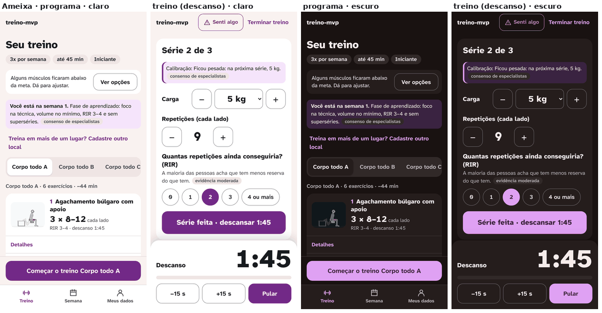

O palco do Boneco usa as cores de sempre (`--stage`, `--fig`, `--mus-p`...): nenhuma muda.

### Letra
Fica a **Atkinson Hyperlegible Next**: tem algarismos de largura igual (medido), licença OFL e pode ser servida pelo próprio app num arquivo variável de 34 kB, no lugar de 3 pedidos ao Google (55,6 kB). Sem internet, a letra continua.

| Degrau | Tamanho / peso | Uso |
|---|---|---|
| Relógio | 88 / 800 | só o descanso |
| Número | 44 / 800 | carga, repetições, números do fim e da semana |
| Título | 24 / 800 | um por tela |
| Pergunta | 20 / 700 | perguntas, seções, nome do exercício |
| Corpo | 17 / 400 (700 em botão) | texto, botões, opções |
| Apoio | 15 / 400 | ajuda, segunda linha |
| Rótulo | 13 / 700 | passo, barra inferior, selo |

Nunca abaixo de 13 px; campo nunca abaixo de 16 px (zoom do iPhone).

### Espaço, canto, toque
Espaço **4 · 8 · 12 · 16 · 24 · 32**; canto **8 · 16 · pílula**; borda **1 e 2 px**; toque **48** (chip, segmentado, barra), **56** (botão, opção, linha, RIR, "Senti algo") e **64** ("Série feita", barra inferior). O piso continua 48.

### As 16 peças
Cabeçalho (de passo, de casa, de tarefa) · barra inferior · base fixa · botão (primário, secundário, terciário, perigo) · superfície (neutra, informação, aviso, alerta, feito) · lista de linhas · opção em linha · chip · segmentado · cartão de equipamento · campo · stepper · pílula e selo · progresso · recolher · folha e diálogo. Cada uma com os estados normal, pressionado ou escolhido, desabilitado, foco e, onde houver, erro e carregando; nada depende só da cor. A tabela de antes e depois está em `agente-4-organizacao.md`, 4.3.

### Movimento
Resposta ao toque no mesmo quadro (menos de 100 ms); folha e diálogo em 200 ms; nenhuma troca de tela automática; tudo desligado com `prefers-reduced-motion`; nenhuma espera acima de 1 s sem dizer o que está acontecendo (a foto mostra as etapas reais). *[fonte: Nielsen 1993 e NN/g "Response Times", consenso; Giroux 2019, um estudo; regras do agente 2, seção H]*

### Navegação
```
SEM BARRA (tarefa)                              COM BARRA [Treino | Semana | Meus dados]
Boas-vindas → Saúde → Experiência → Rotina      Início (Treino): cartão "Hoje", semana, 1 mensagem, dias,
  → Equipamento ("Gerar meu programa")            lista; o exercício abre uma folha; "Começar" fixo
Treino: ‹ Início · A · 1 de 6 · Senti algo      Semana → Evolução (a barra fica, Semana acesa)
  ├─ Ver como fazer → Guia (‹ Treino · Senti algo)   Meus dados → Locais (a barra fica)
  ├─ Senti algo, Trocar: folhas abaixo do cabeçalho
  └─ Terminar (confirma) → Fim → Semana
```

## 6. Tela a tela: o antes e o depois

O protótipo tem 32 telas e estados. Abaixo, as que mais mudam; todas as imagens estão em `img/ad-*.png` (claro, e as do treino também no escuro e a 360 px).

### Treino (o foco a)
- **Série:** o painel da série fica preso embaixo, com carga, repetições, RIR e "Série feita" sempre à vista; acima, o exercício e a sugestão com selo (rolam se faltar espaço). **Medido no protótipo:** "Série feita", RIR e "Senti algo" à vista e não cobertos em 100% dos estados de série, a 412 × 839, 360 × 740 e 412 × 640 (hoje o RIR fica escondido em 24 de 24 casos).
- **Descanso:** o relógio de 88 px vai para o topo do conteúdo; o registro da próxima série continua embaixo, já preenchido, e "Série feita" encerra o descanso. Quando o tempo acaba, a cor **e** o texto mudam ("Hora da próxima série", 32 px); não pede "Ok".
- **Senti algo e Trocar:** folhas que sobem por cima, abaixo do cabeçalho. Os 7 sinais e a escala de dor em duas fileiras de 56 px; os textos de segurança são os de hoje.
- **Exercício sem animação:** a montagem segura aparece sempre, com o selo; dicas e erros abrem numa folha sem empurrar o registro.
- **Terminar:** sai do topo e pede confirmação.
- **Tela acesa** durante todo o treino, pedida de novo quando o app volta (não aparece em imagem; vai para o teste e2e).

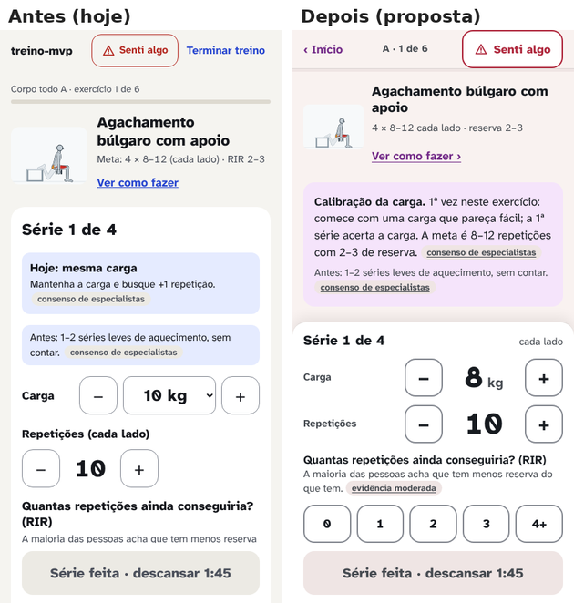
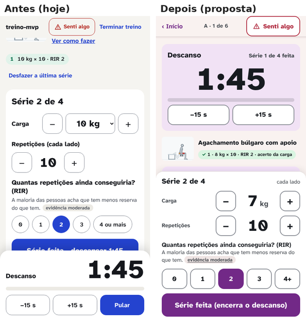
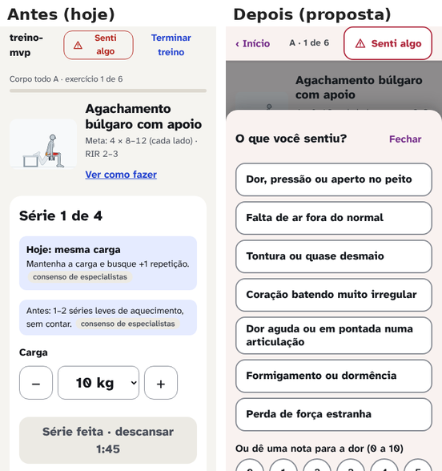
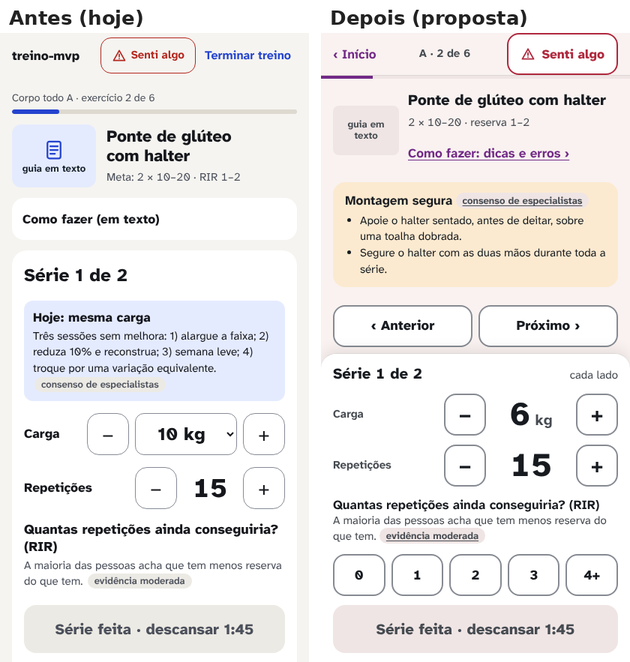

### Guia (o foco a)
O palco do Boneco no topo, de borda a borda (412 × 309); logo abaixo, tocar, lento e a vista; os 4 modos numa barra de 56 px e, colado nela, o que o modo mostra (legenda, a lista de erros); depois as 3 dicas em 20 px e a montagem, aberta. "Senti algo" no cabeçalho. O desenho do Boneco é o do motor.

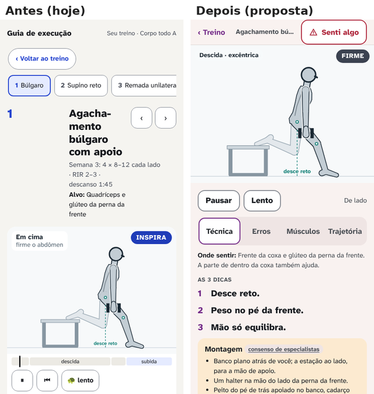

### Cadastro (o foco b)
- 6 → 5 telas: o "Tudo certo?" sai; o botão do equipamento vira "Gerar meu programa", e o programa abre com "Montado para: ... Mudar".
- Boas-vindas com cerca de metade do texto e o botão à vista; o aviso de segurança intacto.
- Quem tem alguma condição marca só as que valem (de 29 para 18 toques no caminho do Bruno com dor), com o mesmo texto e a mesma regra de bloqueio.
- O objetivo sai para depois; as prioridades ficam.
- Equipamento: "Onde você treina?" primeiro; "Academia completa" diz em 1 linha o que supôs; a lista vem por categoria, com a contagem escrita; a foto mostra as etapas reais e deixa usar a lista enquanto analisa.
- Toques por persona, hoje → proposto (contando o "Gerar" fora do equipamento, como o teste conta hoje): Ana 12 → 11, Bruno 17 → 14, Carla 14 → 13, Diego 12 → 11, Elisa 10 → 9, Fábio 11 → 10 (agente 2, recontado).

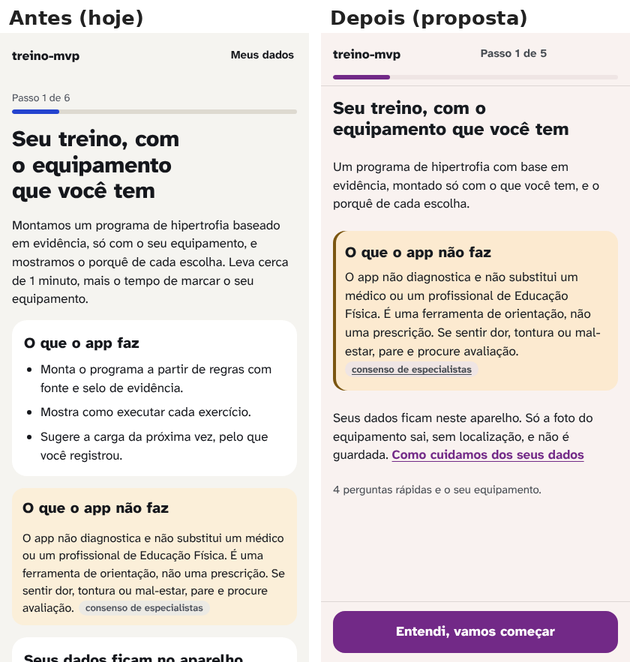
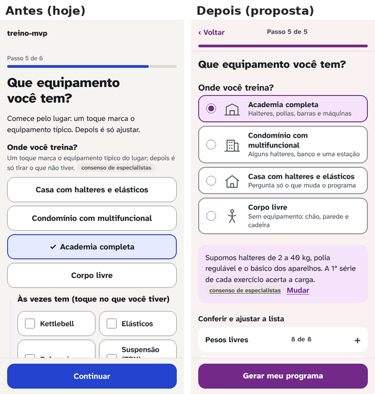

### Início, fim do treino e semana (o foco c)
- **Início:** um cartão "Hoje" no topo, com a fase dentro dele; a faixa da semana em 1 linha; no máximo 1 oferta por abertura, as outras em "Mais 2 avisos"; "Começar" preso embaixo em qualquer estado. A volta depois de uma pausa vira o próprio cartão de hoje.
- **Fim do treino:** primeiro "O que mudou hoje" (a semana já no estado novo, o recorde, quantas cargas sobem), depois "Hoje foi" e "Para a próxima vez".
- **Semana:** o dado antes da oferta: treinos da semana, últimas 8 semanas, o que subiu, séries por músculo (cheio é feito, tracejado é a meta, o número escrito) e só então as ofertas.
- **Evolução:** o resumo em 1 linha em cima ("de 8 kg × 10 a 9 kg × 12 em 5 treinos").

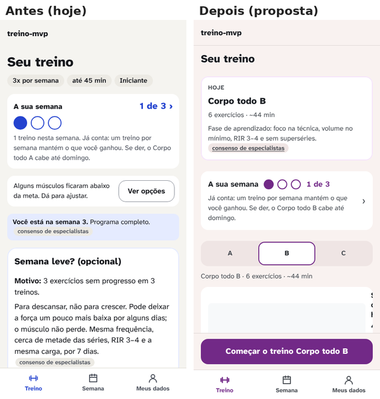
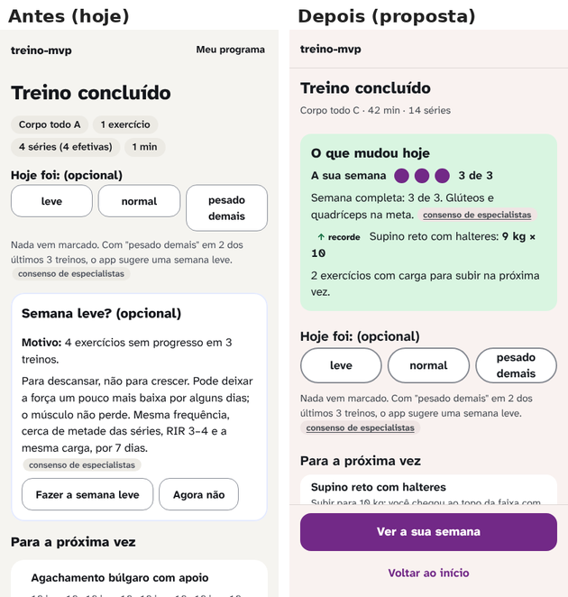
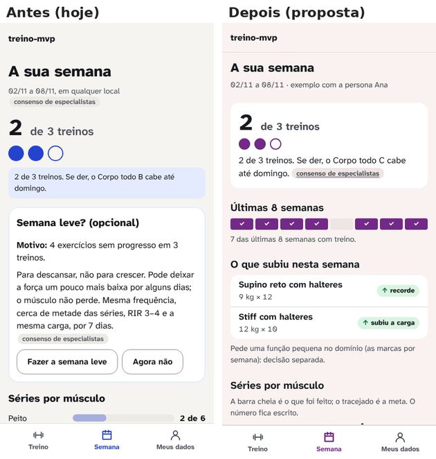

### O resto (o foco d)
Meus dados em 3 grupos de linhas, com "Apagar todos os dados" por último e confirmado num diálogo; Locais com a barra inferior; os 24 ícones de equipamento que faltam desenhados no traço de hoje, com o nome sempre escrito (até lá, um contorno tracejado).

## 7. Medidas do protótipo

`depois/medidas-{claro,escuro,pequeno,baixo}.json`, pelas mesmas regras de `scripts/design/medir.ts`:

| Medida | Claro 412 × 839 | Escuro | 360 × 740 | 412 × 640 |
|---|---:|---:|---:|---:|
| Telas e estados | 32 | 32 | 32 | 32 |
| Com toque abaixo de 44 px | 0 | 0 | 0 | 0 |
| Com contraste abaixo da WCAG | 0 | 0 | 0 | 0 |
| Que rolam de lado | 0 | 0 | 0 | 0 |
| Estados do treino com "Senti algo" à vista e não coberto (com o guia) | 8 de 8 | 8 de 8 | 8 de 8 | 8 de 8 |
| Estados de série com "Série feita" e RIR à vista e não cobertos | 4 de 4 | 4 de 4 | 4 de 4 | 4 de 4 |
| Altura da tela ocupada pelo painel da série | 49% | 49% | 59–60% | 64% |

O que **não** dá para medir no protótipo e fica para a implementação: o tempo de resposta real, o Lighthouse (o protótipo não tem o motor rodando nem o pacote do app), a tela acesa, e a cronometragem do cadastro no celular (fim do lote do cadastro, decisão de 05/11).

## 8. Pedidos ao domínio e ao estado guardado (decisões separadas)

| # | Pedido | De onde | Teste que o valida |
|---:|---|---|---|
| 1 | `fontes.json` (as fontes por extenso, de `docs/pesquisa/fontes.md`), para o selo abrir a referência | agente 4 | toda chave de `regras.json` existe no arquivo |
| 2 | Dias planejados (`rotina.diasPlanejados`, versão 8 do estado, com migração) para "hoje é dia de treino" | agente 1 | Ana com seg, qua, sex e hoje quinta → "próximo: sexta" |
| 3 | Marcas por sessão e por semana (recorde, subiu a carga) para o fim do treino e a semana | agente 1 | o caso E1 de `pesquisa-v2/07` |
| 4 | Resumo curto da calibração e da sugestão (opcional; sem ele, o texto inteiro rola acima do registro) | agente 3 | até 40 caracteres e o mesmo `regraId` |
| 5 | `restricoes` ausente vale como listas vazias (para "algo a evitar" sair do cadastro), sem versão nova | agente 2 | estado v7 sem `restricoes` gera o perfil |

Os pedidos 2 a 4 mudam ou acrescentam domínio; nenhum entra num lote de design sem decisão própria.

## 9. Fora do escopo dos agentes, mas medido: o desempenho

O Lighthouse de hoje dá 59 a 73 de desempenho no celular simulado, abaixo da meta de 90 do pedido. A causa medida é o processamento do JavaScript (de 1,4 a 5,1 s de bloqueio), não a rede: o app é um pacote único de 1 MB, com o motor do Boneco e a biblioteca em todas as telas. **Proposta [opinião, com custo medido depois]:** carregar o motor do Boneco e o guia só quando a tela pede (o próprio Vite faz isso, sem dependência nova), e servir a letra pelo app. É um lote técnico à parte, com medida antes e depois.

## 10. O que não fazer (juntado dos 5 relatórios)

- Sequência que quebra, medalha, confete, ranking, notificação de ausência ou "faz X dias" (agente 1, seção 5).
- Avanço automático entre telas e respostas pré-marcadas (agente 2).
- "Senti algo" embaixo, misturado aos controles da série (agente 3).
- Furar o modo silencioso do iPhone para o bipe tocar; gestos de arrastar para registrar (agente 3).
- Menu escondido, ícone sem rótulo, recolher dentro de recolher, folha sobre folha (agente 4).
- Marca laranja, vermelha ou verde; escolher cor por "psicologia" (agente 5).
- Encurtar texto de segurança ou de regra com selo para ganhar espaço (todos).

## 11. Riscos e o que eu não sei

- **Ninguém de verdade usou nada disto.** São medidas de robô, modelo e opinião com fonte. O Gustavo decide pelas imagens (decisão de 05/11); o teste com uma mão vem no app real, lote a lote.
- **O painel da série preso embaixo ocupa 49% da tela no Pixel 7, 60% a 360 px e 64% a 412 × 640** [medido]. O exercício e a sugestão rolam acima dele. Medi que os controles ficam à vista; não medi se a pessoa estranha ler a sugestão rolando [opinião].
- **A cor Ameixa** é gosto antes de ser medida: a medida diz que ela funciona; não diz que agrada. Roxo tem associação cultural de gênero para algumas pessoas (agente 5, sem dado).
- **Tela acesa no iPhone instalado** só a partir do iOS 18.4 (agente 3, caniuse); antes disso, um aviso único.
- **Fontes:** a maior parte foi lida só pelo resumo (o PubMed segue bloqueado); cada relatório lista as que não conseguiu verificar.
- **O tamanho do trabalho:** é uma reescrita de `src/features/` (~5.950 linhas) e `src/styles.css`, em lotes. A estimativa por lote vai na tabela de decisões.

## 12. Para decidir

A tabela item a item, com o antes e o depois, a evidência, o custo em lotes e a minha recomendação em cada linha, vem depois da crítica independente (agente 6), na Fase 4.
